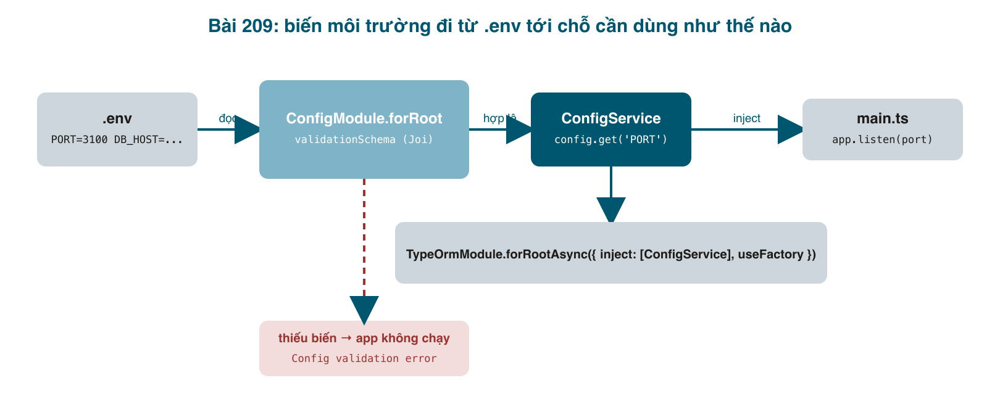

Ba bài đầu (045, 046, 047) dựng được một API quản lý task bằng NestJS: CRUD, validation, và lưu vào Postgres qua TypeORM. Nhưng nếu mở <mark>src/config/typeorm.config.ts</mark> ra sẽ thấy username, password và tên database viết thẳng vào code. Ở máy mình thì chạy, nhưng ngày đầu tiên deploy lên server staging, hoặc ngày đồng nghiệp mới clone về với Postgres có password khác, là mọi thứ vỡ. Tệ hơn, password nằm trong git mãi mãi. Bài này sửa chuyện đó bằng cách chuẩn: **biến môi trường**, đọc qua <mark>ConfigModule</mark>, và **kiểm tra ngay lúc khởi động** để thiếu biến nào là app từ chối chạy, thay vì chạy rồi lỗi mờ mịt ở request đầu tiên.

Từ bài này trở đi mình viết theo kiểu "người mới học NestJS để giải quyết việc thật": mỗi bài là một vấn đề gặp trong dự án, giải thích phần NestJS cần biết để xử lý, rồi code, rồi chạy thật và dán kết quả. Mã nguồn mỗi bài có zip ở cuối. Mình chuyển hẳn sang <mark>npm</mark> (ba bài trước dùng lẫn yarn); bạn dùng yarn hoặc pnpm cũng không sao, chỉ cần đừng để hai lockfile trong một repo.



#### Ôn nhanh ba khái niệm NestJS mà cả series dựa vào
- **Module**: một nhóm chức năng (<mark>TasksModule</mark>, sau này <mark>AuthModule</mark>). Module khai báo nó có controller nào, provider nào, và import module nào khác.
- **Provider**: bất kỳ class nào Nest tạo giúp bạn và giữ một bản duy nhất (service, repository, config...). Đánh dấu bằng <mark>@Injectable()</mark>.
- **Dependency Injection (DI)**: bạn không <mark>new TasksService()</mark>. Bạn khai báo trong constructor "tôi cần TasksService", Nest tự tạo và đưa vào. Lợi ích thấy rõ ở bài 214: khi test, đưa vào một bản giả thay vì bản thật.

<mark>ConfigService</mark> của bài này chính là một provider: bất kỳ chỗ nào cần đọc cấu hình, khai báo trong constructor là có.

#### Bước 1: cài và tạo file .env
```bash
npm install @nestjs/config joi dotenv
```
<mark>@nestjs/config</mark> đọc file <mark>.env</mark> và cung cấp <mark>ConfigService</mark>. <mark>joi</mark> để mô tả "biến nào bắt buộc, kiểu gì, mặc định bao nhiêu". <mark>dotenv</mark> để TypeORM CLI (chạy ngoài Nest) cũng đọc được cùng file.

Tạo hai file ở thư mục gốc. <mark>.env.example</mark> commit vào git làm mẫu; <mark>.env</mark> là bản thật của từng máy, **không** commit.

```bash
# .env.example

# Copy this file to .env and fill in the values for your machine.
# .env is ignored by git; never commit real passwords.
NODE_ENV=development
PORT=3100

DB_HOST=localhost
DB_PORT=5432
DB_USERNAME=postgres
DB_PASSWORD=postgres
DB_NAME=task_management_dev
```

Thêm vào cuối <mark>.gitignore</mark>:
```bash
# Environment
.env
```
Rồi <mark>cp .env.example .env</mark> và sửa cho đúng máy bạn. Mình dùng cổng 3100 vì 3000 đang bận bởi một app khác, và một database mới <mark>task_management_dev</mark> để bài này bắt đầu từ sạch (<mark>createdb -U postgres task_management_dev</mark>).

#### Bước 2: mô tả các biến bằng Joi
```typescript
// src/config/env.validation.ts

import * as Joi from 'joi';

// Every variable the app needs, with its type and default.
// If .env is missing one, the app refuses to start and tells you which.
export const envValidationSchema = Joi.object({
  NODE_ENV: Joi.string()
    .valid('development', 'test', 'production')
    .default('development'),
  PORT: Joi.number().port().default(3000),

  DB_HOST: Joi.string().required(),
  DB_PORT: Joi.number().port().default(5432),
  DB_USERNAME: Joi.string().required(),
  DB_PASSWORD: Joi.string().required(),
  DB_NAME: Joi.string().required(),
});
```

Đây là "hợp đồng" của app với môi trường. Ai đọc file này là biết app cần gì để chạy, không phải lục code. <mark>Joi.number().port()</mark> vừa ép kiểu (trong <mark>.env</mark> mọi thứ là chuỗi) vừa kiểm tra khoảng hợp lệ.

#### Bước 3: ConfigModule và TypeORM đọc từ ConfigService
```typescript
// src/app.module.ts

import { Module } from '@nestjs/common';
import { ConfigModule, ConfigService } from '@nestjs/config';
import { TypeOrmModule } from '@nestjs/typeorm';
import { TasksModule } from './tasks/tasks.module';
import { envValidationSchema } from './config/env.validation';

@Module({
  imports: [
    // Reads .env once, validates it, and makes ConfigService injectable everywhere.
    ConfigModule.forRoot({
      isGlobal: true,
      validationSchema: envValidationSchema,
    }),
    // "Async" because the options depend on another provider (ConfigService),
    // which only exists after ConfigModule has loaded.
    TypeOrmModule.forRootAsync({
      inject: [ConfigService],
      useFactory: (config: ConfigService) => ({
        type: 'postgres',
        host: config.get<string>('DB_HOST'),
        port: config.get<number>('DB_PORT'),
        username: config.get<string>('DB_USERNAME'),
        password: config.get<string>('DB_PASSWORD'),
        database: config.get<string>('DB_NAME'),
        autoLoadEntities: true,
        synchronize: false, // schema changes go through migrations only
      }),
    }),
    TasksModule,
  ],
})
export class AppModule {}
```

Ba điểm cần hiểu:
- <mark>isGlobal: true</mark>: bình thường một module muốn dùng provider của module khác thì phải import module đó. Cấu hình thì chỗ nào cũng cần, nên khai báo global một lần cho xong.
- <mark>forRoot</mark> và <mark>forRootAsync</mark>: <mark>forRoot(options)</mark> nhận options viết sẵn. Nhưng options của TypeORM giờ phụ thuộc vào <mark>ConfigService</mark>, một provider chỉ tồn tại sau khi <mark>ConfigModule</mark> nạp xong. <mark>forRootAsync</mark> cho phép nói "hãy <mark>inject</mark> ConfigService cho tôi, rồi gọi <mark>useFactory</mark> để tạo options". Bạn sẽ gặp lại mẫu này ở <mark>JwtModule.registerAsync</mark> bài sau.
- <mark>synchronize: false</mark>: TypeORM có thể tự sửa bảng theo entity, tiện lúc học nhưng trong dự án thật rất nguy hiểm (đổi tên cột là mất dữ liệu). Schema chỉ đổi qua migration.

Xoá file <mark>src/config/typeorm.config.ts</mark> cũ đi.

TypeORM CLI (lệnh <mark>migration:generate</mark>, <mark>migration:run</mark>) không chạy qua Nest nên không có ConfigService. Nó dùng <mark>src/data-source.ts</mark>, và ta cho file này đọc cùng <mark>.env</mark> bằng dotenv để hai bên không bao giờ lệch nhau:

```typescript
// src/data-source.ts

import 'dotenv/config';
import { DataSource } from 'typeorm';

// Used by the TypeORM CLI only (migration:generate / migration:run).
// It reads the same .env as the app, so both always point at the same database.
export const AppDataSource = new DataSource({
  type: 'postgres',
  host: process.env.DB_HOST,
  port: Number(process.env.DB_PORT ?? 5432),
  username: process.env.DB_USERNAME,
  password: process.env.DB_PASSWORD,
  database: process.env.DB_NAME,
  entities: ['src/**/*.entity.ts'],
  migrations: ['src/migrations/**/*.ts'],
  synchronize: false,
});
```

#### Bước 4: main.ts đọc PORT
```typescript
// src/main.ts

import { NestFactory } from '@nestjs/core';
import { Logger, ValidationPipe } from '@nestjs/common';
import { ConfigService } from '@nestjs/config';
import { AppModule } from './app.module';

async function bootstrap() {
  const app = await NestFactory.create(AppModule);
  app.useGlobalPipes(new ValidationPipe());

  const config = app.get(ConfigService);
  const port = config.get<number>('PORT', 3000);
  await app.listen(port);
  Logger.log(
    `Listening on http://localhost:${port} (${config.get('NODE_ENV')})`,
    'Bootstrap',
  );
}
void bootstrap();
```

<mark>app.get(ConfigService)</mark> là cách lấy một provider ở nơi không có constructor để inject. <mark>Logger.log(msg, 'Bootstrap')</mark> dùng logger có sẵn của Nest thay cho <mark>console.log</mark>: có thời gian, có ngữ cảnh, và sau này tắt/bật được theo mức.

#### Chạy thử: thiếu biến thì không chạy
Tạm giấu <mark>.env</mark> đi để xem app phản ứng:
```bash
mv .env .env.bak
npm run build && node dist/main
# [Nest] 15162  - ERROR [ExceptionHandler] Error: Config validation error: DB_HOST: "DB_HOST" is required
mv .env.bak .env
```
App dừng ngay với tên biến thiếu. So với trước: app vẫn lên, và lỗi "connect ECONNREFUSED" chỉ xuất hiện khi có request đầu tiên, lúc nửa đêm.

#### Một cái bẫy thật: migration sinh ra ở bài 047 không chạy được trên database mới
Database mới còn trống, chạy migration:
```bash
npm run migration:run
# query failed: CREATE TABLE "tasks" (... "status" "public"."tasks_status_enum" NOT NULL DEFAULT 'OPEN' ...)
# error: type "public.tasks_status_enum" does not exist
```
Mở file migration <mark>Initial</mark> sinh ở bài 047 ra: nó chỉ có <mark>CREATE TABLE</mark>, không có <mark>CREATE TYPE</mark> cho enum. Lý do: lúc đó database đã có sẵn type này (do một lần <mark>synchronize: true</mark> trước đó), nên <mark>migration:generate</mark> so sánh entity với database và thấy "type đã có, không cần tạo". Migration đúng ở máy mình, sai ở mọi máy khác. Bài học: **migration sinh tự động phải được đọc lại trước khi commit**, và nên thử chạy trên một database trống. Sửa bằng tay:

```typescript
// src/migrations/1764580894395-Initial.ts

import { MigrationInterface, QueryRunner } from "typeorm";

export class Initial1764580894395 implements MigrationInterface {
    name = 'Initial1764580894395'

    public async up(queryRunner: QueryRunner): Promise<void> {
        await queryRunner.query(`CREATE TYPE "public"."tasks_status_enum" AS ENUM('OPEN', 'IN_PROGRESS', 'DONE')`);
        await queryRunner.query(`CREATE TABLE "tasks" ("id" SERIAL NOT NULL, "title" character varying NOT NULL, "description" character varying NOT NULL, "status" "public"."tasks_status_enum" NOT NULL DEFAULT 'OPEN', CONSTRAINT "PK_8d12ff38fcc62aaba2cab748772" PRIMARY KEY ("id"))`);
    }

    public async down(queryRunner: QueryRunner): Promise<void> {
        await queryRunner.query(`DROP TABLE "tasks"`);
        await queryRunner.query(`DROP TYPE "public"."tasks_status_enum"`);
    }

}
```

```bash
npm run migration:run
# query: CREATE TYPE "public"."tasks_status_enum" AS ENUM('OPEN', 'IN_PROGRESS', 'DONE')
# query: CREATE TABLE "tasks" ("id" SERIAL NOT NULL, "title" character varying NOT NULL, ...
# Migration Initial1764580894395 has been executed successfully.
```

#### Chạy thật
```bash
node dist/main
# [Nest] LOG [Bootstrap] Listening on http://localhost:3100 (development)

curl -X POST localhost:3100/tasks -H 'content-type: application/json' \
  -d '{"title":"Học NestJS","description":"Bài 209: cấu hình"}'
# {"id":1,"title":"Học NestJS","description":"Bài 209: cấu hình","status":"OPEN"}   [201]

curl localhost:3100/tasks
# [{"id":1,"title":"Học NestJS","description":"Bài 209: cấu hình","status":"OPEN"}]   [200]

curl -X POST localhost:3100/tasks -H 'content-type: application/json' -d '{"title":""}'
# {"message":["title should not be empty","description should not be empty"],"error":"Bad Request","statusCode":400}
```
Mọi thứ của ba bài trước vẫn chạy, nhưng giờ đổi database, đổi cổng, đổi password chỉ là sửa <mark>.env</mark>.

#### Mẹo và lỗi hay gặp
- **Commit nhầm <mark>.env</mark>**: thêm vào <mark>.gitignore</mark> **trước** khi tạo file. Nếu lỡ commit, đổi password ngay; xoá khỏi git không xoá khỏi lịch sử.
- **Biến trong <mark>.env</mark> luôn là chuỗi**: <mark>PORT=3100</mark> là <mark>"3100"</mark>. Joi (<mark>Joi.number()</mark>) đã ép kiểu giúp; nếu không dùng Joi thì <mark>config.get&lt;number&gt;('PORT')</mark> vẫn trả về chuỗi, chữ <mark>&lt;number&gt;</mark> chỉ là lời hứa với TypeScript.
- **Hai nơi cấu hình database** (<mark>app.module.ts</mark> cho app, <mark>data-source.ts</mark> cho CLI) là bình thường với TypeORM 0.3; điều quan trọng là cả hai đọc cùng <mark>.env</mark>.
- **Phiên bản gói**: <mark>npm install @nestjs/config</mark> không ghi version sẽ lấy bản mới nhất, có thể dành cho Nest major khác với <mark>@nestjs/core</mark> đang dùng. Lúc viết bài, cài trần lấy <mark>@nestjs/config@12</mark> trong khi project là Nest 11; nó vẫn chạy nhưng đến bài 214 mới lòi ra rắc rối. Quy tắc: các gói <mark>@nestjs/*</mark> nên cùng major với <mark>@nestjs/core</mark>.
- **<mark>migration:generate</mark> nói "No changes in database schema were found"** nghĩa là entity và database đã khớp; đó là trạng thái bạn muốn thấy sau khi chạy xong migration.

#### Checklist
- <mark>mv .env .env.bak && node dist/main</mark>: lỗi <mark>Config validation error</mark>, app không lên. Trả file lại.
- <mark>npm run migration:run</mark> trên database trống: tạo type enum rồi bảng, không lỗi.
- <mark>curl localhost:3100/tasks</mark>: 200 với mảng task.
- <mark>git status</mark>: không thấy <mark>.env</mark>.

Mã nguồn cuối bài: [post_209.zip](/assets/code/post_209.zip).

#### Bài tập thêm
- Thêm biến <mark>LOG_LEVEL</mark> (<mark>debug | log | warn | error</mark>, mặc định <mark>log</mark>) vào Joi và truyền vào <mark>NestFactory.create(AppModule, { logger: [...] })</mark>.
- Thử <mark>PORT=abc</mark> trong <mark>.env</mark> và đọc thông báo lỗi của Joi.
- Viết <mark>README.md</mark> ngắn: cách copy <mark>.env.example</mark>, tạo database, chạy migration. Người mới vào team sẽ cảm ơn bạn.
