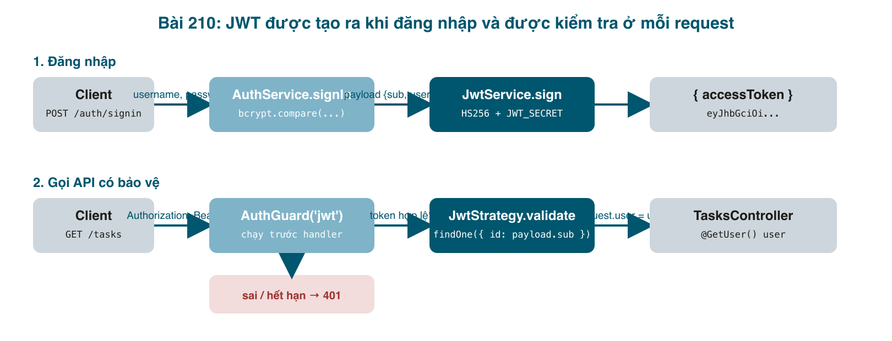

API task của chúng ta hiện ai gọi cũng được: không cần đăng nhập, không biết task của ai. Yêu cầu thật đầu tiên của mọi app có người dùng là **tài khoản**: đăng ký, đăng nhập, và chỉ người đã đăng nhập mới gọi được API. Bài này làm phần đó với bộ ba quen thuộc trong NestJS: <mark>bcrypt</mark> để băm mật khẩu, <mark>JWT</mark> làm "vé" gửi kèm mỗi request, và <mark>Guard</mark> để chặn request không có vé. Bài sau mới gắn task với chủ của nó.



#### Hiểu trước khi code: JWT là gì và Guard nằm ở đâu
HTTP không nhớ gì giữa hai request. Để server biết "request này của nolan", client phải gửi kèm một bằng chứng mỗi lần. Cách cổ điển là session: server lưu một bảng session, client gửi id. **JWT** (JSON Web Token) đảo lại: server **ký** một đoạn JSON nhỏ (<mark>{ sub: 1, username: "nolan", exp: ... }</mark>) bằng một khoá bí mật, đưa cho client; mỗi request client gửi lại, server chỉ cần kiểm tra chữ ký, không cần tra bảng nào. Token gồm ba phần cách nhau bởi dấu chấm: header, payload (base64, **ai cũng đọc được**, nên không bao giờ để mật khẩu hay dữ liệu nhạy cảm trong đó), và chữ ký.

**Guard** là class NestJS chạy **trước** handler và trả lời đúng một câu: request này được đi tiếp không? Guard có quyền đọc request, nên nó là nơi hoàn hảo để kiểm tra token. Ta không tự viết guard kiểm tra JWT mà dùng <mark>AuthGuard('jwt')</mark> của <mark>@nestjs/passport</mark>; phần việc của ta là viết **Strategy**: "token lấy từ đâu, kiểm tra bằng khoá nào, và khi hợp lệ thì trả về user nào".

#### Bước 1: cài gói, thêm biến môi trường
```bash
npm install @nestjs/jwt @nestjs/passport passport passport-jwt bcrypt
npm install -D @types/passport-jwt @types/bcrypt
```
Thêm vào <mark>.env.example</mark> và <mark>.env</mark>:
```bash
# Any long random string (at least 32 chars). Generate one with:
#   node -e "console.log(require('crypto').randomBytes(32).toString('hex'))"
JWT_SECRET=
JWT_EXPIRES_IN=1h
```
Và vào schema Joi (bài 209), để quên khai báo khoá là app không chạy:
```typescript
// src/config/env.validation.ts (thêm)

  JWT_SECRET: Joi.string().min(32).required(),
  JWT_EXPIRES_IN: Joi.string().default('1h'),
```

#### Bước 2: entity User
```typescript
// src/auth/user.entity.ts

import {
  Column,
  CreateDateColumn,
  Entity,
  PrimaryGeneratedColumn,
} from 'typeorm';

@Entity('users')
export class User {
  @PrimaryGeneratedColumn()
  id: number;

  @Column({ unique: true })
  username: string;

  // Never the raw password: only the bcrypt hash is stored.
  @Column()
  passwordHash: string;

  @CreateDateColumn()
  createdAt: Date;
}
```

Cột tên là <mark>passwordHash</mark>, không phải <mark>password</mark>, để ai đọc code cũng không bao giờ nghĩ nó chứa mật khẩu thật. <mark>unique: true</mark> để database chặn hai tài khoản trùng tên, kể cả khi hai request đăng ký đến cùng lúc; kiểm tra bằng code (<mark>findOne</mark> rồi mới <mark>save</mark>) không đủ chắc trong trường hợp đó.

Sinh migration (CLI đọc <mark>.env</mark> theo cách bài 209):
```bash
npm run migration:generate -- src/migrations/CreateUsers
# Migration src/migrations/1793966688163-CreateUsers.ts has been generated successfully.
npm run migration:run
# Migration CreateUsers1793966688163 has been executed successfully.
```
Lần này mở file ra kiểm tra: có <mark>CREATE TABLE "users"</mark> với <mark>CONSTRAINT "UQ_..." UNIQUE ("username")</mark>. Tốt.

#### Bước 3: DTO cho đăng ký và đăng nhập
```typescript
// src/auth/dto/auth-credentials.dto.ts

import { IsString, Matches, MaxLength, MinLength } from 'class-validator';

export class AuthCredentialsDto {
  @IsString()
  @MinLength(4)
  @MaxLength(20)
  username: string;

  @IsString()
  @MinLength(8)
  @MaxLength(32)
  // at least one lowercase, one uppercase and one digit
  @Matches(/^(?=.*[a-z])(?=.*[A-Z])(?=.*\d).+$/, {
    message: 'password must contain a lowercase, an uppercase and a number',
  })
  password: string;
}
```

Dùng chung một DTO cho cả hai vì cùng hai trường. Regex yêu cầu có chữ thường, chữ hoa, chữ số; thông điệp lỗi viết rõ để frontend hiện thẳng cho người dùng.

#### Bước 4: AuthService: băm, so sánh, ký token
```typescript
// src/auth/auth.service.ts

import {
  ConflictException,
  Injectable,
  UnauthorizedException,
} from '@nestjs/common';
import { InjectRepository } from '@nestjs/typeorm';
import { JwtService } from '@nestjs/jwt';
import { Repository } from 'typeorm';
import * as bcrypt from 'bcrypt';
import { User } from './user.entity';
import { AuthCredentialsDto } from './dto/auth-credentials.dto';
import { JwtPayload } from './jwt-payload.interface';

@Injectable()
export class AuthService {
  constructor(
    @InjectRepository(User)
    private usersRepository: Repository<User>,
    private jwtService: JwtService,
  ) {}

  async signUp(dto: AuthCredentialsDto): Promise<{ id: number; username: string }> {
    const passwordHash = await bcrypt.hash(dto.password, 10);
    const user = this.usersRepository.create({ username: dto.username, passwordHash });
    try {
      await this.usersRepository.save(user);
    } catch (error) {
      // 23505 = unique_violation in Postgres: the username is taken
      if ((error as { code?: string }).code === '23505') {
        throw new ConflictException('Username already exists');
      }
      throw error;
    }
    return { id: user.id, username: user.username };
  }

  async signIn(dto: AuthCredentialsDto): Promise<{ accessToken: string }> {
    const user = await this.usersRepository.findOne({ where: { username: dto.username } });
    // Same message for "no such user" and "wrong password": don't help attackers
    // find out which usernames exist.
    if (!user || !(await bcrypt.compare(dto.password, user.passwordHash))) {
      throw new UnauthorizedException('Please check your login credentials');
    }
    const payload: JwtPayload = { sub: user.id, username: user.username };
    return { accessToken: await this.jwtService.signAsync(payload) };
  }
}
```

- <mark>bcrypt.hash(password, 10)</mark>: số 10 là "cost", mỗi lần tăng 1 thì chậm gấp đôi. 10 là mức hợp lý (~60 ms). Mật khẩu **không bao giờ** lưu dạng gốc, và cũng không thể "giải mã" từ hash; chỉ so sánh được bằng <mark>bcrypt.compare</mark>.
- Mã lỗi <mark>23505</mark> là <mark>unique_violation</mark> của Postgres. Ta bắt đúng mã đó để trả 409 Conflict có nghĩa, còn mọi lỗi khác ném tiếp để không che giấu bug.
- Đăng nhập sai user hay sai mật khẩu đều trả **cùng một câu**. Nếu trả "user không tồn tại" riêng, kẻ xấu dò được danh sách tài khoản.
- Payload chỉ có <mark>sub</mark> (chuẩn JWT cho "subject", ở đây là id) và <mark>username</mark>. Thời hạn do <mark>JwtModule</mark> cấu hình.

#### Bước 5: JwtStrategy: token hợp lệ thì user là ai
```typescript
// src/auth/jwt.strategy.ts

import { Injectable, UnauthorizedException } from '@nestjs/common';
import { ConfigService } from '@nestjs/config';
import { PassportStrategy } from '@nestjs/passport';
import { InjectRepository } from '@nestjs/typeorm';
import { ExtractJwt, Strategy } from 'passport-jwt';
import { Repository } from 'typeorm';
import { User } from './user.entity';
import { JwtPayload } from './jwt-payload.interface';

// Runs on every request that has @UseGuards(AuthGuard()):
// 1. passport-jwt reads "Authorization: Bearer <token>" and verifies the signature
// 2. if valid, validate() receives the payload and returns the user
// 3. Nest puts that user on request.user
@Injectable()
export class JwtStrategy extends PassportStrategy(Strategy) {
  constructor(
    config: ConfigService,
    @InjectRepository(User)
    private usersRepository: Repository<User>,
  ) {
    super({
      jwtFromRequest: ExtractJwt.fromAuthHeaderAsBearerToken(),
      secretOrKey: config.getOrThrow<string>('JWT_SECRET'),
    });
  }

  async validate(payload: JwtPayload): Promise<User> {
    const user = await this.usersRepository.findOne({ where: { id: payload.sub } });
    if (!user) {
      throw new UnauthorizedException(); // token valid but user deleted
    }
    return user;
  }
}
```

<mark>validate()</mark> chỉ được gọi khi chữ ký và hạn đã đúng. Ta tra lại database thay vì tin payload, để tài khoản bị xoá hoặc khoá thì token cũ cũng vô dụng ngay. Giá trị trả về được Nest gắn vào <mark>request.user</mark>.

#### Bước 6: Controller và Module
```typescript
// src/auth/auth.controller.ts

import { Body, Controller, HttpCode, Post } from '@nestjs/common';
import { AuthService } from './auth.service';
import { AuthCredentialsDto } from './dto/auth-credentials.dto';

@Controller('auth')
export class AuthController {
  constructor(private authService: AuthService) {}

  @Post('signup')
  signUp(@Body() dto: AuthCredentialsDto) {
    return this.authService.signUp(dto);
  }

  @Post('signin')
  @HttpCode(200) // nothing is created, so 200 instead of the POST default 201
  signIn(@Body() dto: AuthCredentialsDto) {
    return this.authService.signIn(dto);
  }
}
```

<mark>@HttpCode(200)</mark>: Nest mặc định trả 201 cho mọi <mark>@Post</mark>. Đăng nhập không tạo gì nên 200 hợp lý hơn; chi tiết nhỏ nhưng người làm frontend sẽ để ý.

```typescript
// src/auth/auth.module.ts

import { Module } from '@nestjs/common';
import { ConfigService } from '@nestjs/config';
import { JwtModule, JwtModuleOptions, JwtSignOptions } from '@nestjs/jwt';
import { PassportModule } from '@nestjs/passport';
import { TypeOrmModule } from '@nestjs/typeorm';
import { User } from './user.entity';
import { AuthController } from './auth.controller';
import { AuthService } from './auth.service';
import { JwtStrategy } from './jwt.strategy';

@Module({
  imports: [
    TypeOrmModule.forFeature([User]),
    PassportModule.register({ defaultStrategy: 'jwt' }),
    JwtModule.registerAsync({
      inject: [ConfigService],
      useFactory: (config: ConfigService): JwtModuleOptions => ({
        secret: config.getOrThrow<string>('JWT_SECRET'),
        signOptions: {
          // "1h", "7d", 3600... the jsonwebtoken "ms" format
          expiresIn: config.get('JWT_EXPIRES_IN', '1h') as JwtSignOptions['expiresIn'],
        },
      }),
    }),
  ],
  controllers: [AuthController],
  providers: [AuthService, JwtStrategy],
  // Other modules import AuthModule to get AuthGuard() working in their controllers.
  exports: [JwtStrategy, PassportModule],
})
export class AuthModule {}
```

<mark>JwtModule.registerAsync</mark> là đúng mẫu <mark>forRootAsync</mark> của bài 209: khoá nằm trong ConfigService nên phải <mark>inject</mark>. Phần <mark>exports</mark> rất quan trọng: module nào muốn dùng <mark>AuthGuard()</mark> phải import <mark>AuthModule</mark>, và AuthModule phải xuất <mark>PassportModule</mark> cùng <mark>JwtStrategy</mark>. Thiếu export là lỗi "Unknown authentication strategy "jwt"" mơ hồ ở runtime.

Nhớ thêm <mark>AuthModule</mark> vào <mark>imports</mark> của <mark>AppModule</mark>.

#### Bước 7: khoá TasksController
```typescript
// src/tasks/tasks.module.ts (một phần)
  imports: [TypeOrmModule.forFeature([Task]), AuthModule],
```
```typescript
// src/tasks/tasks.controller.ts (một phần)
import { UseGuards } from '@nestjs/common';
import { AuthGuard } from '@nestjs/passport';

@Controller('tasks')
@UseGuards(AuthGuard()) // every route below needs a valid Bearer token
export class TasksController {
```
Đặt <mark>@UseGuards</mark> ở class là áp cho mọi route trong controller. Đặt ở từng method khi chỉ một vài route cần (như <mark>GET /auth/me</mark> ở bài 212).

#### Chạy thật
```bash
npm run build && node dist/main
# Mapped {/auth/signup, POST}
# Mapped {/auth/signin, POST}

# mật khẩu yếu
curl -X POST localhost:3100/auth/signup -H 'content-type: application/json' \
  -d '{"username":"nolan","password":"abc"}'
# {"message":["password must contain a lowercase, an uppercase and a number",
#   "password must be longer than or equal to 8 characters"],"error":"Bad Request","statusCode":400}

# đăng ký
curl -X POST localhost:3100/auth/signup -H 'content-type: application/json' \
  -d '{"username":"nolan","password":"Secret123"}'
# {"id":1,"username":"nolan"}   [201]

# đăng ký trùng
# {"message":"Username already exists","error":"Conflict","statusCode":409}

# đăng nhập sai
# {"message":"Please check your login credentials","error":"Unauthorized","statusCode":401}

# đăng nhập đúng
curl -X POST localhost:3100/auth/signin -H 'content-type: application/json' \
  -d '{"username":"nolan","password":"Secret123"}'
# {"accessToken":"eyJhbGciOiJIUzI1NiIsInR5cCI6IkpXVCJ9.eyJzdWIiOjEsInVzZXJuYW1lIjoibm9sYW4iLCJpYXQiOjE3OTM5NjY2OTQsImV4cCI6MTc5Mzk3MDI5NH0...."}

# gọi API không có token
curl localhost:3100/tasks
# {"message":"Unauthorized","statusCode":401}

# có token
curl localhost:3100/tasks -H "Authorization: Bearer eyJhbGciOi..."
# [{"id":1,"title":"Học NestJS","description":"Bài 209: cấu hình","status":"OPEN"}]   [200]
```
Giải mã phần giữa của token (payload) để thấy nó không bí mật:
```bash
echo "$TOKEN" | cut -d. -f2 | base64 -d
# {"sub":1,"username":"nolan","iat":1793966694,"exp":1793970294}
```
Và trong database chỉ có hash:
```
 id | username |         hash         |         createdAt
----+----------+----------------------+----------------------------
  1 | nolan    | $2b$10$C2AU.Lp/2jS4u | 2026-11-06 19:04:54.698769
```

#### Mẹo và lỗi hay gặp
- **"Unknown authentication strategy "jwt""**: module dùng <mark>AuthGuard()</mark> chưa import <mark>AuthModule</mark>, hoặc AuthModule chưa <mark>exports: [PassportModule, JwtStrategy]</mark>.
- **Token đúng nhưng vẫn 401**: header phải đúng dạng <mark>Authorization: Bearer &lt;token&gt;</mark> (có chữ Bearer và một dấu cách). Hoặc <mark>JWT_SECRET</mark> lúc ký khác lúc kiểm tra (đổi <mark>.env</mark> mà chưa restart).
- **Token hết hạn**: <mark>exp</mark> trong payload là giây Unix. Với <mark>1h</mark>, sau một giờ mọi request trả 401 và client phải đăng nhập lại; app thật sẽ thêm refresh token (bài tập).
- **Lưu mật khẩu rồi mới băm**: thứ tự trong <mark>signUp</mark> là băm trước, tạo entity sau. Đừng bao giờ log <mark>dto.password</mark>.
- **Trả về entity User từ signup**: ta cố ý chỉ trả <mark>{ id, username }</mark>. Bài 212 sẽ có cách tự động loại <mark>passwordHash</mark> khỏi mọi response.
- **Lỗi TypeScript ở <mark>expiresIn</mark>**: các bản <mark>@nestjs/jwt</mark> mới gõ kiểu chặt hơn (<mark>"1h"</mark> phải là kiểu <mark>StringValue</mark>). Cách xử lý trong <mark>auth.module.ts</mark>: ép kiểu <mark>as JwtSignOptions['expiresIn']</mark>.

#### Checklist
- Đăng ký với mật khẩu yếu: 400 kèm lý do. Đăng ký hợp lệ: 201. Đăng ký lại: 409.
- Đăng nhập sai: 401 với câu chung chung. Đúng: 200 và <mark>accessToken</mark>.
- <mark>GET /tasks</mark> không token: 401. Có token: 200.
- Trong bảng <mark>users</mark> không có mật khẩu gốc.

Mã nguồn cuối bài: [post_210.zip](/assets/code/post_210.zip).

#### Bài tập thêm
- Thêm <mark>GET /auth/me</mark> trả về user đang đăng nhập (gợi ý: <mark>@Req() req</mark> rồi <mark>req.user</mark>; bài 211 có cách đẹp hơn với decorator riêng).
- Giảm <mark>JWT_EXPIRES_IN=30s</mark>, đăng nhập, đợi, gọi API và xem 401 xuất hiện.
- Tìm hiểu refresh token: một token sống lâu, chỉ dùng để xin access token mới; thử phác thảo bảng <mark>refresh_tokens</mark> và hai endpoint cần có.
