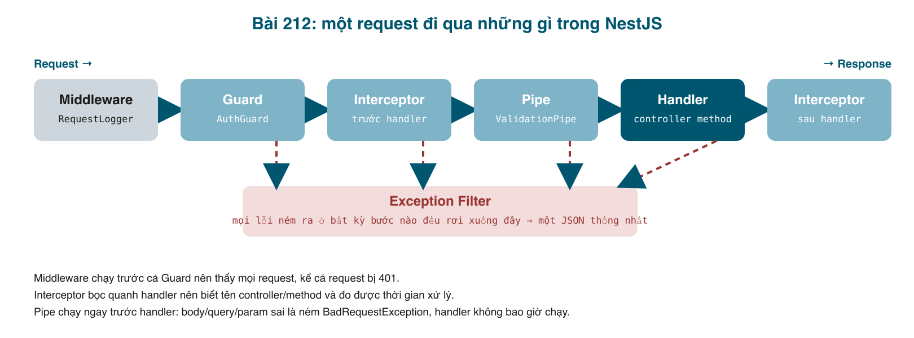

Ba yêu cầu thật đến cùng một tuần. Bạn frontend: "lỗi của API mỗi kiểu một format, có cái <mark>message</mark> là chuỗi, có cái là mảng, có cái không có <mark>error</mark>, em không biết hiện gì". Bạn vận hành: "có request nào chậm không, log đâu?". Và chính bạn phát hiện: gửi <mark>status: "INVALID"</mark> thì API trả **500**, còn gửi thêm trường <mark>isAdmin: true</mark> thì API im lặng nhận. Cả ba đều giải quyết bằng những thành phần NestJS chạy **xung quanh** handler, và để dùng đúng, cần biết một request đi qua chúng theo thứ tự nào.



#### Thứ tự: Middleware → Guard → Interceptor → Pipe → Handler → Interceptor → (Filter)
- **Middleware**: hàm kiểu Express, chạy đầu tiên, chưa biết gì về controller. Dùng cho việc "mọi request đều cần": gắn request id, log, đọc cookie.
- **Guard**: trả lời có/không. Bài 210 đã dùng <mark>AuthGuard</mark>.
- **Interceptor**: bọc quanh handler, có code chạy **trước** và **sau** (nhờ RxJS). Dùng để đo thời gian, biến đổi response, cache.
- **Pipe**: biến đổi và kiểm tra **tham số** ngay trước khi vào handler. <mark>ValidationPipe</mark> (bài 046) và <mark>ParseIntPipe</mark> là pipe.
- **Handler**: method trong controller.
- **Exception Filter**: bất kỳ bước nào ném lỗi, request nhảy thẳng xuống filter. Filter quyết định HTTP status và body.

Trước khi sửa, ghi lại hiện trạng để so sánh:
```bash
# status không hợp lệ: lọt qua DTO (chưa có @IsEnum) và vỡ ở Postgres
curl -X PUT localhost:3100/tasks/2 -H "$H" -H "Authorization: Bearer $T1" -d '{"status":"INVALID"}'
# {"statusCode":500,"message":"Internal server error"}
# log server: QueryFailedError: invalid input value for enum tasks_status_enum: "INVALID"

# trường lạ: được nhận, bỏ qua trong im lặng
curl -X POST localhost:3100/tasks ... -d '{"title":"Extra","description":"x","status":"DONE","isAdmin":true}'
# {"id":4,"title":"Extra","description":"x","status":"OPEN","userId":1}   [201]

# query sai cũng 500
curl "localhost:3100/tasks?status=NOPE" -H "Authorization: Bearer $T1"
# {"statusCode":500,"message":"Internal server error"}
```

#### Bước 1: Middleware gắn request id và log mọi request
```typescript
// src/common/middleware/request-logger.middleware.ts

import { Injectable, Logger, NestMiddleware } from '@nestjs/common';
import { randomUUID } from 'crypto';
import { NextFunction, Request, Response } from 'express';

// Runs before everything else (even before guards), so it sees every request,
// including the ones that end with 401 or 404.
@Injectable()
export class RequestLoggerMiddleware implements NestMiddleware {
  private readonly logger = new Logger('HTTP');

  use(req: Request, res: Response, next: NextFunction) {
    const requestId = randomUUID();
    const startedAt = Date.now();
    // Make the id available to everything downstream (filters, logs) and to the client.
    res.locals.requestId = requestId;
    res.setHeader('X-Request-Id', requestId);

    res.on('finish', () => {
      const ms = Date.now() - startedAt;
      const line = `${req.method} ${req.originalUrl} ${res.statusCode} ${ms}ms [${requestId.slice(0, 8)}]`;
      if (res.statusCode >= 500) this.logger.error(line);
      else if (res.statusCode >= 400) this.logger.warn(line);
      else this.logger.log(line);
    });

    next();
  }
}
```

<mark>res.on('finish')</mark> chạy khi response đã gửi xong, nên biết status và thời gian thật. Request id vừa trả về client trong header <mark>X-Request-Id</mark> (người dùng báo lỗi thì gửi kèm id), vừa để trong <mark>res.locals</mark> cho filter dùng.

Đăng ký trong <mark>AppModule</mark>:
```typescript
// src/app.module.ts (một phần)
import { MiddlewareConsumer, Module, NestModule } from '@nestjs/common';
import { RequestLoggerMiddleware } from './common/middleware/request-logger.middleware';

export class AppModule implements NestModule {
  configure(consumer: MiddlewareConsumer) {
    consumer.apply(RequestLoggerMiddleware).forRoutes('*');
  }
}
```

#### Bước 2: Interceptor đo thời gian handler
```typescript
// src/common/interceptors/logging.interceptor.ts

import {
  CallHandler,
  ExecutionContext,
  Injectable,
  Logger,
  NestInterceptor,
} from '@nestjs/common';
import { Observable, tap } from 'rxjs';

// Runs around the handler, after guards and pipes. Unlike middleware it knows
// WHICH controller method is running, so it can time the business logic itself.
@Injectable()
export class LoggingInterceptor implements NestInterceptor {
  private readonly logger = new Logger('Handler');

  intercept(context: ExecutionContext, next: CallHandler): Observable<unknown> {
    const handler = `${context.getClass().name}.${context.getHandler().name}`;
    const startedAt = Date.now();
    return next.handle().pipe(
      tap({
        next: () => this.logger.debug(`${handler} ok in ${Date.now() - startedAt}ms`),
        error: (err: Error) =>
          this.logger.debug(`${handler} threw ${err.constructor.name} in ${Date.now() - startedAt}ms`),
      }),
    );
  }
}
```

Khác middleware ở hai chỗ: nó chạy **sau** guard (request bị 401 không tới đây), và nó biết **tên controller và method**. <mark>next.handle()</mark> trả về một Observable; <mark>tap</mark> cho phép nhìn vào kết quả hoặc lỗi mà không đổi gì. Muốn biến đổi response (ví dụ bọc trong <mark>{ data: ... }</mark>) thì dùng <mark>map</mark> thay <mark>tap</mark>.

#### Bước 3: Exception Filter: một format lỗi cho tất cả
```typescript
// src/common/filters/all-exceptions.filter.ts

import {
  ArgumentsHost,
  Catch,
  ExceptionFilter,
  HttpException,
  HttpStatus,
  Logger,
} from '@nestjs/common';
import { Request, Response } from 'express';

// One JSON shape for every error, whatever threw it.
export interface ErrorBody {
  statusCode: number;
  error: string;
  message: string | string[];
  path: string;
  timestamp: string;
  requestId?: string;
}

@Catch() // no argument = catch everything, not only HttpException
export class AllExceptionsFilter implements ExceptionFilter {
  private readonly logger = new Logger(AllExceptionsFilter.name);

  catch(exception: unknown, host: ArgumentsHost) {
    const ctx = host.switchToHttp();
    const res = ctx.getResponse<Response>();
    const req = ctx.getRequest<Request>();
    const requestId = res.locals.requestId as string | undefined;

    let statusCode = HttpStatus.INTERNAL_SERVER_ERROR;
    let error = 'Internal Server Error';
    let message: string | string[] = 'Something went wrong';

    if (exception instanceof HttpException) {
      // Thrown on purpose (NotFoundException, ValidationPipe...): safe to show.
      statusCode = exception.getStatus();
      const body = exception.getResponse();
      if (typeof body === 'string') {
        message = body;
      } else {
        const b = body as { error?: string; message?: string | string[] };
        // "UnauthorizedException" -> "Unauthorized" when the body has no error field
        error = b.error ?? exception.name.replace(/Exception$/, '');
        message = b.message ?? exception.message;
      }
    } else {
      // A real bug or an infrastructure failure: log everything, show nothing.
      const err = exception as Error;
      this.logger.error(`${req.method} ${req.originalUrl} [${requestId}] ${err.message}`, err.stack);
    }

    const payload: ErrorBody = {
      statusCode,
      error,
      message,
      path: req.originalUrl,
      timestamp: new Date().toISOString(),
      requestId,
    };
    res.status(statusCode).json(payload);
  }
}
```

Ý tưởng: chia lỗi làm hai loại.
- <mark>HttpException</mark> và các con (<mark>NotFoundException</mark>, lỗi của ValidationPipe...): do **code của ta cố ý ném**, nội dung an toàn, trả nguyên cho client.
- Mọi thứ khác (lỗi database, bug <mark>undefined is not a function</mark>): **không được** lộ ra ngoài (stack trace, tên bảng, câu SQL). Ghi đầy đủ vào log kèm request id, trả 500 với câu chung chung.

Mọi lỗi đều có <mark>statusCode, error, message, path, timestamp, requestId</mark>. Frontend viết đúng một hàm xử lý.

#### Bước 4: Pipe chặt hơn và DTO đầy đủ
<mark>ValidationPipe</mark> đã bật từ bài 046 nhưng ở chế độ dễ dãi. Ba tuỳ chọn thay đổi mọi thứ:
```typescript
// src/main.ts (một phần)
  app.useGlobalPipes(
    new ValidationPipe({
      whitelist: true, // drop properties that are not in the DTO
      forbidNonWhitelisted: true, // ...or rather, reject the request if any are present
      transform: true, // "3" in a query string becomes 3 when the DTO says number
    }),
  );
```
Và DTO phải khai báo **mọi** trường, kể cả tuỳ chọn, vì giờ trường không khai báo là bị từ chối:

```typescript
// src/tasks/dto/update-task.dto.ts

import { IsEnum } from 'class-validator';
import { TaskStatus } from '../task.model';

export class UpdateTaskDto {
  // Reject anything that is not OPEN / IN_PROGRESS / DONE before it reaches the database.
  @IsEnum(TaskStatus)
  status: TaskStatus;
}
```

```typescript
// src/tasks/dto/filter-task.dto.ts

import { IsEnum, IsOptional, IsString, MaxLength } from 'class-validator';
import { TaskStatus } from '../task.model';

export class FilterTaskDto {
  @IsOptional()
  @IsEnum(TaskStatus)
  status?: TaskStatus;

  @IsOptional()
  @IsString()
  @MaxLength(100)
  search?: string;
}
```

```typescript
// src/tasks/dto/create-task.dto.ts

import { IsNotEmpty, IsString, MaxLength } from 'class-validator';

export class CreateTaskDto {
  @IsString()
  @IsNotEmpty()
  @MaxLength(100)
  title: string;

  @IsString()
  @IsNotEmpty()
  @MaxLength(1000)
  description: string;
}
```

<mark>@IsEnum(TaskStatus)</mark> là thứ biến lỗi 500 thành 400. Nguyên tắc: **dữ liệu sai phải bị chặn ở Pipe, không để tới database**. Database báo lỗi là chuyện bất thường, Pipe báo lỗi là chuyện bình thường.

#### Bước 5: tự động giấu passwordHash
Bài 211 phải cẩn thận không trả object User. Thay vì nhớ mãi, đánh dấu một lần ở entity và bật <mark>ClassSerializerInterceptor</mark>:
```typescript
// src/auth/user.entity.ts (một phần)
import { Exclude } from 'class-transformer';

  @Exclude()
  @Column()
  passwordHash: string;
```
Để thấy nó hoạt động, thêm <mark>GET /auth/me</mark> trả thẳng user:

```typescript
// src/auth/auth.controller.ts

import { Body, Controller, Get, HttpCode, Post, UseGuards } from '@nestjs/common';
import { AuthGuard } from '@nestjs/passport';
import { AuthService } from './auth.service';
import { AuthCredentialsDto } from './dto/auth-credentials.dto';
import { GetUser } from './get-user.decorator';
import { User } from './user.entity';

@Controller('auth')
export class AuthController {
  constructor(private authService: AuthService) {}

  @Post('signup')
  signUp(@Body() dto: AuthCredentialsDto) {
    return this.authService.signUp(dto);
  }

  @Post('signin')
  @HttpCode(200) // nothing is created, so 200 instead of the POST default 201
  signIn(@Body() dto: AuthCredentialsDto) {
    return this.authService.signIn(dto);
  }

  // "Who am I?": the frontend calls this after reload to restore the session.
  @Get('me')
  @UseGuards(AuthGuard())
  me(@GetUser() user: User): User {
    return user; // passwordHash is removed by ClassSerializerInterceptor
  }
}
```

#### Bước 6: lắp tất cả vào main.ts
```typescript
// src/main.ts

import { NestFactory, Reflector } from '@nestjs/core';
import {
  ClassSerializerInterceptor,
  Logger,
  ValidationPipe,
} from '@nestjs/common';
import { ConfigService } from '@nestjs/config';
import { AppModule } from './app.module';
import { AllExceptionsFilter } from './common/filters/all-exceptions.filter';
import { LoggingInterceptor } from './common/interceptors/logging.interceptor';

async function bootstrap() {
  const app = await NestFactory.create(AppModule);

  // Pipes: validate and clean every incoming body / query / param.
  app.useGlobalPipes(
    new ValidationPipe({
      whitelist: true, // drop properties that are not in the DTO
      forbidNonWhitelisted: true, // ...or rather, reject the request if any are present
      transform: true, // "3" in a query string becomes 3 when the DTO says number
    }),
  );

  // Interceptors: run around every handler.
  app.useGlobalInterceptors(
    new ClassSerializerInterceptor(app.get(Reflector)), // honours @Exclude()
    new LoggingInterceptor(),
  );

  // Filters: turn every thrown error into one JSON shape.
  app.useGlobalFilters(new AllExceptionsFilter());

  const config = app.get(ConfigService);
  const port = config.get<number>('PORT', 3000);
  await app.listen(port);
  Logger.log(
    `Listening on http://localhost:${port} (${config.get('NODE_ENV')})`,
    'Bootstrap',
  );
}
void bootstrap();
```

Đăng ký "global" ở <mark>main.ts</mark> là cách đơn giản nhất. Nếu filter hay interceptor cần inject service (ví dụ gửi lỗi lên Sentry qua một provider), dùng cách thứ hai: khai báo trong <mark>providers</mark> của AppModule với token <mark>APP_FILTER</mark> / <mark>APP_INTERCEPTOR</mark> / <mark>APP_PIPE</mark>.

#### Chạy thật: sau khi sửa
```bash
curl -X PUT localhost:3100/tasks/2 ... -d '{"status":"INVALID"}'
# {"statusCode":400,"error":"Bad Request","message":["status must be one of the following values: OPEN, IN_PROGRESS, DONE"],
#  "path":"/tasks/2","timestamp":"2026-11-06T12:09:49.887Z","requestId":"4cb130ec-c60c-468d-9f5b-fe799034e3aa"}

curl -X POST localhost:3100/tasks ... -d '{"title":"Extra","description":"x","isAdmin":true}'
# {"statusCode":400,"error":"Bad Request","message":["property isAdmin should not exist"],...}

curl "localhost:3100/tasks?status=NOPE" ...
# {"statusCode":400,"error":"Bad Request","message":["status must be one of the following values: ..."],"path":"/tasks?status=NOPE",...}

curl localhost:3100/tasks/999 ...
# {"statusCode":404,"error":"Not Found","message":"Task with ID \"999\" not found","path":"/tasks/999",...}

curl localhost:3100/tasks
# {"statusCode":401,"error":"Unauthorized","message":"Unauthorized","path":"/tasks",...}

curl localhost:3100/auth/me -H "Authorization: Bearer $T1"
# {"id":1,"username":"nolan","createdAt":"2026-11-06T12:04:54.698Z"}        <- không có passwordHash
# header: X-Request-Id: fe46f6b1-8643-4208-86ab-8ade97d50bb6
```
Một lỗi 500 **thật** để xem filter che thế nào: id vượt quá kiểu <mark>integer</mark> của Postgres.
```bash
curl localhost:3100/tasks/99999999999 -H "Authorization: Bearer $T1"
# {"statusCode":500,"error":"Internal Server Error","message":"Something went wrong",
#  "path":"/tasks/99999999999","timestamp":"...","requestId":"2212159e-9b1f-48c1-aed2-a6b43a7caf48"}
```
Client chỉ thấy câu chung chung và request id. Log server có đủ:
```
ERROR [AllExceptionsFilter] GET /tasks/99999999999 [2212159e-...] value "99999999999" is out of range for type integer
QueryFailedError: value "99999999999" is out of range for type integer
    at PostgresQueryRunner.query (...)
ERROR [HTTP] GET /tasks/99999999999 500 6ms [2212159e]
```
Và log của một chuỗi request bình thường, thấy rõ ai chạy trước ai:
```
DEBUG [Handler] AuthController.signIn ok in 95ms
  LOG [HTTP] POST /auth/signin 200 100ms [1d071383]
DEBUG [Handler] TasksController.updateTaskStatus threw BadRequestException in 2ms
 WARN [HTTP] PUT /tasks/2 400 6ms [4cb130ec]
 WARN [HTTP] GET /tasks 401 1ms [c022eb1f]          <- 401: chỉ middleware thấy, interceptor không chạy
DEBUG [Handler] AuthController.me ok in 0ms
  LOG [HTTP] GET /auth/me 200 1ms [33a3e963]
```

#### Mẹo và lỗi hay gặp
- **<mark>forbidNonWhitelisted</mark> làm frontend "tự nhiên" bị 400**: vì họ đang gửi thừa trường. Đó là tính năng: API nói rõ nó nhận gì. Nếu team chưa sẵn sàng, bật <mark>whitelist</mark> trước (lặng lẽ bỏ trường thừa), bật <mark>forbid</mark> sau.
- **<mark>transform: true</mark> và query string**: <mark>?page=2</mark> thành số chỉ khi DTO khai báo <mark>page: number</mark> và có <mark>@Type(() => Number)</mark> hoặc <mark>enableImplicitConversion</mark>. Với enum và string thì không cần.
- **Filter nuốt mất lỗi khi dev**: vì ta chỉ log <mark>err.message</mark> và stack. Nếu thấy 500 mà log trống, kiểm tra nhánh <mark>else</mark> của filter có <mark>this.logger.error</mark> chưa.
- **<mark>@Exclude()</mark> không có tác dụng**: quên <mark>ClassSerializerInterceptor</mark>, hoặc handler trả về object thường (<mark>{ ...user }</mark>) thay vì instance của class. Serializer chỉ nhìn instance.
- **Thứ tự interceptor**: <mark>useGlobalInterceptors(A, B)</mark> thì A bọc ngoài B. Serializer nên ở ngoài để thấy kết quả cuối.
- **Middleware với <mark>forRoutes('*')</mark>** chạy cả cho route không tồn tại; hữu ích để log 404.

#### Checklist
- <mark>PUT</mark> với status sai: 400, không còn 500. Trường thừa: 400 với tên trường.
- Mọi lỗi có cùng sáu trường; 500 không chứa câu SQL.
- Header <mark>X-Request-Id</mark> có trong mọi response; id đó xuất hiện trong log server.
- <mark>GET /auth/me</mark> không có <mark>passwordHash</mark>.

Mã nguồn cuối bài: [post_212.zip](/assets/code/post_212.zip).

#### Bài tập thêm
- Viết <mark>TimeoutInterceptor</mark>: handler quá 5 giây thì ném <mark>RequestTimeoutException</mark> (gợi ý: toán tử <mark>timeout</mark> của RxJS).
- Thêm trường <mark>page</mark>, <mark>limit</mark> vào <mark>FilterTaskDto</mark> với <mark>@Type(() => Number)</mark>, <mark>@Min(1)</mark>, <mark>@Max(100)</mark> và phân trang trong service.
- Đổi filter để khi <mark>NODE_ENV=development</mark>, lỗi 500 trả thêm <mark>stack</mark> cho dễ debug, còn production thì không.
