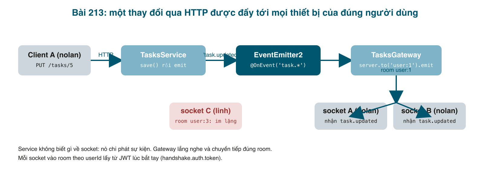

Yêu cầu nghe rất bình thường: "Em mở app trên điện thoại đánh dấu task xong, trên laptop phải tự đổi theo, không phải F5". HTTP không làm được: server không thể gọi ngược client. Cần một kết nối hai chiều mở sẵn, tức **WebSocket**, và thư viện phổ biến nhất trên Node là **Socket.IO**. NestJS có sẵn khái niệm **Gateway** cho việc này. Bài này đẩy ba sự kiện <mark>task.created</mark>, <mark>task.updated</mark>, <mark>task.deleted</mark> tới **mọi thiết bị của đúng người đó**, và chỉ người đó.



#### Hiểu trước khi code
- **Gateway** là class đánh dấu <mark>@WebSocketGateway()</mark>. Nest tạo một Socket.IO server dùng chung cổng với HTTP. Gateway có thể lắng nghe tin nhắn từ client (<mark>@SubscribeMessage</mark>) và chủ động gửi đi (<mark>server.emit</mark>). Bài này chỉ cần chiều gửi đi.
- **Room**: một nhãn mà socket "tham gia". <mark>server.to('user:1').emit(...)</mark> gửi tới mọi socket trong room đó, không cần tự giữ danh sách. Mỗi user một room là cách đơn giản nhất để "đúng người, mọi thiết bị".
- **Guard không chạy lúc kết nối**. <mark>@UseGuards</mark> chỉ áp dụng cho <mark>@SubscribeMessage</mark>. Vì vậy ta kiểm tra JWT bằng tay trong <mark>handleConnection</mark>, và từ chối ngay socket không hợp lệ.
- **Service không nên biết về socket**. Nếu <mark>TasksService</mark> gọi thẳng gateway, mai mốt thêm "gửi email khi task xong" lại sửa service lần nữa, và hai module phụ thuộc vòng. Thay vào đó service **phát sự kiện** (<mark>EventEmitter2</mark> của <mark>@nestjs/event-emitter</mark>), ai quan tâm thì lắng nghe. Gateway là một người nghe; sau này email, thống kê là người nghe khác.

#### Bước 1: cài gói đúng major
```bash
npm install @nestjs/websockets@^11 @nestjs/platform-socket.io@^11 socket.io @nestjs/event-emitter@^3
npm install -D socket.io-client
```
Lần đầu mình gõ <mark>npm install @nestjs/websockets</mark> không ghi version và npm báo <mark>ERESOLVE unable to resolve dependency tree</mark>: bản mới nhất là 12, đòi <mark>@nestjs/common@12</mark>, trong khi project là 11. Ghi rõ <mark>@^11</mark> là xong. (<mark>@nestjs/event-emitter</mark> đánh số riêng: bản 3 đi với Nest 11.)

Bật module sự kiện trong <mark>AppModule</mark>:
```typescript
// src/app.module.ts (một phần)
import { EventEmitterModule } from '@nestjs/event-emitter';

    // In-process pub/sub: services emit "task.created" etc., listeners react.
    EventEmitterModule.forRoot({ wildcard: true }),
```
<mark>wildcard: true</mark> để gateway đăng ký một lần <mark>'task.*'</mark> thay vì ba lần.

#### Bước 2: định nghĩa sự kiện
```typescript
// src/tasks/task-events.ts

import { Task } from './task.entity';

// Published by TasksService after each write, consumed by TasksGateway.
// The service never knows about sockets: it only says "this happened".
export type TaskEventName = 'task.created' | 'task.updated' | 'task.deleted';

export interface TaskEvent {
  name: TaskEventName;
  task: Task;
}
```

Một file nhỏ nhưng là "hợp đồng" giữa người phát và người nghe: tên sự kiện nào, mang dữ liệu gì.

#### Bước 3: service phát sự kiện sau mỗi lần ghi
```typescript
// src/tasks/tasks.service.ts

import { Injectable, NotFoundException } from '@nestjs/common';
import { EventEmitter2 } from '@nestjs/event-emitter';
import { InjectRepository } from '@nestjs/typeorm';
import { Repository } from 'typeorm';
import { Task } from './task.entity';
import { TaskStatus } from './task.model';
import { TaskEvent } from './task-events';
import { User } from '../auth/user.entity';
import { CreateTaskDto } from './dto/create-task.dto';
import { UpdateTaskDto } from './dto/update-task.dto';
import { FilterTaskDto } from './dto/filter-task.dto';

@Injectable()
export class TasksService {
  constructor(
    @InjectRepository(Task)
    private tasksRepository: Repository<Task>,
    private events: EventEmitter2,
  ) {}

  // Every method receives the current user and only ever touches that user's rows.
  async getTasks(filterTaskDto: FilterTaskDto, user: User): Promise<Task[]> {
    const { status, search } = filterTaskDto;
    const query = this.tasksRepository
      .createQueryBuilder('task')
      .where('task.userId = :userId', { userId: user.id });

    if (status) {
      query.andWhere('task.status = :status', { status });
    }
    if (search) {
      query.andWhere('task.title ILIKE :search', { search: `%${search}%` });
    }

    return query.orderBy('task.id', 'DESC').getMany();
  }

  async getTaskById(id: number, user: User): Promise<Task> {
    const task = await this.tasksRepository.findOne({
      where: { id, userId: user.id },
    });
    if (!task) {
      // 404, not 403: don't reveal that someone else's task exists.
      throw new NotFoundException(`Task with ID "${id}" not found`);
    }
    return task;
  }

  async createTask(createTaskDto: CreateTaskDto, user: User): Promise<Task> {
    const task = this.tasksRepository.create({
      ...createTaskDto,
      status: TaskStatus.OPEN,
      userId: user.id, // the id only, so the response does not carry the user object
    });
    const saved = await this.tasksRepository.save(task);
    this.publish('task.created', saved);
    return saved;
  }

  async deleteTaskById(id: number, user: User): Promise<void> {
    const task = await this.getTaskById(id, user); // 404 if not ours
    await this.tasksRepository.remove(task);
    this.publish('task.deleted', { ...task, id }); // remove() clears id, put it back
  }

  async updateTaskStatus(
    id: number,
    updateTaskDto: UpdateTaskDto,
    user: User,
  ): Promise<Task> {
    const task = await this.getTaskById(id, user); // 404 if not ours
    task.status = updateTaskDto.status;
    const saved = await this.tasksRepository.save(task);
    this.publish('task.updated', saved);
    return saved;
  }

  // Fire and forget: listeners (the gateway today, maybe email tomorrow)
  // run after this method returns, and a failing listener cannot break the request.
  private publish(name: TaskEvent['name'], task: Task) {
    this.events.emit(name, { name, task } satisfies TaskEvent);
  }
}
```

Hai chi tiết:
- <mark>publish()</mark> gọi **sau** <mark>save()</mark> thành công. Phát trước rồi save lỗi thì client thấy một task không tồn tại.
- Với xoá, dùng <mark>remove(task)</mark> thay <mark>delete()</mark> để có object task mà gửi cho client; nhưng TypeORM xoá <mark>id</mark> khỏi object sau khi remove, nên gán lại <mark>{ ...task, id }</mark>.

#### Bước 4: gateway
```typescript
// src/tasks/tasks.gateway.ts

import { Logger } from '@nestjs/common';
import { OnEvent } from '@nestjs/event-emitter';
import { JwtService } from '@nestjs/jwt';
import {
  OnGatewayConnection,
  OnGatewayDisconnect,
  WebSocketGateway,
  WebSocketServer,
} from '@nestjs/websockets';
import { Server, Socket } from 'socket.io';
import { JwtPayload } from '../auth/jwt-payload.interface';
// "import type": the type is only used in a decorated method signature,
// and TypeScript must not try to emit it as runtime metadata.
import type { TaskEvent } from './task-events';

// One Socket.IO server shared with the HTTP server, on the same port.
@WebSocketGateway({ cors: { origin: '*' } })
export class TasksGateway implements OnGatewayConnection, OnGatewayDisconnect {
  @WebSocketServer() server: Server;
  private readonly logger = new Logger(TasksGateway.name);

  constructor(private jwtService: JwtService) {}

  // Guards do not run on the connection itself, so we check the token here.
  handleConnection(client: Socket) {
    const token = client.handshake.auth?.token as string | undefined;
    try {
      if (!token) throw new Error('missing token');
      const payload = this.jwtService.verify<JwtPayload>(token);
      // Each user gets a private "room": every tab/device of that user joins it.
      void client.join(this.room(payload.sub));
      client.data.username = payload.username;
      this.logger.log(`${payload.username} connected (${client.id})`);
    } catch (err) {
      this.logger.warn(`rejected ${client.id}: ${(err as Error).message}`);
      client.emit('error', { message: 'Unauthorized' });
      client.disconnect(true);
    }
  }

  handleDisconnect(client: Socket) {
    this.logger.log(`${client.data.username ?? 'unknown'} disconnected (${client.id})`);
  }

  // TasksService emits these after each write; we forward them to the owner only.
  @OnEvent('task.*')
  onTaskEvent(event: TaskEvent) {
    this.server.to(this.room(event.task.userId)).emit(event.name, event.task);
  }

  private room(userId: number) {
    return `user:${userId}`;
  }
}
```

- Token đến qua <mark>handshake.auth.token</mark>. Đây là cách Socket.IO khuyến nghị (không nhét vào query string vì query string hay lọt vào log).
- <mark>jwtService.verify</mark> ném lỗi nếu chữ ký sai hoặc hết hạn; ta bắt, gửi một sự kiện <mark>error</mark> cho client biết lý do rồi <mark>disconnect(true)</mark>.
- <mark>@OnEvent('task.*')</mark>: method này được <mark>EventEmitter2</mark> gọi với đúng object <mark>TaskEvent</mark> mà service phát. Gateway chỉ nhìn <mark>task.userId</mark> để chọn room.
- <mark>import type { TaskEvent }</mark>: <mark>TaskEvent</mark> là interface, không tồn tại lúc chạy. Khi nó xuất hiện trong chữ ký của method có decorator, TypeScript (với <mark>emitDecoratorMetadata</mark> + <mark>isolatedModules</mark>) bắt phải import kiểu <mark>type</mark>, nếu không sẽ lỗi TS1272. Bạn sẽ gặp lỗi này ở bất kỳ DTO nào là interface thay vì class.

<mark>JwtService</mark> đến từ <mark>AuthModule</mark>, nên AuthModule phải xuất thêm <mark>JwtModule</mark>:
```typescript
// src/auth/auth.module.ts (một phần)
  exports: [JwtStrategy, PassportModule, JwtModule],
```
Và đăng ký gateway như một provider thường của <mark>TasksModule</mark>:
```typescript
// src/tasks/tasks.module.ts (một phần)
  providers: [TasksService, TasksGateway],
```

#### Bước 5: một client nhỏ để thử
Không cần frontend; một script Node đóng vai một tab trình duyệt:

```javascript
// scripts/socket-client.mjs

// A tiny "frontend": signs in, opens a socket with the token, prints every task event.
//   node scripts/socket-client.mjs <username> <password> [http://localhost:3100]
import { io } from 'socket.io-client';

const [username, password, base = 'http://localhost:3100'] = process.argv.slice(2);

const res = await fetch(`${base}/auth/signin`, {
  method: 'POST',
  headers: { 'content-type': 'application/json' },
  body: JSON.stringify({ username, password }),
});
if (!res.ok) {
  console.error('sign in failed', res.status, await res.text());
  process.exit(1);
}
const { accessToken } = await res.json();

const socket = io(base, { auth: { token: accessToken } });

socket.on('connect', () => console.log(`[${username}] connected as ${socket.id}`));
socket.on('error', (e) => console.log(`[${username}] error`, e));
socket.on('disconnect', (reason) => console.log(`[${username}] disconnected: ${reason}`));

for (const name of ['task.created', 'task.updated', 'task.deleted']) {
  socket.on(name, (task) =>
    console.log(`[${username}] ${name}: #${task.id} "${task.title}" ${task.status}`),
  );
}
```

#### Chạy thật
Mở ba "thiết bị": nolan hai cái, linh một cái, rồi nolan thao tác qua HTTP như bình thường.
```bash
node scripts/socket-client.mjs nolan Secret123 &   # thiết bị A
node scripts/socket-client.mjs nolan Secret123 &   # thiết bị B
node scripts/socket-client.mjs linh  Secret123 &   # linh

# nolan tạo, cập nhật, xoá qua HTTP (token của nolan)
curl -X POST   localhost:3100/tasks   ... -d '{"title":"Realtime","description":"bài 213"}'   # created #5
curl -X PUT    localhost:3100/tasks/5 ... -d '{"status":"IN_PROGRESS"}'                        # [200]
curl -X DELETE localhost:3100/tasks/5 ...                                                      # [200]
```
Thiết bị A của nolan:
```
[nolan] connected as _ay-41SDddBHGWF6AAAC
[nolan] task.created: #5 "Realtime" OPEN
[nolan] task.updated: #5 "Realtime" IN_PROGRESS
[nolan] task.deleted: #5 "Realtime" IN_PROGRESS
```
Thiết bị B của nolan nhận y hệt. Còn linh:
```
[linh] connected as jJ-1QEw_Y_yU1nH6AAAA
```
Không một sự kiện nào, dù cùng server, cùng lúc. Một client với token bậy:
```
bad-token client got: {"message":"Unauthorized"}
bad-token client disconnected: io server disconnect
```
Log server:
```
LOG  [TasksGateway] linh connected (jJ-1QEw_Y_yU1nH6AAAA)
LOG  [TasksGateway] nolan connected (SVq941hlpdjQQ2TLAAAB)
LOG  [TasksGateway] nolan connected (_ay-41SDddBHGWF6AAAC)
WARN [TasksGateway] rejected YxmkJ3Uk4QT3R4g6AAAD: jwt malformed
```

#### Mẹo và lỗi hay gặp
- **Client kết nối được nhưng không nhận gì**: kiểm tra client gửi token trong <mark>auth</mark> (không phải header), và tên sự kiện hai bên khớp từng ký tự (<mark>task.created</mark>).
- **CORS với WebSocket**: trình duyệt ở domain khác cần <mark>cors</mark> trong <mark>@WebSocketGateway({ cors: { origin: ... } })</mark>, tách biệt với CORS của HTTP. <mark>'*'</mark> chỉ cho lúc học.
- **Token hết hạn giữa chừng**: socket vẫn mở vì chỉ kiểm tra lúc bắt tay. App thật nên ngắt khi token hết hạn (đặt <mark>setTimeout</mark> theo <mark>exp</mark>) hoặc yêu cầu client kết nối lại định kỳ.
- **Nhiều server (scale ngang)**: room chỉ tồn tại trong bộ nhớ của một process. Chạy hai bản API thì sự kiện ở server này không tới socket ở server kia; cần adapter Redis của Socket.IO (<mark>@socket.io/redis-adapter</mark>). Đây là lý do service phát sự kiện qua emitter: sau này thay emitter trong tiến trình bằng Redis pub/sub mà service không đổi.
- **Listener ném lỗi**: với <mark>EventEmitter2</mark>, lỗi trong listener không làm request HTTP lỗi theo (sự kiện phát không đợi), nhưng hãy <mark>try/catch</mark> và log trong listener, kẻo lỗi biến mất.
- **Dùng gateway cho cả chiều ngược (client gửi lên)**: <mark>@SubscribeMessage('task.create')</mark> được, nhưng giữ việc ghi dữ liệu ở HTTP để tận dụng Pipe, Guard, Filter của bài 212; WebSocket chỉ để đẩy thông báo.

#### Checklist
- Hai client cùng user đều nhận ba sự kiện; client user khác không nhận gì.
- Token sai: client nhận <mark>error</mark> và bị ngắt; log server có <mark>rejected</mark>.
- Tắt gateway (bỏ khỏi <mark>providers</mark>): HTTP vẫn chạy bình thường, chứng tỏ service không phụ thuộc gateway.

Mã nguồn cuối bài: [post_213.zip](/assets/code/post_213.zip).

#### Bài tập thêm
- Thêm người nghe thứ hai: <mark>TaskAuditListener</mark> với <mark>@OnEvent('task.*')</mark> ghi một dòng log "user 1 updated task 5". Không sửa service.
- Cho client gửi <mark>typing</mark> (<mark>@SubscribeMessage</mark>) và gateway phát lại cho các thiết bị khác của cùng user.
- Viết một trang HTML 30 dòng dùng <mark>socket.io-client</mark> từ CDN, đăng nhập, rồi hiện danh sách task tự cập nhật.
