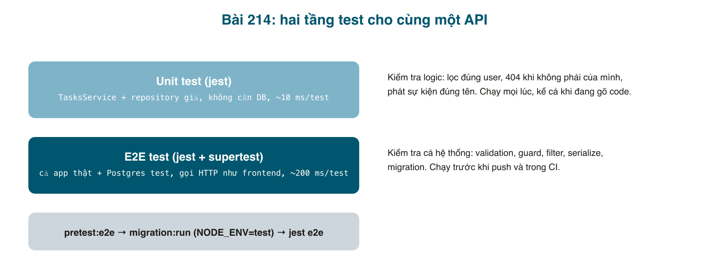

Đến bài này API đã có 6 endpoint, guard, filter, realtime. Mỗi lần sửa một chỗ, bạn lại mở Postman bấm lại từng cái để chắc không hỏng chỗ khác? Tuần đầu còn chịu được, tháng sau thì bỏ bấm, và bug lọt. Test tự động giải quyết đúng chuyện đó: **viết một lần, chạy mỗi lần sửa, vài giây**. NestJS sinh sẵn Jest; bài này dùng nó ở hai tầng: **unit test** cho logic trong service, không cần database, và **e2e test** chạy cả app thật với Postgres test, gọi HTTP như frontend.



#### Unit test: đây là lúc Dependency Injection trả ơn
<mark>TasksService</mark> cần <mark>Repository&lt;Task&gt;</mark> và <mark>EventEmitter2</mark>. Nhờ DI, trong test ta dựng một module **giả** và đưa vào hai object giả do ta kiểm soát: <mark>findOne</mark> trả gì, <mark>save</mark> trả gì là do test quyết định. Không database, không mạng, mỗi test vài mili giây.

```typescript
// src/tasks/tasks.service.spec.ts

import { NotFoundException } from '@nestjs/common';
import { EventEmitter2 } from '@nestjs/event-emitter';
import { Test } from '@nestjs/testing';
import { getRepositoryToken } from '@nestjs/typeorm';
import { Task } from './task.entity';
import { TaskStatus } from './task.model';
import { TasksService } from './tasks.service';
import { User } from '../auth/user.entity';

// A fake repository: every method is a jest.fn() we control per test.
// No database, so these tests run in milliseconds.
const mockRepository = () => ({
  findOne: jest.fn(),
  create: jest.fn(),
  save: jest.fn(),
  remove: jest.fn(),
  createQueryBuilder: jest.fn(),
});
const mockEvents = () => ({ emit: jest.fn() });

const user = { id: 7, username: 'nolan' } as User;
const task: Task = {
  id: 1,
  title: 'Học NestJS',
  description: 'bài 214',
  status: TaskStatus.OPEN,
  userId: user.id,
  user,
};

describe('TasksService', () => {
  let service: TasksService;
  let repo: ReturnType<typeof mockRepository>;
  let events: ReturnType<typeof mockEvents>;

  beforeEach(async () => {
    const module = await Test.createTestingModule({
      providers: [
        TasksService,
        { provide: getRepositoryToken(Task), useFactory: mockRepository },
        { provide: EventEmitter2, useFactory: mockEvents },
      ],
    }).compile();

    service = module.get(TasksService);
    repo = module.get(getRepositoryToken(Task));
    events = module.get(EventEmitter2);
  });

  describe('getTaskById', () => {
    it('returns the task when it belongs to the user', async () => {
      repo.findOne.mockResolvedValue(task);

      await expect(service.getTaskById(1, user)).resolves.toEqual(task);
      // the query must always be scoped to the current user
      expect(repo.findOne).toHaveBeenCalledWith({ where: { id: 1, userId: 7 } });
    });

    it('throws NotFoundException when nothing matches', async () => {
      repo.findOne.mockResolvedValue(null);

      await expect(service.getTaskById(99, user)).rejects.toThrow(NotFoundException);
    });
  });

  describe('createTask', () => {
    it('saves with status OPEN and the owner id, then publishes task.created', async () => {
      repo.create.mockImplementation((data: Partial<Task>) => data);
      repo.save.mockImplementation((data: Task) => Promise.resolve({ ...data, id: 5 }));

      const result = await service.createTask({ title: 'A', description: 'B' }, user);

      expect(repo.create).toHaveBeenCalledWith({
        title: 'A',
        description: 'B',
        status: TaskStatus.OPEN,
        userId: 7,
      });
      expect(result.id).toBe(5);
      expect(events.emit).toHaveBeenCalledWith('task.created', {
        name: 'task.created',
        task: result,
      });
    });
  });

  describe('updateTaskStatus', () => {
    it('changes the status and publishes task.updated', async () => {
      repo.findOne.mockResolvedValue({ ...task });
      repo.save.mockImplementation((data: Task) => Promise.resolve(data));

      const result = await service.updateTaskStatus(1, { status: TaskStatus.DONE }, user);

      expect(result.status).toBe(TaskStatus.DONE);
      expect(events.emit).toHaveBeenCalledWith('task.updated', expect.objectContaining({ name: 'task.updated' }));
    });

    it('does not touch the database when the task is not ours', async () => {
      repo.findOne.mockResolvedValue(null);

      await expect(
        service.updateTaskStatus(1, { status: TaskStatus.DONE }, user),
      ).rejects.toThrow(NotFoundException);
      expect(repo.save).not.toHaveBeenCalled();
      expect(events.emit).not.toHaveBeenCalled();
    });
  });

  describe('getTasks', () => {
    it('always filters by the current user and adds status/search when given', async () => {
      // createQueryBuilder returns a chainable object; every method returns itself.
      const qb = {
        where: jest.fn().mockReturnThis(),
        andWhere: jest.fn().mockReturnThis(),
        orderBy: jest.fn().mockReturnThis(),
        getMany: jest.fn().mockResolvedValue([task]),
      };
      repo.createQueryBuilder.mockReturnValue(qb);

      const result = await service.getTasks({ status: TaskStatus.OPEN, search: 'nest' }, user);

      expect(result).toEqual([task]);
      expect(qb.where).toHaveBeenCalledWith('task.userId = :userId', { userId: 7 });
      expect(qb.andWhere).toHaveBeenCalledWith('task.status = :status', { status: 'OPEN' });
      expect(qb.andWhere).toHaveBeenCalledWith('task.title ILIKE :search', { search: '%nest%' });
    });
  });
});
```

Đọc từng phần:
- <mark>Test.createTestingModule({ providers: [...] })</mark>: giống một module Nest thật nhưng ta tự chọn provider. <mark>getRepositoryToken(Task)</mark> là "tên" mà <mark>@InjectRepository(Task)</mark> dùng để xin repository; ta đăng ký object giả dưới đúng tên đó.
- <mark>jest.fn()</mark> là hàm giả: ghi lại mọi lần được gọi (<mark>toHaveBeenCalledWith</mark>) và trả về thứ ta đặt (<mark>mockResolvedValue</mark>).
- Test quan trọng nhất là **"does not touch the database when the task is not ours"**: khẳng định <mark>save</mark> và <mark>emit</mark> không được gọi khi 404. Đây chính là quy tắc bảo mật của bài 211, giờ được ghi thành test; ai đó sửa service làm hỏng quy tắc là test đỏ.
- Query builder là chuỗi <mark>.where().andWhere().orderBy().getMany()</mark>; giả lập bằng object mà mỗi method <mark>mockReturnThis()</mark> (trả về chính nó).

Một bộ nữa cho <mark>AuthService</mark>:

```typescript
// src/auth/auth.service.spec.ts

import { ConflictException, UnauthorizedException } from '@nestjs/common';
import { JwtService } from '@nestjs/jwt';
import { Test } from '@nestjs/testing';
import { getRepositoryToken } from '@nestjs/typeorm';
import * as bcrypt from 'bcrypt';
import { AuthService } from './auth.service';
import { User } from './user.entity';

const mockRepository = () => ({
  findOne: jest.fn(),
  create: jest.fn((data: Partial<User>) => data),
  save: jest.fn(),
});
const mockJwt = () => ({ signAsync: jest.fn().mockResolvedValue('signed.jwt.token') });

describe('AuthService', () => {
  let service: AuthService;
  let repo: ReturnType<typeof mockRepository>;
  let jwt: ReturnType<typeof mockJwt>;

  beforeEach(async () => {
    const module = await Test.createTestingModule({
      providers: [
        AuthService,
        { provide: getRepositoryToken(User), useFactory: mockRepository },
        { provide: JwtService, useFactory: mockJwt },
      ],
    }).compile();
    service = module.get(AuthService);
    repo = module.get(getRepositoryToken(User));
    jwt = module.get(JwtService);
  });

  describe('signUp', () => {
    it('stores a bcrypt hash, never the password', async () => {
      repo.save.mockImplementation((u: User) => Promise.resolve(Object.assign(u, { id: 1 })));

      await service.signUp({ username: 'nolan', password: 'Secret123' });

      const saved = repo.save.mock.calls[0][0] as User;
      expect(saved.passwordHash).not.toBe('Secret123');
      expect(await bcrypt.compare('Secret123', saved.passwordHash)).toBe(true);
    });

    it('maps the Postgres unique violation to 409 Conflict', async () => {
      repo.save.mockRejectedValue({ code: '23505' });

      await expect(service.signUp({ username: 'nolan', password: 'Secret123' })).rejects.toThrow(
        ConflictException,
      );
    });
  });

  describe('signIn', () => {
    it('returns a token for the right password', async () => {
      repo.findOne.mockResolvedValue({
        id: 1,
        username: 'nolan',
        passwordHash: await bcrypt.hash('Secret123', 4),
      });

      const result = await service.signIn({ username: 'nolan', password: 'Secret123' });

      expect(result).toEqual({ accessToken: 'signed.jwt.token' });
      expect(jwt.signAsync).toHaveBeenCalledWith({ sub: 1, username: 'nolan' });
    });

    it('rejects a wrong password and an unknown user with the same error', async () => {
      repo.findOne.mockResolvedValueOnce({
        id: 1,
        username: 'nolan',
        passwordHash: await bcrypt.hash('Secret123', 4),
      });
      await expect(service.signIn({ username: 'nolan', password: 'Wrong1234' })).rejects.toThrow(
        UnauthorizedException,
      );

      repo.findOne.mockResolvedValueOnce(null);
      await expect(service.signIn({ username: 'ghost', password: 'Secret123' })).rejects.toThrow(
        UnauthorizedException,
      );
    });
  });
});
```

Ở đây <mark>bcrypt</mark> là thật (chỉ giảm cost xuống 4 cho nhanh) vì mục đích test là "có băm không, so sánh đúng không". Còn <mark>JwtService</mark> là giả: ta không test thư viện JWT, ta test rằng service gọi nó với đúng payload.

```bash
npx jest
# PASS src/tasks/tasks.service.spec.ts
# PASS src/auth/auth.service.spec.ts
# Tests:       10 passed, 10 total
# Time:        0.9 s
```

#### Một cái bẫy thật: gói ESM-only và Jest
Lần chạy đầu, bộ test auth **không chạy nổi**:
```
Jest encountered an unexpected token
/node_modules/@nestjs/jwt/dist/index.js:1
import jsonwebtoken from 'jsonwebtoken';
^^^^^^
SyntaxError: Cannot use import statement outside a module
```
Bài 210 cài <mark>@nestjs/jwt</mark> không ghi version nên lấy bản 12, bản này là **ESM-only** (chỉ <mark>import/export</mark>). App build bằng <mark>nest build</mark> vẫn chạy, nhưng Jest + ts-jest ở chế độ CommonJS không nạp được. Nguyên nhân gốc là lệch major như đã cảnh báo ở bài 209. Sửa tận gốc:
```bash
npm install @nestjs/jwt@^11 @nestjs/passport@^11 @nestjs/config@^4
```
(<mark>@nestjs/config</mark> bản 4 là bản đi với Nest 11.) Build lại, 10 test xanh. Bài học: khi một gói <mark>@nestjs/*</mark> có major khác <mark>@nestjs/core</mark>, sửa ngay, đừng đợi nó "tự nhiên" chạy được.

#### E2E test: chạy cả app với Postgres thật
Unit test không thấy được ValidationPipe, Guard, Filter, Serializer, migration. E2E test thì thấy tất cả, vì nó khởi động đúng <mark>AppModule</mark> và gửi HTTP thật bằng <mark>supertest</mark>. Cần ba thứ: một database riêng, cấu hình riêng, và app được lắp ráp **y như** production.

**Database và cấu hình riêng.** Tạo <mark>task_management_test</mark> và một file <mark>.env.test</mark> (commit được, vì chỉ chứa giá trị test):

```bash
# .env.test

# Used when NODE_ENV=test (npm run test:e2e). Safe to commit: test-only values.
NODE_ENV=test
PORT=3101

DB_HOST=localhost
DB_PORT=5432
DB_USERNAME=postgres
DB_PASSWORD=postgres
DB_NAME=task_management_test

JWT_SECRET=test-only-secret-not-for-production-0123456789
JWT_EXPIRES_IN=1h
```

<mark>ConfigModule</mark> đọc file theo <mark>NODE_ENV</mark>, file <mark>.env</mark> bù phần thiếu:
```typescript
// src/app.module.ts (một phần)
    ConfigModule.forRoot({
      isGlobal: true,
      // NODE_ENV=test -> .env.test first, then .env for anything missing.
      envFilePath: process.env.NODE_ENV
        ? [`.env.${process.env.NODE_ENV}`, '.env']
        : '.env',
      validationSchema: envValidationSchema,
    }),
```
<mark>data-source.ts</mark> của TypeORM CLI cũng theo quy tắc đó, để <mark>migration:run</mark> chạy được trên database test:

```typescript
// src/data-source.ts

import { config } from 'dotenv';
import { DataSource } from 'typeorm';

// Used by the TypeORM CLI only (migration:generate / migration:run).
// It reads the same .env files as the app, so both always point at the same database.
if (process.env.NODE_ENV) config({ path: `.env.${process.env.NODE_ENV}` });
config(); // .env fills in whatever is still missing (dotenv never overrides)
export const AppDataSource = new DataSource({
  type: 'postgres',
  host: process.env.DB_HOST,
  port: Number(process.env.DB_PORT ?? 5432),
  username: process.env.DB_USERNAME,
  password: process.env.DB_PASSWORD,
  database: process.env.DB_NAME,
  entities: ['src/**/*.entity.ts'],
  migrations: ['src/migrations/**/*.ts'],
  synchronize: false,
});
```

**Lắp ráp giống production.** Pipe, interceptor, filter đang khai báo trong <mark>main.ts</mark>, mà e2e test không chạy <mark>main.ts</mark>. Tách ra một hàm dùng chung:

```typescript
// src/app.setup.ts

import { ClassSerializerInterceptor, INestApplication, ValidationPipe } from '@nestjs/common';
import { Reflector } from '@nestjs/core';
import { AllExceptionsFilter } from './common/filters/all-exceptions.filter';
import { LoggingInterceptor } from './common/interceptors/logging.interceptor';

// Everything that makes the app behave like production: pipes, interceptors, filters.
// Shared by main.ts and by the e2e tests, so tests exercise the real setup.
export function configureApp(app: INestApplication): INestApplication {
  app.useGlobalPipes(
    new ValidationPipe({
      whitelist: true, // drop properties that are not in the DTO
      forbidNonWhitelisted: true, // ...or rather, reject the request if any are present
      transform: true, // "3" in a query string becomes 3 when the DTO says number
    }),
  );
  app.useGlobalInterceptors(
    new ClassSerializerInterceptor(app.get(Reflector)), // honours @Exclude()
    new LoggingInterceptor(),
  );
  app.useGlobalFilters(new AllExceptionsFilter());
  return app;
}
```

<mark>main.ts</mark> giờ chỉ còn <mark>configureApp(await NestFactory.create(AppModule))</mark> rồi <mark>listen</mark>.

**Script.** npm tự chạy <mark>preX</mark> trước <mark>X</mark>, nên migration cho database test luôn được áp trước khi test:
```json
// package.json (một phần)
    "pretest:e2e": "NODE_ENV=test npm run migration:run",
    "test:e2e": "NODE_ENV=test jest --config ./test/jest-e2e.json --runInBand",
```
<mark>--runInBand</mark>: chạy tuần tự, vì các file e2e dùng chung một database.

**Bài test.** Xoá <mark>test/app.e2e-spec.ts</mark> mẫu (nó kiểm tra "Hello World!" không còn tồn tại) và viết:

```typescript
// test/tasks.e2e-spec.ts

import { INestApplication } from '@nestjs/common';
import { Test } from '@nestjs/testing';
import request from 'supertest';
import { App } from 'supertest/types';
import { DataSource } from 'typeorm';
import { AppModule } from '../src/app.module';
import { configureApp } from '../src/app.setup';

// Boots the whole app (real modules, real Postgres from .env.test) and talks
// to it over HTTP, exactly like a frontend would.
describe('Tasks (e2e)', () => {
  let app: INestApplication<App>;
  let http: App;

  const signUpAndIn = async (username: string, password = 'Secret123') => {
    await request(http).post('/auth/signup').send({ username, password }).expect(201);
    const res = await request(http).post('/auth/signin').send({ username, password }).expect(200);
    return `Bearer ${res.body.accessToken as string}`;
  };

  beforeAll(async () => {
    const moduleRef = await Test.createTestingModule({ imports: [AppModule] }).compile();
    app = configureApp(moduleRef.createNestApplication<INestApplication<App>>());
    await app.init();
    http = app.getHttpServer();

    // Start from an empty database every run (schema comes from migrations, see pretest:e2e).
    await app.get(DataSource).query('TRUNCATE "tasks", "users" RESTART IDENTITY CASCADE');
  });

  afterAll(async () => {
    await app.close();
  });

  it('rejects requests without a token', async () => {
    const res = await request(http).get('/tasks').expect(401);
    expect(res.body).toMatchObject({ statusCode: 401, error: 'Unauthorized', path: '/tasks' });
    expect(res.body.requestId).toBeDefined();
  });

  it('validates the body and names every problem', async () => {
    const token = await signUpAndIn('nolan');
    const res = await request(http)
      .post('/tasks')
      .set('Authorization', token)
      .send({ title: '', isAdmin: true })
      .expect(400);

    expect(res.body.message).toEqual(
      expect.arrayContaining([
        'title should not be empty',
        'description should not be empty',
        'property isAdmin should not exist',
      ]),
    );
  });

  it('lets a user create, list, update and delete their own tasks', async () => {
    const token = await signUpAndIn('alice');

    const created = await request(http)
      .post('/tasks')
      .set('Authorization', token)
      .send({ title: 'Write tests', description: 'post 214' })
      .expect(201);
    expect(created.body).toMatchObject({ title: 'Write tests', status: 'OPEN', userId: 2 });

    const list = await request(http).get('/tasks').set('Authorization', token).expect(200);
    expect(list.body).toHaveLength(1);

    const updated = await request(http)
      .put(`/tasks/${created.body.id}`)
      .set('Authorization', token)
      .send({ status: 'DONE' })
      .expect(200);
    expect(updated.body.status).toBe('DONE');

    await request(http).delete(`/tasks/${created.body.id}`).set('Authorization', token).expect(200);
    await request(http).get(`/tasks/${created.body.id}`).set('Authorization', token).expect(404);
  });

  it('never shows one user the tasks of another', async () => {
    const bob = await signUpAndIn('bobby');
    const carol = await signUpAndIn('carol');

    const bobsTask = await request(http)
      .post('/tasks')
      .set('Authorization', bob)
      .send({ title: 'Secret plan', description: 'bob only' })
      .expect(201);

    const carolsList = await request(http).get('/tasks').set('Authorization', carol).expect(200);
    expect(carolsList.body).toEqual([]);

    await request(http).get(`/tasks/${bobsTask.body.id}`).set('Authorization', carol).expect(404);
    await request(http).delete(`/tasks/${bobsTask.body.id}`).set('Authorization', carol).expect(404);

    // still there for its owner
    await request(http).get(`/tasks/${bobsTask.body.id}`).set('Authorization', bob).expect(200);
  });

  it('never leaks the password hash', async () => {
    const token = await signUpAndIn('dave1');
    const me = await request(http).get('/auth/me').set('Authorization', token).expect(200);
    expect(me.body.username).toBe('dave1');
    expect(me.body.passwordHash).toBeUndefined();
  });
});
```

- <mark>beforeAll</mark> khởi động app một lần, <mark>TRUNCATE</mark> hai bảng để mỗi lần chạy bắt đầu từ trống (<mark>RESTART IDENTITY</mark> để id lại từ 1, nên test có thể khẳng định <mark>userId: 2</mark>).
- <mark>signUpAndIn</mark> là helper: hầu hết test cần một user có token.
- Bài test "never shows one user the tasks of another" là phiên bản e2e của quy tắc bài 211; cùng với unit test ở trên, quy tắc được bảo vệ ở hai tầng.
- Bài "never leaks the password hash" chỉ chạy được ở e2e vì serializer là interceptor toàn cục.

```bash
npm run test:e2e
# > pretest:e2e
# > NODE_ENV=test npm run migration:run
# Migration Initial1764580894395 has been executed successfully.
# Migration CreateUsers1793966688163 has been executed successfully.
# Migration AddUserToTasks1793966794813 has been executed successfully.
# > test:e2e
# PASS test/tasks.e2e-spec.ts
#   ✓ rejects requests without a token (19 ms)
#   ✓ validates the body and names every problem (177 ms)
#   ✓ lets a user create, list, update and delete their own tasks (183 ms)
#   ✓ never shows one user the tasks of another (300 ms)
#   ✓ never leaks the password hash (152 ms)
# Tests:       5 passed, 5 total
```
Lần chạy thứ hai, migration báo "No migrations are pending" và đi thẳng vào test.

#### Mẹo và lỗi hay gặp
- **Test chạy vào database dev**: <mark>NODE_ENV=test</mark> thiếu, hoặc <mark>.env.test</mark> không có <mark>DB_NAME</mark> nên lấy từ <mark>.env</mark>. Thêm một <mark>expect(config.get('DB_NAME')).toContain('test')</mark> ở <mark>beforeAll</mark> nếu muốn chắc chắn.
- **"open handles" làm Jest không thoát**: quên <mark>app.close()</mark> trong <mark>afterAll</mark>; Nest đóng kết nối database ở đó.
- **Unit test quá bám vào cách gọi**: khẳng định <mark>andWhere</mark> được gọi với chuỗi SQL chính xác làm test đỏ mỗi khi đổi câu query mà hành vi không đổi. Chấp nhận được với query builder, nhưng ưu tiên khẳng định **kết quả** (trả gì, ném gì, có gọi save không).
- **Mock quá nhiều**: nếu một test phải giả 6 thứ, đó là dấu hiệu service làm quá nhiều việc; tách nhỏ.
- **E2E chậm khi nhiều file**: mỗi file khởi động app một lần (~1 giây). Gom test cùng tính năng vào một file; không cần mỗi endpoint một file.
- **ESM-only package**: ngoài <mark>@nestjs/jwt@12</mark>, nhiều gói mới (chalk, nanoid...) cũng ESM-only. Nếu bắt buộc dùng, cấu hình <mark>transformIgnorePatterns</mark> cho Jest hoặc chuyển cả project sang ESM; với người mới, chọn bản CommonJS của gói là lối ra nhanh nhất.

#### Checklist
- <mark>npx jest</mark>: 10 test xanh dưới 2 giây, không cần Postgres chạy.
- <mark>npm run test:e2e</mark>: migration áp lên database test, 5 test xanh.
- Cố ý xoá điều kiện <mark>userId</mark> trong <mark>getTaskById</mark>: cả unit test lẫn e2e test đỏ. Trả lại.
- <mark>git status</mark>: <mark>.env.test</mark> được commit, <mark>.env</mark> thì không.

Mã nguồn cuối bài: [post_214.zip](/assets/code/post_214.zip).

#### Bài tập thêm
- Viết unit test cho <mark>JwtStrategy.validate</mark>: user tồn tại thì trả user, không thì ném <mark>UnauthorizedException</mark>.
- E2E cho đăng ký trùng tên (409) và đăng nhập sai (401), kiểm tra format lỗi của bài 212.
- Thêm <mark>npm run test:cov</mark> vào thói quen và xem file nào chưa có test; <mark>tasks.gateway.ts</mark> là ứng viên cho bài tập khó: giả <mark>Socket</mark> và kiểm tra <mark>join</mark> được gọi với <mark>user:1</mark>.
