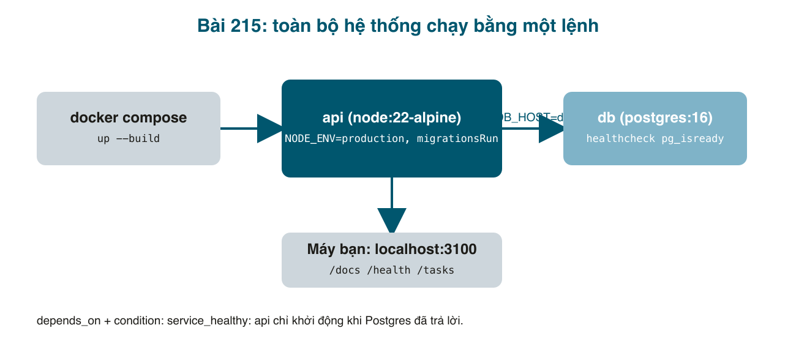

API chạy tốt trên máy mình, có test, giờ đến ngày phải đưa cho người khác dùng: bạn frontend hỏi "tài liệu API đâu?", bạn vận hành hỏi "làm sao biết nó sống hay chết?", và server thật thì không có <mark>npm run start:dev</mark>. Bài cuối series gom những việc "trước khi deploy" mà dự án nào cũng cần: tài liệu tự sinh từ code (Swagger), endpoint <mark>/health</mark>, header bảo mật, migration tự chạy khi khởi động, và đóng gói bằng Docker để một lệnh là cả hệ thống lên.



#### Bước 1: Swagger không cần viết tay
```bash
npm install @nestjs/swagger@^11 @nestjs/terminus@^11 helmet
```
<mark>@nestjs/swagger</mark> sinh tài liệu OpenAPI từ controller. Bình thường phải thêm <mark>@ApiProperty()</mark> vào từng trường DTO; nhưng có một **CLI plugin** đọc luôn kiểu TypeScript và decorator của class-validator để sinh hộ. Bật trong <mark>nest-cli.json</mark>:

```json
// nest-cli.json

{
  "$schema": "https://json.schemastore.org/nest-cli",
  "collection": "@nestjs/schematics",
  "sourceRoot": "src",
  "compilerOptions": {
    "deleteOutDir": true,
    "plugins": [
      {
        "name": "@nestjs/swagger",
        "options": {
          "classValidatorShim": true,
          "introspectComments": true,
          "dtoFileNameSuffix": [".dto.ts", ".entity.ts"]
        }
      }
    ]
  }
}
```

Chỉ cần đặt tên nhóm và đánh dấu route nào cần token:
```typescript
// src/tasks/tasks.controller.ts (một phần)
import { ApiBearerAuth, ApiTags } from '@nestjs/swagger';

@ApiTags('tasks')
@ApiBearerAuth() // tells Swagger UI these routes take the JWT from "Authorize"
@Controller('tasks')
@UseGuards(AuthGuard())
export class TasksController {
```
Tương tự <mark>@ApiTags('auth')</mark> cho AuthController và <mark>@ApiBearerAuth()</mark> riêng cho <mark>GET /auth/me</mark>.

#### Bước 2: health check
Load balancer, Docker, Kubernetes đều hỏi định kỳ "còn sống không?" qua một URL. Trả 200 khi app **và database** ổn, 503 khi không, để họ ngừng gửi traffic tới bản lỗi. <mark>@nestjs/terminus</mark> có sẵn bộ kiểm tra:

```typescript
// src/health/health.controller.ts

import { Controller, Get } from '@nestjs/common';
import { ApiTags } from '@nestjs/swagger';
import {
  HealthCheck,
  HealthCheckService,
  TypeOrmHealthIndicator,
} from '@nestjs/terminus';

// Load balancers, Docker and Kubernetes poll this to know whether to send traffic.
// 200 = alive and the database answers; 503 = take me out of rotation.
@ApiTags('health')
@Controller('health')
export class HealthController {
  constructor(
    private health: HealthCheckService,
    private db: TypeOrmHealthIndicator,
  ) {}

  @Get()
  @HealthCheck()
  check() {
    return this.health.check([() => this.db.pingCheck('database', { timeout: 1500 })]);
  }
}
```

```typescript
// src/health/health.module.ts

import { Module } from '@nestjs/common';
import { TerminusModule } from '@nestjs/terminus';
import { HealthController } from './health.controller';

@Module({
  imports: [TerminusModule],
  controllers: [HealthController],
})
export class HealthModule {}
```

Không có guard: hệ thống giám sát không đăng nhập. Nhưng cũng không trả gì nhạy cảm.

#### Bước 3: migration tự chạy khi production khởi động
Dev và test chạy <mark>npm run migration:run</mark> bằng tay. Trên server, deploy xong ai chạy? Cho app tự làm lúc khởi động, chỉ ở production:
```typescript
// src/app.module.ts (một phần)
        // In production the app applies pending migrations itself at boot
        // (dev and test run "npm run migration:run" explicitly instead).
        migrations: [join(__dirname, 'migrations', '*{.ts,.js}')],
        migrationsRun: config.get('NODE_ENV') === 'production',
```
<mark>__dirname</mark> trỏ vào <mark>dist/</mark> khi chạy bản build, nên glob phải chấp nhận cả <mark>.js</mark>.

#### Bước 4: main.ts cho production
```typescript
// src/main.ts

import { NestFactory } from '@nestjs/core';
import { Logger } from '@nestjs/common';
import { ConfigService } from '@nestjs/config';
import { DocumentBuilder, SwaggerModule } from '@nestjs/swagger';
import helmet from 'helmet';
import { AppModule } from './app.module';
import { configureApp } from './app.setup';

async function bootstrap() {
  const app = configureApp(await NestFactory.create(AppModule));
  const config = app.get(ConfigService);

  // Security headers (no sniffing, no framing, strict transport, ...).
  app.use(helmet());
  // Which browser origins may call this API. "*" is fine for a public API or local dev.
  app.enableCors({ origin: config.get<string>('CORS_ORIGIN', '*') });
  // On SIGTERM (docker stop, Kubernetes), finish in-flight requests and close the DB pool.
  app.enableShutdownHooks();

  // Interactive API docs at /docs, generated from controllers and DTOs.
  const document = SwaggerModule.createDocument(
    app,
    new DocumentBuilder()
      .setTitle('Task Management API')
      .setDescription('NestJS series on thachnguyenp.github.io')
      .setVersion('1.0')
      .addBearerAuth() // the "Authorize" button for JWT
      .build(),
  );
  SwaggerModule.setup('docs', app, document);

  const port = config.get<number>('PORT', 3000);
  await app.listen(port);
  Logger.log(
    `Listening on http://localhost:${port} (${config.get('NODE_ENV')}), docs at /docs`,
    'Bootstrap',
  );
}
void bootstrap();
```

- <mark>helmet()</mark>: một dòng thêm cả bộ header (<mark>X-Content-Type-Options</mark>, <mark>Strict-Transport-Security</mark>, <mark>X-Frame-Options</mark>...). Không thay thế được xác thực, nhưng chặn vài lớp tấn công rẻ tiền.
- <mark>enableCors</mark> với <mark>CORS_ORIGIN</mark> từ <mark>.env</mark> (thêm vào Joi với mặc định <mark>'*'</mark>): production đặt đúng domain của frontend.
- <mark>enableShutdownHooks</mark>: khi Docker gửi SIGTERM, Nest đợi request đang xử lý xong và đóng kết nối database thay vì chết giữa chừng.
- Swagger UI ở <mark>/docs</mark>, JSON ở <mark>/docs-json</mark>. Nút **Authorize** nhận JWT nhờ <mark>addBearerAuth()</mark>.

#### Chạy thật ở chế độ dev
```bash
npm run build && node dist/main
# LOG [Bootstrap] Listening on http://localhost:3100 (development), docs at /docs

curl localhost:3100/health
# {"status":"ok","info":{"database":{"status":"up"}},"error":{},"details":{"database":{"status":"up"}}}   [200]

curl localhost:3100/docs-json | python3 -c 'import sys,json; d=json.load(sys.stdin); print(sorted(d["paths"]))'
# ['/auth/me', '/auth/signin', '/auth/signup', '/health', '/tasks', '/tasks/{id}']
```
Schema của <mark>CreateTaskDto</mark> mà plugin sinh ra, đúng theo decorator class-validator:
```json
{"type":"object","properties":{"title":{"type":"string","maxLength":100},"description":{"type":"string","maxLength":1000}},"required":["title","description"]}
```
Và <mark>UpdateTaskDto</mark> có <mark>"enum":["OPEN","IN_PROGRESS","DONE"]</mark>. Header từ helmet và CORS:
```
Strict-Transport-Security: max-age=31536000; includeSubDomains
X-Content-Type-Options: nosniff
X-Frame-Options: SAMEORIGIN
Access-Control-Allow-Origin: *
```
Mở <mark>http://localhost:3100/docs</mark> trong trình duyệt: bấm Authorize, dán token, thử từng endpoint ngay trên trang.

#### Chạy thật ở chế độ production, database trống
```bash
createdb -U postgres task_management_prod
NODE_ENV=production DB_NAME=task_management_prod PORT=3102 node dist/main
# LOG [Bootstrap] Listening on http://localhost:3102 (production), docs at /docs
```
Biến đặt trên dòng lệnh thắng <mark>.env</mark>. Ba migration đã tự chạy: database có <mark>migrations, tasks, users</mark>, và <mark>/health</mark> trả 200.

#### Bước 5: Docker
```dockerfile
# Dockerfile

# ---- 1. build: TypeScript -> dist/ ----
FROM node:22-alpine AS build
WORKDIR /app
COPY package*.json ./
RUN npm ci
COPY . .
RUN npm run build

# ---- 2. runtime: only what "node dist/main" needs ----
FROM node:22-alpine
ENV NODE_ENV=production
WORKDIR /app
COPY package*.json ./
RUN npm ci --omit=dev && npm cache clean --force
COPY --from=build /app/dist ./dist
# Run as a normal user, not root.
USER node
EXPOSE 3000
CMD ["node", "dist/main"]
```

Hai giai đoạn: giai đoạn đầu có TypeScript và devDependencies để build; giai đoạn hai chỉ copy <mark>dist/</mark> và cài <mark>--omit=dev</mark>. Ảnh cuối không có compiler, nhỏ hơn và ít bề mặt tấn công hơn. <mark>USER node</mark>: không chạy bằng root trong container.

```bash
# .dockerignore

node_modules
dist
coverage
.git
.env
.env.*
!.env.example
*.log
```

<mark>.env*</mark> bị loại: cấu hình vào container qua biến môi trường của compose/orchestrator, không nướng vào ảnh.

```yaml
# docker-compose.yml

# docker compose up --build   ->  API on http://localhost:3100, Postgres on 5433
services:
  db:
    image: postgres:16-alpine
    environment:
      POSTGRES_USER: postgres
      POSTGRES_PASSWORD: postgres
      POSTGRES_DB: task_management
    ports:
      - "5433:5432" # 5433 on the host so it does not clash with a local Postgres
    volumes:
      - pgdata:/var/lib/postgresql/data
    healthcheck:
      test: ["CMD-SHELL", "pg_isready -U postgres"]
      interval: 5s
      timeout: 3s
      retries: 10

  api:
    build: .
    environment:
      NODE_ENV: production
      PORT: 3000
      DB_HOST: db # the service name is the hostname inside the compose network
      DB_PORT: 5432
      DB_USERNAME: postgres
      DB_PASSWORD: postgres
      DB_NAME: task_management
      JWT_SECRET: ${JWT_SECRET:-compose-dev-secret-change-me-0123456789abcdef}
      CORS_ORIGIN: "*"
    ports:
      - "3100:3000"
    depends_on:
      db:
        condition: service_healthy # wait until Postgres answers before starting the API

volumes:
  pgdata:
```

<mark>DB_HOST: db</mark>: trong mạng của compose, tên service là hostname. <mark>depends_on</mark> với <mark>condition: service_healthy</mark>: api chỉ khởi động khi <mark>pg_isready</mark> trả lời; không có dòng này, api lên trước Postgres và chết với ECONNREFUSED.

```bash
docker compose up --build -d
#  Container nestjs-task-management-db-1   Healthy
#  Container nestjs-task-management-api-1  Started

docker compose logs api
# [Nest] 1  - LOG [Bootstrap] Listening on http://localhost:3000 (production), docs at /docs

curl localhost:3100/health
# {"status":"ok","info":{"database":{"status":"up"}},...}   [200]
curl -X POST localhost:3100/auth/signup -H 'content-type: application/json' -d '{"username":"docker","password":"Secret123"}'
# {"id":1,"username":"docker"}   [201]

docker images | grep nestjs-task-management
# nestjs-task-management-api   latest   277MB

docker compose down -v     # dừng và xoá volume dữ liệu
```
Process id trong log là 1: app là tiến trình chính của container, nhận SIGTERM trực tiếp, đúng điều <mark>enableShutdownHooks</mark> cần.

#### Mẹo và lỗi hay gặp
- **Swagger không hiện trường của DTO**: plugin chỉ chạy qua <mark>nest build</mark> / <mark>nest start</mark>, không qua <mark>tsc</mark> thuần hay ts-jest. Và tên file phải khớp <mark>dtoFileNameSuffix</mark>.
- **<mark>/docs</mark> trên production**: tuỳ chính sách. API nội bộ thì để; API công khai cân nhắc tắt (<mark>if (NODE_ENV !== 'production')</mark>) hoặc đặt sau xác thực.
- **Health check làm database bận**: <mark>pingCheck</mark> chạy <mark>SELECT 1</mark>, rất nhẹ. Nhưng đừng cho nó gọi API bên thứ ba; health của bạn không nên phụ thuộc vào uptime của người khác.
- **Migration tự chạy với nhiều bản api cùng lúc**: TypeORM khoá bảng <mark>migrations</mark>, bản thứ hai sẽ đợi hoặc thấy đã xong. Với hệ thống lớn, tách migration thành một job riêng chạy trước khi rollout.
- **Ảnh Docker 277 MB** vẫn chủ yếu là <mark>node_modules</mark> production. Xem <mark>npm ls --omit=dev</mark> để biết ai nặng; <mark>bcrypt</mark> có binary native, nếu build trên máy ARM rồi chạy trên x86 phải build trong container (Dockerfile này làm đúng vậy nhờ <mark>npm ci</mark> ở giai đoạn runtime).
- **<mark>JWT_SECRET</mark> trong compose**: giá trị mặc định ở đây chỉ để chạy thử. Production đọc từ secret manager hoặc biến môi trường của máy, không ghi vào file.
- **Postgres cổng 5433 trên máy**: để không đụng Postgres cài sẵn ở 5432. Trong container vẫn là 5432.

#### Checklist
- <mark>/docs</mark> hiện 6 đường dẫn, DTO có <mark>maxLength</mark> và <mark>enum</mark> mà không viết <mark>@ApiProperty</mark> nào.
- <mark>/health</mark>: 200 khi Postgres chạy; tắt Postgres thì 503.
- <mark>NODE_ENV=production</mark> trên database trống: migration tự chạy, không cần lệnh tay.
- <mark>docker compose up --build</mark>: đăng ký được user qua <mark>localhost:3100</mark>; <mark>down -v</mark> dọn sạch.

Mã nguồn cuối bài: [post_215.zip](/assets/code/post_215.zip).

#### Bài tập thêm
- Thêm một GitHub Actions workflow: cài Postgres service, chạy <mark>npm test</mark> và <mark>npm run test:e2e</mark> ở mỗi pull request.
- Tắt <mark>/docs</mark> khi <mark>NODE_ENV=production</mark>, hoặc bảo vệ bằng basic auth.
- Thêm <mark>MemoryHealthIndicator</mark> của terminus: cảnh báo khi heap vượt 300 MB.
- Đọc lại 10 bài và viết README cho repo: cách chạy dev, test, docker, và danh sách biến môi trường. Đó là thứ người tiếp theo nhận project sẽ đọc đầu tiên.
