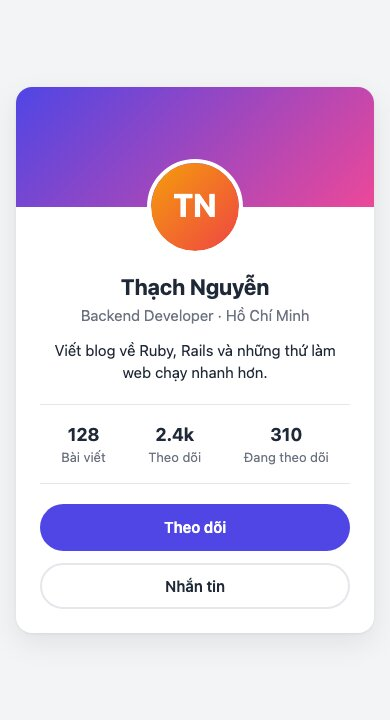
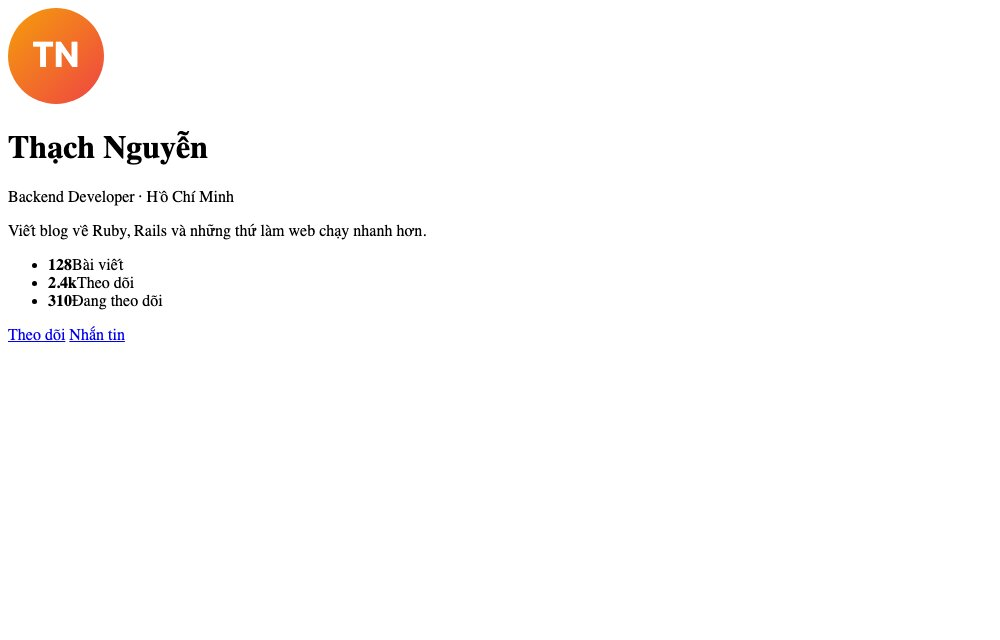
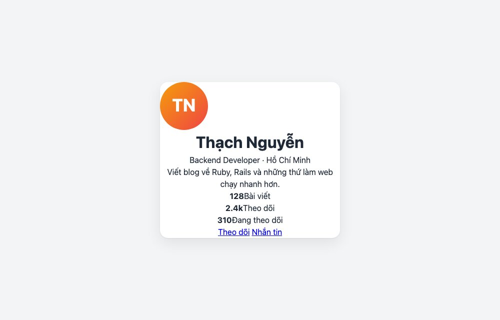
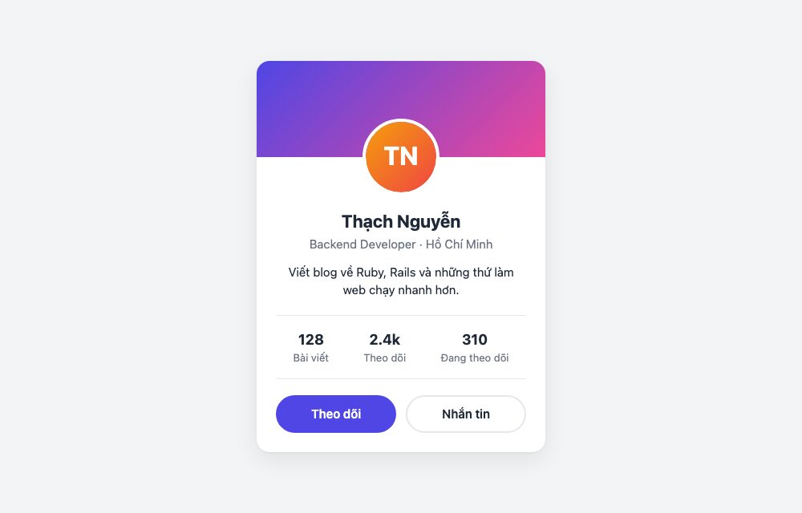

Bài thực hành đầu tiên: một card hồ sơ người dùng. Nhỏ, nhưng đủ để đi hết 7 bước của bài 129 và làm quen với BEM, token, flexbox, hover.

#### Kết quả cần đạt


Trên điện thoại card chiếm hết chiều ngang và hai nút xếp dọc.



Mã nguồn đầy đủ: [index.html](/assets/code/post_130/index.html), [style.css](/assets/code/post_130/style.css), [avatar.svg](/assets/code/post_130/avatar.svg). Tạo thư mục, lưu 3 file này vào, mở <mark>index.html</mark> bằng trình duyệt.

#### Bước 1: Tách component
Nhìn ảnh và liệt kê từ ngoài vào trong
```
card
├── cover          ảnh bìa gradient
├── avatar         ảnh tròn đè lên cover
└── body
    ├── name
    ├── title       nghề nghiệp · thành phố
    ├── bio
    ├── stats       3 cột, có đường kẻ trên dưới
    │   └── stat × 3
    │       ├── value
    │       └── label
    └── actions
        └── btn × 2   primary (đặc), outline (viền)
```
<mark>stat</mark> và <mark>btn</mark> tách thành block riêng vì chúng lặp lại và dùng được ở nơi khác.

#### Bước 2: Đặt tên

| Khối | Class |
|---|---|
| Card và các phần | <mark>.card</mark>, <mark>.card__cover</mark>, <mark>.card__avatar</mark>, <mark>.card__body</mark>, <mark>.card__name</mark>, <mark>.card__title</mark>, <mark>.card__bio</mark>, <mark>.card__stats</mark>, <mark>.card__actions</mark> |
| Một ô số liệu | <mark>.stat</mark>, <mark>.stat__value</mark>, <mark>.stat__label</mark> |
| Nút | <mark>.btn</mark>, <mark>.btn--primary</mark>, <mark>.btn--outline</mark> |

#### Bước 3: HTML
```html
<!doctype html>
<html lang="vi">
<head>
  <meta charset="utf-8">
  <meta name="viewport" content="width=device-width, initial-scale=1">
  <title>Profile card</title>
  <link rel="stylesheet" href="style.css">
</head>
<body>
  <article class="card">
    <div class="card__cover"></div>
    

    <div class="card__body">
      <h1 class="card__name">Thạch Nguyễn</h1>
      <p class="card__title">Backend Developer · Hồ Chí Minh</p>
      <p class="card__bio">Viết blog về Ruby, Rails và những thứ làm web chạy nhanh hơn.</p>

      <ul class="card__stats">
        <li class="stat"><strong class="stat__value">128</strong><span class="stat__label">Bài viết</span></li>
        <li class="stat"><strong class="stat__value">2.4k</strong><span class="stat__label">Theo dõi</span></li>
        <li class="stat"><strong class="stat__value">310</strong><span class="stat__label">Đang theo dõi</span></li>
      </ul>

      <div class="card__actions">
        <a class="btn btn--primary" href="#">Theo dõi</a>
        <a class="btn btn--outline" href="#">Nhắn tin</a>
      </div>
    </div>
  </article>
</body>
</html>
```
Để ý các thẻ: <mark>article</mark> cho card (nội dung độc lập), <mark>h1</mark> cho tên, <mark>ul</mark>/<mark>li</mark> cho danh sách số liệu, <mark>a</mark> cho nút vì chúng dẫn tới trang khác. <mark>alt</mark> của ảnh mô tả ảnh là gì.

Ảnh đại diện là một file SVG vẽ chữ cái đầu, để không phụ thuộc ảnh bên ngoài
```html
<svg xmlns="http://www.w3.org/2000/svg" viewBox="0 0 120 120">
  <defs>
    <linearGradient id="g" x1="0" y1="0" x2="1" y2="1">
      <stop offset="0" stop-color="#f59e0b"/><stop offset="1" stop-color="#ef4444"/>
    </linearGradient>
  </defs>
  <circle cx="60" cy="60" r="60" fill="url(#g)"/>
  <text x="60" y="74" text-anchor="middle" font-family="system-ui, sans-serif" font-size="44" font-weight="700" fill="#fff">TN</text>
</svg>
```
Mở trang lúc này



Chữ đen nền trắng, xếp dọc, nhưng **đọc được và đúng thứ tự**. Đó là dấu hiệu HTML đã tốt. Nếu tắt CSS mà trang không đọc được thì cấu trúc có vấn đề.

**Mẹo:** để ý <mark>width="96" height="96"</mark> trên thẻ <mark>img</mark>. Lần đầu tôi quên, và file SVG không có kích thước đã phình ra **chiếm cả màn hình**, vì SVG co giãn theo chiều rộng khả dụng. Luôn ghi kích thước thật của ảnh vào HTML: trình duyệt giữ chỗ đúng cỡ trước khi tải xong, trang không bị nhảy.

#### Bước 4: Token, reset và layout
```css
/* ===== 1. Token & reset ===== */
:root {
  --color-primary: #4f46e5;
  --color-primary-dark: #4338ca;
  --color-text: #1f2937;
  --color-muted: #6b7280;
  --color-bg: #f3f4f6;
  --color-surface: #ffffff;
  --color-border: #e5e7eb;
  --radius: 16px;
  --shadow: 0 1px 3px rgba(0, 0, 0, 0.06), 0 10px 30px rgba(0, 0, 0, 0.08);
  --font: system-ui, -apple-system, "Segoe UI", Roboto, sans-serif;
}

*,
*::before,
*::after {
  box-sizing: border-box;
  margin: 0;
  padding: 0;
}

body {
  font-family: var(--font);
  color: var(--color-text);
  background: var(--color-bg);
  line-height: 1.5;
}

img {
  display: block;
  max-width: 100%;
}

/* ===== 2. Layout ===== */
body {
  min-height: 100vh;
  display: grid;
  place-items: center;
  padding: 24px;
}

.card {
  width: 360px;
  background: var(--color-surface);
  border-radius: var(--radius);
  box-shadow: var(--shadow);
  overflow: hidden;
  text-align: center;
}
```
Trang lúc này



Card đã nằm giữa màn hình, có nền trắng và bo góc. Bên trong vẫn lộn xộn, đó là việc của bước sau.

**Mẹo:** khi không hiểu vì sao một khối nằm sai chỗ, thêm tạm <mark>* { outline: 1px solid red; }</mark> vào đầu CSS để thấy viền của mọi phần tử, hoặc rê chuột lên phần tử trong tab Elements của DevTools để thấy vùng xanh (content) và cam (margin) của nó. Xong thì xóa.

Hai điều đáng học ở đây:
- <mark>display: grid; place-items: center</mark> trên <mark>body</mark> với <mark>min-height: 100vh</mark>: cách ngắn nhất để căn giữa một thứ cả ngang lẫn dọc.
- <mark>overflow: hidden</mark> trên card: để ảnh bìa bên trong bị cắt theo bo góc của card.

#### Bước 5: Style từng component
```css
/* ===== 3. Component ===== */
.card__cover {
  height: 120px;
  background: linear-gradient(135deg, #4f46e5, #ec4899);
}

.card__avatar {
  width: 96px;
  height: 96px;
  margin: -48px auto 0;
  border-radius: 50%;
  border: 4px solid var(--color-surface);
}

.card__body {
  padding: 16px 24px 24px;
}

.card__name {
  font-size: 1.375rem;
  font-weight: 700;
}

.card__title {
  color: var(--color-muted);
  font-size: 0.9375rem;
}

.card__bio {
  margin-top: 12px;
  font-size: 0.9375rem;
}

.card__stats {
  display: flex;
  justify-content: space-around;
  list-style: none;
  margin: 20px 0;
  padding: 16px 0;
  border-top: 1px solid var(--color-border);
  border-bottom: 1px solid var(--color-border);
}

.stat {
  display: flex;
  flex-direction: column;
}

.stat__value {
  font-size: 1.125rem;
}

.stat__label {
  font-size: 0.8125rem;
  color: var(--color-muted);
}

.card__actions {
  display: flex;
  gap: 12px;
}

.btn {
  flex: 1;
  padding: 10px 16px;
  border-radius: 999px;
  font-weight: 600;
  font-size: 0.9375rem;
  text-decoration: none;
  text-align: center;
  border: 2px solid transparent;
}

.btn--primary {
  background: var(--color-primary);
  color: #fff;
}

.btn--outline {
  border-color: var(--color-border);
  color: var(--color-text);
}
```
Trang lúc này gần như hoàn chỉnh



**Mẹo:** làm từ trên xuống, mỗi lần một element: viết CSS cho <mark>.card__cover</mark>, lưu, nhìn trình duyệt, rồi mới sang <mark>.card__avatar</mark>. Đừng viết 80 dòng CSS rồi mới xem, lúc đó không biết lỗi ở dòng nào.

Những kỹ thuật nhỏ nhưng dùng mãi:
- **Avatar đè lên cover**: <mark>margin-top: -48px</mark> (nửa chiều cao avatar) kéo nó lên, <mark>margin: auto</mark> hai bên căn giữa. Viền trắng 4px tạo cảm giác nổi.
- **Đường kẻ của stats** là <mark>border-top</mark>/<mark>border-bottom</mark> của chính danh sách, không cần thẻ <mark>hr</mark>.
- **<mark>.btn</mark> có <mark>border: 2px solid transparent</mark>** ngay từ block gốc, để nút primary và outline **cao bằng nhau**. Nếu chỉ outline mới có border, nó sẽ cao hơn 4px.
- <mark>flex: 1</mark> trên nút để hai nút chia đều chiều ngang.

#### Bước 6: Hiệu ứng
```css
/* ===== 4. Hiệu ứng ===== */
.card {
  transition: transform 0.25s ease, box-shadow 0.25s ease;
}

.card:hover {
  transform: translateY(-6px);
  box-shadow: 0 4px 6px rgba(0, 0, 0, 0.06), 0 20px 40px rgba(0, 0, 0, 0.12);
}

.card__avatar {
  transition: transform 0.25s ease;
}

.card:hover .card__avatar {
  transform: scale(1.05);
}

.btn {
  transition: background-color 0.2s ease, border-color 0.2s ease, transform 0.1s ease;
}

.btn--primary:hover {
  background: var(--color-primary-dark);
}

.btn--outline:hover {
  border-color: var(--color-primary);
  color: var(--color-primary);
}

.btn:active {
  transform: scale(0.97);
}
```
<mark>transition</mark> đặt ở trạng thái **bình thường**, không phải trong <mark>:hover</mark>, để hiệu ứng chạy cả lúc rê vào lẫn lúc rê ra. Card nhấc lên và bóng đậm hơn cùng lúc tạo cảm giác "nổi"; nút <mark>:active</mark> co nhẹ tạo cảm giác bấm.

<mark>.card:hover .card__avatar</mark> là trường hợp hiếm hoi dùng selector 2 cấp trong BEM: trạng thái của cha ảnh hưởng con. Chấp nhận được.

**Mẹo:** hiệu ứng hover khó chỉnh vì cứ rời chuột là mất. Trong DevTools, tab Elements, chọn phần tử rồi bấm nút <mark>:hov</mark> và tick <mark>:hover</mark>, trình duyệt sẽ giữ trạng thái hover để bạn sửa CSS thoải mái.

#### Bước 7: Responsive
```css
/* ===== 5. Responsive ===== */
@media (max-width: 400px) {
  body {
    padding: 16px;
  }

  .card {
    width: 100%;
  }

  .card__actions {
    flex-direction: column;
  }
}
```
Card rộng cố định 360px, trên màn hình 375px sẽ tràn. Dưới 400px cho nó chiếm hết chiều ngang và xếp 2 nút dọc. Chỉ 3 thay đổi, vì phần còn lại vốn đã co giãn được.

Kiểm tra bằng DevTools: bật Toggle device toolbar, chọn iPhone SE, xem card có khớp ảnh mobile ở đầu bài không.

**Mẹo:** viết media query ở **cuối file**, sau mọi CSS khác. CSS đọc từ trên xuống, quy tắc sau đè quy tắc trước; media query đặt ở trên sẽ bị CSS desktop phía dưới ghi đè và bạn sẽ tưởng nó "không chạy".

#### Checklist trước khi xong
- Mở DevTools, không có lỗi đỏ ở Console (thường là sai đường dẫn file CSS/ảnh).
- Tab với phím Tab: hai nút lần lượt được focus và có viền (trình duyệt tự vẽ, đừng xóa <mark>outline</mark>).
- Thu nhỏ cửa sổ tới 320px: không có thanh cuộn ngang.
- Mọi màu lấy từ token, không có mã màu lẻ trong phần component (trừ gradient cover).

#### Bài tập thêm
- Thêm modifier <mark>.card--dark</mark>: nền tối, chữ sáng. Chỉ cần ghi đè vài token bên trong <mark>.card--dark { --color-surface: #111827; ... }</mark>.
- Thêm một hàng icon mạng xã hội dưới nút (gợi ý: block mới <mark>.social</mark> với <mark>.social__link</mark>).
- Đặt 3 card cạnh nhau trong một <mark>.team</mark> dùng grid, xem bài 131 để biết cách.
