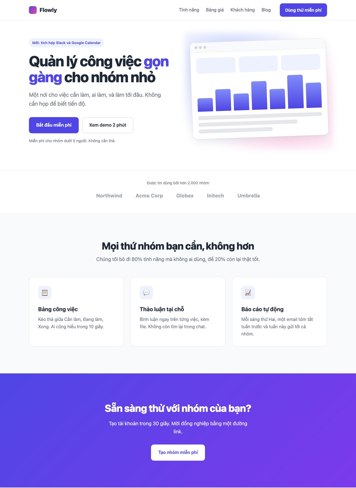
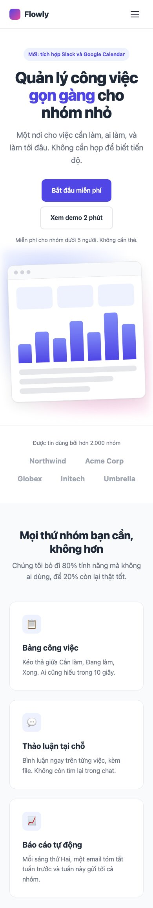
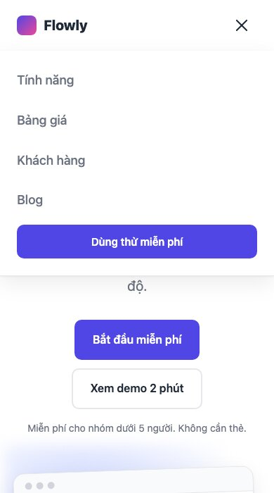
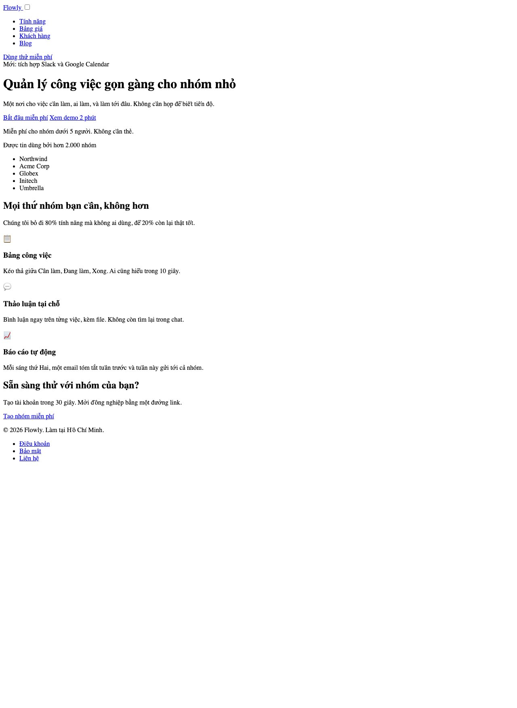
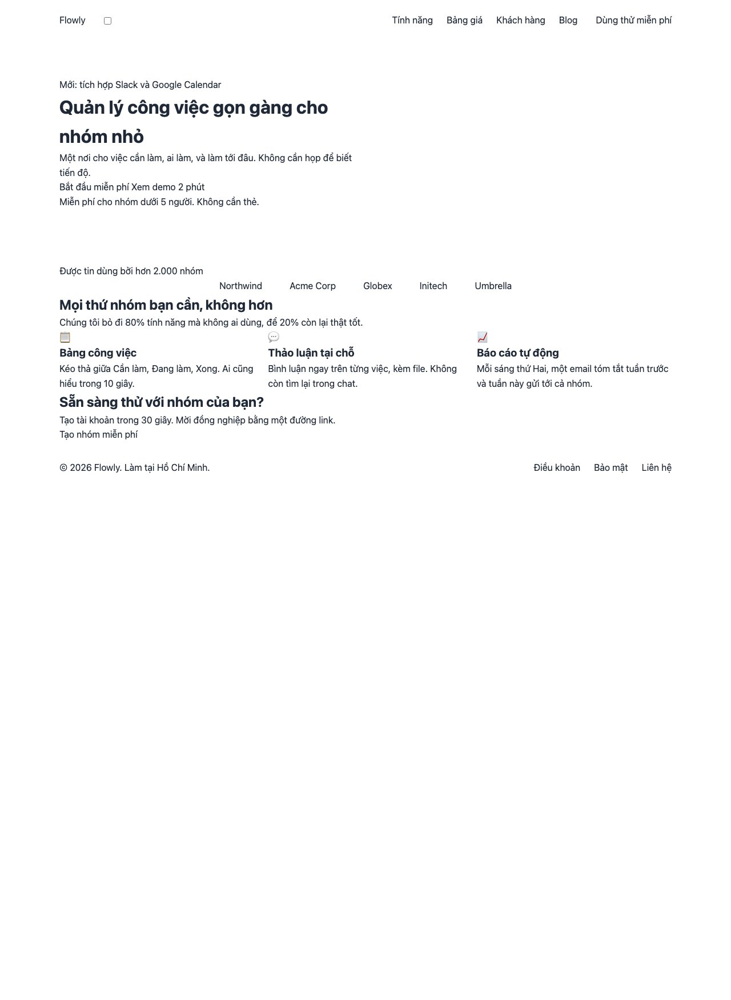
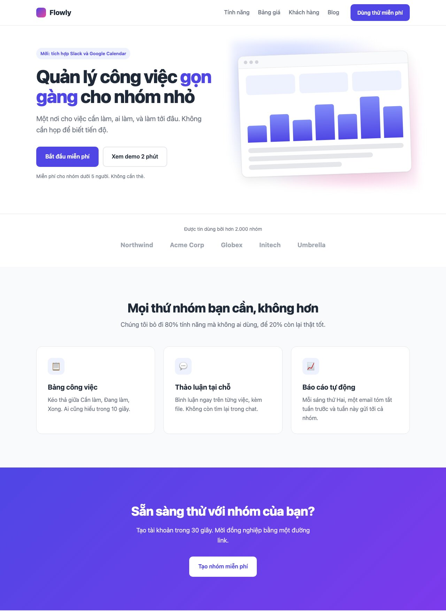

Bài 3 là trang đầu tiên có **nhiều section**: header dính trên cùng, hero 2 cột, dải logo khách hàng, 3 tính năng, khối kêu gọi hành động, footer. Kỹ năng mới: container dùng chung, header sticky, vẽ "ảnh minh họa" bằng CSS, animation khi tải trang, và menu di động **không cần JavaScript**.

#### Kết quả cần đạt


Trên điện thoại, menu thu thành nút 3 gạch; bấm vào mở menu dọc.




Mã nguồn: [index.html](/assets/code/post_132/index.html), [style.css](/assets/code/post_132/style.css).

#### Bước 1: Tách component
Trang dài thì tách theo 2 tầng: **section** trước, rồi component bên trong từng section
```
header
├── logo (mark + text)
├── nav-toggle (checkbox + nút 3 gạch, chỉ hiện trên mobile)
└── nav
    ├── nav__list > nav__item > nav__link × 4
    └── btn
hero
├── hero__content: eyebrow, title (có highlight), text, actions (2 btn), note
└── hero__visual: mockup (cửa sổ app giả vẽ bằng CSS)
logos: label + list > item × 5
features: section-head + features__grid > feature × 3 (icon, title, text)
cta: title, text, btn
footer: copy + links
```
Nhìn vào tree, có 2 thứ xuất hiện ở nhiều section và nên là block riêng: <mark>btn</mark> (4 biến thể) và <mark>section-head</mark> (tiêu đề + mô tả căn giữa, bài sau còn dùng). <mark>container</mark> cũng là block riêng: khối giới hạn chiều rộng, mọi section đều bọc nội dung trong nó.

#### Bước 2: Đặt tên

| Khối | Class |
|---|---|
| Khung | <mark>.container</mark>, <mark>.header</mark>, <mark>.header__inner</mark>, <mark>.footer</mark>, <mark>.footer__inner</mark>, <mark>.footer__copy</mark>, <mark>.footer__links</mark>, <mark>.footer__link</mark> |
| Logo, menu | <mark>.logo</mark>, <mark>.logo__mark</mark>, <mark>.logo__text</mark>, <mark>.nav</mark>, <mark>.nav__list</mark>, <mark>.nav__item</mark>, <mark>.nav__link</mark>, <mark>.nav-toggle</mark>, <mark>.nav-toggle__btn</mark>, <mark>.nav-toggle__bar</mark> |
| Hero | <mark>.hero</mark>, <mark>.hero__inner</mark>, <mark>.hero__content</mark>, <mark>.hero__title</mark>, <mark>.hero__highlight</mark>, <mark>.hero__text</mark>, <mark>.hero__actions</mark>, <mark>.hero__note</mark>, <mark>.hero__visual</mark>, <mark>.eyebrow</mark> |
| Mockup | <mark>.mockup</mark>, <mark>.mockup__bar</mark>, <mark>.mockup__dot</mark>, <mark>.mockup__body</mark>, <mark>.mockup__stats</mark>, <mark>.mockup__stat</mark>, <mark>.mockup__chart</mark>, <mark>.mockup__col</mark>, <mark>.mockup__rows</mark>, <mark>.mockup__row</mark> |
| Các section | <mark>.logos</mark>, <mark>.logos__label</mark>, <mark>.logos__list</mark>, <mark>.logos__item</mark>, <mark>.features</mark>, <mark>.features__grid</mark>, <mark>.feature</mark>, <mark>.feature__icon</mark>, <mark>.feature__title</mark>, <mark>.feature__text</mark>, <mark>.section-head</mark>, <mark>.section-head__title</mark>, <mark>.section-head__text</mark>, <mark>.cta</mark>, <mark>.cta__inner</mark>, <mark>.cta__title</mark>, <mark>.cta__text</mark> |
| Nút | <mark>.btn</mark>, <mark>.btn--primary</mark>, <mark>.btn--ghost</mark>, <mark>.btn--light</mark>, <mark>.btn--sm</mark> |

Để ý <mark>.nav-toggle</mark> là một block riêng (không phải <mark>.nav__toggle</mark>) vì nó đứng ngoài <mark>.nav</mark> trong HTML, và phải đứng ngoài để CSS chọn được <mark>.nav</mark> là "anh em" của nó.

#### Bước 3: HTML
```html
<!doctype html>
<html lang="vi">
<head>
  <meta charset="utf-8">
  <meta name="viewport" content="width=device-width, initial-scale=1">
  <title>Flowly - Quản lý công việc cho nhóm nhỏ</title>
  <link rel="stylesheet" href="style.css">
</head>
<body>
  <header class="header">
    <div class="container header__inner">
      <a class="logo" href="#">
        <span class="logo__mark"></span>
        <span class="logo__text">Flowly</span>
      </a>

      <input class="nav-toggle" type="checkbox" id="nav-toggle" aria-label="Mở menu">
      <label class="nav-toggle__btn" for="nav-toggle">
        <span class="nav-toggle__bar"></span>
        <span class="nav-toggle__bar"></span>
        <span class="nav-toggle__bar"></span>
      </label>

      <nav class="nav">
        <ul class="nav__list">
          <li class="nav__item"><a class="nav__link" href="#features">Tính năng</a></li>
          <li class="nav__item"><a class="nav__link" href="#">Bảng giá</a></li>
          <li class="nav__item"><a class="nav__link" href="#">Khách hàng</a></li>
          <li class="nav__item"><a class="nav__link" href="#">Blog</a></li>
        </ul>
        <a class="btn btn--primary btn--sm" href="#">Dùng thử miễn phí</a>
      </nav>
    </div>
  </header>

  <main>
    <section class="hero">
      <div class="container hero__inner">
        <div class="hero__content">
          <span class="eyebrow">Mới: tích hợp Slack và Google Calendar</span>
          <h1 class="hero__title">Quản lý công việc <span class="hero__highlight">gọn gàng</span> cho nhóm nhỏ</h1>
          <p class="hero__text">Một nơi cho việc cần làm, ai làm, và làm tới đâu. Không cần họp để biết tiến độ.</p>
          <div class="hero__actions">
            <a class="btn btn--primary" href="#">Bắt đầu miễn phí</a>
            <a class="btn btn--ghost" href="#">Xem demo 2 phút</a>
          </div>
          <p class="hero__note">Miễn phí cho nhóm dưới 5 người. Không cần thẻ.</p>
        </div>

        <div class="hero__visual">
          <div class="mockup">
            <div class="mockup__bar">
              <span class="mockup__dot"></span><span class="mockup__dot"></span><span class="mockup__dot"></span>
            </div>
            <div class="mockup__body">
              <div class="mockup__stats">
                <div class="mockup__stat"></div>
                <div class="mockup__stat"></div>
                <div class="mockup__stat"></div>
              </div>
              <div class="mockup__chart">
                <span class="mockup__col"></span><span class="mockup__col"></span><span class="mockup__col"></span>
                <span class="mockup__col"></span><span class="mockup__col"></span><span class="mockup__col"></span>
                <span class="mockup__col"></span>
              </div>
              <div class="mockup__rows">
                <div class="mockup__row"></div>
                <div class="mockup__row"></div>
                <div class="mockup__row"></div>
              </div>
            </div>
          </div>
        </div>
      </div>
    </section>

    <section class="logos">
      <div class="container">
        <p class="logos__label">Được tin dùng bởi hơn 2.000 nhóm</p>
        <ul class="logos__list">
          <li class="logos__item">Northwind</li>
          <li class="logos__item">Acme Corp</li>
          <li class="logos__item">Globex</li>
          <li class="logos__item">Initech</li>
          <li class="logos__item">Umbrella</li>
        </ul>
      </div>
    </section>

    <section class="features" id="features">
      <div class="container">
        <div class="section-head">
          <h2 class="section-head__title">Mọi thứ nhóm bạn cần, không hơn</h2>
          <p class="section-head__text">Chúng tôi bỏ đi 80% tính năng mà không ai dùng, để 20% còn lại thật tốt.</p>
        </div>

        <div class="features__grid">
          <article class="feature">
            <span class="feature__icon">📋</span>
            <h3 class="feature__title">Bảng công việc</h3>
            <p class="feature__text">Kéo thả giữa Cần làm, Đang làm, Xong. Ai cũng hiểu trong 10 giây.</p>
          </article>
          <article class="feature">
            <span class="feature__icon">💬</span>
            <h3 class="feature__title">Thảo luận tại chỗ</h3>
            <p class="feature__text">Bình luận ngay trên từng việc, kèm file. Không còn tìm lại trong chat.</p>
          </article>
          <article class="feature">
            <span class="feature__icon">📈</span>
            <h3 class="feature__title">Báo cáo tự động</h3>
            <p class="feature__text">Mỗi sáng thứ Hai, một email tóm tắt tuần trước và tuần này gửi tới cả nhóm.</p>
          </article>
        </div>
      </div>
    </section>

    <section class="cta">
      <div class="container cta__inner">
        <h2 class="cta__title">Sẵn sàng thử với nhóm của bạn?</h2>
        <p class="cta__text">Tạo tài khoản trong 30 giây. Mời đồng nghiệp bằng một đường link.</p>
        <a class="btn btn--light" href="#">Tạo nhóm miễn phí</a>
      </div>
    </section>
  </main>

  <footer class="footer">
    <div class="container footer__inner">
      <p class="footer__copy">© 2026 Flowly. Làm tại Hồ Chí Minh.</p>
      <ul class="footer__links">
        <li><a class="footer__link" href="#">Điều khoản</a></li>
        <li><a class="footer__link" href="#">Bảo mật</a></li>
        <li><a class="footer__link" href="#">Liên hệ</a></li>
      </ul>
    </div>
  </footer>
</body>
</html>
```
Mở trang



Những chỗ đáng chú ý trong HTML:
- Bộ ba <mark>header</mark> / <mark>main</mark> / <mark>footer</mark>, và mỗi section là <mark>section</mark> có tiêu đề <mark>h2</mark>. Chỉ có **một** <mark>h1</mark>, là tiêu đề hero.
- Ô vuông nhỏ cạnh logo là checkbox <mark>.nav-toggle</mark>, nó sẽ điều khiển menu di động ở bước 7. Checkbox đứng **trước** <mark>label</mark> và <mark>nav</mark>, để CSS chọn được chúng bằng <mark>+</mark> và <mark>~</mark>.
- Mockup là một đống <mark>div</mark>/<mark>span</mark> rỗng: chúng chỉ để trang trí, không có nội dung, nên dùng <mark>div</mark> là đúng. Trong thực tế đây sẽ là một ảnh chụp màn hình <mark>img</mark>.

**Mẹo:** gõ <mark>!</mark> rồi Tab trong VS Code để sinh khung HTML chuẩn. Gõ <mark>ul.nav__list>li.nav__item*4>a.nav__link</mark> rồi Tab để sinh cả danh sách (cú pháp Emmet). Tiết kiệm rất nhiều thời gian với HTML lặp lại.

#### Bước 4: Layout
```css
/* ===== 1. Token & reset ===== */
:root {
  --color-primary: #4f46e5;
  --color-primary-dark: #4338ca;
  --color-primary-soft: #eef2ff;
  --color-text: #1f2937;
  --color-muted: #6b7280;
  --color-bg: #ffffff;
  --color-bg-alt: #f9fafb;
  --color-border: #e5e7eb;
  --radius: 16px;
  --shadow: 0 1px 3px rgba(0, 0, 0, 0.06), 0 10px 30px rgba(0, 0, 0, 0.08);
  --font: system-ui, -apple-system, "Segoe UI", Roboto, sans-serif;
  --header-height: 72px;
}

*,
*::before,
*::after {
  box-sizing: border-box;
  margin: 0;
  padding: 0;
}

html {
  scroll-behavior: smooth;
}

body {
  font-family: var(--font);
  color: var(--color-text);
  background: var(--color-bg);
  line-height: 1.6;
}

img {
  display: block;
  max-width: 100%;
}

ul {
  list-style: none;
}

a {
  color: inherit;
  text-decoration: none;
}

/* ===== 2. Layout ===== */
.container {
  max-width: 1120px;
  margin: 0 auto;
  padding: 0 24px;
}

.header__inner {
  height: var(--header-height);
  display: flex;
  align-items: center;
  gap: 32px;
}

.nav {
  margin-left: auto;
  display: flex;
  align-items: center;
  gap: 32px;
}

.nav__list {
  display: flex;
  gap: 24px;
}

.hero__inner {
  display: grid;
  grid-template-columns: 1.1fr 1fr;
  align-items: center;
  gap: 48px;
  padding-top: 64px;
  padding-bottom: 96px;
}

.logos__list {
  display: flex;
  justify-content: center;
  flex-wrap: wrap;
  gap: 16px 48px;
}

.features__grid {
  display: grid;
  grid-template-columns: repeat(3, 1fr);
  gap: 24px;
}

.footer__inner {
  display: flex;
  justify-content: space-between;
  align-items: center;
  flex-wrap: wrap;
  gap: 16px;
  padding: 32px 24px;
}

.footer__links {
  display: flex;
  gap: 24px;
}
```
Trang lúc này



Chưa có màu nhưng **mọi thứ đã nằm đúng chỗ**: menu bên phải, hero 2 cột, 3 tính năng ngang hàng, footer 2 đầu. Nếu làm được tới đây, phần còn lại chỉ là trang trí.

Ba điều đáng học:
- Reset có thêm <mark>ul { list-style: none }</mark> và <mark>a { color: inherit; text-decoration: none }</mark>, vì trang này gần như không có danh sách hay link "kiểu văn bản". Reset là thứ tùy từng trang, không có bản chuẩn.
- <mark>.nav { margin-left: auto }</mark> trong flex đẩy nav sang phải, logo ở lại bên trái. Cùng mẹo với <mark>margin-top: auto</mark> ở bài 131, chỉ đổi hướng.
- <mark>grid-template-columns: 1.1fr 1fr</mark>: cột chữ hơi rộng hơn cột hình, để tiêu đề 3 dòng có chỗ thở. Số lẻ như vậy là bình thường, chỉnh bằng mắt.

**Mẹo:** mọi section đều theo một mẫu: <mark>section.tên</mark> bên ngoài để đặt nền và padding dọc, <mark>div.container</mark> bên trong để giới hạn chiều rộng. Nền (gradient của cta, xám của features) phải tràn hết màn hình, còn nội dung thì không; tách 2 lớp là để làm được cả hai.

#### Bước 5: Style component
Phần này dài vì nhiều component, nhưng từng khối đều ngắn. Làm theo thứ tự trên trang: header, hero, rồi các section còn lại.
```css
/* ===== 3. Component ===== */
.header {
  position: sticky;
  top: 0;
  z-index: 10;
  background: rgba(255, 255, 255, 0.9);
  backdrop-filter: blur(8px);
  border-bottom: 1px solid var(--color-border);
}

.logo {
  display: flex;
  align-items: center;
  gap: 10px;
  font-weight: 800;
  font-size: 1.25rem;
}

.logo__mark {
  width: 28px;
  height: 28px;
  border-radius: 8px;
  background: linear-gradient(135deg, var(--color-primary), #ec4899);
}

.nav-toggle {
  position: absolute;
  opacity: 0;
  pointer-events: none;
}

.nav-toggle__btn {
  display: none;
}

.nav__link {
  position: relative;
  font-weight: 500;
  color: var(--color-muted);
  padding: 4px 0;
}

.btn {
  display: inline-block;
  padding: 14px 24px;
  border-radius: 10px;
  font-weight: 600;
  text-align: center;
  border: 2px solid transparent;
}

.btn--sm {
  padding: 10px 18px;
  font-size: 0.9375rem;
}

.btn--primary {
  background: var(--color-primary);
  color: #fff;
}

.btn--ghost {
  border-color: var(--color-border);
  color: var(--color-text);
}

.btn--light {
  background: #fff;
  color: var(--color-primary);
}

.eyebrow {
  display: inline-block;
  padding: 6px 12px;
  border-radius: 999px;
  background: var(--color-primary-soft);
  color: var(--color-primary);
  font-size: 0.8125rem;
  font-weight: 600;
}

.hero__title {
  margin-top: 20px;
  font-size: 3.25rem;
  line-height: 1.1;
  font-weight: 800;
  letter-spacing: -0.03em;
}

.hero__highlight {
  color: var(--color-primary);
}

.hero__text {
  margin-top: 20px;
  font-size: 1.25rem;
  color: var(--color-muted);
  max-width: 480px;
}

.hero__actions {
  margin-top: 32px;
  display: flex;
  gap: 12px;
  flex-wrap: wrap;
}

.hero__note {
  margin-top: 16px;
  font-size: 0.875rem;
  color: var(--color-muted);
}

.hero__visual {
  position: relative;
}

.hero__visual::before {
  content: "";
  position: absolute;
  inset: -10% -5%;
  background: radial-gradient(circle at 30% 30%, #c7d2fe, transparent 60%),
              radial-gradient(circle at 70% 70%, #fbcfe8, transparent 60%);
  z-index: -1;
  filter: blur(10px);
}

.mockup {
  background: #fff;
  border-radius: var(--radius);
  box-shadow: var(--shadow);
  border: 1px solid var(--color-border);
  overflow: hidden;
  transform: rotate(-2deg);
}

.mockup__bar {
  display: flex;
  gap: 6px;
  padding: 12px 16px;
  background: var(--color-bg-alt);
  border-bottom: 1px solid var(--color-border);
}

.mockup__dot {
  width: 10px;
  height: 10px;
  border-radius: 50%;
  background: #d1d5db;
}

.mockup__body {
  padding: 20px;
  display: grid;
  gap: 16px;
}

.mockup__stats {
  display: grid;
  grid-template-columns: repeat(3, 1fr);
  gap: 12px;
}

.mockup__stat {
  height: 56px;
  border-radius: 10px;
  background: var(--color-primary-soft);
}

.mockup__chart {
  height: 120px;
  display: flex;
  align-items: flex-end;
  gap: 10px;
}

.mockup__col {
  flex: 1;
  border-radius: 6px 6px 0 0;
  background: linear-gradient(to top, var(--color-primary), #818cf8);
}

.mockup__col:nth-child(1) { height: 40%; }
.mockup__col:nth-child(2) { height: 65%; }
.mockup__col:nth-child(3) { height: 50%; }
.mockup__col:nth-child(4) { height: 85%; }
.mockup__col:nth-child(5) { height: 60%; }
.mockup__col:nth-child(6) { height: 100%; }
.mockup__col:nth-child(7) { height: 75%; }

.mockup__rows {
  display: grid;
  gap: 10px;
}

.mockup__row {
  height: 14px;
  border-radius: 999px;
  background: var(--color-border);
}

.mockup__row:nth-child(2) { width: 80%; }
.mockup__row:nth-child(3) { width: 60%; }
```
Giải thích các kỹ thuật mới:
- **Header dính**: <mark>position: sticky; top: 0</mark>. Nền trắng mờ 90% cộng <mark>backdrop-filter: blur(8px)</mark> tạo hiệu ứng kính mờ khi nội dung cuộn phía dưới. <mark>z-index: 10</mark> để header luôn nằm trên.
- **Mockup**: một cửa sổ app giả gồm thanh tiêu đề 3 chấm, 3 ô thống kê, biểu đồ cột và 3 dòng chữ giả. Biểu đồ là flex với <mark>align-items: flex-end</mark> (cột mọc từ đáy lên) và chiều cao từng cột đặt bằng <mark>:nth-child(n)</mark>. Xoay nhẹ <mark>rotate(-2deg)</mark> cho sinh động.
- **Vệt màu sau mockup**: <mark>::before</mark> của <mark>.hero__visual</mark> với 2 <mark>radial-gradient</mark> chồng lên nhau, làm mờ bằng <mark>filter: blur</mark>, <mark>z-index: -1</mark> để nằm sau. Trang trí không cần thêm HTML.

**Mẹo:** <mark>inset: -10% -5%</mark> là viết tắt của <mark>top/bottom: -10%; left/right: -5%</mark>. Số âm làm vệt màu tràn ra ngoài khối một chút, nhìn tự nhiên hơn.

Tiếp tục với các section còn lại
```css
.logos {
  padding: 32px 0 48px;
  border-top: 1px solid var(--color-border);
}

.logos__label {
  text-align: center;
  font-size: 0.875rem;
  color: var(--color-muted);
  margin-bottom: 20px;
}

.logos__item {
  font-weight: 700;
  font-size: 1.125rem;
  color: #9ca3af;
  letter-spacing: 0.02em;
}

.features {
  padding: 96px 0;
  background: var(--color-bg-alt);
}

.section-head {
  text-align: center;
  max-width: 600px;
  margin: 0 auto 48px;
}

.section-head__title {
  font-size: 2.25rem;
  font-weight: 800;
  letter-spacing: -0.02em;
  line-height: 1.2;
}

.section-head__text {
  margin-top: 12px;
  font-size: 1.125rem;
  color: var(--color-muted);
}

.feature {
  padding: 32px;
  background: #fff;
  border: 1px solid var(--color-border);
  border-radius: var(--radius);
}

.feature__icon {
  display: grid;
  place-items: center;
  width: 48px;
  height: 48px;
  border-radius: 12px;
  background: var(--color-primary-soft);
  font-size: 1.5rem;
}

.feature__title {
  margin-top: 20px;
  font-size: 1.25rem;
  font-weight: 700;
}

.feature__text {
  margin-top: 8px;
  color: var(--color-muted);
}

.cta {
  padding: 96px 0;
  background: linear-gradient(135deg, var(--color-primary), #7c3aed);
  color: #fff;
}

.cta__inner {
  text-align: center;
}

.cta__title {
  font-size: 2.25rem;
  font-weight: 800;
  letter-spacing: -0.02em;
}

.cta__text {
  margin: 12px auto 32px;
  max-width: 520px;
  opacity: 0.9;
  font-size: 1.125rem;
}

.footer {
  border-top: 1px solid var(--color-border);
  font-size: 0.875rem;
  color: var(--color-muted);
}
```
Trang lúc này



**Mẹo:** khoảng cách **giữa các section** (96px) lớn hơn hẳn khoảng cách **bên trong** section (48px, 24px). Nguyên tắc chung của bố cục: thứ gần nhau về nghĩa thì gần nhau về khoảng cách. Nếu trang trông "rối", thường là do khoảng cách trong và ngoài bằng nhau.

#### Bước 6: Hiệu ứng
```css
/* ===== 4. Hiệu ứng ===== */
@keyframes fade-up {
  from {
    opacity: 0;
    transform: translateY(16px);
  }
  to {
    opacity: 1;
    transform: translateY(0);
  }
}

@keyframes float {
  0%, 100% { transform: rotate(-2deg) translateY(0); }
  50% { transform: rotate(-2deg) translateY(-10px); }
}

.hero__content > * {
  animation: fade-up 0.6s ease both;
}

.hero__content > :nth-child(2) { animation-delay: 0.1s; }
.hero__content > :nth-child(3) { animation-delay: 0.2s; }
.hero__content > :nth-child(4) { animation-delay: 0.3s; }
.hero__content > :nth-child(5) { animation-delay: 0.4s; }

.hero__visual {
  animation: fade-up 0.8s ease 0.3s both;
}

.mockup {
  animation: float 6s ease-in-out 1s infinite;
}

.nav__link::after {
  content: "";
  position: absolute;
  left: 0;
  bottom: 0;
  width: 100%;
  height: 2px;
  background: var(--color-primary);
  transform: scaleX(0);
  transform-origin: left;
  transition: transform 0.25s ease;
}

.nav__link:hover {
  color: var(--color-text);
}

.nav__link:hover::after {
  transform: scaleX(1);
}

.btn {
  transition: background-color 0.2s ease, border-color 0.2s ease, transform 0.15s ease, box-shadow 0.2s ease;
}

.btn--primary:hover {
  background: var(--color-primary-dark);
  box-shadow: 0 8px 20px rgba(79, 70, 229, 0.3);
  transform: translateY(-2px);
}

.btn--ghost:hover {
  border-color: var(--color-text);
}

.btn--light:hover {
  transform: translateY(-2px);
  box-shadow: 0 8px 20px rgba(0, 0, 0, 0.2);
}

.feature {
  transition: transform 0.25s ease, box-shadow 0.25s ease;
}

.feature:hover {
  transform: translateY(-4px);
  box-shadow: var(--shadow);
}

.logos__item {
  transition: color 0.2s ease;
}

.logos__item:hover {
  color: var(--color-text);
}

@media (prefers-reduced-motion: reduce) {
  *,
  *::before,
  *::after {
    animation: none !important;
    transition: none !important;
  }
}
```
Tải lại trang: các dòng trong hero lần lượt trôi lên, mỗi dòng trễ hơn dòng trước 0.1 giây (**stagger**), mockup hiện ra sau cùng rồi lơ lửng lên xuống mãi.
- <mark>@keyframes</mark> định nghĩa hành trình; <mark>animation: tên thời-gian easing độ-trễ fill-mode</mark> gắn vào phần tử. <mark>both</mark> nghĩa là giữ trạng thái đầu trước khi chạy và trạng thái cuối sau khi xong; thiếu nó, phần tử sẽ nhấp nháy ở frame đầu.
- Gạch chân menu là <mark>::after</mark> cao 2px, bình thường <mark>scaleX(0)</mark> (vô hình), hover thì <mark>scaleX(1)</mark>, với <mark>transform-origin: left</mark> nên nó "mọc" từ trái sang. Rẻ hơn transition <mark>width</mark> rất nhiều (bài 129).
- Mockup đã có <mark>rotate(-2deg)</mark> ở bước 5; keyframe <mark>float</mark> phải **lặp lại** rotate trong từng frame, vì <mark>transform</mark> trong animation ghi đè toàn bộ transform của phần tử.

**Mẹo:** khi dùng <mark>animation ... both</mark> với <mark>opacity: 0</mark> ở frame đầu, nếu vì lý do gì animation không chạy (lỗi gõ sai tên keyframes, hoặc công cụ chụp màn hình không chờ), nội dung sẽ **tàng hình**. Chính tôi gặp khi chụp ảnh cho bài này: hero trống trơn. Gõ sai tên keyframes là lỗi rất hay gặp, hãy kiểm tra tên trước khi nghi ngờ thứ khác.

**Mẹo:** khối <mark>prefers-reduced-motion</mark> ở cuối tắt mọi animation cho người đã bật "giảm chuyển động" trong hệ điều hành. Đây là trường hợp hiếm hoi dùng <mark>!important</mark> là đúng.

#### Bước 7: Responsive và menu di động
```css
/* ===== 5. Responsive ===== */
@media (max-width: 900px) {
  .nav-toggle__btn {
    display: flex;
    flex-direction: column;
    justify-content: center;
    gap: 5px;
    width: 44px;
    height: 44px;
    margin-left: auto;
    cursor: pointer;
  }

  .nav-toggle__bar {
    display: block;
    height: 2px;
    width: 22px;
    margin: 0 auto;
    background: var(--color-text);
    border-radius: 2px;
    transition: transform 0.25s ease, opacity 0.25s ease;
  }

  .nav-toggle:focus-visible + .nav-toggle__btn {
    outline: 2px solid var(--color-primary);
    border-radius: 8px;
  }

  .nav {
    position: absolute;
    top: var(--header-height);
    left: 0;
    right: 0;
    flex-direction: column;
    align-items: stretch;
    gap: 8px;
    padding: 16px 24px 24px;
    background: #fff;
    border-bottom: 1px solid var(--color-border);
    box-shadow: var(--shadow);
    display: none;
  }

  .nav__list {
    flex-direction: column;
    gap: 4px;
  }

  .nav__link {
    display: block;
    padding: 12px 0;
    font-size: 1.125rem;
  }

  .nav-toggle:checked ~ .nav {
    display: flex;
  }

  .nav-toggle:checked + .nav-toggle__btn .nav-toggle__bar:nth-child(1) {
    transform: translateY(7px) rotate(45deg);
  }

  .nav-toggle:checked + .nav-toggle__btn .nav-toggle__bar:nth-child(2) {
    opacity: 0;
  }

  .nav-toggle:checked + .nav-toggle__btn .nav-toggle__bar:nth-child(3) {
    transform: translateY(-7px) rotate(-45deg);
  }

  .hero__inner {
    grid-template-columns: 1fr;
    gap: 48px;
    padding-top: 48px;
    padding-bottom: 64px;
    text-align: center;
  }

  .hero__text {
    margin-left: auto;
    margin-right: auto;
  }

  .hero__actions {
    justify-content: center;
  }

  .hero__title {
    font-size: 2.5rem;
  }

  .features__grid {
    grid-template-columns: 1fr;
    max-width: 480px;
    margin: 0 auto;
  }

  .features,
  .cta {
    padding: 64px 0;
  }

  .section-head__title,
  .cta__title {
    font-size: 1.75rem;
  }

  .footer__inner {
    flex-direction: column;
    text-align: center;
  }
}
```
Menu di động hoạt động như sau, hoàn toàn bằng CSS:
1. Dưới 900px, nút 3 gạch (<mark>label</mark>) hiện ra, <mark>.nav</mark> bị <mark>display: none</mark> và chuyển thành khối tuyệt đối nằm ngay dưới header.
2. Bấm nút = bấm <mark>label</mark> = đổi trạng thái checkbox (cùng kỹ thuật với công tắc ở bài 131).
3. <mark>.nav-toggle:checked ~ .nav</mark>: checkbox được chọn thì **anh em đứng sau** nó (<mark>~</mark>, không cần kề sát) là <mark>.nav</mark> hiện ra.
4. Ba gạch biến thành dấu X: gạch 1 và 3 xoay 45° và dịch vào giữa, gạch 2 mờ đi.

Nút cao 44px dù gạch chỉ 22px: vùng bấm tối thiểu cho ngón tay là 44×44, nhỏ hơn rất khó bấm trúng.

**Mẹo:** <mark>+</mark> chọn anh em **kề ngay sau**, <mark>~</mark> chọn **mọi** anh em sau. Checkbox phải đứng trước cả label lẫn nav trong HTML thì 2 selector này mới hoạt động, đó là lý do ở bước 3 checkbox được đặt ở vị trí đó. Hạn chế của cách này: không đóng menu khi bấm vào link (vì không có JavaScript). Với trang một màn hình thì chấp nhận được; cần đóng tự động thì thêm 3 dòng JS: <mark>document.querySelectorAll('.nav__link').forEach(a => a.addEventListener('click', () => toggle.checked = false))</mark>.

#### Checklist
- Cuộn trang: header dính trên và mờ nhìn xuyên nội dung.
- Tải lại trang: hero trôi lên theo thứ tự, mockup lơ lửng. Bật "Reduce motion" trong hệ điều hành thì tất cả đứng yên.
- Thu nhỏ dưới 900px: nút 3 gạch hiện, bấm mở menu, bấm lần nữa đóng, gạch biến thành X.
- Tab bằng bàn phím tới nút 3 gạch, bấm Space: menu mở, nút có viền focus.
- Bấm "Tính năng" trên menu: trang cuộn mượt tới section (nhờ <mark>scroll-behavior: smooth</mark> và <mark>id="features"</mark>).

#### Bài tập thêm
- Thêm section "Khách hàng nói gì" với 3 card trích dẫn, tái sử dụng <mark>.section-head</mark> và grid của <mark>.features</mark>.
- Thay mockup bằng ảnh chụp màn hình thật (<mark>img</mark>), giữ nguyên vệt màu và hiệu ứng float.
- Làm header đổi sang nền đặc khi cuộn xuống. Gợi ý: cần vài dòng JavaScript thêm class, phần CSS thì bạn đã biết.
