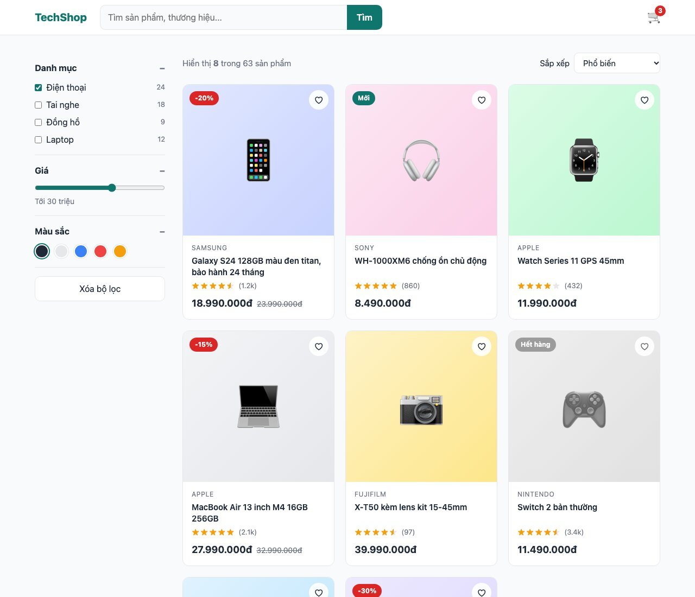
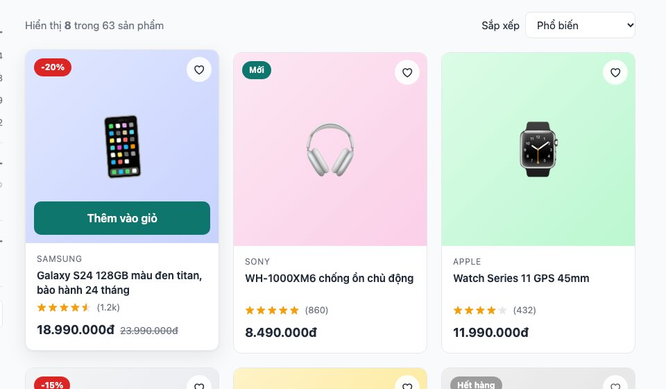
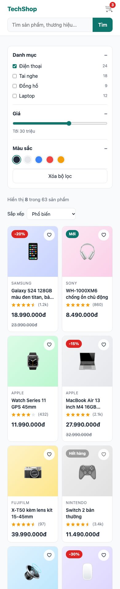
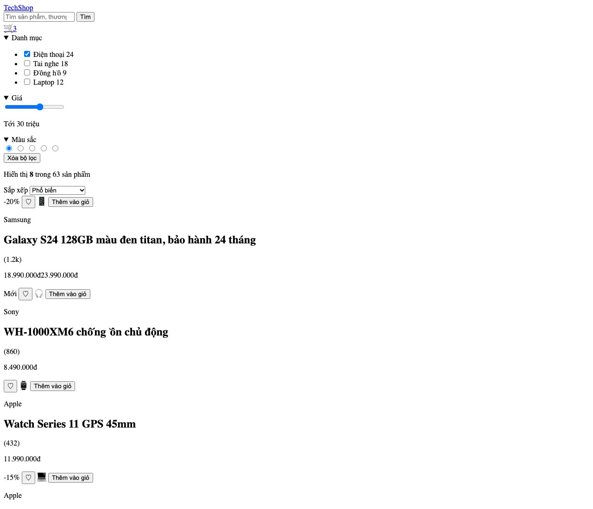
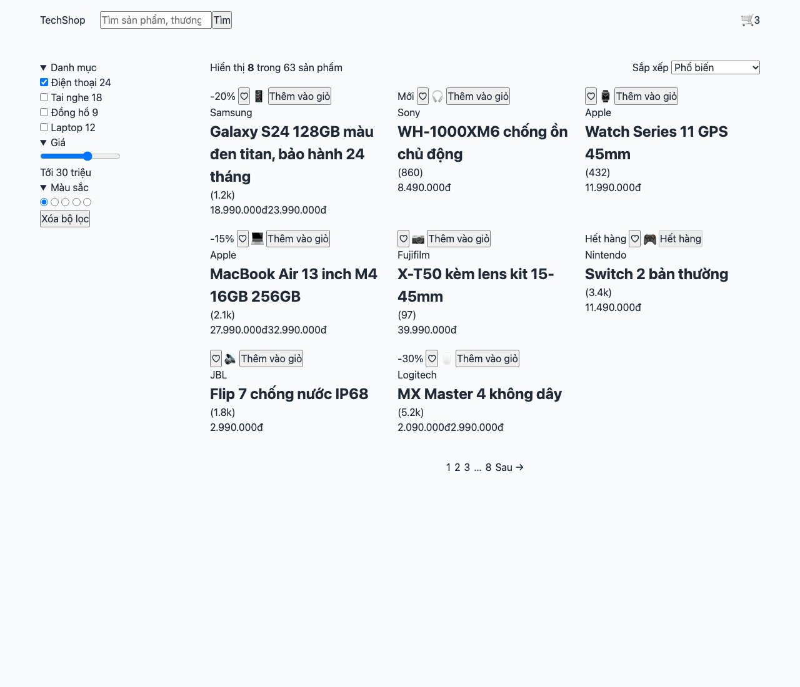
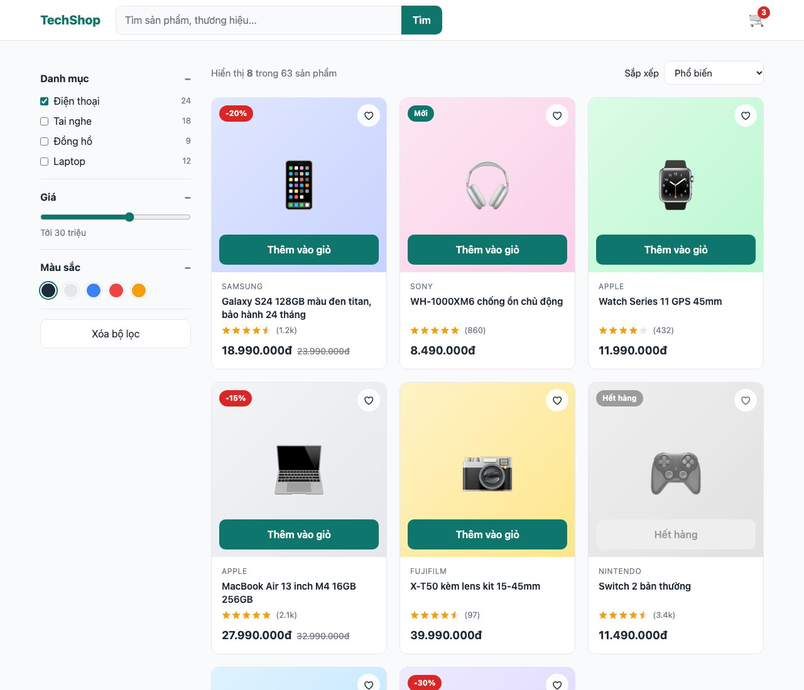

Bài 4 là trang danh sách sản phẩm của một shop: thanh tìm kiếm, bộ lọc bên trái, lưới sản phẩm tự co giãn theo màn hình, phân trang. Kỹ năng mới: <mark>aspect-ratio</mark>, grid <mark>auto-fill</mark>, <mark>details</mark> làm nhóm lọc đóng mở, style checkbox/radio bằng CSS, vẽ sao đánh giá, và cách xử lý card trên thiết bị cảm ứng.

#### Kết quả cần đạt


Rê chuột vào một sản phẩm: card nhấc lên, ảnh phóng to, nút "Thêm vào giỏ" trượt lên từ dưới.



Trên điện thoại, bộ lọc chuyển lên trên và lưới còn 2 cột.



Mã nguồn: [index.html](/assets/code/post_133/index.html), [style.css](/assets/code/post_133/style.css).

#### Bước 1: Tách component
```
header: logo, search (input + btn), cart (icon + count)
shop (2 cột)
├── filters (aside)
│   ├── filter × 3 (details: title + nội dung)
│   │   ├── filter__list > filter__option (checkbox + tên + count)
│   │   ├── filter__range + filter__hint
│   │   └── swatches > swatch × 5 (radio + dot màu)
│   └── filters__clear
└── catalog
    ├── toolbar: count, sort (select)
    ├── catalog__grid > product × 8
    │   ├── media: badge, wish, img, add (nút)
    │   └── body: brand, name, rating (stars + reviews), price (new, old)
    └── pagination > link × n (một link active)
```
Sản phẩm có vài **trạng thái**: giảm giá (badge đỏ), mới (badge xanh), hết hàng (xám, nút disabled). Mỗi trạng thái là một modifier: <mark>.product__badge--sale</mark>, <mark>.product--soldout</mark>.

#### Bước 2: Đặt tên

| Khối | Class |
|---|---|
| Header | <mark>.header</mark>, <mark>.header__inner</mark>, <mark>.logo</mark>, <mark>.search</mark>, <mark>.search__input</mark>, <mark>.search__btn</mark>, <mark>.cart</mark>, <mark>.cart__count</mark> |
| Bộ lọc | <mark>.filters</mark>, <mark>.filters__clear</mark>, <mark>.filter</mark>, <mark>.filter__title</mark>, <mark>.filter__list</mark>, <mark>.filter__option</mark>, <mark>.filter__count</mark>, <mark>.filter__range</mark>, <mark>.filter__hint</mark>, <mark>.swatches</mark>, <mark>.swatch</mark>, <mark>.swatch__dot</mark> |
| Danh sách | <mark>.shop</mark>, <mark>.catalog</mark>, <mark>.catalog__grid</mark>, <mark>.toolbar</mark>, <mark>.toolbar__count</mark>, <mark>.toolbar__sort</mark>, <mark>.toolbar__select</mark> |
| Sản phẩm | <mark>.product</mark>, <mark>.product--soldout</mark>, <mark>.product__media</mark> (+ <mark>--phone</mark>, <mark>--audio</mark>...), <mark>.product__badge</mark> (+ <mark>--sale</mark>, <mark>--new</mark>, <mark>--out</mark>), <mark>.product__wish</mark>, <mark>.product__img</mark>, <mark>.product__add</mark>, <mark>.product__body</mark>, <mark>.product__brand</mark>, <mark>.product__name</mark>, <mark>.product__rating</mark>, <mark>.product__stars</mark>, <mark>.product__reviews</mark>, <mark>.product__price</mark>, <mark>.product__price--new</mark>, <mark>.product__price--old</mark> |
| Phân trang | <mark>.pagination</mark>, <mark>.pagination__link</mark>, <mark>.pagination__link--active</mark>, <mark>.pagination__dots</mark> |

#### Bước 3: HTML
Ảnh sản phẩm trong bài là emoji trên nền màu để không cần file ảnh; trong dự án thật thay <mark>span.product__img</mark> bằng <mark>img</mark>, CSS phía dưới vẫn dùng được.
```html
<!doctype html>
<html lang="vi">
<head>
  <meta charset="utf-8">
  <meta name="viewport" content="width=device-width, initial-scale=1">
  <title>TechShop - Phụ kiện công nghệ</title>
  <link rel="stylesheet" href="style.css">
</head>
<body>
  <header class="header">
    <div class="container header__inner">
      <a class="logo" href="#">TechShop</a>
      <form class="search" role="search">
        <input class="search__input" type="search" placeholder="Tìm sản phẩm, thương hiệu...">
        <button class="search__btn" type="submit">Tìm</button>
      </form>
      <a class="cart" href="#" aria-label="Giỏ hàng, 3 sản phẩm">
        🛒<span class="cart__count">3</span>
      </a>
    </div>
  </header>

  <main class="container shop">
    <aside class="filters">
      <details class="filter" open>
        <summary class="filter__title">Danh mục</summary>
        <ul class="filter__list">
          <li><label class="filter__option"><input type="checkbox" checked> Điện thoại <span class="filter__count">24</span></label></li>
          <li><label class="filter__option"><input type="checkbox"> Tai nghe <span class="filter__count">18</span></label></li>
          <li><label class="filter__option"><input type="checkbox"> Đồng hồ <span class="filter__count">9</span></label></li>
          <li><label class="filter__option"><input type="checkbox"> Laptop <span class="filter__count">12</span></label></li>
        </ul>
      </details>

      <details class="filter" open>
        <summary class="filter__title">Giá</summary>
        <input class="filter__range" type="range" min="0" max="50" value="30" aria-label="Giá tối đa">
        <p class="filter__hint">Tới 30 triệu</p>
      </details>

      <details class="filter" open>
        <summary class="filter__title">Màu sắc</summary>
        <div class="swatches">
          <label class="swatch" style="--swatch: #1f2937"><input type="radio" name="color" checked><span class="swatch__dot"></span></label>
          <label class="swatch" style="--swatch: #e5e7eb"><input type="radio" name="color"><span class="swatch__dot"></span></label>
          <label class="swatch" style="--swatch: #3b82f6"><input type="radio" name="color"><span class="swatch__dot"></span></label>
          <label class="swatch" style="--swatch: #ef4444"><input type="radio" name="color"><span class="swatch__dot"></span></label>
          <label class="swatch" style="--swatch: #f59e0b"><input type="radio" name="color"><span class="swatch__dot"></span></label>
        </div>
      </details>

      <button class="filters__clear" type="button">Xóa bộ lọc</button>
    </aside>

    <section class="catalog">
      <div class="toolbar">
        <p class="toolbar__count">Hiển thị <strong>8</strong> trong 63 sản phẩm</p>
        <label class="toolbar__sort">Sắp xếp
          <select class="toolbar__select">
            <option>Phổ biến</option>
            <option>Giá thấp đến cao</option>
            <option>Giá cao đến thấp</option>
            <option>Mới nhất</option>
          </select>
        </label>
      </div>

      <div class="catalog__grid">
        <article class="product">
          <div class="product__media product__media--phone">
            <span class="product__badge product__badge--sale">-20%</span>
            <button class="product__wish" type="button" aria-label="Yêu thích">♡</button>
            <span class="product__img">📱</span>
            <button class="btn product__add" type="button">Thêm vào giỏ</button>
          </div>
          <div class="product__body">
            <p class="product__brand">Samsung</p>
            <h2 class="product__name">Galaxy S24 128GB màu đen titan, bảo hành 24 tháng</h2>
            <p class="product__rating"><span class="product__stars" style="--rating: 4.5"></span><span class="product__reviews">(1.2k)</span></p>
            <p class="product__price"><span class="product__price--new">18.990.000đ</span><span class="product__price--old">23.990.000đ</span></p>
          </div>
        </article>

        <article class="product">
          <div class="product__media product__media--audio">
            <span class="product__badge product__badge--new">Mới</span>
            <button class="product__wish" type="button" aria-label="Yêu thích">♡</button>
            <span class="product__img">🎧</span>
            <button class="btn product__add" type="button">Thêm vào giỏ</button>
          </div>
          <div class="product__body">
            <p class="product__brand">Sony</p>
            <h2 class="product__name">WH-1000XM6 chống ồn chủ động</h2>
            <p class="product__rating"><span class="product__stars" style="--rating: 5"></span><span class="product__reviews">(860)</span></p>
            <p class="product__price"><span class="product__price--new">8.490.000đ</span></p>
          </div>
        </article>

        <article class="product">
          <div class="product__media product__media--watch">
            <button class="product__wish" type="button" aria-label="Yêu thích">♡</button>
            <span class="product__img">⌚</span>
            <button class="btn product__add" type="button">Thêm vào giỏ</button>
          </div>
          <div class="product__body">
            <p class="product__brand">Apple</p>
            <h2 class="product__name">Watch Series 11 GPS 45mm</h2>
            <p class="product__rating"><span class="product__stars" style="--rating: 4"></span><span class="product__reviews">(432)</span></p>
            <p class="product__price"><span class="product__price--new">11.990.000đ</span></p>
          </div>
        </article>

        <article class="product">
          <div class="product__media product__media--laptop">
            <span class="product__badge product__badge--sale">-15%</span>
            <button class="product__wish" type="button" aria-label="Yêu thích">♡</button>
            <span class="product__img">💻</span>
            <button class="btn product__add" type="button">Thêm vào giỏ</button>
          </div>
          <div class="product__body">
            <p class="product__brand">Apple</p>
            <h2 class="product__name">MacBook Air 13 inch M4 16GB 256GB</h2>
            <p class="product__rating"><span class="product__stars" style="--rating: 5"></span><span class="product__reviews">(2.1k)</span></p>
            <p class="product__price"><span class="product__price--new">27.990.000đ</span><span class="product__price--old">32.990.000đ</span></p>
          </div>
        </article>

        <article class="product">
          <div class="product__media product__media--camera">
            <button class="product__wish" type="button" aria-label="Yêu thích">♡</button>
            <span class="product__img">📷</span>
            <button class="btn product__add" type="button">Thêm vào giỏ</button>
          </div>
          <div class="product__body">
            <p class="product__brand">Fujifilm</p>
            <h2 class="product__name">X-T50 kèm lens kit 15-45mm</h2>
            <p class="product__rating"><span class="product__stars" style="--rating: 4.5"></span><span class="product__reviews">(97)</span></p>
            <p class="product__price"><span class="product__price--new">39.990.000đ</span></p>
          </div>
        </article>

        <article class="product product--soldout">
          <div class="product__media product__media--game">
            <span class="product__badge product__badge--out">Hết hàng</span>
            <button class="product__wish" type="button" aria-label="Yêu thích">♡</button>
            <span class="product__img">🎮</span>
            <button class="btn product__add" type="button" disabled>Hết hàng</button>
          </div>
          <div class="product__body">
            <p class="product__brand">Nintendo</p>
            <h2 class="product__name">Switch 2 bản thường</h2>
            <p class="product__rating"><span class="product__stars" style="--rating: 4.5"></span><span class="product__reviews">(3.4k)</span></p>
            <p class="product__price"><span class="product__price--new">11.490.000đ</span></p>
          </div>
        </article>

        <article class="product">
          <div class="product__media product__media--speaker">
            <button class="product__wish" type="button" aria-label="Yêu thích">♡</button>
            <span class="product__img">🔊</span>
            <button class="btn product__add" type="button">Thêm vào giỏ</button>
          </div>
          <div class="product__body">
            <p class="product__brand">JBL</p>
            <h2 class="product__name">Flip 7 chống nước IP68</h2>
            <p class="product__rating"><span class="product__stars" style="--rating: 4"></span><span class="product__reviews">(1.8k)</span></p>
            <p class="product__price"><span class="product__price--new">2.990.000đ</span></p>
          </div>
        </article>

        <article class="product">
          <div class="product__media product__media--mouse">
            <span class="product__badge product__badge--sale">-30%</span>
            <button class="product__wish" type="button" aria-label="Yêu thích">♡</button>
            <span class="product__img">🖱️</span>
            <button class="btn product__add" type="button">Thêm vào giỏ</button>
          </div>
          <div class="product__body">
            <p class="product__brand">Logitech</p>
            <h2 class="product__name">MX Master 4 không dây</h2>
            <p class="product__rating"><span class="product__stars" style="--rating: 5"></span><span class="product__reviews">(5.2k)</span></p>
            <p class="product__price"><span class="product__price--new">2.090.000đ</span><span class="product__price--old">2.990.000đ</span></p>
          </div>
        </article>
      </div>

      <nav class="pagination" aria-label="Phân trang">
        <a class="pagination__link pagination__link--active" href="#">1</a>
        <a class="pagination__link" href="#">2</a>
        <a class="pagination__link" href="#">3</a>
        <span class="pagination__dots">…</span>
        <a class="pagination__link" href="#">8</a>
        <a class="pagination__link" href="#">Sau →</a>
      </nav>
    </section>
  </main>
</body>
</html>
```
Mở trang



Những chỗ đáng chú ý:
- Mỗi nhóm lọc là <mark>details</mark> + <mark>summary</mark>: trình duyệt tự làm đóng/mở, không cần JavaScript, và thuộc tính <mark>open</mark> quyết định trạng thái ban đầu. Nhìn ảnh trên, chúng đã đóng mở được dù chưa có CSS.
- Màu của từng swatch và số sao của từng sản phẩm nằm trong <mark>style="--swatch: ..."</mark>, <mark>style="--rating: 4.5"</mark>. Đây là inline style **chấp nhận được**: nó chỉ truyền **dữ liệu** vào CSS (sau này do server sinh ra), còn cách hiển thị vẫn nằm trong file CSS.
- Nút trái tim và nút thêm giỏ là <mark>button type="button"</mark>, có <mark>aria-label</mark> khi chỉ có icon. Nút hết hàng có <mark>disabled</mark>.
- <mark>input type="search"</mark>, <mark>type="range"</mark>: dùng đúng loại input, điện thoại sẽ hiện bàn phím và điều khiển phù hợp.

**Mẹo:** viết HTML của **một** sản phẩm có đủ mọi trạng thái (badge, giá cũ), kiểm tra xong rồi mới nhân bản. Với Emmet, gõ <mark>article.product*8</mark> rồi Tab.

#### Bước 4: Layout
```css
/* ===== 1. Token & reset ===== */
:root {
  --color-primary: #0f766e;
  --color-primary-dark: #115e59;
  --color-primary-soft: #ccfbf1;
  --color-text: #1f2937;
  --color-muted: #6b7280;
  --color-bg: #f9fafb;
  --color-surface: #ffffff;
  --color-border: #e5e7eb;
  --color-sale: #dc2626;
  --color-star: #f59e0b;
  --radius: 12px;
  --shadow: 0 1px 3px rgba(0, 0, 0, 0.06), 0 10px 30px rgba(0, 0, 0, 0.08);
  --font: system-ui, -apple-system, "Segoe UI", Roboto, sans-serif;
}

*,
*::before,
*::after {
  box-sizing: border-box;
  margin: 0;
  padding: 0;
}

body {
  font-family: var(--font);
  color: var(--color-text);
  background: var(--color-bg);
  line-height: 1.5;
}

ul {
  list-style: none;
}

a {
  color: inherit;
  text-decoration: none;
}

button,
input,
select {
  font: inherit;
  color: inherit;
}

/* ===== 2. Layout ===== */
.container {
  max-width: 1200px;
  margin: 0 auto;
  padding: 0 24px;
}

.header__inner {
  height: 64px;
  display: flex;
  align-items: center;
  gap: 24px;
}

.search {
  flex: 1;
  max-width: 520px;
  display: flex;
}

.cart {
  margin-left: auto;
}

.shop {
  display: grid;
  grid-template-columns: 240px 1fr;
  gap: 32px;
  padding-top: 32px;
  padding-bottom: 64px;
}

.toolbar {
  display: flex;
  justify-content: space-between;
  align-items: center;
  gap: 16px;
  margin-bottom: 20px;
}

.catalog__grid {
  display: grid;
  grid-template-columns: repeat(auto-fill, minmax(220px, 1fr));
  gap: 20px;
}

.pagination {
  display: flex;
  justify-content: center;
  gap: 6px;
  margin-top: 40px;
}
```
Trang lúc này



Ba điều đáng học:
- Reset có thêm <mark>button, input, select { font: inherit }</mark>. Mặc định các control dùng font riêng của hệ điều hành, nhỏ hơn và khác font trang. Hầu như trang nào có form cũng cần dòng này.
- <mark>grid-template-columns: 240px 1fr</mark>: sidebar cố định 240px, phần còn lại cho danh sách. Khác bài 131 dùng toàn <mark>fr</mark>.
- <mark>repeat(auto-fill, minmax(220px, 1fr))</mark>: "xếp **nhiều cột nhất có thể**, mỗi cột ít nhất 220px, dư bao nhiêu chia đều". Màn hình rộng ra thì tự thêm cột, hẹp lại tự bớt, **không cần media query**. Đây là dòng CSS đáng nhớ nhất của bài.

**Mẹo:** <mark>auto-fill</mark> và <mark>auto-fit</mark> chỉ khác nhau khi có ít sản phẩm hơn số cột: <mark>auto-fit</mark> kéo giãn các card cho đầy hàng, <mark>auto-fill</mark> giữ cỡ card và để trống. Với lưới sản phẩm, <mark>auto-fill</mark> đúng hơn: 2 sản phẩm không nên to gấp 3 lần bình thường.

#### Bước 5: Style component
Header và bộ lọc trước
```css
/* ===== 3. Component: header và bộ lọc ===== */
.header {
  background: var(--color-surface);
  border-bottom: 1px solid var(--color-border);
}

.logo {
  font-weight: 800;
  font-size: 1.25rem;
  color: var(--color-primary);
}

.search__input {
  flex: 1;
  padding: 10px 14px;
  border: 1px solid var(--color-border);
  border-right: 0;
  border-radius: 10px 0 0 10px;
  background: var(--color-bg);
}

.search__input:focus {
  outline: none;
  border-color: var(--color-primary);
  background: var(--color-surface);
}

.search__btn {
  padding: 10px 18px;
  border: 0;
  border-radius: 0 10px 10px 0;
  background: var(--color-primary);
  color: #fff;
  font-weight: 600;
  cursor: pointer;
}

.cart {
  position: relative;
  font-size: 1.375rem;
}

.cart__count {
  position: absolute;
  top: -6px;
  right: -10px;
  min-width: 20px;
  height: 20px;
  padding: 0 6px;
  border-radius: 999px;
  background: var(--color-sale);
  color: #fff;
  font-size: 0.75rem;
  font-weight: 700;
  display: grid;
  place-items: center;
}

.filters {
  position: sticky;
  top: 24px;
  align-self: start;
}

.filter {
  padding: 16px 0;
  border-bottom: 1px solid var(--color-border);
}

.filter__title {
  font-weight: 700;
  cursor: pointer;
  list-style: none;
  display: flex;
  justify-content: space-between;
}

.filter__title::after {
  content: "−";
  color: var(--color-muted);
}

.filter:not([open]) .filter__title::after {
  content: "+";
}

.filter__list {
  margin-top: 12px;
  display: grid;
  gap: 8px;
}

.filter__option {
  display: flex;
  align-items: center;
  gap: 8px;
  cursor: pointer;
  accent-color: var(--color-primary);
}

.filter__count {
  margin-left: auto;
  font-size: 0.8125rem;
  color: var(--color-muted);
}

.filter__range {
  width: 100%;
  margin-top: 12px;
  accent-color: var(--color-primary);
}

.filter__hint {
  font-size: 0.875rem;
  color: var(--color-muted);
}

.swatches {
  display: flex;
  gap: 10px;
  margin-top: 12px;
}

.swatch {
  cursor: pointer;
}

.swatch input {
  position: absolute;
  opacity: 0;
  width: 0;
  height: 0;
}

.swatch__dot {
  display: block;
  width: 26px;
  height: 26px;
  border-radius: 50%;
  background: var(--swatch);
  border: 2px solid var(--color-surface);
  box-shadow: 0 0 0 1px var(--color-border);
}

.swatch input:checked + .swatch__dot {
  box-shadow: 0 0 0 2px var(--color-primary);
}

.swatch input:focus-visible + .swatch__dot {
  box-shadow: 0 0 0 2px var(--color-primary), 0 0 0 4px var(--color-primary-soft);
}

.filters__clear {
  margin-top: 16px;
  width: 100%;
  padding: 10px;
  border: 1px solid var(--color-border);
  border-radius: 10px;
  background: var(--color-surface);
  cursor: pointer;
}
```
- **Sidebar dính** khi cuộn: <mark>position: sticky; top: 24px</mark> cộng <mark>align-self: start</mark>. Thiếu <mark>align-self: start</mark>, grid kéo sidebar cao bằng cột bên cạnh và sticky không có chỗ để "dính".
- **Checkbox và range đổi màu** chỉ bằng một dòng <mark>accent-color</mark>. Trước đây phải vẽ lại checkbox từ đầu; giờ giữ nguyên control gốc (bàn phím, trình đọc màn hình đều hoạt động) mà vẫn đúng màu thương hiệu.
- **Swatch màu** là radio ẩn + chấm tròn (cùng kỹ thuật công tắc bài 131). Chấm được chọn có viền xanh bằng <mark>box-shadow</mark>, không dùng <mark>border</mark> để kích thước không đổi khi chọn.
- Dấu <mark>+</mark>/<mark>−</mark> ở tiêu đề nhóm lọc là <mark>::after</mark>, đổi theo <mark>details[open]</mark>. <mark>list-style: none</mark> trên <mark>summary</mark> để bỏ mũi tên mặc định.

Tiếp theo là toolbar, card sản phẩm và phân trang
```css
/* ===== 3. Component: toolbar, product, pagination ===== */
.toolbar__count {
  color: var(--color-muted);
  font-size: 0.9375rem;
}

.toolbar__sort {
  display: flex;
  align-items: center;
  gap: 8px;
  font-size: 0.9375rem;
}

.toolbar__select {
  padding: 8px 12px;
  border: 1px solid var(--color-border);
  border-radius: 8px;
  background: var(--color-surface);
}

.product {
  position: relative;
  min-width: 0;
  display: flex;
  flex-direction: column;
  background: var(--color-surface);
  border: 1px solid var(--color-border);
  border-radius: var(--radius);
  overflow: hidden;
}

.product__media {
  position: relative;
  aspect-ratio: 1;
  display: grid;
  place-items: center;
  background: #f3f4f6;
}

.product__media--phone { background: linear-gradient(135deg, #e0e7ff, #c7d2fe); }
.product__media--audio { background: linear-gradient(135deg, #fce7f3, #fbcfe8); }
.product__media--watch { background: linear-gradient(135deg, #dcfce7, #bbf7d0); }
.product__media--laptop { background: linear-gradient(135deg, #f3f4f6, #e5e7eb); }
.product__media--camera { background: linear-gradient(135deg, #fef3c7, #fde68a); }
.product__media--game { background: linear-gradient(135deg, #fee2e2, #fecaca); }
.product__media--speaker { background: linear-gradient(135deg, #e0f2fe, #bae6fd); }
.product__media--mouse { background: linear-gradient(135deg, #ede9fe, #ddd6fe); }

.product__img {
  font-size: 5rem;
  line-height: 1;
}

.product__badge {
  position: absolute;
  top: 12px;
  left: 12px;
  padding: 4px 10px;
  border-radius: 999px;
  font-size: 0.75rem;
  font-weight: 700;
  color: #fff;
  background: var(--color-text);
}

.product__badge--sale { background: var(--color-sale); }
.product__badge--new { background: var(--color-primary); }
.product__badge--out { background: var(--color-muted); }

.product__wish {
  position: absolute;
  top: 10px;
  right: 10px;
  width: 36px;
  height: 36px;
  border: 0;
  border-radius: 50%;
  background: rgba(255, 255, 255, 0.9);
  font-size: 1.125rem;
  cursor: pointer;
}

.product__body {
  padding: 14px 16px 16px;
  display: grid;
  gap: 4px;
}

.product__brand {
  font-size: 0.75rem;
  text-transform: uppercase;
  letter-spacing: 0.06em;
  color: var(--color-muted);
}

.product__name {
  font-size: 0.9375rem;
  font-weight: 600;
  line-height: 1.4;
  display: -webkit-box;
  -webkit-line-clamp: 2;
  -webkit-box-orient: vertical;
  overflow: hidden;
  min-height: calc(0.9375rem * 1.4 * 2);
}

.product__rating {
  display: flex;
  align-items: center;
  gap: 6px;
  font-size: 0.8125rem;
  color: var(--color-muted);
}

.product__stars {
  --percent: calc(var(--rating) / 5 * 100%);
  font-size: 0.875rem;
  letter-spacing: 2px;
  background: linear-gradient(90deg, var(--color-star) var(--percent), var(--color-border) var(--percent));
  -webkit-background-clip: text;
  background-clip: text;
  color: transparent;
}

.product__stars::before {
  content: "★★★★★";
}

.product__price {
  margin-top: 4px;
  display: flex;
  flex-wrap: wrap;
  align-items: baseline;
  gap: 8px;
}

.product__price--new {
  font-size: 1.125rem;
  font-weight: 700;
}

.product__price--old {
  font-size: 0.875rem;
  color: var(--color-muted);
  text-decoration: line-through;
}

.btn {
  padding: 12px;
  border: 0;
  font-weight: 600;
  cursor: pointer;
}

.product__add {
  position: absolute;
  left: 12px;
  right: 12px;
  bottom: 12px;
  border-radius: 10px;
  background: var(--color-primary);
  color: #fff;
}

.product__add:disabled {
  background: var(--color-border);
  color: var(--color-muted);
  cursor: not-allowed;
}

.product--soldout .product__media {
  filter: grayscale(1);
  opacity: 0.7;
}

.pagination__link {
  min-width: 40px;
  height: 40px;
  padding: 0 12px;
  display: grid;
  place-items: center;
  border-radius: 10px;
  border: 1px solid var(--color-border);
  background: var(--color-surface);
  font-weight: 600;
}

.pagination__link--active {
  background: var(--color-primary);
  border-color: var(--color-primary);
  color: #fff;
}

.pagination__dots {
  align-self: center;
  color: var(--color-muted);
}
```
Trang lúc này



Năm kỹ thuật đáng nhớ trong card:
- **Ảnh vuông bất kể kích thước**: <mark>aspect-ratio: 1</mark> trên khung ảnh. Với ảnh thật, thêm <mark>img { width: 100%; height: 100%; object-fit: cover }</mark> để ảnh lấp đầy khung mà không méo. Trước khi có <mark>aspect-ratio</mark> phải dùng mẹo <mark>padding-top: 100%</mark>, giờ không cần nữa.
- **Tên sản phẩm tối đa 2 dòng**, dài hơn thì hiện "…": bộ 4 dòng <mark>-webkit-box</mark> + <mark>-webkit-line-clamp: 2</mark>. Và <mark>min-height</mark> bằng đúng 2 dòng để tên 1 dòng không làm card thấp hơn các card khác.
- **Sao đánh giá** chỉ với một <mark>span</mark> và một số: <mark>::before</mark> in 5 ngôi sao, rồi tô bằng gradient vàng/xám cắt tại <mark>--percent</mark> (4.5/5 = 90%) nhờ <mark>background-clip: text</mark>. Không cần ảnh, không cần 5 thẻ.
- **Nút thêm giỏ** nằm đè lên ảnh (<mark>position: absolute; bottom</mark>), nên không chiếm chỗ trong card. Bước 6 sẽ cho nó ẩn/hiện.
- **Hết hàng**: <mark>filter: grayscale(1)</mark> làm cả khung ảnh thành đen trắng, nút <mark>:disabled</mark> xám và <mark>cursor: not-allowed</mark>.

**Mẹo (lỗi tôi gặp khi làm bài này):** trên điện thoại, card bị **cắt mất chữ** bên phải. Nguyên nhân: grid item mặc định có <mark>min-width: auto</mark>, tức là không bao giờ hẹp hơn nội dung "không thể xuống dòng" của nó; hàng giá là flex không wrap nên "18.990.000đ 23.990.000đ" dài hơn cột, cột bị đẩy rộng ra và tràn. Hai dòng sửa: <mark>min-width: 0</mark> trên <mark>.product</mark> và <mark>flex-wrap: wrap</mark> trên <mark>.product__price</mark>. Khi thấy grid hoặc flex "tràn" khó hiểu, 9/10 là do <mark>min-width: auto</mark>.

#### Bước 6: Hiệu ứng
```css
/* ===== 4. Hiệu ứng ===== */
.product {
  transition: transform 0.25s ease, box-shadow 0.25s ease;
}

.product:hover {
  transform: translateY(-4px);
  box-shadow: var(--shadow);
}

.product__img {
  transition: transform 0.4s ease;
}

.product:hover .product__img {
  transform: scale(1.12) rotate(-4deg);
}

.product__add {
  transition: background-color 0.2s ease, opacity 0.25s ease, transform 0.25s ease;
}

.product__add:not(:disabled):hover {
  background: var(--color-primary-dark);
}

.product__wish {
  transition: transform 0.2s ease, color 0.2s ease;
}

.product__wish:hover {
  transform: scale(1.15);
  color: var(--color-sale);
}

.pagination__link {
  transition: border-color 0.2s ease, color 0.2s ease;
}

.pagination__link:hover {
  border-color: var(--color-primary);
  color: var(--color-primary);
}

.pagination__link--active:hover {
  color: #fff;
}

@media (hover: hover) {
  .product__add {
    opacity: 0;
    transform: translateY(8px);
  }

  .product:hover .product__add,
  .product:focus-within .product__add {
    opacity: 1;
    transform: translateY(0);
  }
}
```
Khối cuối là điểm quan trọng nhất của bước này: nút "Thêm vào giỏ" **chỉ ẩn đi trên thiết bị có chuột**. <mark>@media (hover: hover)</mark> chỉ đúng với thiết bị rê chuột được; trên điện thoại (không hover) nút luôn hiện, vì không thể rê để nó hiện ra. Nhiều shop quên điều này và người dùng điện thoại không tìm thấy nút mua.

<mark>:focus-within</mark> hiện nút khi người dùng **Tab** vào bất kỳ thứ gì trong card (nút trái tim chẳng hạn), để người dùng bàn phím cũng tới được nút mua.

**Mẹo:** hover làm ảnh <mark>scale</mark> nhưng khung <mark>.product</mark> đã có <mark>overflow: hidden</mark> nên ảnh phóng to không tràn ra ngoài bo góc. Muốn thấy hiệu ứng trong lúc sửa CSS, dùng nút <mark>:hov</mark> trong DevTools như bài 130.

#### Bước 7: Responsive
```css
/* ===== 5. Responsive ===== */
@media (max-width: 900px) {
  .shop {
    grid-template-columns: 1fr;
    gap: 24px;
  }

  .filters {
    position: static;
    display: grid;
    grid-template-columns: repeat(auto-fit, minmax(180px, 1fr));
    gap: 0 24px;
    padding: 0 16px;
    background: var(--color-surface);
    border: 1px solid var(--color-border);
    border-radius: var(--radius);
  }

  .filters__clear {
    margin: 0 0 16px;
    grid-column: 1 / -1;
  }
}

@media (max-width: 600px) {
  .header__inner {
    flex-wrap: wrap;
    height: auto;
    padding-top: 12px;
    padding-bottom: 12px;
    gap: 12px;
  }

  .search {
    order: 3;
    flex-basis: 100%;
    max-width: none;
  }

  .toolbar {
    flex-direction: column;
    align-items: flex-start;
  }

  .catalog__grid {
    grid-template-columns: repeat(2, 1fr);
    gap: 12px;
  }

  .product__body {
    padding: 12px;
  }

  .product__add {
    left: 8px;
    right: 8px;
    bottom: 8px;
    padding: 10px;
    font-size: 0.875rem;
  }

  .product__img {
    font-size: 3.5rem;
  }
}
```
Hai mốc:
- **Dưới 900px**: sidebar không còn chỗ bên trái, chuyển lên trên và các nhóm lọc xếp ngang bằng chính <mark>auto-fit</mark>, nút "Xóa bộ lọc" trải hết chiều ngang bằng <mark>grid-column: 1 / -1</mark> (từ cột đầu tới cột cuối). Vì là <mark>details</mark>, người dùng đóng bớt các nhóm được.
- **Dưới 600px**: ô tìm kiếm xuống dòng riêng, rộng 100%. <mark>order: 3</mark> đẩy nó xuống sau giỏ hàng mà không cần sửa HTML. Lưới ép về đúng 2 cột (ở cỡ này <mark>auto-fill</mark> với 220px chỉ cho 1 cột, quá to).

**Mẹo:** <mark>order</mark> chỉ đổi thứ tự **hiển thị**, không đổi thứ tự Tab và đọc màn hình. Dùng nó cho những dịch chuyển nhỏ như thế này thì ổn; đảo lộn cả trang bằng <mark>order</mark> sẽ làm người dùng bàn phím rối.

#### Checklist
- Kéo rộng/hẹp cửa sổ từ 1400px xuống 700px: số cột đổi 4 → 3 → 2 mà không có media query nào can thiệp (chỉ có <mark>auto-fill</mark>).
- Rê chuột vào card: nhấc lên, ảnh phóng, nút hiện. Tab bằng bàn phím tới nút trái tim: nút mua cũng hiện.
- Bật Toggle device toolbar (giả lập cảm ứng): nút mua luôn hiện.
- Bấm tiêu đề nhóm lọc: đóng mở, dấu +/− đổi. Tab tới swatch màu, bấm mũi tên: đổi màu được chọn.
- 360px: không cuộn ngang, tên dài hiện "…".

#### Bài tập thêm
- Thêm chế độ xem danh sách (ảnh bên trái, thông tin bên phải) bằng modifier <mark>.catalog__grid--list</mark> và một công tắc như bài 131.
- Thêm "skeleton" loading: card xám nhấp nháy bằng <mark>@keyframes</mark> đổi <mark>opacity</mark>, dùng khi chờ dữ liệu.
- Thay emoji bằng ảnh thật với <mark>object-fit: cover</mark> và <mark>loading="lazy"</mark>.
