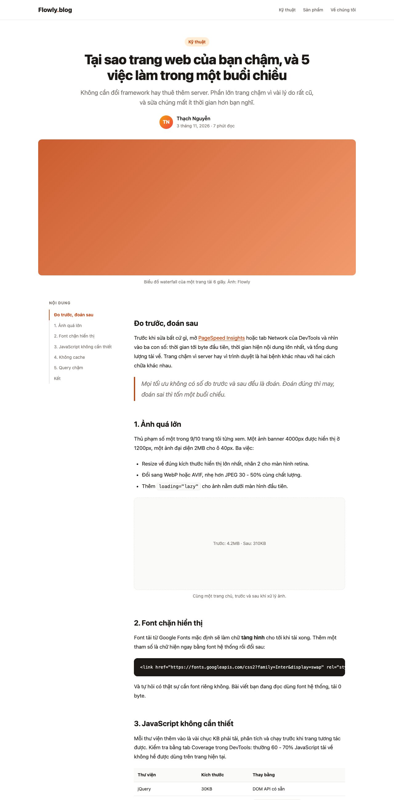
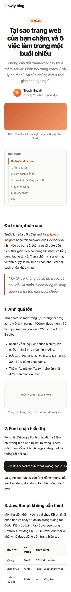
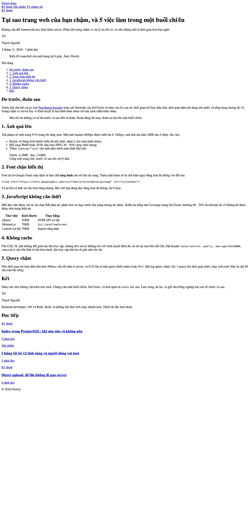
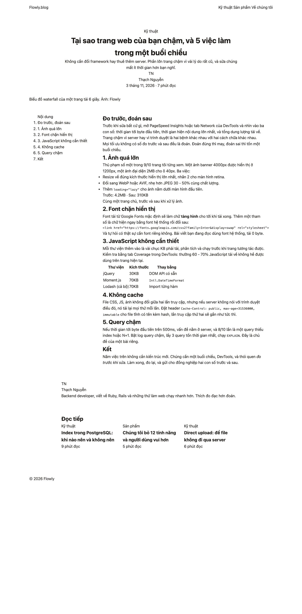

Bài 5 là trang đọc một bài viết: tiêu đề lớn, ảnh bìa, mục lục dính bên trái, nội dung với heading, danh sách, trích dẫn, code, bảng; cuối bài có tác giả và bài liên quan. Hai thứ mới: **typography** (làm chữ dễ đọc) và **SCSS**, từ bài này trở đi CSS được chia thành nhiều file nhỏ.

#### Kết quả cần đạt




Mã nguồn: [index.html](/assets/code/post_134/index.html), thư mục [scss/](/assets/code/post_134/scss/main.scss) và file đã biên dịch [css/style.css](/assets/code/post_134/css/style.css).

#### SCSS là gì và cài thế nào
SCSS là CSS cộng thêm vài thứ: **biến** lúc biên dịch, **lồng selector**, **tách file**, **hàm và mixin**. Trình duyệt không hiểu SCSS, nên cần một bước biên dịch ra CSS thường. Cài Node.js rồi
```sh
npm init -y
npm install --save-dev sass
npx sass --watch scss:css
```
Lệnh cuối theo dõi thư mục <mark>scss/</mark>, mỗi lần lưu file là biên dịch lại ra <mark>css/style.css</mark>. HTML vẫn chỉ link tới file CSS, không biết gì về SCSS. Muốn một file duy nhất không watch: <mark>npx sass scss/main.scss css/style.css</mark>.

Cấu trúc thư mục của bài này, mỗi bước của quy trình là một file
```
scss/
├── main.scss              gom tất cả, là file duy nhất được biên dịch
├── _tokens.scss           bước 1: biến, map, hàm, mixin, CSS variable
├── _reset.scss            bước 1: reset
├── _layout.scss           bước 2
├── components/
│   ├── _header.scss       bước 3
│   ├── _post-head.scss
│   ├── _toc.scss
│   ├── _prose.scss
│   └── _author.scss
├── _effects.scss          bước 4
└── _responsive.scss       bước 5
```
File bắt đầu bằng <mark>_</mark> là **partial**: sass không biên dịch nó thành file riêng, chỉ để file khác <mark>@use</mark>. Nhờ vậy <mark>css/</mark> chỉ có đúng một file.

#### Bước 1: Tách component
```
header: logo, nav
post-head: tag, title, lead, byline (avatar, name, meta)
cover: image, caption
post-layout (2 cột)
├── toc: title, list > link (một link active)
└── prose: nội dung bài viết, KHÔNG có class bên trong
author: avatar, name, bio
related: title, grid > card × 3 (tag, title, meta)
footer
```
Khối <mark>prose</mark> đặc biệt: nội dung do người viết soạn trong CMS/Markdown, HTML sinh ra chỉ có thẻ <mark>h2</mark>, <mark>p</mark>, <mark>ul</mark>... **không có class**. Đây là ngoại lệ duy nhất của BEM: CSS phải chọn theo thẻ bên trong <mark>.prose</mark>.

#### Bước 2: Đặt tên

| Khối | Class |
|---|---|
| Khung | <mark>.container</mark>, <mark>.header</mark>, <mark>.header__inner</mark>, <mark>.logo</mark>, <mark>.logo__dot</mark>, <mark>.nav</mark>, <mark>.nav__link</mark>, <mark>.footer</mark> |
| Đầu bài | <mark>.tag</mark>, <mark>.post-head</mark>, <mark>.post-head__title</mark>, <mark>.post-head__lead</mark>, <mark>.byline</mark>, <mark>.byline__avatar</mark>, <mark>.byline__name</mark>, <mark>.byline__meta</mark>, <mark>.cover</mark>, <mark>.cover__image</mark>, <mark>.cover__caption</mark> |
| Thân bài | <mark>.post-layout</mark>, <mark>.toc</mark>, <mark>.toc__title</mark>, <mark>.toc__list</mark>, <mark>.toc__link</mark>, <mark>.toc__link--active</mark>, <mark>.prose</mark> |
| Cuối bài | <mark>.author</mark>, <mark>.author__avatar</mark>, <mark>.author__name</mark>, <mark>.author__bio</mark>, <mark>.related</mark>, <mark>.related__title</mark>, <mark>.related__grid</mark>, <mark>.card</mark>, <mark>.card__tag</mark>, <mark>.card__title</mark>, <mark>.card__meta</mark> |

#### Bước 3: HTML
```html
<!doctype html>
<html lang="vi">
<head>
  <meta charset="utf-8">
  <meta name="viewport" content="width=device-width, initial-scale=1">
  <title>Tại sao trang web của bạn chậm - Blog Flowly</title>
  <link rel="stylesheet" href="css/style.css">
</head>
<body>
  <header class="header">
    <div class="container header__inner">
      <a class="logo" href="#">Flowly<span class="logo__dot">.</span>blog</a>
      <nav class="nav">
        <a class="nav__link" href="#">Kỹ thuật</a>
        <a class="nav__link" href="#">Sản phẩm</a>
        <a class="nav__link" href="#">Về chúng tôi</a>
      </nav>
    </div>
  </header>

  <main class="container">
    <header class="post-head">
      <a class="tag" href="#">Kỹ thuật</a>
      <h1 class="post-head__title">Tại sao trang web của bạn chậm, và 5 việc làm trong một buổi chiều</h1>
      <p class="post-head__lead">Không cần đổi framework hay thuê thêm server. Phần lớn trang chậm vì vài lý do rất cũ, và sửa chúng mất ít thời gian hơn bạn nghĩ.</p>
      <div class="byline">
        <span class="byline__avatar">TN</span>
        <div>
          <p class="byline__name">Thạch Nguyễn</p>
          <p class="byline__meta">3 tháng 11, 2026 · 7 phút đọc</p>
        </div>
      </div>
    </header>

    <figure class="cover">
      <div class="cover__image"></div>
      <figcaption class="cover__caption">Biểu đồ waterfall của một trang tải 6 giây. Ảnh: Flowly</figcaption>
    </figure>

    <div class="post-layout">
      <aside class="toc">
        <p class="toc__title">Nội dung</p>
        <ol class="toc__list">
          <li><a class="toc__link toc__link--active" href="#do">Đo trước, đoán sau</a></li>
          <li><a class="toc__link" href="#anh">1. Ảnh quá lớn</a></li>
          <li><a class="toc__link" href="#font">2. Font chặn hiển thị</a></li>
          <li><a class="toc__link" href="#js">3. JavaScript không cần thiết</a></li>
          <li><a class="toc__link" href="#cache">4. Không cache</a></li>
          <li><a class="toc__link" href="#db">5. Query chậm</a></li>
          <li><a class="toc__link" href="#ket">Kết</a></li>
        </ol>
      </aside>

      <article class="prose">
        <h2 id="do">Đo trước, đoán sau</h2>
        <p>Trước khi sửa bất cứ gì, mở <a href="#">PageSpeed Insights</a> hoặc tab Network của DevTools và nhìn vào ba con số: thời gian tới byte đầu tiên, thời gian hiện nội dung lớn nhất, và tổng dung lượng tải về. Trang chậm vì server hay vì trình duyệt là hai bệnh khác nhau với hai cách chữa khác nhau.</p>
        <blockquote>
          <p>Mọi tối ưu không có số đo trước và sau đều là đoán. Đoán đúng thì may, đoán sai thì tốn một buổi chiều.</p>
        </blockquote>

        <h2 id="anh">1. Ảnh quá lớn</h2>
        <p>Thủ phạm số một trong 9/10 trang tôi từng xem. Một ảnh banner 4000px được hiển thị ở 1200px, một ảnh đại diện 2MB cho ô 40px. Ba việc:</p>
        <ul>
          <li>Resize về đúng kích thước hiển thị lớn nhất, nhân 2 cho màn hình retina.</li>
          <li>Đổi sang WebP hoặc AVIF, nhẹ hơn JPEG 30 - 50% cùng chất lượng.</li>
          <li>Thêm <code>loading="lazy"</code> cho ảnh nằm dưới màn hình đầu tiên.</li>
        </ul>
        <figure>
          <div class="figure__placeholder">Trước: 4.2MB · Sau: 310KB</div>
          <figcaption>Cùng một trang chủ, trước và sau khi xử lý ảnh.</figcaption>
        </figure>

        <h2 id="font">2. Font chặn hiển thị</h2>
        <p>Font tải từ Google Fonts mặc định sẽ làm chữ <strong>tàng hình</strong> cho tới khi tải xong. Thêm một tham số là chữ hiện ngay bằng font hệ thống rồi đổi sau:</p>
        <pre><code>&lt;link href="https://fonts.googleapis.com/css2?family=Inter&amp;display=swap" rel="stylesheet"&gt;</code></pre>
        <p>Và tự hỏi có thật sự cần font riêng không. Bài viết bạn đang đọc dùng font hệ thống, tải 0 byte.</p>

        <h2 id="js">3. JavaScript không cần thiết</h2>
        <p>Mỗi thư viện thêm vào là vài chục KB phải tải, phân tích và chạy trước khi trang tương tác được. Kiểm tra bằng tab Coverage trong DevTools: thường 60 - 70% JavaScript tải về không hề được dùng trên trang hiện tại.</p>
        <table>
          <thead>
            <tr><th>Thư viện</th><th>Kích thước</th><th>Thay bằng</th></tr>
          </thead>
          <tbody>
            <tr><td>jQuery</td><td>30KB</td><td>DOM API có sẵn</td></tr>
            <tr><td>Moment.js</td><td>70KB</td><td><code>Intl.DateTimeFormat</code></td></tr>
            <tr><td>Lodash (cả bộ)</td><td>70KB</td><td>Import từng hàm</td></tr>
          </tbody>
        </table>

        <h2 id="cache">4. Không cache</h2>
        <p>File CSS, JS, ảnh không đổi giữa hai lần truy cập, nhưng nếu server không nói với trình duyệt điều đó, nó tải lại mọi thứ mỗi lần. Đặt header <code>Cache-Control: public, max-age=31536000, immutable</code> cho file tĩnh có tên kèm hash, lần truy cập thứ hai sẽ gần như tức thì.</p>

        <h2 id="db">5. Query chậm</h2>
        <p>Nếu thời gian tới byte đầu tiên trên 500ms, vấn đề nằm ở server, và 8/10 lần là một query thiếu index hoặc N+1. Bật log query chậm, lấy 3 query tốn thời gian nhất, chạy <code>EXPLAIN</code>. Đây là chủ đề của một bài riêng.</p>

        <h2 id="ket">Kết</h2>
        <p>Năm việc trên không cần kiến trúc mới. Chúng cần một buổi chiều, DevTools, và thói quen <em>đo trước khi sửa</em>. Làm xong, đo lại, và gửi cho đồng nghiệp hai con số trước và sau.</p>
      </article>
    </div>

    <section class="author">
      <span class="author__avatar">TN</span>
      <div>
        <p class="author__name">Thạch Nguyễn</p>
        <p class="author__bio">Backend developer, viết về Ruby, Rails và những thứ làm web chạy nhanh hơn. Thích đo đạc hơn đoán.</p>
      </div>
    </section>

    <section class="related">
      <h2 class="related__title">Đọc tiếp</h2>
      <div class="related__grid">
        <a class="card" href="#">
          <span class="card__tag">Kỹ thuật</span>
          <h3 class="card__title">Index trong PostgreSQL: khi nào nên và không nên</h3>
          <p class="card__meta">9 phút đọc</p>
        </a>
        <a class="card" href="#">
          <span class="card__tag">Sản phẩm</span>
          <h3 class="card__title">Chúng tôi bỏ 12 tính năng và người dùng vui hơn</h3>
          <p class="card__meta">5 phút đọc</p>
        </a>
        <a class="card" href="#">
          <span class="card__tag">Kỹ thuật</span>
          <h3 class="card__title">Direct upload: để file không đi qua server</h3>
          <p class="card__meta">6 phút đọc</p>
        </a>
      </div>
    </section>
  </main>

  <footer class="footer">
    <div class="container">© 2026 Flowly</div>
  </footer>
</body>
</html>
```
Mở trang



Trang bài viết là nơi HTML ngữ nghĩa quan trọng nhất, vì Google và trình đọc màn hình đọc chính cấu trúc này: <mark>article</mark> cho bài, <mark>h2</mark> có <mark>id</mark> để mục lục trỏ tới, <mark>figure</mark>/<mark>figcaption</mark> cho ảnh có chú thích, <mark>blockquote</mark>, <mark>pre</mark>/<mark>code</mark>, <mark>table</mark> với <mark>thead</mark>/<mark>tbody</mark>. Trong <mark>pre</mark>, ký tự <mark>&lt;</mark> phải viết thành <mark>&amp;lt;</mark>, nếu không trình duyệt hiểu là thẻ.

**Mẹo:** card bài liên quan là một thẻ <mark>a</mark> bọc cả tiêu đề lẫn mô tả. HTML5 cho phép <mark>a</mark> chứa phần tử khối, nên cả card bấm được mà không cần JavaScript.

#### Bước 4: Token, reset và layout (SCSS)
File đầu tiên có nhiều thứ mới
```scss
/* ===== 1. Token & reset ===== */
@use "sass:map";

// Biến Sass: chỉ dùng lúc biên dịch (breakpoint, thang chữ)
$breakpoints: (
  tablet: 900px,
  phone: 600px,
);

$font-sizes: (
  sm: 0.875rem,
  base: 1.0625rem,
  lg: 1.25rem,
  xl: 1.5rem,
  2xl: 2.25rem,
  3xl: 2.75rem,
);

// Hàm: lấy cỡ chữ theo tên, fs(lg) thay vì nhớ số
@function fs($name) {
  @return map.get($font-sizes, $name);
}

// Mixin: viết media query bằng tên thay vì nhớ số
@mixin below($name) {
  @media (max-width: map.get($breakpoints, $name)) {
    @content;
  }
}

// CSS variable: dùng lúc chạy, đổi được theo theme
:root {
  --color-primary: #c2410c;
  --color-primary-soft: #ffedd5;
  --color-text: #1c1917;
  --color-muted: #78716c;
  --color-bg: #ffffff;
  --color-bg-alt: #fafaf9;
  --color-border: #e7e5e4;
  --color-code-bg: #1c1917;
  --radius: 12px;
  --font: system-ui, -apple-system, "Segoe UI", Roboto, sans-serif;
  --font-mono: ui-monospace, "SF Mono", Menlo, Consolas, monospace;
  --measure: 68ch;
}
```
Giải thích từng thứ:
- <mark>$biến</mark> và <mark>(map)</mark>: tồn tại **lúc biên dịch**, biến mất trong CSS cuối. Hợp cho breakpoint và thang chữ, những thứ không bao giờ đổi khi trang đang chạy.
- <mark>--biến</mark>: là CSS thật, tồn tại **lúc chạy**, đổi được bằng media query hay class (dark mode ở bài 137). Màu sắc nên là CSS variable.
- <mark>@function</mark> trả về một giá trị, dùng trong thuộc tính: <mark>font-size: fs(lg)</mark>.
- <mark>@mixin</mark> chèn cả một khối CSS; <mark>@content</mark> là chỗ nhận khối code bạn truyền vào khi <mark>@include</mark>. Bước 7 sẽ thấy nó gọn thế nào.
- Comment <mark>//</mark> bị bỏ khi biên dịch, <mark>/* */</mark> được giữ lại.
- <mark>--measure: 68ch</mark>: chiều rộng tối đa của một dòng chữ, tính bằng số ký tự. Dòng dài hơn 75 ký tự thì mắt khó tìm đầu dòng tiếp theo; 60 - 70 là lý tưởng cho đọc dài.

Reset giống các bài trước, tách thành file riêng
```scss
*,
*::before,
*::after {
  box-sizing: border-box;
  margin: 0;
  padding: 0;
}

html {
  scroll-behavior: smooth;
}

body {
  font-family: var(--font);
  color: var(--color-text);
  background: var(--color-bg);
  line-height: 1.6;
}

img {
  display: block;
  max-width: 100%;
}

a {
  color: inherit;
  text-decoration: none;
}
```
Layout
```scss
/* ===== 2. Layout ===== */
@use "tokens" as *;

.container {
  max-width: 1080px;
  margin: 0 auto;
  padding: 0 24px;
}

.header__inner {
  height: 64px;
  display: flex;
  align-items: center;
  justify-content: space-between;
}

.post-head {
  max-width: 760px;
  margin: 56px auto 32px;
  text-align: center;
}

.cover {
  margin-bottom: 48px;
}

.post-layout {
  display: grid;
  grid-template-columns: 220px minmax(0, var(--measure));
  gap: 56px;
  justify-content: center;
}

.toc {
  position: sticky;
  top: 32px;
  align-self: start;
}

.author,
.related {
  max-width: 760px;
  margin: 64px auto 0;
}

.related__grid {
  display: grid;
  grid-template-columns: repeat(3, 1fr);
  gap: 20px;
}

.footer {
  margin-top: 80px;
  padding: 32px 0;
}
```
Trang lúc này



- <mark>@use "tokens" as *</mark>: nạp file <mark>_tokens.scss</mark> (không cần gạch dưới và đuôi) và cho dùng trực tiếp <mark>fs()</mark>, <mark>below()</mark> không cần tiền tố. Mỗi file dùng tới token đều phải có dòng này, sass sẽ không chèn trùng.
- Cột nội dung là <mark>minmax(0, var(--measure))</mark>: tối đa 68 ký tự, và <mark>0</mark> để tránh bẫy <mark>min-width: auto</mark> của bài 133 (bảng hoặc code dài sẽ cuộn trong cột thay vì phá cột). <mark>justify-content: center</mark> căn cả cụm 2 cột vào giữa.
- Mục lục dính: <mark>sticky</mark> + <mark>align-self: start</mark>, như sidebar bài 133.

#### Bước 5: Style component
Header và footer, lần đầu dùng **nesting**
```scss
/* ===== 3. Component ===== */
@use "../tokens" as *;

.header {
  border-bottom: 1px solid var(--color-border);
}

.logo {
  font-weight: 800;
  font-size: fs(lg);

  &__dot {
    color: var(--color-primary);
  }
}

.nav {
  display: flex;
  gap: 24px;

  &__link {
    font-size: fs(sm);
    font-weight: 500;
    color: var(--color-muted);
  }
}

.footer {
  border-top: 1px solid var(--color-border);
  font-size: fs(sm);
  color: var(--color-muted);
}
```
<mark>&amp;</mark> là "selector cha". <mark>&amp;__dot</mark> bên trong <mark>.logo</mark> biên dịch thành <mark>.logo__dot</mark>, **không** phải <mark>.logo .logo__dot</mark>. Đây là lý do SCSS và BEM hợp nhau: mỗi block một khối nesting, mọi element nằm trong, CSS ra vẫn là selector một cấp. Đường dẫn <mark>"../tokens"</mark> vì file này nằm trong <mark>components/</mark>.

**Mẹo:** chỉ lồng **một cấp** <mark>&amp;__</mark> hoặc <mark>&amp;--</mark>, và lồng pseudo-class (<mark>&amp;:hover</mark>). Lồng selector con kiểu <mark>.card { .title { .icon { } } }</mark> là cách nhanh nhất để tạo ra CSS specificity cao không gỡ được, đúng thứ BEM muốn tránh.

Đầu bài và ảnh bìa
```scss
@use "../tokens" as *;

.tag {
  display: inline-block;
  padding: 4px 12px;
  border-radius: 999px;
  background: var(--color-primary-soft);
  color: var(--color-primary);
  font-size: fs(sm);
  font-weight: 600;
}

.post-head {
  &__title {
    margin-top: 16px;
    font-size: fs(3xl);
    font-weight: 800;
    line-height: 1.15;
    letter-spacing: -0.02em;
  }

  &__lead {
    margin-top: 16px;
    font-size: fs(lg);
    color: var(--color-muted);
  }
}

.byline {
  margin-top: 24px;
  display: inline-flex;
  align-items: center;
  gap: 12px;
  text-align: left;

  &__avatar {
    width: 44px;
    height: 44px;
    border-radius: 50%;
    background: linear-gradient(135deg, #f59e0b, #ef4444);
    color: #fff;
    font-weight: 700;
    display: grid;
    place-items: center;
  }

  &__name {
    font-weight: 600;
  }

  &__meta {
    font-size: fs(sm);
    color: var(--color-muted);
  }
}

.cover {
  &__image {
    aspect-ratio: 21 / 9;
    border-radius: var(--radius);
    background:
      linear-gradient(135deg, rgba(194, 65, 12, 0.85), rgba(234, 88, 12, 0.6)),
      repeating-linear-gradient(90deg, transparent 0 40px, rgba(255, 255, 255, 0.15) 40px 42px);
  }

  &__caption {
    margin-top: 10px;
    text-align: center;
    font-size: fs(sm);
    color: var(--color-muted);
  }
}
```
Tiêu đề lớn dùng <mark>line-height: 1.15</mark> và <mark>letter-spacing</mark> âm: chữ càng to thì dòng càng sát và chữ càng gần nhau, ngược với chữ nhỏ. Đây là quy tắc typography đáng nhớ nhất.

Mục lục
```scss
@use "../tokens" as *;

.toc {
  font-size: fs(sm);

  &__title {
    font-weight: 700;
    text-transform: uppercase;
    letter-spacing: 0.08em;
    font-size: 0.75rem;
    color: var(--color-muted);
    margin-bottom: 12px;
  }

  &__list {
    list-style: none;
    border-left: 2px solid var(--color-border);
  }

  &__link {
    display: block;
    padding: 6px 0 6px 14px;
    margin-left: -2px;
    border-left: 2px solid transparent;
    color: var(--color-muted);

    &--active {
      color: var(--color-primary);
      border-left-color: var(--color-primary);
      font-weight: 600;
    }
  }
}
```
<mark>&amp;--active</mark> lồng trong <mark>&amp;__link</mark> thành <mark>.toc__link--active</mark>. Vạch màu của mục đang đọc là <mark>border-left</mark> của link, kéo sang trái 2px bằng <mark>margin-left: -2px</mark> để đè đúng lên đường kẻ xám của danh sách.

Nội dung bài viết, khối dài nhất và quan trọng nhất
```scss
@use "../tokens" as *;

// Nội dung bài viết đến từ CMS, không có class, nên dùng selector theo thẻ bên trong .prose
.prose {
  font-size: fs(base);
  line-height: 1.75;

  h2 {
    margin-top: 2.5em;
    margin-bottom: 0.75em;
    font-size: fs(xl);
    font-weight: 700;
    line-height: 1.3;
    scroll-margin-top: 24px;
  }

  p,
  ul,
  ol,
  figure,
  table,
  blockquote,
  pre {
    margin-bottom: 1.25em;
  }

  ul,
  ol {
    padding-left: 1.5em;
  }

  li + li {
    margin-top: 0.4em;
  }

  a {
    color: var(--color-primary);
    text-decoration: underline;
    text-underline-offset: 3px;
  }

  strong {
    font-weight: 700;
  }

  blockquote {
    padding: 4px 0 4px 20px;
    border-left: 4px solid var(--color-primary);
    font-size: fs(lg);
    font-style: italic;
    color: var(--color-muted);

    p {
      margin: 0;
    }
  }

  code {
    font-family: var(--font-mono);
    font-size: 0.9em;
    padding: 2px 6px;
    border-radius: 6px;
    background: var(--color-bg-alt);
    border: 1px solid var(--color-border);
  }

  pre {
    padding: 16px 20px;
    border-radius: var(--radius);
    background: var(--color-code-bg);
    color: #fafaf9;
    overflow-x: auto;
    font-size: 0.9em;

    code {
      padding: 0;
      border: 0;
      background: none;
      color: inherit;
    }
  }

  figure {
    .figure__placeholder {
      aspect-ratio: 16 / 7;
      border-radius: var(--radius);
      background: var(--color-bg-alt);
      border: 1px dashed var(--color-border);
      display: grid;
      place-items: center;
      color: var(--color-muted);
      font-size: fs(sm);
    }

    figcaption {
      margin-top: 8px;
      text-align: center;
      font-size: fs(sm);
      color: var(--color-muted);
    }
  }

  table {
    width: 100%;
    border-collapse: collapse;
    font-size: fs(sm);

    th,
    td {
      padding: 10px 12px;
      text-align: left;
      border-bottom: 1px solid var(--color-border);
    }

    th {
      font-weight: 700;
      background: var(--color-bg-alt);
    }
  }
}
```
Những quyết định typography trong khối này:
- Chữ bài viết <mark>1.0625rem</mark> (17px) với <mark>line-height: 1.75</mark>: chữ đọc dài cần to hơn và thoáng hơn chữ giao diện.
- Mọi khoảng cách dọc tính bằng <mark>em</mark> (<mark>margin-bottom: 1.25em</mark>, <mark>margin-top: 2.5em</mark> cho heading): tỷ lệ với cỡ chữ, đổi cỡ chữ là khoảng cách tự theo. Khoảng cách **trên** heading lớn hơn **dưới** để heading dính với đoạn của nó.
- <mark>scroll-margin-top: 24px</mark> trên <mark>h2</mark>: khi bấm mục lục, trình duyệt cuộn tới heading và chừa 24px phía trên thay vì dính sát mép. Nếu header dính (bài 132) thì đặt bằng chiều cao header.
- <mark>pre { overflow-x: auto }</mark>: dòng code dài sẽ cuộn ngang **trong** khối, không phá chiều rộng cột. Nhìn ảnh kết quả, dòng <mark>&lt;link ...&gt;</mark> đúng là bị cắt và cuộn được.
- <mark>code</mark> trong <mark>pre</mark> bỏ nền và viền của <mark>code</mark> inline: đây là một nesting có lý (selector con thật sự), không phải BEM.

Tác giả và bài liên quan
```scss
@use "../tokens" as *;

.author {
  display: flex;
  gap: 16px;
  padding: 24px;
  border: 1px solid var(--color-border);
  border-radius: var(--radius);
  background: var(--color-bg-alt);

  &__avatar {
    flex: none;
    width: 56px;
    height: 56px;
    border-radius: 50%;
    background: linear-gradient(135deg, #f59e0b, #ef4444);
    color: #fff;
    font-weight: 700;
    font-size: fs(lg);
    display: grid;
    place-items: center;
  }

  &__name {
    font-weight: 700;
  }

  &__bio {
    margin-top: 4px;
    font-size: fs(sm);
    color: var(--color-muted);
  }
}

.related {
  &__title {
    font-size: fs(xl);
    font-weight: 800;
    margin-bottom: 20px;
  }
}

.card {
  display: block;
  padding: 20px;
  border: 1px solid var(--color-border);
  border-radius: var(--radius);

  &__tag {
    font-size: 0.75rem;
    font-weight: 600;
    text-transform: uppercase;
    letter-spacing: 0.06em;
    color: var(--color-primary);
  }

  &__title {
    margin-top: 8px;
    font-size: fs(base);
    font-weight: 700;
    line-height: 1.4;
  }

  &__meta {
    margin-top: 12px;
    font-size: fs(sm);
    color: var(--color-muted);
  }
}
```
Trang lúc này


**Mẹo:** avatar gradient xuất hiện 2 lần (byline và author) với cùng 3 dòng. Lần thứ 3 thì nên tách thành <mark>@mixin avatar($size)</mark> trong tokens và <mark>@include avatar(44px)</mark>. Quy tắc "lặp 3 lần mới tách" giúp không tạo mixin quá sớm.

#### Bước 6: Hiệu ứng
```scss
/* ===== 4. Hiệu ứng ===== */
.nav__link,
.toc__link,
.card,
.prose a {
  transition: color 0.2s ease, border-color 0.2s ease, transform 0.2s ease, box-shadow 0.2s ease;
}

.nav__link:hover {
  color: var(--color-text);
}

.toc__link:hover {
  color: var(--color-text);
  border-left-color: var(--color-muted);
}

.prose a:hover {
  color: var(--color-text);
}

.card:hover {
  transform: translateY(-3px);
  box-shadow: 0 10px 30px rgba(0, 0, 0, 0.08);
  border-color: var(--color-primary);
}

.cover__image {
  transition: transform 0.4s ease;
}

.cover:hover .cover__image {
  transform: scale(1.01);
}

@media (prefers-reduced-motion: reduce) {
  html {
    scroll-behavior: auto;
  }
}
```
Trang đọc thì hiệu ứng nên **ít**: hover đổi màu, card nhấc nhẹ. Cuộn mượt khi bấm mục lục cũng là chuyển động, nên tắt trong <mark>prefers-reduced-motion</mark>.

Mục "đang đọc" trong mục lục (<mark>--active</mark>) ở bài này được đặt cứng. Để nó tự chuyển theo vị trí cuộn cần JavaScript với <mark>IntersectionObserver</mark> (bài 118), khoảng 10 dòng, phần CSS thì đã sẵn.

#### Bước 7: Responsive với mixin
```scss
/* ===== 5. Responsive ===== */
@use "tokens" as *;

@include below(tablet) {
  .post-layout {
    grid-template-columns: minmax(0, var(--measure));
    gap: 32px;
  }

  .toc {
    position: static;
    padding: 16px 20px;
    border: 1px solid var(--color-border);
    border-radius: var(--radius);
    background: var(--color-bg-alt);
  }

  .related__grid {
    grid-template-columns: 1fr;
  }
}

@include below(phone) {
  .post-head {
    margin-top: 32px;

    &__title {
      font-size: fs(2xl);
    }
  }

  .nav {
    display: none;
  }

  .author {
    flex-direction: column;
  }
}
```
<mark>@include below(tablet) { ... }</mark> biên dịch thành <mark>@media (max-width: 900px) { ... }</mark>. Lợi ích thật sự: breakpoint chỉ định nghĩa **một chỗ**; đổi 900 thành 960 là mọi media query đổi theo. Và <mark>&amp;__title</mark> vẫn dùng được bên trong media query.

Dưới tablet, mục lục không còn chỗ bên trái: bỏ sticky, cho nó thành một hộp nằm trên bài. Vẫn hữu ích vì bấm vào là nhảy tới mục.

Cuối cùng, file gom
```scss
// Thứ tự import = thứ tự 5 bước
@use "tokens";
@use "reset";
@use "layout";
@use "components/header";
@use "components/post-head";
@use "components/toc";
@use "components/prose";
@use "components/author";
@use "effects";
@use "responsive";
```
Thứ tự quan trọng: CSS sau đè CSS trước, nên <mark>responsive</mark> phải cuối cùng (bài 130 đã nhắc). Nếu bạn từng thấy <mark>@import</mark> trong SCSS cũ: nó đã bị thay bằng <mark>@use</mark>, đừng dùng nữa.

#### Checklist
- <mark>npx sass --watch scss:css</mark> đang chạy, sửa một file SCSS, trình duyệt tải lại thấy thay đổi. Không có warning nào trong terminal.
- Mở <mark>css/style.css</mark> đã biên dịch: thấy <mark>.logo__dot</mark>, <mark>.toc__link--active</mark> là selector một cấp, không có <mark>$</mark> hay <mark>fs(</mark> nào sót lại.
- Bấm một mục trong mục lục: cuộn mượt tới heading, heading không dính sát mép trên.
- Bảng và khối code ở 390px: cuộn ngang bên trong, trang không cuộn ngang.
- Thu rộng cửa sổ 1600px: cột chữ **không** rộng theo, vẫn khoảng 68 ký tự.

#### Bài tập thêm
- Tách mixin <mark>avatar($size)</mark> như gợi ý ở bước 5 và dùng ở cả 2 chỗ.
- Thêm thanh tiến độ đọc trên cùng (cần vài dòng JavaScript đo <mark>scrollY</mark>, CSS là một <mark>div</mark> cố định cao 3px đổi <mark>width</mark> hoặc <mark>transform: scaleX</mark>).
- Thêm dark mode: vì màu là CSS variable, chỉ cần ghi đè <mark>:root</mark> trong <mark>@media (prefers-color-scheme: dark)</mark>. Bài 137 sẽ làm đầy đủ.
