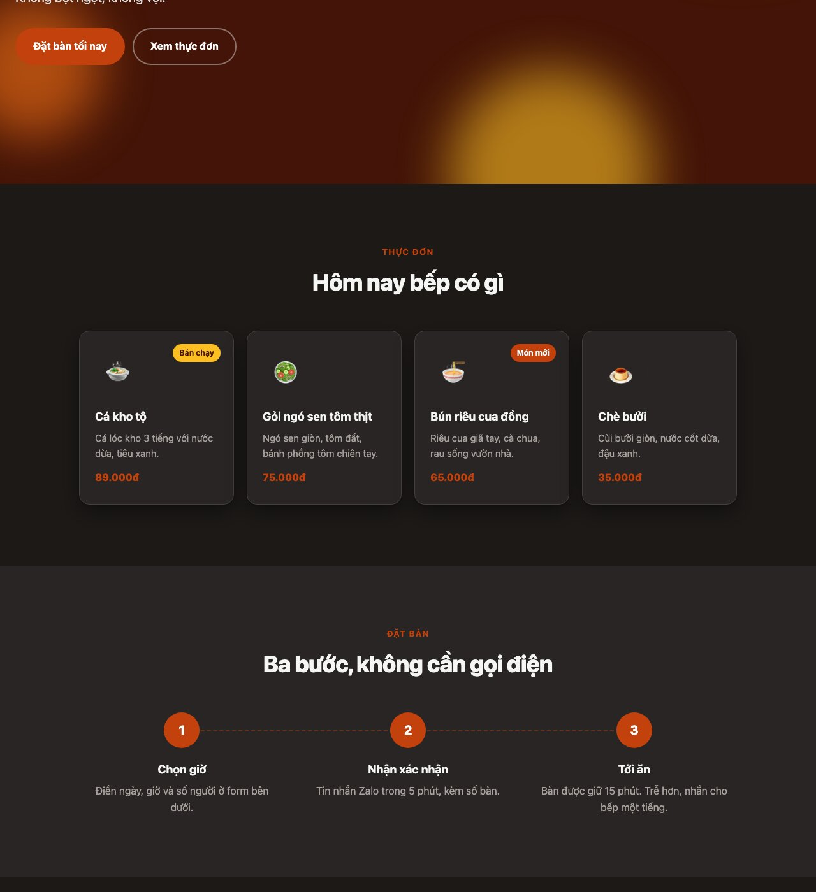
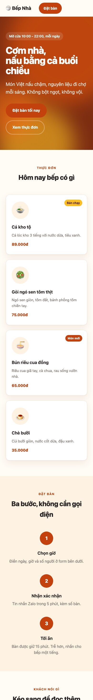
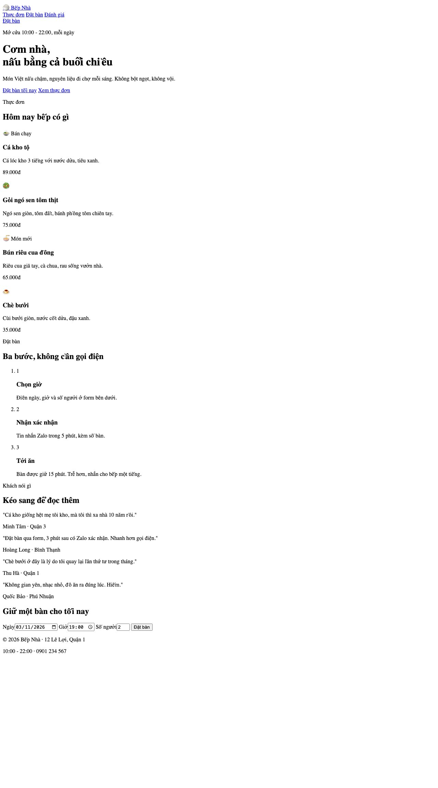
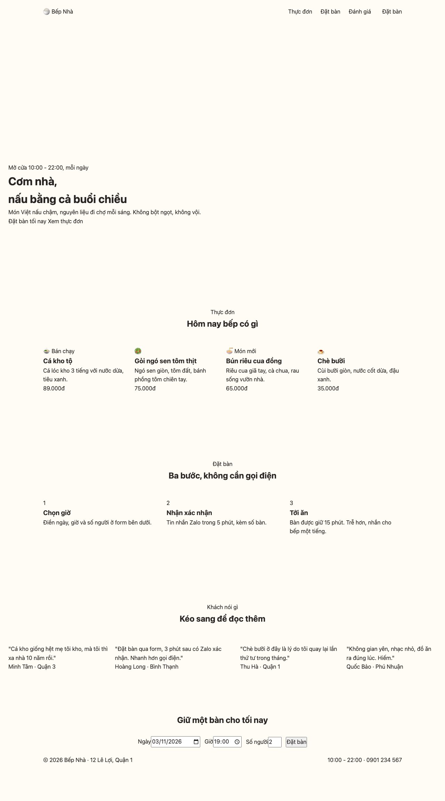
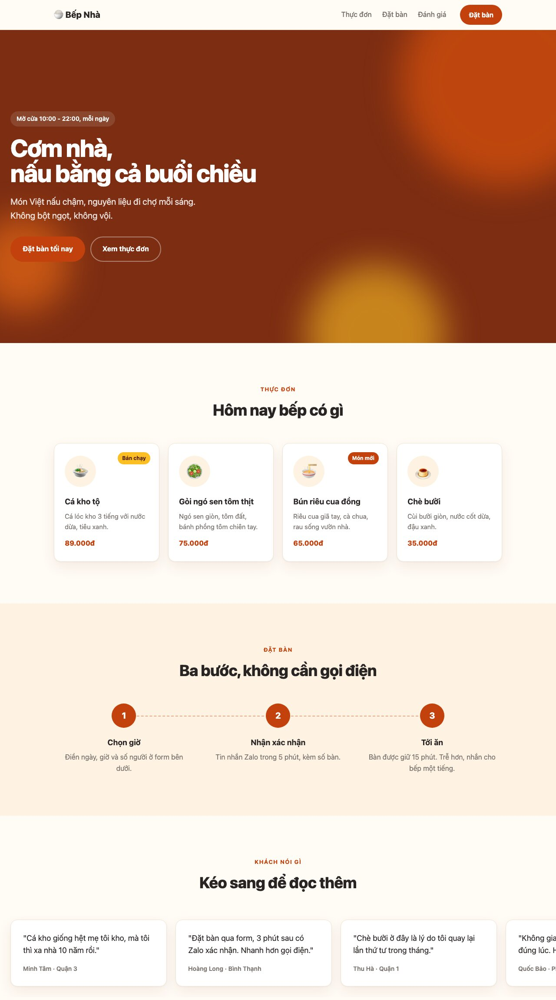

Bài cuối gom lại mọi thứ của series vào một trang giới thiệu nhà hàng, và thêm 3 kỹ năng chưa có ở các bài trước: **animation nền** chạy liên tục, **carousel bằng scroll-snap** không cần JavaScript, và **dark mode** tự theo hệ điều hành hoặc bật tay, chỉ bằng cách đổi token.

#### Kết quả cần đạt


Cùng trang đó khi hệ điều hành ở chế độ tối, không đổi một dòng HTML:





Mã nguồn: [index.html](/assets/code/post_137/index.html), [scss/main.scss](/assets/code/post_137/scss/main.scss), [css/style.css](/assets/code/post_137/css/style.css).

#### Bước 1: Tách component
```
header: logo, nav, btn
hero: shape × 3 (đốm màu mờ chuyển động), eyebrow, title, text, actions
section#menu: section-head + dishes > dish × 4 (icon, tag, name, desc, price)
section#steps (nền khác): section-head + steps > step × 3 (number, title, text)
section#reviews: section-head + reviews (cuộn ngang) > review × 4 (text, author)
reserve: title + form (field × 3, btn)
footer
```
<mark>section-head</mark> và <mark>btn</mark> dùng lại từ bài 132. Hai section <mark>menu</mark> và <mark>steps</mark> cùng là <mark>.section</mark>, khác nhau bằng modifier <mark>.section--alt</mark> cho nền.

#### Bước 2: Đặt tên

| Khối | Class |
|---|---|
| Khung | <mark>.container</mark>, <mark>.header</mark>, <mark>.header__inner</mark>, <mark>.logo</mark>, <mark>.nav</mark>, <mark>.nav__link</mark>, <mark>.section</mark>, <mark>.section--alt</mark>, <mark>.section-head</mark>, <mark>.section-head__eyebrow</mark>, <mark>.section-head__title</mark>, <mark>.footer</mark>, <mark>.footer__inner</mark> |
| Hero | <mark>.hero</mark>, <mark>.hero__inner</mark>, <mark>.hero__shape</mark> (+ <mark>--1</mark>, <mark>--2</mark>, <mark>--3</mark>), <mark>.hero__eyebrow</mark>, <mark>.hero__title</mark>, <mark>.hero__text</mark>, <mark>.hero__actions</mark> |
| Nội dung | <mark>.dishes</mark>, <mark>.dish</mark>, <mark>.dish__icon</mark>, <mark>.dish__tag</mark>, <mark>.dish__tag--new</mark>, <mark>.dish__name</mark>, <mark>.dish__desc</mark>, <mark>.dish__price</mark>, <mark>.steps</mark>, <mark>.step</mark>, <mark>.step__number</mark>, <mark>.step__title</mark>, <mark>.step__text</mark>, <mark>.reviews</mark>, <mark>.review</mark>, <mark>.review__text</mark>, <mark>.review__author</mark> |
| Đặt bàn | <mark>.reserve</mark>, <mark>.reserve__inner</mark>, <mark>.reserve__title</mark>, <mark>.reserve__form</mark>, <mark>.reserve__field</mark>, <mark>.reserve__input</mark>, <mark>.btn</mark>, <mark>.btn--primary</mark>, <mark>.btn--ghost</mark>, <mark>.btn--light</mark>, <mark>.btn--sm</mark> |

#### Bước 3: HTML
```html
<!doctype html>
<html lang="vi">
<head>
  <meta charset="utf-8">
  <meta name="viewport" content="width=device-width, initial-scale=1">
  <title>Bếp Nhà - Cơm Việt mỗi ngày</title>
  <link rel="stylesheet" href="css/style.css">
</head>
<body>
  <header class="header">
    <div class="container header__inner">
      <a class="logo" href="#">🍚 Bếp Nhà</a>
      <nav class="nav">
        <a class="nav__link" href="#menu">Thực đơn</a>
        <a class="nav__link" href="#steps">Đặt bàn</a>
        <a class="nav__link" href="#reviews">Đánh giá</a>
      </nav>
      <a class="btn btn--primary btn--sm" href="#reserve">Đặt bàn</a>
    </div>
  </header>

  <main>
    <section class="hero">
      <span class="hero__shape hero__shape--1"></span>
      <span class="hero__shape hero__shape--2"></span>
      <span class="hero__shape hero__shape--3"></span>
      <div class="container hero__inner">
        <p class="hero__eyebrow">Mở cửa 10:00 - 22:00, mỗi ngày</p>
        <h1 class="hero__title">Cơm nhà,<br>nấu bằng cả buổi chiều</h1>
        <p class="hero__text">Món Việt nấu chậm, nguyên liệu đi chợ mỗi sáng. Không bột ngọt, không vội.</p>
        <div class="hero__actions">
          <a class="btn btn--primary" href="#reserve">Đặt bàn tối nay</a>
          <a class="btn btn--ghost" href="#menu">Xem thực đơn</a>
        </div>
      </div>
    </section>

    <section class="section" id="menu">
      <div class="container">
        <div class="section-head">
          <p class="section-head__eyebrow">Thực đơn</p>
          <h2 class="section-head__title">Hôm nay bếp có gì</h2>
        </div>
        <div class="dishes">
          <article class="dish">
            <span class="dish__icon">🍲</span>
            <span class="dish__tag">Bán chạy</span>
            <h3 class="dish__name">Cá kho tộ</h3>
            <p class="dish__desc">Cá lóc kho 3 tiếng với nước dừa, tiêu xanh.</p>
            <p class="dish__price">89.000đ</p>
          </article>
          <article class="dish">
            <span class="dish__icon">🥗</span>
            <h3 class="dish__name">Gỏi ngó sen tôm thịt</h3>
            <p class="dish__desc">Ngó sen giòn, tôm đất, bánh phồng tôm chiên tay.</p>
            <p class="dish__price">75.000đ</p>
          </article>
          <article class="dish">
            <span class="dish__icon">🍜</span>
            <span class="dish__tag dish__tag--new">Món mới</span>
            <h3 class="dish__name">Bún riêu cua đồng</h3>
            <p class="dish__desc">Riêu cua giã tay, cà chua, rau sống vườn nhà.</p>
            <p class="dish__price">65.000đ</p>
          </article>
          <article class="dish">
            <span class="dish__icon">🍮</span>
            <h3 class="dish__name">Chè bưởi</h3>
            <p class="dish__desc">Cùi bưởi giòn, nước cốt dừa, đậu xanh.</p>
            <p class="dish__price">35.000đ</p>
          </article>
        </div>
      </div>
    </section>

    <section class="section section--alt" id="steps">
      <div class="container">
        <div class="section-head">
          <p class="section-head__eyebrow">Đặt bàn</p>
          <h2 class="section-head__title">Ba bước, không cần gọi điện</h2>
        </div>
        <ol class="steps">
          <li class="step">
            <span class="step__number">1</span>
            <h3 class="step__title">Chọn giờ</h3>
            <p class="step__text">Điền ngày, giờ và số người ở form bên dưới.</p>
          </li>
          <li class="step">
            <span class="step__number">2</span>
            <h3 class="step__title">Nhận xác nhận</h3>
            <p class="step__text">Tin nhắn Zalo trong 5 phút, kèm số bàn.</p>
          </li>
          <li class="step">
            <span class="step__number">3</span>
            <h3 class="step__title">Tới ăn</h3>
            <p class="step__text">Bàn được giữ 15 phút. Trễ hơn, nhắn cho bếp một tiếng.</p>
          </li>
        </ol>
      </div>
    </section>

    <section class="section" id="reviews">
      <div class="container">
        <div class="section-head">
          <p class="section-head__eyebrow">Khách nói gì</p>
          <h2 class="section-head__title">Kéo sang để đọc thêm</h2>
        </div>
      </div>
      <div class="reviews">
        <article class="review">
          <p class="review__text">"Cá kho giống hệt mẹ tôi kho, mà tôi thì xa nhà 10 năm rồi."</p>
          <p class="review__author">Minh Tâm · Quận 3</p>
        </article>
        <article class="review">
          <p class="review__text">"Đặt bàn qua form, 3 phút sau có Zalo xác nhận. Nhanh hơn gọi điện."</p>
          <p class="review__author">Hoàng Long · Bình Thạnh</p>
        </article>
        <article class="review">
          <p class="review__text">"Chè bưởi ở đây là lý do tôi quay lại lần thứ tư trong tháng."</p>
          <p class="review__author">Thu Hà · Quận 1</p>
        </article>
        <article class="review">
          <p class="review__text">"Không gian yên, nhạc nhỏ, đồ ăn ra đúng lúc. Hiếm."</p>
          <p class="review__author">Quốc Bảo · Phú Nhuận</p>
        </article>
      </div>
    </section>

    <section class="reserve" id="reserve">
      <div class="container reserve__inner">
        <h2 class="reserve__title">Giữ một bàn cho tối nay</h2>
        <form class="reserve__form">
          <label class="reserve__field">Ngày<input class="reserve__input" type="date" value="2026-11-03"></label>
          <label class="reserve__field">Giờ<input class="reserve__input" type="time" value="19:00"></label>
          <label class="reserve__field">Số người<input class="reserve__input" type="number" min="1" max="12" value="2"></label>
          <button class="btn btn--light" type="submit">Đặt bàn</button>
        </form>
      </div>
    </section>
  </main>

  <footer class="footer">
    <div class="container footer__inner">
      <p>© 2026 Bếp Nhà · 12 Lê Lợi, Quận 1</p>
      <p>10:00 - 22:00 · 0901 234 567</p>
    </div>
  </footer>
</body>
</html>
```
Mở trang



- Ba <mark>span.hero__shape</mark> rỗng là các đốm màu trang trí. Chúng là <mark>span</mark> rỗng chứ không phải <mark>::before</mark> vì cần **3** cái, mà một phần tử chỉ có 2 pseudo-element.
- Các bước đặt bàn là <mark>ol</mark> (danh sách **có thứ tự**), số thứ tự hiển thị bằng <mark>span</mark> để style được.
- Khối đánh giá nằm **ngoài** <mark>.container</mark>: carousel cần tràn ra sát mép màn hình để người dùng thấy "còn nữa" ở bên phải.
- Form đặt bàn dùng <mark>type="date"</mark>, <mark>type="time"</mark>, <mark>type="number"</mark> với <mark>min</mark>/<mark>max</mark>: trình duyệt tự hiện lịch, đồng hồ và giới hạn số.

#### Bước 4: Token với dark mode, reset, layout
```scss
/* ===== 1. Token & reset ===== */
@use "sass:map";

$breakpoints: (
  tablet: 900px,
  phone: 600px,
);

@mixin below($name) {
  @media (max-width: map.get($breakpoints, $name)) {
    @content;
  }
}

// Theme sáng: mặc định
:root {
  --color-primary: #c2410c;
  --color-primary-dark: #9a3412;
  --color-accent: #fbbf24;
  --color-text: #292524;
  --color-muted: #78716c;
  --color-bg: #fffbf5;
  --color-bg-alt: #fef3e2;
  --color-surface: #ffffff;
  --color-border: #f1e4d3;
  --color-hero: #7c2d12;
  --radius: 16px;
  --shadow: 0 1px 3px rgba(0, 0, 0, 0.05), 0 12px 32px rgba(124, 45, 18, 0.08);
  --font: system-ui, -apple-system, "Segoe UI", Roboto, sans-serif;
}

// Theme tối: tự theo hệ điều hành, hoặc bật tay bằng data-theme="dark"
@mixin dark-tokens {
  --color-text: #f5f5f4;
  --color-muted: #a8a29e;
  --color-bg: #1c1917;
  --color-bg-alt: #292524;
  --color-surface: #292524;
  --color-border: #44403c;
  --color-hero: #431407;
  --shadow: 0 1px 3px rgba(0, 0, 0, 0.3), 0 12px 32px rgba(0, 0, 0, 0.4);
}

@media (prefers-color-scheme: dark) {
  :root:not([data-theme="light"]) {
    @include dark-tokens;
  }
}

:root[data-theme="dark"] {
  @include dark-tokens;
}
```
Đây là toàn bộ dark mode của trang. Vì mọi màu ở các bài trước đều đi qua token, giờ chỉ cần **ghi đè token** là cả trang đổi theme. Hai cách kích hoạt dùng chung một mixin:
- <mark>@media (prefers-color-scheme: dark)</mark>: người dùng bật chế độ tối trong hệ điều hành thì trang tự tối. <mark>:not([data-theme="light"])</mark> để nếu họ chủ động chọn sáng trên trang thì ưu tiên lựa chọn đó.
- <mark>[data-theme="dark"]</mark> trên thẻ <mark>html</mark>: nút chuyển theme (vài dòng JavaScript đặt thuộc tính này) hoặc đơn giản là để bạn **test** dark mode bằng cách thêm thuộc tính vào HTML mà không cần đổi cài đặt máy.

Chỉ đổi những token **cần** đổi: màu chính, màu nhấn vẫn giữ nguyên, nên thương hiệu không đổi khi sang tối.

**Mẹo:** test dark mode nhanh trong DevTools: Rendering tab (⋮ → More tools → Rendering) có mục "Emulate CSS media feature prefers-color-scheme".
```scss
*,
*::before,
*::after {
  box-sizing: border-box;
  margin: 0;
  padding: 0;
}

html {
  scroll-behavior: smooth;
  scroll-padding-top: 80px;
}

body {
  font-family: var(--font);
  color: var(--color-text);
  background: var(--color-bg);
  line-height: 1.6;
}

a {
  color: inherit;
  text-decoration: none;
}

ol,
ul {
  list-style: none;
}

button,
input {
  font: inherit;
  color: inherit;
}
```
<mark>scroll-padding-top: 80px</mark>: khi bấm link <mark>#menu</mark>, trang cuộn tới section và chừa 80px cho header dính, thay vì section bị header che. Bài 134 dùng <mark>scroll-margin-top</mark> trên từng heading; đặt trên <mark>html</mark> áp dụng cho mọi anchor.
```scss
/* ===== 2. Layout ===== */
.container {
  max-width: 1080px;
  margin: 0 auto;
  padding: 0 24px;
}

.header__inner {
  height: 68px;
  display: flex;
  align-items: center;
  gap: 32px;
}

.nav {
  margin-left: auto;
  display: flex;
  gap: 24px;
}

.hero {
  position: relative;
  overflow: hidden;
  min-height: min(80vh, 720px);
  display: grid;
  align-items: center;
}

.hero__inner {
  position: relative;
  max-width: 640px;
  margin: 0;
  padding: 96px 24px;
}

.section {
  padding: 96px 0;
}

.section-head {
  text-align: center;
  margin-bottom: 48px;
}

.dishes {
  display: grid;
  grid-template-columns: repeat(4, 1fr);
  gap: 20px;
}

.steps {
  display: grid;
  grid-template-columns: repeat(3, 1fr);
  gap: 32px;
}

.reviews {
  display: flex;
  gap: 20px;
  overflow-x: auto;
  padding: 8px 24px 24px;
  scroll-snap-type: x mandatory;
  scroll-padding: 24px;
}

.reserve__inner {
  text-align: center;
}

.reserve__form {
  margin-top: 28px;
  display: flex;
  justify-content: center;
  align-items: flex-end;
  gap: 12px;
  flex-wrap: wrap;
}

.footer__inner {
  display: flex;
  justify-content: space-between;
  flex-wrap: wrap;
  gap: 8px;
  padding: 24px;
}
```
Trang lúc này



- <mark>min-height: min(80vh, 720px)</mark>: hero cao 80% màn hình nhưng **không quá 720px**. Chỉ <mark>80vh</mark> thì trên màn hình 27 inch dọc hero cao 1600px, toàn khoảng trống. <mark>min()</mark> nhận giá trị nhỏ hơn trong hai.
- **Carousel** là một flex container với <mark>overflow-x: auto</mark> (cuộn ngang) và <mark>scroll-snap-type: x mandatory</mark>: khi người dùng thả tay, trình duyệt tự cuộn tới card gần nhất. <mark>scroll-padding: 24px</mark> để card "dính" cách mép 24px đúng bằng padding. Đã dùng được ngay sau bước này, không JavaScript.

#### Bước 5: Style component
Header, nút, hero
```scss
/* ===== 3. Component ===== */
@use "../tokens" as *;

.header {
  position: sticky;
  top: 0;
  z-index: 10;
  background: color-mix(in srgb, var(--color-bg) 85%, transparent);
  backdrop-filter: blur(10px);
  border-bottom: 1px solid var(--color-border);
}

.logo {
  font-weight: 800;
  font-size: 1.25rem;
}

.nav__link {
  font-weight: 500;
  color: var(--color-muted);
}

.btn {
  display: inline-block;
  padding: 14px 26px;
  border-radius: 999px;
  border: 2px solid transparent;
  font-weight: 700;
  text-align: center;
  cursor: pointer;

  &--sm {
    padding: 9px 18px;
    font-size: 0.9375rem;
  }

  &--primary {
    background: var(--color-primary);
    color: #fff;
  }

  &--ghost {
    border-color: rgba(255, 255, 255, 0.4);
    color: #fff;
  }

  &--light {
    background: var(--color-accent);
    color: #431407;
  }
}

.hero {
  background: var(--color-hero);
  color: #fff;

  &__shape {
    position: absolute;
    border-radius: 50%;
    filter: blur(40px);
    opacity: 0.6;
    pointer-events: none;

    &--1 {
      width: 480px;
      height: 480px;
      right: -120px;
      top: -120px;
      background: #ea580c;
    }

    &--2 {
      width: 320px;
      height: 320px;
      right: 20%;
      bottom: -140px;
      background: var(--color-accent);
    }

    &--3 {
      width: 220px;
      height: 220px;
      left: -60px;
      bottom: 10%;
      background: #f97316;
    }
  }

  &__eyebrow {
    display: inline-block;
    padding: 6px 14px;
    border-radius: 999px;
    background: rgba(255, 255, 255, 0.12);
    font-size: 0.875rem;
    font-weight: 600;
  }

  &__title {
    margin-top: 20px;
    font-size: 3.5rem;
    line-height: 1.05;
    font-weight: 800;
    letter-spacing: -0.03em;
  }

  &__text {
    margin-top: 20px;
    font-size: 1.25rem;
    opacity: 0.85;
    max-width: 480px;
  }

  &__actions {
    margin-top: 32px;
    display: flex;
    gap: 12px;
    flex-wrap: wrap;
  }
}
```
- Nền header là <mark>color-mix(in srgb, var(--color-bg) 85%, transparent)</mark>: lấy màu nền **của theme hiện tại** pha 15% trong suốt. Bài 132 viết cứng <mark>rgba(255,255,255,0.9)</mark>, sang dark mode sẽ sai; <mark>color-mix</mark> giải quyết đúng vì nó đọc token.
- Đốm màu: 3 hình tròn lớn, <mark>filter: blur(40px)</mark> làm chúng thành vệt sáng mềm, <mark>pointer-events: none</mark> để không chắn click. Hero có <mark>overflow: hidden</mark> nên phần tràn bị cắt.

Các section còn lại
```scss
@use "../tokens" as *;

.section--alt {
  background: var(--color-bg-alt);
}

.section-head {
  &__eyebrow {
    color: var(--color-primary);
    font-weight: 700;
    text-transform: uppercase;
    letter-spacing: 0.1em;
    font-size: 0.8125rem;
  }

  &__title {
    margin-top: 8px;
    font-size: 2.25rem;
    font-weight: 800;
    letter-spacing: -0.02em;
  }
}

.dish {
  position: relative;
  padding: 28px 24px;
  background: var(--color-surface);
  border: 1px solid var(--color-border);
  border-radius: var(--radius);
  box-shadow: var(--shadow);

  &__icon {
    display: grid;
    place-items: center;
    width: 72px;
    height: 72px;
    border-radius: 50%;
    background: var(--color-bg-alt);
    font-size: 2.25rem;
  }

  &__tag {
    position: absolute;
    top: 20px;
    right: 20px;
    padding: 4px 10px;
    border-radius: 999px;
    background: var(--color-accent);
    color: #431407;
    font-size: 0.75rem;
    font-weight: 700;

    &--new {
      background: var(--color-primary);
      color: #fff;
    }
  }

  &__name {
    margin-top: 20px;
    font-size: 1.125rem;
    font-weight: 700;
  }

  &__desc {
    margin-top: 6px;
    font-size: 0.9375rem;
    color: var(--color-muted);
  }

  &__price {
    margin-top: 14px;
    font-weight: 800;
    color: var(--color-primary);
  }
}

.step {
  position: relative;
  text-align: center;
  padding: 0 12px;

  &__number {
    display: grid;
    place-items: center;
    width: 56px;
    height: 56px;
    margin: 0 auto;
    border-radius: 50%;
    background: var(--color-primary);
    color: #fff;
    font-size: 1.25rem;
    font-weight: 800;
    position: relative;
    z-index: 1;
  }

  &:not(:last-child)::after {
    content: "";
    position: absolute;
    top: 28px;
    left: 50%;
    width: 100%;
    border-top: 2px dashed var(--color-primary);
    opacity: 0.4;
  }

  &__title {
    margin-top: 20px;
    font-size: 1.125rem;
    font-weight: 700;
  }

  &__text {
    margin-top: 6px;
    color: var(--color-muted);
  }
}

.review {
  flex: 0 0 360px;
  scroll-snap-align: start;
  padding: 28px;
  background: var(--color-surface);
  border: 1px solid var(--color-border);
  border-radius: var(--radius);
  box-shadow: var(--shadow);

  &__text {
    font-size: 1.125rem;
    line-height: 1.6;
  }

  &__author {
    margin-top: 16px;
    font-size: 0.875rem;
    font-weight: 600;
    color: var(--color-muted);
  }
}

.reserve {
  padding: 80px 0;
  background: var(--color-hero);
  color: #fff;

  &__title {
    font-size: 2.25rem;
    font-weight: 800;
    letter-spacing: -0.02em;
  }

  &__field {
    display: grid;
    gap: 6px;
    text-align: left;
    font-size: 0.8125rem;
    font-weight: 600;
    opacity: 0.9;
  }

  &__input {
    padding: 12px 14px;
    border-radius: 10px;
    border: 1px solid rgba(255, 255, 255, 0.3);
    background: rgba(255, 255, 255, 0.1);
    color: #fff;
    color-scheme: dark;
    min-width: 150px;

    &:focus {
      outline: none;
      border-color: var(--color-accent);
    }
  }
}

.footer {
  font-size: 0.875rem;
  color: var(--color-muted);
}
```
Trang lúc này



- **Đường nối giữa các bước**: <mark>::after</mark> của mỗi <mark>.step</mark> **trừ bước cuối** (<mark>:not(:last-child)</mark>), là một đường gạch ngang bắt đầu từ giữa bước này (<mark>left: 50%</mark>) kéo sang bước kế. Số thứ tự có <mark>z-index: 1</mark> để đè lên đường.
- **Card đánh giá**: <mark>flex: 0 0 360px</mark> (không co, không giãn, rộng đúng 360px) và <mark>scroll-snap-align: start</mark>: điểm dính là mép trái card.
- **Ô nhập trên nền tối**: <mark>color-scheme: dark</mark> bảo trình duyệt vẽ icon lịch/đồng hồ của <mark>type="date"</mark> màu sáng. Thiếu dòng này, icon đen trên nền nâu không nhìn thấy.

**Mẹo:** nền của hero và khối đặt bàn dùng cùng token <mark>--color-hero</mark>, sang dark mode đổi một chỗ là cả hai đổi. Khi hai nơi **phải** cùng màu, dùng chung token; khi chỉ **tình cờ** cùng màu, dùng hai token khác nhau để sau này đổi riêng được.

#### Bước 6: Animation
```scss
/* ===== 4. Hiệu ứng ===== */
@keyframes drift {
  0%, 100% { transform: translate(0, 0) scale(1); }
  50% { transform: translate(-30px, 20px) scale(1.08); }
}

@keyframes rise {
  from { opacity: 0; transform: translateY(20px); }
  to { opacity: 1; transform: translateY(0); }
}

.hero__shape {
  animation: drift 14s ease-in-out infinite;

  &--2 { animation-duration: 18s; animation-delay: -5s; }
  &--3 { animation-duration: 11s; animation-delay: -2s; }
}

.hero__inner > * {
  animation: rise 0.7s ease both;
}

.hero__inner > :nth-child(2) { animation-delay: 0.1s; }
.hero__inner > :nth-child(3) { animation-delay: 0.2s; }
.hero__inner > :nth-child(4) { animation-delay: 0.3s; }

.btn {
  transition: transform 0.15s ease, background-color 0.2s ease, border-color 0.2s ease, box-shadow 0.2s ease;

  &:hover {
    transform: translateY(-2px);
  }

  &--primary:hover {
    background: var(--color-primary-dark);
    box-shadow: 0 10px 24px rgba(194, 65, 12, 0.35);
  }

  &--ghost:hover {
    border-color: #fff;
  }
}

.dish,
.review {
  transition: transform 0.25s ease, box-shadow 0.25s ease;
}

.dish:hover {
  transform: translateY(-6px);
}

.dish__icon {
  transition: transform 0.4s ease;
}

.dish:hover .dish__icon {
  transform: rotate(-8deg) scale(1.1);
}

.nav__link {
  transition: color 0.2s ease;

  &:hover {
    color: var(--color-text);
  }
}

@media (prefers-reduced-motion: reduce) {
  *,
  *::before,
  *::after {
    animation: none !important;
    transition: none !important;
  }

  html {
    scroll-behavior: auto;
  }
}
```
Ba đốm màu trôi chậm và phóng to thu nhỏ **mãi mãi** (<mark>infinite</mark>), mỗi đốm một tốc độ khác nhau (14s, 18s, 11s) nên chuyển động không bao giờ lặp lại y hệt. <mark>animation-delay</mark> **âm**: đốm 2 bắt đầu như thể đã chạy được 5 giây, để lúc tải trang 3 đốm không cùng xuất phát từ một vị trí.

Vì chúng chỉ dùng <mark>transform</mark> và đã có <mark>filter: blur</mark> cố định, trình duyệt chạy animation này trên GPU, không tốn CPU dù chạy liên tục. Một animation nền kiểu này mà dùng <mark>left</mark>/<mark>top</mark> sẽ làm máy nóng.

**Mẹo:** animation vô hạn là thứ đầu tiên phải tắt trong <mark>prefers-reduced-motion</mark>. Với người bị say chuyển động, một đốm màu lắc lư liên tục ở góc mắt có thể gây khó chịu thật sự.

#### Bước 7: Responsive
```scss
/* ===== 5. Responsive ===== */
@use "tokens" as *;

@include below(tablet) {
  .nav {
    display: none;
  }

  .hero__title {
    font-size: 2.5rem;
  }

  .section {
    padding: 64px 0;
  }

  .section-head__title {
    font-size: 1.75rem;
  }

  .dishes {
    grid-template-columns: repeat(2, 1fr);
  }

  .steps {
    grid-template-columns: 1fr;
    max-width: 420px;
    margin: 0 auto;
    gap: 40px;
  }

  .step:not(:last-child)::after {
    display: none;
  }
}

@include below(phone) {
  .hero {
    min-height: auto;
  }

  .hero__inner {
    padding: 64px 24px;
  }

  .dishes {
    grid-template-columns: 1fr;
  }

  .review {
    flex-basis: 85%;
  }

  .reserve__form {
    flex-direction: column;
    align-items: stretch;
  }

  .reserve__input {
    width: 100%;
  }
}
```
Hai chi tiết đáng chú ý:
- Đường nối giữa các bước là ngang, khi các bước xếp dọc thì bỏ đi (<mark>display: none</mark> trên <mark>::after</mark>).
- Card đánh giá trên điện thoại rộng <mark>85%</mark> chứ không phải 100%: ló ra một mẩu card kế tiếp để người dùng **biết** có thể kéo sang. Đây là mẹo UX rất nhỏ nhưng nhiều trang quên.

Nav bị giấu dưới tablet mà không có nút menu: trang này chỉ có 3 link nội bộ và nút "Đặt bàn" đã ở header, nên chấp nhận được. Cần menu thì lấy từ bài 132.
```scss
@use "tokens";
@use "reset";
@use "layout";
@use "components/header-hero";
@use "components/sections";
@use "effects";
@use "responsive";
```

#### Checklist
- Thêm <mark>data-theme="dark"</mark> vào thẻ <mark>html</mark>: cả trang tối, nút và tag vẫn đúng màu thương hiệu. Bỏ ra: sáng lại.
- Kéo carousel bằng chuột (Shift + lăn) hoặc ngón tay: card dừng đúng mép, không lệch nửa chừng.
- Bấm "Thực đơn" trên header: cuộn tới section, tiêu đề không bị header che.
- Bật "Reduce motion": đốm màu đứng yên, hero hiện ngay.
- 390px: thấy mẩu card đánh giá thứ hai ló ra bên phải; form đặt bàn xếp dọc, icon lịch nhìn thấy được.

#### Bài tập thêm
- Thêm nút chuyển theme ☀️/🌙 ở header: JavaScript đặt <mark>document.documentElement.dataset.theme</mark> và lưu vào <mark>localStorage</mark>. CSS không cần sửa.
- Thêm nút trái/phải cho carousel: <mark>reviews.scrollBy({ left: 380, behavior: "smooth" })</mark>, CSS scroll-snap lo phần còn lại.
- Làm section "Thực đơn" lọc theo loại (Món chính / Tráng miệng) bằng radio + <mark>:has()</mark> như công tắc giá ở bài 131.

#### Kết thúc series
Tám trang, một quy trình. Nhìn lại, những thứ lặp lại nhiều nhất không phải là thuộc tính CSS lạ, mà là vài thói quen:

| Thói quen | Xuất hiện ở |
|---|---|
| Tách component rồi mới viết HTML, đặt tên BEM | Mọi bài |
| Token cho màu và kích thước, đổi một chỗ đổi cả trang | Mọi bài, đỉnh điểm là dark mode bài 137 |
| Layout trước, màu sau; xem trang sau mỗi bước | Mọi bài |
| <mark>margin: auto</mark> trong flex để đẩy phần tử ra xa | 130, 131, 132, 136 |
| <mark>::before</mark>/<mark>::after</mark> thay vì thêm HTML trang trí | 131, 133, 135, 136, 137 |
| Checkbox/radio ẩn + <mark>+</mark>/<mark>~</mark>/<mark>:has()</mark> thay JavaScript | 131, 132, 133 |
| <mark>min-width: 0</mark> khi grid/flex tràn | 133, 134, 136 |
| Chỉ animate <mark>transform</mark>/<mark>opacity</mark>, tôn trọng reduced motion | 132, 136, 137 |
| Media query ở cuối, chỉ sửa chỗ vỡ | Mọi bài |

Bước tiếp theo tự nhiên là lấy một thiết kế thật (Dribbble, hoặc trang web bạn thích), chụp lại, và làm đúng 7 bước mà không nhìn code của ai. Lần đầu sẽ mất một ngày; lần thứ năm sẽ mất một buổi.
