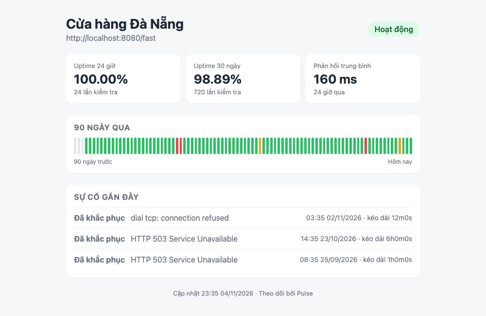

Mọi thứ Pulse trả về tới giờ đều là JSON, dành cho máy. Bài này làm thứ dành cho người: một **trang status công khai** như <mark>status.github.com</mark>, không cần đăng nhập, cho thấy website đang sống hay chết, uptime 24 giờ và 30 ngày, dải màu 90 ngày và danh sách sự cố. Công cụ là <mark>html/template</mark> trong thư viện chuẩn, kèm <mark>embed</mark> để template và CSS nằm luôn trong binary. Trên đường đi sẽ gặp hai việc nhỏ nhưng rất "thật": thêm cột NOT NULL vào bảng đã có dữ liệu, và tạo slug từ tên tiếng Việt có dấu.

#### Kết quả cuối bài


#### HTML từ server, không cần React
Series Next.js (bài 138 trở đi) dạy render giao diện bằng component. Với một trang như thế này, React là dùng dao mổ trâu: không có tương tác, dữ liệu đổi mỗi phút, ai mở cũng thấy giống nhau. Go làm được trong một file template: server điền dữ liệu vào HTML rồi gửi đi, trình duyệt chỉ việc hiện. Cách này đủ cho trang công khai, trang quản trị nội bộ, email HTML, trang in hóa đơn. Khi nào cần tương tác nhiều (kéo thả, cập nhật liên tục) thì mới cần frontend riêng gọi JSON API ta đã có.

Go có hai package template cùng cú pháp: <mark>text/template</mark> cho văn bản bất kỳ, và <mark>html/template</mark> **hiểu HTML**: giá trị chèn vào được tự động escape theo ngữ cảnh. Tên monitor là <mark>&lt;script&gt;alert(1)&lt;/script&gt;</mark> sẽ hiện nguyên chữ chứ không chạy. Với HTML, luôn dùng <mark>html/template</mark>; đây là lớp chống XSS miễn phí, cùng tinh thần với bài 092.

#### Bước 1: Thêm cột slug
Trang công khai cần một URL. Dùng id (<mark>/status/7</mark>) thì ai cũng đoán được <mark>/status/8</mark>, <mark>/status/9</mark> và xem trộm mọi monitor trong hệ thống, đúng lỗi IDOR của bài 092. Thay vào đó mỗi monitor có một **slug** khó đoán: <mark>cua-hang-da-nang-519ac2</mark>. Thêm cột:
```sql
-- internal/store/migrations/00005_add_slug.sql
-- +goose Up
ALTER TABLE monitors ADD COLUMN slug TEXT;
UPDATE monitors SET slug = 'monitor-' || id;
ALTER TABLE monitors ALTER COLUMN slug SET NOT NULL;
CREATE UNIQUE INDEX monitors_slug_idx ON monitors (slug);

-- +goose Down
ALTER TABLE monitors DROP COLUMN slug;
```
Bảng đã có dữ liệu, nên không thể <mark>ADD COLUMN slug TEXT NOT NULL</mark> một phát: PostgreSQL sẽ từ chối vì các dòng cũ không có giá trị. Mẫu an toàn là **ba bước**: thêm cột cho phép NULL, điền giá trị cho dòng cũ, rồi mới SET NOT NULL. Bài 114 nói kỹ hơn về migration an toàn trên bảng lớn. Unique index vừa cấm trùng vừa làm <mark>WHERE slug = $1</mark> nhanh (bài 111).

#### Bước 2: Slug từ tên tiếng Việt
```go
// internal/monitor/slug.go
package monitor

import (
	"crypto/rand"
	"encoding/hex"
	"strings"
	"unicode"

	"golang.org/x/text/unicode/norm"
)

// NewSlug tạo slug từ tên, kèm đuôi ngẫu nhiên để không trùng:
// "Cửa hàng Đà Nẵng" -> "cua-hang-da-nang-3f9a1c".
func NewSlug(name string) string {
	suffix := make([]byte, 3)
	rand.Read(suffix)
	return slugify(name) + "-" + hex.EncodeToString(suffix)
}

// slugify bỏ dấu tiếng Việt, đổi chữ thường, thay mọi ký tự lạ bằng "-".
func slugify(s string) string {
	// NFD tách "ế" thành "e" + dấu; bỏ dấu (nhóm Mn) là còn "e".
	s = norm.NFD.String(strings.ToLower(s))
	var b strings.Builder
	lastDash := true
	for _, r := range s {
		switch {
		case unicode.Is(unicode.Mn, r):
			continue
		case r == 'đ':
			r = 'd'
		}
		if r >= 'a' && r <= 'z' || r >= '0' && r <= '9' {
			b.WriteRune(r)
			lastDash = false
		} else if !lastDash {
			b.WriteByte('-')
			lastDash = true
		}
	}
	out := strings.TrimRight(b.String(), "-")
	if len(out) > 40 {
		out = strings.TrimRight(out[:40], "-")
	}
	if out == "" {
		out = "monitor"
	}
	return out
}
```
Đây là bài học về **chuỗi trong Go**. Một <mark>string</mark> là dãy byte UTF-8; <mark>len("Đà")</mark> là 4 chứ không phải 2, và <mark>s[0]</mark> là một byte, không phải một chữ. Muốn đi từng chữ, dùng <mark>for _, r := range s</mark>: mỗi vòng cho một **rune** (mã Unicode của một ký tự). Quên điều này là slug tiếng Việt thành rác.

Bỏ dấu dùng mẹo Unicode: dạng **NFD** tách một chữ có dấu thành chữ gốc + các dấu đi kèm, ví dụ "ế" thành "e" + dấu mũ + dấu sắc. Các dấu đó thuộc nhóm <mark>Mn</mark> (Mark, nonspacing), lọc bỏ là còn "e". Package <mark>golang.org/x/text/unicode/norm</mark> làm việc tách này; nó đã có sẵn trong <mark>go.mod</mark> vì pgx dùng, chạy <mark>go get golang.org/x/text</mark> để chuyển từ gián tiếp sang trực tiếp. Riêng chữ "đ" là một chữ cái riêng, không phải "d" có dấu, nên xử lý tay.

<mark>strings.Builder</mark> là cách ghép chuỗi hiệu quả: nối bằng <mark>+=</mark> trong vòng lặp tạo chuỗi mới mỗi lần, Builder chỉ cấp phát một bộ đệm. Biến <mark>lastDash</mark> gộp nhiều ký tự lạ liên tiếp thành một dấu gạch, và khởi tạo <mark>true</mark> để không có gạch ở đầu.

Đuôi ngẫu nhiên lấy từ <mark>crypto/rand</mark>, không phải <mark>math/rand</mark>: 3 byte thành 6 ký tự hex, 16 triệu khả năng, đủ để không trùng tên và không đoán được. Mọi thứ dùng làm "bí mật" hay "khó đoán" đều phải từ <mark>crypto/rand</mark>.

Test với bảng là map:
```go
// internal/monitor/slug_test.go
package monitor

import (
	"regexp"
	"testing"
)

func TestSlugify(t *testing.T) {
	tests := map[string]string{
		"Cửa hàng Đà Nẵng":   "cua-hang-da-nang",
		"  API  Production ": "api-production",
		"Shop!!! (v2)":       "shop-v2",
		"":                   "monitor",
		"日本語":                "monitor",
	}
	for in, want := range tests {
		if got := slugify(in); got != want {
			t.Errorf("slugify(%q) = %q, muốn %q", in, got, want)
		}
	}
}

func TestNewSlug(t *testing.T) {
	a, b := NewSlug("Shop"), NewSlug("Shop")
	if a == b {
		t.Error("hai slug cùng tên phải khác nhau nhờ đuôi ngẫu nhiên")
	}
	if !regexp.MustCompile(`^shop-[0-9a-f]{6}$`).MatchString(a) {
		t.Errorf("slug sai dạng: %s", a)
	}
}
```
Khi mỗi trường hợp chỉ là "vào → ra", map gọn hơn slice struct của bài 153. Tiếng Nhật thành "monitor" vì ta chỉ giữ a-z: với sản phẩm quốc tế bạn sẽ cần cách khác, nhưng Pulse phục vụ người Việt.

Trong <mark>internal/monitor/monitor.go</mark>, thêm <mark>Slug string `json:"slug"`</mark> vào <mark>Monitor</mark> (sau <mark>Name</mark>), kiểu <mark>DayStat</mark> cho dải 90 ngày, và hai phương thức mới vào <mark>Store</mark>:
```go
// internal/monitor/monitor.go (thêm)
// DayStat là uptime của một ngày, dùng cho dải 90 ngày trên trang status.
type DayStat struct {
	Day           time.Time `json:"day"`
	Total         int       `json:"total"`
	Up            int       `json:"up"`
	UptimePercent float64   `json:"uptime_percent"`
}
```
```go
// internal/monitor/monitor.go (thêm vào cuối interface Store)
	GetBySlug(ctx context.Context, slug string) (Monitor, error)
	DailyUptime(ctx context.Context, monitorID int64, days int) ([]DayStat, error)
```

#### Bước 3: Store
Trong <mark>internal/store/monitors.go</mark>, thêm <mark>slug</mark> vào <mark>monitorColumns</mark> và <mark>scanMonitor</mark> (sau <mark>name</mark>), <mark>Create</mark> chèn thêm <mark>monitor.NewSlug(m.Name)</mark>, và thêm:
```go
// internal/store/monitors.go (thêm)
// GetBySlug dùng cho trang status công khai, không cần user_id.
func (s *Monitors) GetBySlug(ctx context.Context, slug string) (monitor.Monitor, error) {
	m, err := scanMonitor(s.db.pool.QueryRow(ctx, `SELECT `+monitorColumns+` FROM monitors WHERE slug = $1`, slug))
	if errors.Is(err, pgx.ErrNoRows) {
		return monitor.Monitor{}, monitor.ErrNotFound
	}
	return m, err
}
```
Khác với <mark>Get</mark> ở bài 157, hàm này **không** lọc theo <mark>user_id</mark>: trang status là công khai, ai có link đều xem được. Slug chính là "quyền".

Dải 90 ngày cần số lần up và tổng số lần kiểm tra **theo từng ngày**:
```go
// internal/store/checks.go (thêm)
// DailyUptime trả về đúng `days` phần tử, cũ nhất trước, ngày không có dữ liệu thì Total = 0.
// Ngày tính theo UTC ở cả hai phía (SQL và Go) để khớp nhau.
func (s *Monitors) DailyUptime(ctx context.Context, monitorID int64, days int) ([]monitor.DayStat, error) {
	today := time.Now().UTC().Truncate(24 * time.Hour)
	from := today.AddDate(0, 0, -(days - 1))

	rows, err := s.db.pool.Query(ctx, `
		SELECT date_trunc('day', checked_at AT TIME ZONE 'UTC') AS day,
		       count(*),
		       count(*) FILTER (WHERE status = 'up')
		FROM checks
		WHERE monitor_id = $1 AND checked_at >= $2
		GROUP BY day`, monitorID, from)
	if err != nil {
		return nil, err
	}
	defer rows.Close()

	byDay := map[time.Time]monitor.DayStat{}
	for rows.Next() {
		var d monitor.DayStat
		if err := rows.Scan(&d.Day, &d.Total, &d.Up); err != nil {
			return nil, err
		}
		if d.Total > 0 {
			d.UptimePercent = float64(d.Up) * 100 / float64(d.Total)
		}
		byDay[d.Day.UTC()] = d
	}
	if err := rows.Err(); err != nil {
		return nil, err
	}

	// Điền đủ 90 ngày, kể cả ngày trống, để trang status vẽ đủ 90 cột.
	list := make([]monitor.DayStat, 0, days)
	for i := range days {
		day := from.AddDate(0, 0, i)
		d, ok := byDay[day]
		if !ok {
			d = monitor.DayStat{Day: day}
		}
		list = append(list, d)
	}
	return list, nil
}
```
- <mark>date_trunc('day', ...)</mark> cắt giờ phút đi, <mark>GROUP BY day</mark> gom theo ngày. <mark>count(*) FILTER (WHERE status = 'up')</mark> đếm có điều kiện ngay trong SQL, gọn hơn <mark>sum(CASE WHEN ...)</mark>. Cộng trong database, không kéo cả nghìn dòng về Go, cùng lý do với <mark>Stats</mark> ở bài 156.
- SQL chỉ trả về những ngày **có** dữ liệu. Trang web cần đủ 90 cột, kể cả ngày trống (monitor mới tạo hay bị tắt). Nên Go đổ kết quả vào map theo ngày rồi lặp đúng 90 ngày, ngày nào thiếu thì zero value <mark>DayStat{Day: day}</mark> với <mark>Total = 0</mark>. <mark>time.Time</mark> dùng được làm key của map vì so sánh được bằng <mark>==</mark>.
- **Múi giờ** là cái bẫy ở đây. "Ngày" bắt đầu lúc nào tùy múi giờ; nếu SQL cắt ngày theo múi giờ của server database còn Go cắt theo UTC, hai bên lệch nhau và map không khớp key nào. Code ép cả hai về UTC: <mark>AT TIME ZONE 'UTC'</mark> trong SQL, <mark>.UTC().Truncate(24 * time.Hour)</mark> trong Go. Hệ quả thật thà: người ở Việt Nam thấy "ngày" bắt đầu lúc 7 giờ sáng. Với một dải màu tổng quan thì chấp nhận được, cách đúng hơn nằm ở bài tập.

#### Bước 4: Package web
```go
// internal/web/web.go
// Package web phục vụ trang status công khai bằng html/template.
package web

import (
	"context"
	"embed"
	"errors"
	"html/template"
	"io/fs"
	"log/slog"
	"net/http"
	"time"

	"github.com/thachnguyenp/pulse/internal/cache"
	"github.com/thachnguyenp/pulse/internal/monitor"
)

//go:embed templates/*.html static/*
var files embed.FS

// Store là những gì trang status cần đọc.
type Store interface {
	GetBySlug(ctx context.Context, slug string) (monitor.Monitor, error)
	Stats(ctx context.Context, monitorID int64, since time.Time) (monitor.Stats, error)
	DailyUptime(ctx context.Context, monitorID int64, days int) ([]monitor.DayStat, error)
	ListIncidents(ctx context.Context, monitorID int64, limit int) ([]monitor.Incident, error)
}

// Handler render trang status.
type Handler struct {
	store Store
	cache *cache.Cache
	tmpl  *template.Template
}

func New(store Store, c *cache.Cache) *Handler {
	funcs := template.FuncMap{
		"barClass": barClass,
		"date":     func(t time.Time) string { return t.Format("02/01/2006") },
		"datetime": func(t time.Time) string { return t.Local().Format("15:04 02/01/2006") },
	}
	// Parse một lần lúc khởi động; template lỗi thì chương trình dừng ngay (Must).
	tmpl := template.Must(template.New("").Funcs(funcs).ParseFS(files, "templates/*.html"))
	return &Handler{store: store, cache: c, tmpl: tmpl}
}

// Register gắn các route vào mux.
func (h *Handler) Register(mux *http.ServeMux) {
	static, _ := fs.Sub(files, "static")
	mux.Handle("GET /static/", http.StripPrefix("/static/", http.FileServerFS(static)))
	mux.HandleFunc("GET /status/{slug}", h.status)
}

// pageData là mọi thứ template cần.
type pageData struct {
	Monitor   monitor.Monitor
	Day       monitor.Stats
	Month     monitor.Stats
	Days      []monitor.DayStat
	Incidents []monitor.Incident
	Now       time.Time
}

func (h *Handler) status(w http.ResponseWriter, r *http.Request) {
	slug := r.PathValue("slug")
	key := "status:" + slug

	var data pageData
	found, _ := h.cache.Get(r.Context(), key, &data)
	if !found {
		var err error
		data, err = h.load(r.Context(), slug)
		if errors.Is(err, monitor.ErrNotFound) {
			http.NotFound(w, r)
			return
		}
		if err != nil {
			slog.Error("trang status lỗi", "slug", slug, "error", err)
			http.Error(w, "lỗi hệ thống", http.StatusInternalServerError)
			return
		}
		h.cache.Set(r.Context(), key, data, time.Minute)
	}

	w.Header().Set("Content-Type", "text/html; charset=utf-8")
	if err := h.tmpl.ExecuteTemplate(w, "status.html", data); err != nil {
		slog.Error("render lỗi", "error", err)
	}
}

func (h *Handler) load(ctx context.Context, slug string) (pageData, error) {
	m, err := h.store.GetBySlug(ctx, slug)
	if err != nil {
		return pageData{}, err
	}
	now := time.Now()
	day, err := h.store.Stats(ctx, m.ID, now.Add(-24*time.Hour))
	if err != nil {
		return pageData{}, err
	}
	month, err := h.store.Stats(ctx, m.ID, now.AddDate(0, 0, -30))
	if err != nil {
		return pageData{}, err
	}
	days, err := h.store.DailyUptime(ctx, m.ID, 90)
	if err != nil {
		return pageData{}, err
	}
	incidents, err := h.store.ListIncidents(ctx, m.ID, 10)
	if err != nil {
		return pageData{}, err
	}
	return pageData{Monitor: m, Day: day, Month: month, Days: days, Incidents: incidents, Now: now}, nil
}

// barClass chọn màu cho một ngày theo uptime.
func barClass(d monitor.DayStat) string {
	switch {
	case d.Total == 0:
		return "none"
	case d.UptimePercent >= 99:
		return "ok"
	case d.UptimePercent >= 90:
		return "warn"
	default:
		return "bad"
	}
}
```
Từng mảnh:
- **embed**. Dòng <mark>//go:embed templates/*.html static/*</mark> ngay trên <mark>var files embed.FS</mark> bảo trình biên dịch nhét các file đó vào binary. Deploy chỉ cần một file <mark>pulsed</mark>, không lo "quên copy thư mục templates" như Rails hay Node. <mark>embed.FS</mark> là một hệ thống file chỉ đọc, dùng được với <mark>ParseFS</mark> và <mark>http.FileServerFS</mark>.
- **Parse lúc khởi động** với <mark>template.Must</mark>: hàm này panic nếu có lỗi. Nghe đáng sợ, nhưng đó là ý đồ: template sai cú pháp là lỗi lập trình, phải lộ ngay khi chạy, không phải lúc người dùng mở trang. Mọi hàm tên <mark>MustXxx</mark> trong Go đều theo quy ước này (<mark>regexp.MustCompile</mark> ở test trên là một).
- **FuncMap** đăng ký hàm riêng để template gọi: <mark>{{date .Day}}</mark>, <mark>{{barClass .}}</mark>. Phải đăng ký **trước** <mark>ParseFS</mark>, vì lúc parse Go đã kiểm tra tên hàm tồn tại.
- **Interface do người dùng định nghĩa**. <mark>web.Store</mark> chỉ có 4 phương thức trang này cần, không phải cả <mark>monitor.Store</mark>. <mark>*store.Monitors</mark> thỏa cả hai mà không cần khai báo gì, nhờ interface ngầm của Go (bài 153). Package <mark>web</mark> vì thế test được với một struct giả 4 phương thức.
- **Static file**: <mark>fs.Sub</mark> cắt thư mục con <mark>static</mark> ra, <mark>http.FileServerFS</mark> phục vụ nó, <mark>http.StripPrefix</mark> bỏ <mark>/static/</mark> khỏi URL trước khi tìm file. Route <mark>GET /static/</mark> có dấu gạch cuối nghĩa là "mọi thứ bắt đầu bằng /static/".
- **Cache cả trang** 1 phút qua package cache của bài 159, key theo slug. Trang công khai là nơi dễ bị gọi dồn dập nhất (ai đó dán link lên Facebook), và 1 phút trễ không ai để ý. Lưu ý thứ được cache là <mark>pageData</mark>, không phải HTML, nên nó qua JSON như mọi thứ khác; đó là lý do các trường của <mark>pageData</mark> viết hoa.
- **404 và 500**: <mark>http.NotFound</mark> và <mark>http.Error</mark> là hai hàm tiện của thư viện chuẩn trả về text, hợp với trang HTML hơn JSON lỗi của API.

#### Bước 5: Template và CSS

```html
<!-- internal/web/templates/status.html -->
<!doctype html>
<html lang="vi">
<head>
  <meta charset="utf-8">
  <meta name="viewport" content="width=device-width, initial-scale=1">
  <title>{{.Monitor.Name}} · Trạng thái</title>
  <link rel="stylesheet" href="/static/style.css">
</head>
<body>
  <main class="page">
    <header class="head">
      <div>
        <h1>{{.Monitor.Name}}</h1>
        <a class="url" href="{{.Monitor.URL}}" rel="nofollow">{{.Monitor.URL}}</a>
      </div>
      <span class="badge badge-{{.Monitor.LastStatus}}">
        {{if eq .Monitor.LastStatus "up"}}Hoạt động{{else if eq .Monitor.LastStatus "down"}}Đang sập{{else}}Chưa kiểm tra{{end}}
      </span>
    </header>

    <section class="stats">
      <div class="stat">
        <span class="stat-label">Uptime 24 giờ</span>
        <strong>{{printf "%.2f" .Day.UptimePercent}}%</strong>
        <small>{{.Day.TotalChecks}} lần kiểm tra</small>
      </div>
      <div class="stat">
        <span class="stat-label">Uptime 30 ngày</span>
        <strong>{{printf "%.2f" .Month.UptimePercent}}%</strong>
        <small>{{.Month.TotalChecks}} lần kiểm tra</small>
      </div>
      <div class="stat">
        <span class="stat-label">Phản hồi trung bình</span>
        <strong>{{printf "%.0f" .Day.AvgLatencyMS}} ms</strong>
        <small>24 giờ qua</small>
      </div>
    </section>

    <section class="history">
      <h2>90 ngày qua</h2>
      <div class="bars">
        {{range .Days}}<span class="bar bar-{{barClass .}}" title="{{date .Day}}: {{if .Total}}{{printf "%.1f" .UptimePercent}}% ({{.Up}}/{{.Total}}){{else}}không có dữ liệu{{end}}"></span>{{end}}
      </div>
      <div class="legend"><span>90 ngày trước</span><span>Hôm nay</span></div>
    </section>

    <section class="incidents">
      <h2>Sự cố gần đây</h2>
      {{if .Incidents}}
      <ul>
        {{range .Incidents}}
        <li class="{{if .ResolvedAt}}resolved{{else}}open{{end}}">
          <div>
            <strong>{{if .ResolvedAt}}Đã khắc phục{{else}}Đang xảy ra{{end}}</strong>
            <span class="cause">{{.Cause}}</span>
          </div>
          <div class="when">{{datetime .StartedAt}} · kéo dài {{.Duration}}</div>
        </li>
        {{end}}
      </ul>
      {{else}}
      <p class="empty">Không có sự cố nào. 🎉</p>
      {{end}}
    </section>

    <footer>Cập nhật {{datetime .Now}} · Theo dõi bởi Pulse</footer>
  </main>
</body>
</html>
```

Cú pháp template trong 5 dòng:
- <mark>.</mark> là dữ liệu hiện tại, ban đầu là <mark>pageData</mark>. <mark>{{.Monitor.Name}}</mark> đi vào trường; <mark>{{.Duration}}</mark> gọi được cả **phương thức** (<mark>Incident.Duration()</mark> của bài 158).
- <mark>{{if .Incidents}}</mark>: slice rỗng, số 0, chuỗi rỗng, nil đều là false. <mark>{{if .ResolvedAt}}</mark> kiểm tra con trỏ nil, đúng cách ta dùng <mark>*time.Time</mark> để biểu diễn "chưa có".
- <mark>{{range .Days}}...{{end}}</mark>: bên trong, <mark>.</mark> trở thành từng phần tử. <mark>{{barClass .}}</mark> truyền phần tử đó cho hàm.
- <mark>eq</mark>, <mark>printf</mark> là hàm có sẵn; <mark>printf "%.2f"</mark> dùng y hệt <mark>fmt.Sprintf</mark>.
- Dải 90 ngày viết trên một dòng không xuống hàng là cố ý: template giữ nguyên khoảng trắng, mà <mark>span</mark> là inline nên xuống hàng giữa chúng sẽ thành khe hở.

Mỗi ngày là một <mark>span</mark> với class theo <mark>barClass</mark>: xám khi không có dữ liệu, xanh từ 99%, vàng từ 90%, đỏ dưới đó. Thuộc tính <mark>title</mark> hiện chi tiết khi rê chuột. Ngưỡng 99% nghe cao, nhưng với kiểm tra mỗi phút, một ngày có 1440 lần, 99% nghĩa là đã sập 14 phút.

CSS không có gì mới so với series 129 đến 137, chỉ lưu ý <mark>.bars</mark> là flex với <mark>flex: 1</mark> cho mỗi cột, nên 90 cột tự chia đều chiều rộng và co lại trên điện thoại:
```css
/* internal/web/static/style.css */
:root { --bg: #f6f7f9; --card: #fff; --text: #1f2937; --muted: #6b7280; --ok: #22c55e; --warn: #f59e0b; --bad: #ef4444; --none: #e5e7eb; }
* { box-sizing: border-box; }
body { margin: 0; font-family: -apple-system, BlinkMacSystemFont, "Segoe UI", Roboto, sans-serif; background: var(--bg); color: var(--text); }
.page { max-width: 760px; margin: 0 auto; padding: 32px 16px; }
.head { display: flex; justify-content: space-between; align-items: center; gap: 16px; margin-bottom: 24px; }
h1 { margin: 0 0 4px; font-size: 28px; }
h2 { font-size: 16px; margin: 0 0 12px; color: var(--muted); text-transform: uppercase; letter-spacing: .04em; }
.url { color: var(--muted); text-decoration: none; word-break: break-all; }
.badge { padding: 6px 14px; border-radius: 999px; font-weight: 600; white-space: nowrap; background: var(--none); }
.badge-up { background: #dcfce7; color: #166534; }
.badge-down { background: #fee2e2; color: #991b1b; }
.stats { display: grid; grid-template-columns: repeat(3, 1fr); gap: 12px; margin-bottom: 24px; }
.stat { background: var(--card); border-radius: 12px; padding: 16px; box-shadow: 0 1px 2px rgba(0,0,0,.05); }
.stat-label, .stat small { display: block; color: var(--muted); font-size: 13px; }
.stat strong { display: block; font-size: 26px; margin: 4px 0; }
.history, .incidents { background: var(--card); border-radius: 12px; padding: 16px; margin-bottom: 24px; box-shadow: 0 1px 2px rgba(0,0,0,.05); }
.bars { display: flex; gap: 3px; }
.bar { flex: 1; height: 34px; border-radius: 3px; background: var(--none); }
.bar-ok { background: var(--ok); } .bar-warn { background: var(--warn); } .bar-bad { background: var(--bad); }
.legend { display: flex; justify-content: space-between; color: var(--muted); font-size: 12px; margin-top: 8px; }
.incidents ul { list-style: none; margin: 0; padding: 0; }
.incidents li { padding: 12px 0; border-top: 1px solid #eee; display: flex; justify-content: space-between; gap: 12px; flex-wrap: wrap; }
.incidents li.open strong { color: var(--bad); } .incidents li.resolved strong { color: var(--muted); }
.cause { margin-left: 8px; color: var(--muted); }
.when { color: var(--muted); font-size: 14px; }
.empty { color: var(--muted); margin: 0; }
footer { text-align: center; color: var(--muted); font-size: 13px; }
@media (max-width: 600px) { .stats { grid-template-columns: 1fr; } .head { flex-direction: column; align-items: flex-start; } }
```

#### Bước 6: Gắn vào server
Trong <mark>internal/api/server.go</mark>, import <mark>internal/web</mark> và thêm một dòng trước <mark>return</mark> của <mark>Handler</mark>:
```go
// internal/api/server.go (thêm vào Handler, sau các route protected)
	// Trang status công khai, HTML thay vì JSON.
	web.New(s.monitors, s.cache).Register(mux)
```
<mark>s.monitors</mark> có kiểu <mark>monitor.Store</mark>, một interface, truyền vào chỗ cần <mark>web.Store</mark>, một interface nhỏ hơn: Go cho phép vì mọi phương thức của <mark>web.Store</mark> đều có trong <mark>monitor.Store</mark>. Trang status dùng chung mux với API nên cũng qua <mark>logging</mark> và <mark>recoverPanic</mark>, nhưng không qua <mark>requireAuth</mark> vì không đăng ký bằng <mark>protected</mark>.

#### Thấy tận mắt
Chạy <mark>go run ./cmd/pulsed</mark> (migration 5 tự chạy), tạo một monitor tên có dấu:
```sh
curl -s -H "Authorization: Bearer $TOKEN" -X POST localhost:3000/monitors \
  -d '{"name":"Cửa hàng Đà Nẵng","url":"http://localhost:8080/fast","interval_seconds":60}'
# {"id":7,"name":"Cửa hàng Đà Nẵng","slug":"cua-hang-da-nang-519ac2",...}
```
Mở <mark>http://localhost:3000/status/cua-hang-da-nang-519ac2</mark>. Monitor mới tinh thì 90 cột đều xám và uptime 0%, hơi buồn. Để xem trang với dữ liệu "như thật" mà không chờ 3 tháng, chèn dữ liệu giả bằng <mark>generate_series</mark> (đổi 7 thành id của bạn):
```sql
INSERT INTO checks (monitor_id, status, status_code, latency_ms, checked_at)
SELECT 7,
       CASE WHEN (d = 12 AND h BETWEEN 3 AND 9) OR d = 61 THEN 'down' ELSE 'up' END,
       CASE WHEN (d = 12 AND h BETWEEN 3 AND 9) OR d = 61 THEN 503 ELSE 200 END,
       120 + (random()*80)::int,
       now() - (d || ' days')::interval - (h || ' hours')::interval
FROM generate_series(0, 85) d, generate_series(0, 23) h;
```
Mỗi cặp (ngày, giờ) trong 86 ngày thành một lần kiểm tra: ngày thứ 12 sập 7 tiếng (cột vàng), ngày thứ 61 sập cả ngày (cột đỏ), 4 ngày đầu chưa có gì (xám). Tải lại trang: uptime 24 giờ 100.00% (24 lần), 30 ngày 98.89% (720 lần), phản hồi trung bình khoảng 160 ms, đúng như ảnh đầu bài. Nhớ xóa cache (<mark>redis-cli del status:cua-hang-da-nang-519ac2</mark>) nếu bạn chèn dữ liệu sau khi đã mở trang.

Kiểm tra hai thứ còn lại:
```sh
curl -s -o /dev/null -w "%{http_code}\n" localhost:3000/status/khong-co      # 404
curl -s -o /dev/null -w "%{http_code} %{content_type}\n" localhost:3000/static/style.css
# 200 text/css; charset=utf-8
```

#### Mẹo và lỗi hay gặp
- **Sửa template phải chạy lại server**, vì file đã nằm trong binary lúc build. Lúc dev có thể tạm <mark>os.DirFS("internal/web")</mark> thay cho <mark>files</mark> để đọc từ đĩa mỗi request; nhớ đổi lại trước khi commit, hoặc đặt sau một biến môi trường <mark>DEV=1</mark>.
- Lỗi <mark>function "date" not defined</mark> lúc khởi động: gọi <mark>Funcs</mark> sau <mark>ParseFS</mark>. Thứ tự phải là <mark>New → Funcs → ParseFS</mark>.
- Template hiện <mark>&lt;nil&gt;</mark> hay số 0 ở chỗ không ngờ: thường do tên trường viết thường (không export), template không đọc được trường thường. Mọi thứ template đụng tới phải viết hoa.
- <mark>http.FileServerFS</mark> trả 404 cho mọi file: quên <mark>fs.Sub</mark>, nên nó tìm <mark>style.css</mark> ở gốc thay vì trong <mark>static/</mark>.
- Mở trang thấy số cũ dù database đã đổi: cache 1 phút đang làm đúng việc. Đó là cái giá của cache, hãy nhớ đến nó trước khi nghi ngờ code.

#### Checklist
- <mark>go test ./internal/monitor/</mark> qua: "Cửa hàng Đà Nẵng" thành "cua-hang-da-nang", hai slug cùng tên khác nhau.
- Tạo monitor mới, phản hồi JSON có trường <mark>slug</mark>. Monitor cũ có slug dạng <mark>monitor-6</mark> (từ migration).
- Mở <mark>/status/{slug}</mark> không cần token, thấy tên, badge "Hoạt động", 3 ô số, 90 cột, danh sách sự cố.
- Rê chuột lên một cột: tooltip hiện ngày và tỉ lệ.
- Thu nhỏ cửa sổ dưới 600px: 3 ô số xếp dọc, dải 90 cột vẫn vừa màn hình.
- <mark>/status/abc</mark> trả 404, <mark>/static/style.css</mark> trả 200 với <mark>text/css</mark>.
- Đặt tên monitor là <mark>&lt;b&gt;x&lt;/b&gt;</mark>: trang hiện nguyên chữ <mark>&lt;b&gt;x&lt;/b&gt;</mark>, không in đậm.

Mã nguồn cuối bài: [post_160.zip](/assets/code/post_160.zip).

#### Bài tập thêm
- Ngày theo múi giờ người xem: nhận <mark>?tz=Asia/Ho_Chi_Minh</mark>, dùng <mark>time.LoadLocation</mark> ở Go và <mark>AT TIME ZONE $3</mark> ở SQL. Key cache phải chứa cả múi giờ.
- Trang tổng hợp <mark>/status</mark> của một người dùng liệt kê mọi monitor công khai của họ. Cần thêm cột <mark>public bool</mark> và một slug cho người dùng.
- Tách layout chung: <mark>{{define "layout"}}</mark> trong <mark>layout.html</mark>, <mark>{{template "layout" .}}</mark> trong các trang, để làm trang thứ hai không chép lại <mark>head</mark>.
- Thêm <mark>GET /status/{slug}/badge.svg</mark> trả về một ảnh SVG nhỏ "up/down" để nhúng vào README, với <mark>Content-Type: image/svg+xml</mark> và cache 1 phút.
