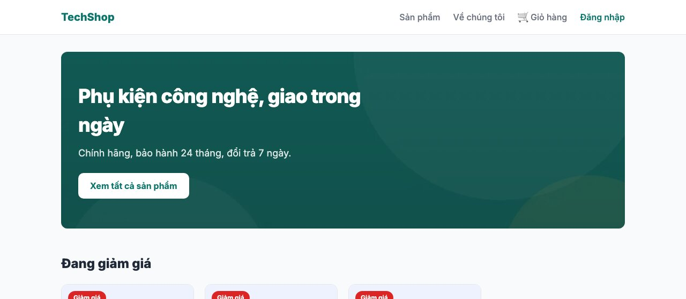
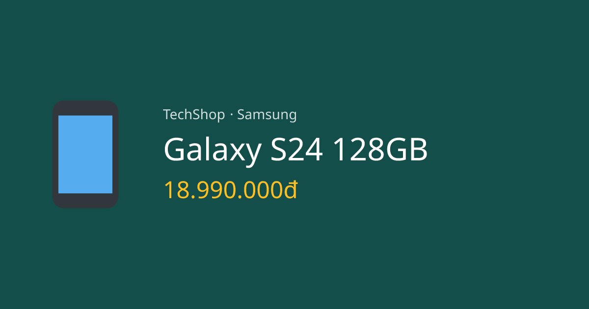

Shop chạy được rồi, giờ làm cho nó **nhanh và được tìm thấy**: font không nhấp nháy, ảnh tự tối ưu, mỗi trang có tiêu đề và mô tả riêng cho Google, ảnh xem trước khi chia sẻ lên Facebook/Zalo, sitemap và robots. Next.js có sẵn công cụ cho từng việc, phần lớn chỉ là cấu hình.

#### Kết quả cuối bài



#### Bước 1: Font với next/font
Tới giờ trang dùng font hệ thống. Muốn một font riêng (Inter) mà không mắc lỗi "chữ tàng hình rồi nhảy font" (bài 134 có nhắc), dùng <mark>next/font</mark>:
```tsx
// app/layout.tsx
import type { Metadata } from "next";
import { Inter } from "next/font/google";
import "./globals.css";

const inter = Inter({ subsets: ["latin", "vietnamese"], display: "swap" });

export const metadata: Metadata = {
  metadataBase: new URL(process.env.NEXT_PUBLIC_SITE_URL ?? "http://localhost:3000"),
  title: { default: "TechShop", template: "%s | TechShop" },
  description: "Phụ kiện công nghệ chính hãng, giao trong ngày tại TP.HCM",
  openGraph: { siteName: "TechShop", locale: "vi_VN", type: "website" },
};

export default function RootLayout({ children }: { children: React.ReactNode }) {
  return (
    <html lang="vi" className={inter.className}>
      <body>{children}</body>
    </html>
  );
}
```
Và trong <mark>globals.css</mark> đổi <mark>--font</mark> thành <mark>inherit</mark> để mọi thứ ăn theo font của <mark>html</mark>.

Điều hay của <mark>next/font/google</mark>: lúc **build**, Next.js tải file font từ Google về và **tự host** trong <mark>/_next/static/media/</mark>. Trình duyệt người dùng không bao giờ gọi tới Google (nhanh hơn, không lộ IP người dùng cho bên thứ ba), và HTML có sẵn <mark>&lt;link rel="preload" as="font"&gt;</mark>:
```html
<link rel="preload" href="/_next/static/media/2bbe8d2671613f1f-s.p.76dcb0b2.woff2" as="font" crossorigin="" type="font/woff2"/>
```
<mark>subsets: ["vietnamese"]</mark> là bắt buộc cho tiếng Việt, thiếu nó chữ có dấu sẽ rơi về font khác. <mark>display: "swap"</mark>: hiện chữ bằng font tạm ngay, đổi sang Inter khi tải xong. Font riêng (file .woff2 của công ty) thì dùng <mark>next/font/local</mark> cùng cách.

Phần <mark>metadata</mark> ở layout cũng mở rộng, giải thích ở bước 3.

#### Bước 2: Ảnh với next/image
Thêm một ảnh nền cho hero. Đặt file <mark>hero.jpg</mark> (1600×900) vào <mark>public/</mark>, rồi ở trang chủ:
```tsx
// app/(shop)/page.tsx (phần hero)
import Image from "next/image";
// ...
<section className={styles.hero}>
  <Image src="/hero.jpg" alt="" fill priority sizes="(max-width: 1100px) 100vw, 1100px" className={styles.heroImage} />
  <div className={styles.heroContent}>
    <h1 className={styles.title}>Phụ kiện công nghệ, giao trong ngày</h1>
    <p className={styles.text}>Chính hãng, bảo hành 24 tháng, đổi trả 7 ngày.</p>
    <Link href="/products" className={styles.cta}>Xem tất cả sản phẩm</Link>
  </div>
</section>
```
```css
/* app/(shop)/page.module.css (phần hero) */
.hero {
  position: relative;
  padding: 56px 32px;
  border-radius: var(--radius);
  overflow: hidden;
  background: #134e4a;
  color: #fff;
}

.heroImage {
  object-fit: cover;
  opacity: 0.35;
}

.heroContent {
  position: relative;
}
```
<mark>&lt;Image&gt;</mark> thay cho <mark>&lt;img&gt;</mark> và làm 4 việc mà bạn sẽ không bao giờ tự làm đủ:
- **Resize và nén** theo kích thước thật cần: xem tab Network, ảnh được tải là <mark>/_next/image?url=/hero.jpg&amp;w=1200&amp;q=75</mark>, **10KB** (webp) thay vì 16KB gốc, và điện thoại nhận bản nhỏ hơn nữa. <mark>sizes</mark> cho biết ảnh rộng bao nhiêu ở mỗi màn hình để chọn đúng bản.
- **Đổi định dạng** sang WebP/AVIF nếu trình duyệt hỗ trợ.
- **Giữ chỗ** đúng kích thước (bắt buộc có <mark>width</mark>/<mark>height</mark>, hoặc <mark>fill</mark> để lấp đầy khung cha có <mark>position: relative</mark>), trang không nhảy khi ảnh tải xong.
- **Lazy load** mặc định: ảnh ngoài màn hình chỉ tải khi cuộn tới. Ảnh đầu trang thì thêm <mark>priority</mark> để tải ngay.

<mark>alt=""</mark> vì đây là ảnh trang trí; ảnh sản phẩm thật phải có alt mô tả. Ảnh từ domain khác (CDN, S3) phải khai báo trong <mark>next.config.ts</mark>: <mark>images: { remotePatterns: [{ hostname: "cdn.techshop.vn" }] }</mark>, nếu không Next.js từ chối tối ưu ảnh lạ.

#### Bước 3: Metadata cho từng trang
Ở layout đã có <mark>metadata</mark> chung với 2 thứ mới:
- <mark>title: { default, template }</mark>: trang con chỉ cần đặt <mark>title: "Galaxy S24"</mark>, Next.js ghép thành <mark>Galaxy S24 | TechShop</mark>.
- <mark>metadataBase</mark>: domain gốc để các URL tương đối (ảnh OG, canonical) thành tuyệt đối. Lấy từ biến môi trường <mark>NEXT_PUBLIC_SITE_URL</mark> (thêm vào <mark>.env</mark>: <mark>NEXT_PUBLIC_SITE_URL="http://localhost:3000"</mark>; production sẽ là domain thật, bài 149). Tiền tố <mark>NEXT_PUBLIC_</mark> nghĩa là biến này được phép gửi xuống trình duyệt.

Trang sản phẩm cần metadata **theo dữ liệu**, dùng <mark>generateMetadata</mark>:
```tsx
// app/(shop)/products/[slug]/page.tsx (thêm)
import type { Metadata } from "next";
// ...
export async function generateMetadata({ params }: { params: Promise<{ slug: string }> }): Promise<Metadata> {
  const { slug } = await params;
  const product = await getProduct(slug);
  if (!product) return { title: "Không tìm thấy sản phẩm" };

  return {
    title: product.name,
    description: `${product.name} chính hãng ${product.brand}, giá ${formatPrice(product.price)}. ${product.description}`,
    openGraph: { title: product.name, description: product.description },
  };
}
```
Kết quả trong HTML của <mark>/products/galaxy-s24</mark>:
```html
<title>Galaxy S24 128GB | TechShop</title>
<meta name="description" content="Galaxy S24 128GB chính hãng Samsung, giá 18.990.000đ. Màn hình 6.2 inch, camera 50MP, pin trâu, bảo hành 24 tháng."/>
<meta property="og:title" content="Galaxy S24 128GB"/>
<meta property="og:image" content="http://localhost:3000/products/galaxy-s24/opengraph-image-16g1u1?f4e37e7338bdda8f"/>
```
<mark>generateMetadata</mark> và <mark>ProductPage</mark> cùng gọi <mark>getProduct(slug)</mark>: Next.js **không** query 2 lần, vì các lời gọi giống nhau trong cùng một request được gộp (request memoization) khi dùng <mark>fetch</mark>; với Prisma thì bọc hàm bằng <mark>cache()</mark> của React để được như vậy: <mark>export const getProduct = cache(async (slug) =&gt; ...)</mark>. Với 1 query nhỏ, để nguyên cũng không sao.

Dòng <mark>og:image</mark> trỏ tới một ảnh tự sinh, đó là bước 4.

#### Bước 4: Ảnh OG sinh bằng code
Khi dán link sản phẩm vào Facebook, Zalo, Slack, họ hiện một ảnh xem trước lấy từ thẻ <mark>og:image</mark>. Thay vì thiết kế ảnh cho từng sản phẩm, viết một file <mark>opengraph-image.tsx</mark> cạnh <mark>page.tsx</mark>: Next.js sẽ render JSX đó thành **ảnh PNG** mỗi khi được hỏi, và tự thêm thẻ meta.

```tsx
// app/(shop)/products/[slug]/opengraph-image.tsx
import { ImageResponse } from "next/og";
import { formatPrice, getProduct } from "@/lib/products";

export const size = { width: 1200, height: 630 };
export const contentType = "image/png";

export default async function OpenGraphImage({ params }: { params: Promise<{ slug: string }> }) {
  const { slug } = await params;
  const product = await getProduct(slug);

  return new ImageResponse(
    (
      <div style={{ width: "100%", height: "100%", display: "flex", alignItems: "center", gap: 48, padding: 64, background: "#134e4a", color: "#fff", fontFamily: "sans-serif" }}>
        <div style={{ fontSize: 220 }}>{product?.emoji ?? "🛒"}</div>
        <div style={{ display: "flex", flexDirection: "column", gap: 16 }}>
          <div style={{ fontSize: 28, opacity: 0.8 }}>{`TechShop · ${product?.brand ?? ""}`}</div>
          <div style={{ fontSize: 64, fontWeight: 700, lineHeight: 1.1 }}>{product?.name ?? "Sản phẩm"}</div>
          <div style={{ fontSize: 48, color: "#fbbf24" }}>{product ? formatPrice(product.price) : ""}</div>
        </div>
      </div>
    ),
    size
  );
}
```

Mở URL trong thẻ <mark>og:image</mark> ở trên: một ảnh PNG 1200×630 (kích thước chuẩn của mạng xã hội). JSX bên trong <mark>ImageResponse</mark> chỉ hỗ trợ một tập CSS con (flexbox, không grid), đủ cho một tấm thẻ. Luật khó chịu nhất: **mọi <mark>div</mark> có nhiều hơn một con phải có <mark>display: flex</mark>**, và "con" tính cả đoạn chữ. Dòng <mark>TechShop · {product?.brand}</mark> là 2 node chữ, nên phải ghép thành một chuỗi <mark>{`TechShop · ${...}`}</mark>; viết tách ra là ảnh không render và server báo "Expected &lt;div&gt; to have explicit display: flex". Tôi mất một lúc mới tìm ra lỗi này.

Kiểm tra cách Facebook/Zalo thấy trang: dán URL vào **opengraph.xyz** hoặc Facebook Sharing Debugger sau khi deploy.

#### Bước 5: Sitemap và robots
Hai file đặc biệt trong <mark>app/</mark>, Next.js biến thành <mark>/sitemap.xml</mark> và <mark>/robots.txt</mark>:
```ts
// app/sitemap.ts  ->  /sitemap.xml
import type { MetadataRoute } from "next";
import { getProducts } from "@/lib/products";

export default async function sitemap(): Promise<MetadataRoute.Sitemap> {
  const base = process.env.NEXT_PUBLIC_SITE_URL ?? "http://localhost:3000";
  const products = await getProducts();

  return [
    { url: base, changeFrequency: "daily", priority: 1 },
    { url: `${base}/products`, changeFrequency: "daily", priority: 0.9 },
    { url: `${base}/about`, changeFrequency: "monthly", priority: 0.3 },
    ...products.map((p) => ({ url: `${base}/products/${p.slug}`, lastModified: p.createdAt, priority: 0.8 })),
  ];
}
```
```ts
// app/robots.ts  ->  /robots.txt
import type { MetadataRoute } from "next";

export default function robots(): MetadataRoute.Robots {
  const base = process.env.NEXT_PUBLIC_SITE_URL ?? "http://localhost:3000";
  return {
    rules: { userAgent: "*", allow: "/", disallow: ["/admin", "/cart", "/checkout", "/orders", "/api/"] },
    sitemap: `${base}/sitemap.xml`,
  };
}
```
```sh
curl http://localhost:3000/robots.txt
# User-Agent: *
# Allow: /
# Disallow: /admin
# Disallow: /cart
# ...
# Sitemap: http://localhost:3000/sitemap.xml

curl http://localhost:3000/sitemap.xml | grep '<loc>'
# <loc>http://localhost:3000</loc>
# <loc>http://localhost:3000/products</loc>
# <loc>http://localhost:3000/products/galaxy-s24</loc> ...
```
Sitemap đọc từ database: thêm sản phẩm là có trong sitemap, không cần nhớ cập nhật. Sau khi deploy, nộp <mark>/sitemap.xml</mark> vào Google Search Console một lần.

#### Build
```
┌ ○ /                                         5.3 kB         142 kB
├ ƒ /products/[slug]/opengraph-image-16g1u1      0 B            0 B
├ ○ /robots.txt                                  0 B            0 B
└ ○ /sitemap.xml                                 0 B            0 B
```
Trang chủ giờ tốn 5.3KB JavaScript: đó là phần client của <mark>next/image</mark> (lazy load, chọn kích thước). Sitemap và robots là tĩnh, tạo lúc build; sitemap có dữ liệu động thì thêm <mark>export const revalidate = 3600</mark> trong <mark>sitemap.ts</mark> để làm mới mỗi giờ.

#### Checklist
- View Page Source trang chủ: có <mark>&lt;link rel="preload" as="font"&gt;</mark> trỏ tới <mark>/_next/static/media/</mark>, không có dòng nào gọi <mark>fonts.googleapis.com</mark>.
- Tab Network, lọc Img: ảnh hero tải qua <mark>/_next/image?...</mark>, định dạng webp, nhỏ hơn file gốc nhiều lần.
- Mỗi trang sản phẩm có <mark>&lt;title&gt;</mark> và <mark>description</mark> riêng; mở link trong <mark>og:image</mark> ra ảnh PNG.
- <mark>/sitemap.xml</mark> liệt kê đủ 8 sản phẩm; <mark>/robots.txt</mark> chặn <mark>/admin</mark>.
- Chạy Lighthouse (DevTools) trên trang sản phẩm: mục SEO đạt 100.

Mã nguồn cuối bài: [post_148.zip](/assets/code/post_148.zip).

#### Bài tập thêm
- Thêm ảnh thật cho sản phẩm: cột <mark>imageUrl</mark>, hiển thị bằng <mark>&lt;Image&gt;</mark> với <mark>width</mark>/<mark>height</mark> cố định trong card, và dùng ảnh đó trong <mark>opengraph-image</mark> (<mark>&lt;img src=... /&gt;</mark> được phép trong ImageResponse).
- Thêm <mark>alternates: { canonical }</mark> vào metadata để tránh Google index cả <mark>/products?q=</mark>.
- Thêm JSON-LD <mark>Product</mark> (schema.org) vào trang sản phẩm bằng một thẻ <mark>&lt;script type="application/ld+json"&gt;</mark>, để Google hiện giá ngay trên kết quả tìm kiếm.
