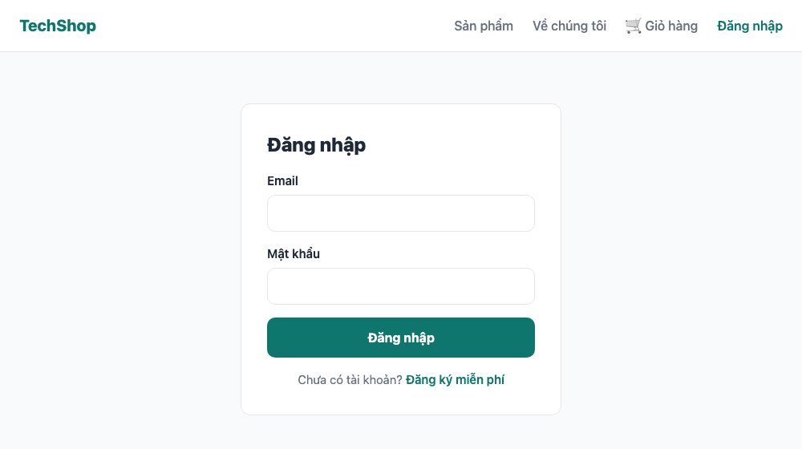
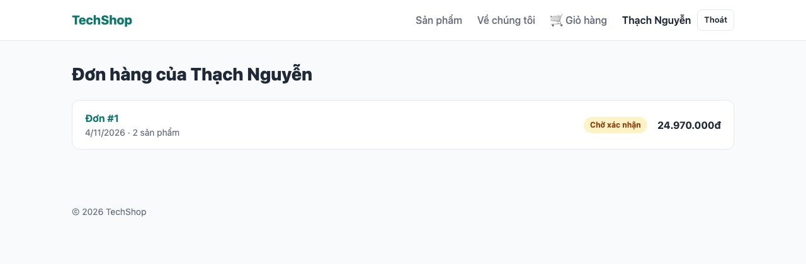
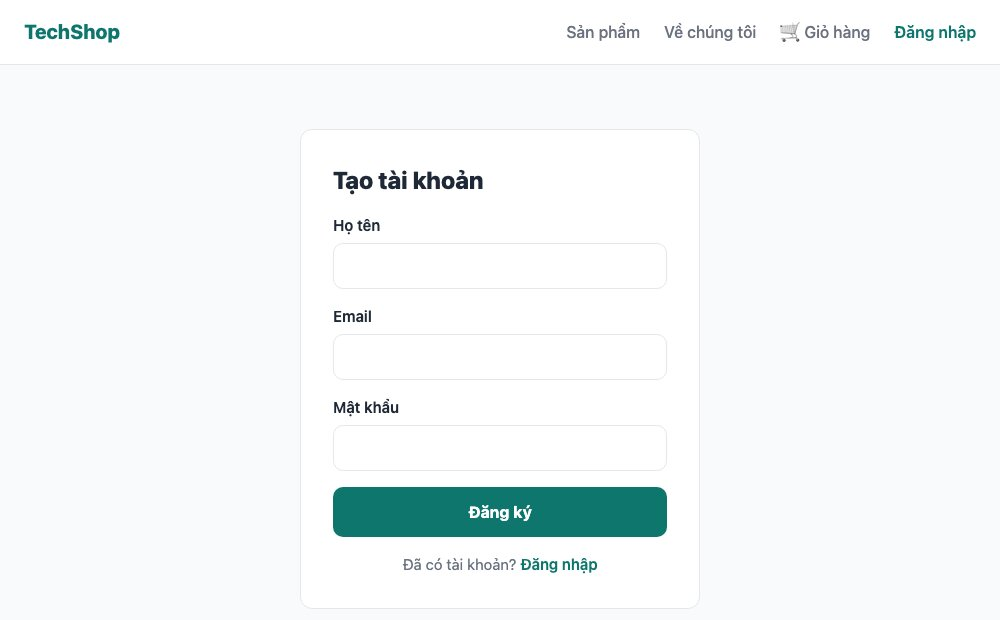

Tới giờ ai cũng là khách vãng lai. Bài này thêm tài khoản: đăng ký, đăng nhập, đăng xuất, trang "Đơn hàng của tôi", và chỉ chủ đơn mới xem được đơn. Thư viện là **better-auth**: cài một lần, có sẵn bảng user/session, mã hóa mật khẩu, cookie an toàn, API và hook cho React.

#### Kết quả cuối bài



#### Vì sao không tự viết đăng nhập
Tự viết nghe đơn giản: bảng user, hash mật khẩu, cookie. Nhưng làm **đúng** thì phải lo: thuật toán hash đủ chậm, session hết hạn và thu hồi, cookie <mark>HttpOnly</mark>/<mark>SameSite</mark>, chống CSRF, rate limit, đổi mật khẩu, quên mật khẩu, đăng nhập Google... Mỗi thứ sai một chút là lộ tài khoản người dùng (series bài 085 - 093). better-auth làm sẵn tất cả, chạy trong chính ứng dụng Next.js (không gửi dữ liệu đi đâu), và dùng Prisma để lưu.

Phiên bản: better-auth **1.7**. Thư viện này thay đổi nhanh; nếu bạn dùng bản mới hơn mà tên hàm khác, tài liệu tại better-auth.com là nguồn đúng nhất.

#### Bước 1: Cài và cấu hình
```sh
npm install better-auth
```
```ts
// lib/auth.ts
import { betterAuth } from "better-auth";
import { prismaAdapter } from "better-auth/adapters/prisma";
import { prisma } from "./db";

export const auth = betterAuth({
  database: prismaAdapter(prisma, { provider: "sqlite" }),
  emailAndPassword: { enabled: true },
});
```
Thêm vào <mark>.env</mark> hai dòng (mỗi dòng một biến, nhớ xuống dòng sau dòng <mark>DATABASE_URL</mark> có sẵn):
```
BETTER_AUTH_SECRET="doi-chuoi-nay-bang-mot-chuoi-ngau-nhien-dai-it-nhat-32-ky-tu"
BETTER_AUTH_URL="http://localhost:3000"
```
Secret dùng để ký cookie phiên. Tạo chuỗi ngẫu nhiên bằng <mark>openssl rand -base64 32</mark>. Thiếu biến này, better-auth báo lỗi "You are using the default secret" và từ chối chạy ở production.

**Mẹo (lỗi tôi gặp):** file <mark>.env</mark> do Prisma tạo không có dấu xuống dòng ở cuối. Tôi nối thêm bằng lệnh và hai biến dính vào cùng một dòng: <mark>DATABASE_URL="file:./dev.db"BETTER_AUTH_SECRET=...</mark>. Hậu quả là Prisma tạo một file database có tên dài ngoằng và migration chạy vào đó. Mở <mark>.env</mark> bằng editor, kiểm tra từng dòng.

#### Bước 2: Bảng user, session
better-auth cần 4 bảng. Lệnh CLI đọc <mark>lib/auth.ts</mark> và **viết thêm** các model vào <mark>schema.prisma</mark>:
```sh
npx @better-auth/cli@latest generate --config lib/auth.ts
```
Mở <mark>schema.prisma</mark>, bạn thấy thêm <mark>User</mark>, <mark>Session</mark>, <mark>Account</mark>, <mark>Verification</mark>. Model User trông như sau (không sửa gì):
```prisma
model User {
  id            String    @id
  name          String
  email         String
  emailVerified Boolean   @default(false)
  image         String?
  createdAt     DateTime  @default(now())
  updatedAt     DateTime  @updatedAt
  sessions      Session[]
  accounts      Account[]

  @@unique([email])
  @@map("user")
}
```
<mark>Account</mark> là nơi lưu mật khẩu đã hash (và sau này là liên kết Google/GitHub), <mark>Session</mark> là phiên đăng nhập, mỗi phiên một token nằm trong cookie.

Gắn đơn hàng với người dùng: thêm vào <mark>model Order</mark> hai dòng, và vào <mark>model User</mark> một dòng
```prisma
model Order {
  // ...các cột cũ
  userId       String?
  user         User?       @relation(fields: [userId], references: [id])
}

model User {
  // ...các cột do CLI sinh
  orders        Order[]
}
```
<mark>userId</mark> cho phép rỗng: khách không đăng nhập vẫn đặt hàng được. Rồi
```sh
npx prisma migrate dev --name add_auth
```

#### Bước 3: API và client
better-auth cần một endpoint nhận mọi request đăng nhập/đăng xuất. Trong Next.js đó là một **Route Handler** bắt tất cả đường dẫn dưới <mark>/api/auth/</mark> (bài 147 nói kỹ về Route Handler):
```ts
// app/api/auth/[...all]/route.ts
import { toNextJsHandler } from "better-auth/next-js";
import { auth } from "@/lib/auth";

export const { GET, POST } = toNextJsHandler(auth);
```
<mark>[...all]</mark> là **catch-all route**: khớp <mark>/api/auth/sign-in/email</mark>, <mark>/api/auth/get-session</mark>, bất kỳ gì. 4 dòng, xong backend.

Phía trình duyệt, một client để gọi các API đó:
```ts
// lib/auth-client.ts
import { createAuthClient } from "better-auth/react";

export const authClient = createAuthClient();
export const { signIn, signUp, signOut, useSession } = authClient;
```
Và phía server, một hàm đọc phiên hiện tại từ cookie:
```ts
// lib/session.ts
import { headers } from "next/headers";
import { auth } from "./auth";

// Đọc phiên đăng nhập ở Server Component / Server Action. Trả về null nếu chưa đăng nhập.
export async function getSession() {
  return auth.api.getSession({ headers: await headers() });
}
```
Hai file này là 2 cửa vào cùng một hệ thống: <mark>auth-client</mark> cho Client Component (gọi qua HTTP), <mark>session</mark> cho Server Component và Server Action (gọi thẳng, không qua HTTP).

#### Bước 4: Form đăng ký và đăng nhập
Một component dùng cho cả hai, khác nhau ở prop <mark>mode</mark>:
```tsx
// components/auth-form.tsx
"use client";

import { useRouter } from "next/navigation";
import { useState } from "react";
import { signIn, signUp } from "@/lib/auth-client";
import styles from "./auth-form.module.css";

export default function AuthForm({ mode }: { mode: "login" | "register" }) {
  const router = useRouter();
  const [error, setError] = useState("");
  const [pending, setPending] = useState(false);

  async function handleSubmit(e: React.FormEvent<HTMLFormElement>) {
    e.preventDefault();
    setError("");
    setPending(true);

    const form = new FormData(e.currentTarget);
    const email = String(form.get("email"));
    const password = String(form.get("password"));

    const result =
      mode === "register"
        ? await signUp.email({ email, password, name: String(form.get("name")) })
        : await signIn.email({ email, password });

    setPending(false);
    if (result.error) {
      setError(result.error.message ?? "Có lỗi xảy ra");
      return;
    }
    router.push("/orders");
    router.refresh();
  }

  return (
    <form onSubmit={handleSubmit} className={styles.form}>
      <h1 className={styles.title}>{mode === "register" ? "Tạo tài khoản" : "Đăng nhập"}</h1>
      {error && <p className={styles.alert}>{error}</p>}

      {mode === "register" && (
        <label className={styles.field}>
          Họ tên
          <input name="name" required minLength={2} />
        </label>
      )}
      <label className={styles.field}>
        Email
        <input name="email" type="email" required autoComplete="email" />
      </label>
      <label className={styles.field}>
        Mật khẩu
        <input name="password" type="password" required minLength={8} autoComplete={mode === "register" ? "new-password" : "current-password"} />
      </label>

      <button className={styles.submit} type="submit" disabled={pending}>
        {pending ? "Đang xử lý..." : mode === "register" ? "Đăng ký" : "Đăng nhập"}
      </button>

      <p className={styles.switch}>
        {mode === "register" ? (
          <>Đã có tài khoản? <a href="/login">Đăng nhập</a></>
        ) : (
          <>Chưa có tài khoản? <a href="/register">Đăng ký miễn phí</a></>
        )}
      </p>
    </form>
  );
}
```
```css
/* components/auth-form.module.css */
.form {
  max-width: 400px;
  margin: 32px auto;
  padding: 32px;
  display: grid;
  gap: 16px;
  background: var(--color-surface);
  border: 1px solid var(--color-border);
  border-radius: var(--radius);
}

.title {
  font-size: 1.5rem;
  font-weight: 800;
}

.field {
  display: grid;
  gap: 6px;
  font-size: 0.9375rem;
  font-weight: 600;
}

.field input {
  padding: 11px 14px;
  border: 1px solid var(--color-border);
  border-radius: 10px;
  font-weight: 400;
}

.field input:focus {
  outline: none;
  border-color: var(--color-primary);
  box-shadow: 0 0 0 3px #ccfbf1;
}

.alert {
  padding: 12px 14px;
  border-radius: 10px;
  background: #fee2e2;
  color: #991b1b;
  font-size: 0.9375rem;
}

.submit {
  padding: 13px;
  border: 0;
  border-radius: 10px;
  background: var(--color-primary);
  color: #fff;
  font-weight: 700;
  cursor: pointer;
}

.submit:disabled {
  opacity: 0.6;
}

.switch {
  text-align: center;
  font-size: 0.9375rem;
  color: var(--color-muted);
}

.switch a {
  color: var(--color-primary);
  font-weight: 600;
}
```
Form này **không** dùng Server Action như bài 143 - 144, mà gọi <mark>signIn.email()</mark> của better-auth từ trình duyệt, vì thư viện đã có sẵn API và cần đặt cookie từ response của chính nó. Vì vậy có <mark>onSubmit</mark>, <mark>e.preventDefault()</mark> và tự quản lý <mark>pending</mark>/<mark>error</mark> bằng <mark>useState</mark>, kiểu React "cổ điển". Bạn sẽ gặp cả hai kiểu trong các dự án thật.

Sau khi đăng nhập xong: <mark>router.push("/orders")</mark> chuyển trang và <mark>router.refresh()</mark> bảo Next.js render lại các Server Component với cookie mới (nếu không, trang vẫn cache trạng thái "chưa đăng nhập").

Hai trang chỉ là vỏ
```tsx
// app/(shop)/login/page.tsx
import AuthForm from "@/components/auth-form";

export default function LoginPage() {
  return <AuthForm mode="login" />;
}
```
```tsx
// app/(shop)/register/page.tsx
import AuthForm from "@/components/auth-form";

export default function RegisterPage() {
  return <AuthForm mode="register" />;
}
```


#### Bước 5: Header biết bạn là ai
```tsx
// components/user-menu.tsx
"use client";

import Link from "next/link";
import { useRouter } from "next/navigation";
import { signOut, useSession } from "@/lib/auth-client";
import styles from "./user-menu.module.css";

export default function UserMenu() {
  const { data: session, isPending } = useSession();
  const router = useRouter();

  if (isPending) return <span className={styles.placeholder} />;

  if (!session) {
    return <Link href="/login" className={styles.login}>Đăng nhập</Link>;
  }

  return (
    <span className={styles.user}>
      <Link href="/orders">{session.user.name}</Link>
      <button
        type="button"
        className={styles.logout}
        onClick={async () => {
          await signOut();
          router.push("/");
          router.refresh();
        }}
      >
        Thoát
      </button>
    </span>
  );
}
```
```css
/* components/user-menu.module.css */
.placeholder {
  display: inline-block;
  width: 80px;
  height: 20px;
}

.login {
  font-weight: 600;
  color: var(--color-primary);
}

.user {
  display: inline-flex;
  align-items: center;
  gap: 10px;
  font-weight: 600;
}

.logout {
  padding: 6px 10px;
  border: 1px solid var(--color-border);
  border-radius: 8px;
  background: var(--color-surface);
  font-size: 0.8125rem;
  cursor: pointer;
}
```
Đặt <mark>&lt;UserMenu /&gt;</mark> vào Header ngay sau <mark>&lt;NavLinks /&gt;</mark> (và xóa dòng <mark>console.log</mark> của bài 140 đi).

Đây là chỗ áp dụng cảnh báo cuối bài 143: Header nằm trong layout, nếu đọc phiên bằng <mark>getSession()</mark> (server, đọc cookie) thì **mọi trang thành động**. Thay vào đó <mark>UserMenu</mark> là Client Component dùng hook <mark>useSession()</mark>: trang tĩnh vẫn tĩnh, chỉ riêng góc này gọi <mark>/api/auth/get-session</mark> sau khi trang hiện và vẽ tên người dùng. Cái giá là một khoảng trắng nhỏ trong vài chục mili giây (<mark>isPending</mark>), chấp nhận được.

#### Bước 6: Gắn đơn với tài khoản
Trong <mark>placeOrder</mark> (bài 144), thêm 3 dòng: import <mark>getSession</mark>, đọc phiên trước transaction, và ghi <mark>userId</mark> vào đơn
```ts
// app/actions/order.ts (thêm)
import { getSession } from "@/lib/session";
// ...
const session = await getSession();
// ... trong tx.order.create, data:
userId: session?.user.id,
```
Trang đơn hàng (bài 144) chỉ cho chủ đơn xem
```tsx
// app/(shop)/orders/[id]/page.tsx (thêm sau notFound)
// Đơn của tài khoản nào thì chỉ tài khoản đó xem được (đơn khách vãng lai thì ai có link cũng xem được)
if (order.userId) {
  const session = await getSession();
  if (session?.user.id !== order.userId) notFound();
}
```
Trả 404 thay vì 403 để người lạ không biết đơn đó có tồn tại. Đây là cách sửa lỗi IDOR cố ý để lại ở bài 144.

Và trang danh sách đơn của tôi
```tsx
// app/(shop)/orders/page.tsx
import Link from "next/link";
import { redirect } from "next/navigation";
import { prisma } from "@/lib/db";
import { formatPrice } from "@/lib/products";
import { getSession } from "@/lib/session";
import styles from "./page.module.css";

const STATUS_LABEL: Record<string, string> = { pending: "Chờ xác nhận", shipping: "Đang giao", done: "Đã giao", cancelled: "Đã hủy" };

export default async function OrdersPage() {
  const session = await getSession();
  if (!session) redirect("/login");

  const orders = await prisma.order.findMany({
    where: { userId: session.user.id },
    orderBy: { createdAt: "desc" },
    include: { items: true },
  });

  return (
    <>
      <h1 className={styles.title}>Đơn hàng của {session.user.name}</h1>
      {orders.length === 0 ? (
        <p className={styles.empty}>Bạn chưa có đơn nào. <Link href="/products">Mua sắm ngay</Link></p>
      ) : (
        <ul className={styles.list}>
          {orders.map((order) => (
            <li key={order.id} className={styles.item}>
              <div>
                <Link href={`/orders/${order.id}`} className={styles.code}>Đơn #{order.id}</Link>
                <p className={styles.meta}>{order.createdAt.toLocaleDateString("vi-VN")} · {order.items.length} sản phẩm</p>
              </div>
              <span className={`${styles.status} ${styles[order.status]}`}>{STATUS_LABEL[order.status] ?? order.status}</span>
              <strong>{formatPrice(order.total)}</strong>
            </li>
          ))}
        </ul>
      )}
    </>
  );
}
```
```css
/* app/(shop)/orders/page.module.css */
.title {
  font-size: 1.75rem;
  font-weight: 800;
  margin-bottom: 20px;
}

.empty {
  color: var(--color-muted);
}

.empty a {
  color: var(--color-primary);
  font-weight: 600;
}

.list {
  display: grid;
  gap: 12px;
}

.item {
  display: grid;
  grid-template-columns: 1fr auto auto;
  align-items: center;
  gap: 16px;
  padding: 16px 20px;
  background: var(--color-surface);
  border: 1px solid var(--color-border);
  border-radius: var(--radius);
}

.code {
  font-weight: 700;
  color: var(--color-primary);
}

.meta {
  font-size: 0.875rem;
  color: var(--color-muted);
}

.status {
  padding: 4px 10px;
  border-radius: 999px;
  font-size: 0.75rem;
  font-weight: 700;
  background: #fef3c7;
  color: #92400e;
}

.shipping { background: #dbeafe; color: #1d4ed8; }
.done { background: #dcfce7; color: #15803d; }
.cancelled { background: #fee2e2; color: #b91c1c; }
```
Mẫu bảo vệ trang ở server: **đọc phiên, không có thì <mark>redirect("/login")</mark>**, ngay dòng đầu. Mọi thứ phía dưới chắc chắn có <mark>session</mark>. Và truy vấn luôn kèm <mark>where: { userId: session.user.id }</mark>, không bao giờ lấy "tất cả đơn" rồi lọc ở giao diện.

#### Thử bằng tay, không cần giao diện
better-auth là API HTTP, nên kiểm tra được bằng <mark>curl</mark>, rất hữu ích khi debug:
```sh
# Đăng ký, lưu cookie vào file
curl -c cookies.txt -H 'Content-Type: application/json' \
  -d '{"name":"Thạch","email":"thach@example.com","password":"matkhau123"}' \
  http://localhost:3000/api/auth/sign-up/email

# Phiên hiện tại
curl -b cookies.txt http://localhost:3000/api/auth/get-session

# Trang cần đăng nhập: không cookie thì 307 về /login, có cookie thì 200
curl -o /dev/null -w '%{http_code}\n' http://localhost:3000/orders
curl -b cookies.txt -o /dev/null -w '%{http_code}\n' http://localhost:3000/orders

# Sai mật khẩu
curl -H 'Content-Type: application/json' -d '{"email":"thach@example.com","password":"sai"}' \
  http://localhost:3000/api/auth/sign-in/email
# {"message":"Invalid email or password","code":"INVALID_EMAIL_OR_PASSWORD"}
```
Trong Prisma Studio, bảng <mark>account</mark> có cột <mark>password</mark> là chuỗi hash dài, không phải mật khẩu thật. Thông báo lỗi "Invalid email or password" cố tình không nói rõ sai cái nào, để kẻ dò không biết email có tồn tại hay không (bài 088).

#### Checklist
- Đăng ký tài khoản mới: được chuyển tới <mark>/orders</mark>, header hiện tên và nút Thoát.
- Đặt một đơn hàng khi đã đăng nhập: đơn xuất hiện ở <mark>/orders</mark>. Mở trang đơn đó ở cửa sổ ẩn danh: 404.
- Bấm Thoát: header hiện "Đăng nhập", vào <mark>/orders</mark> bị đẩy về <mark>/login</mark>.
- Đăng ký trùng email: báo lỗi, không tạo tài khoản thứ hai.
- Trang chủ và trang sản phẩm vẫn <mark>○</mark>/<mark>●</mark> trong <mark>npm run build</mark> dù header có UserMenu.

Mã nguồn cuối bài: [post_145.zip](/assets/code/post_145.zip). Nhớ tạo <mark>.env</mark> với 3 biến như bước 1.

#### Bài tập thêm
- Trang <mark>/account</mark> cho đổi tên: <mark>authClient.updateUser({ name })</mark>.
- Đăng nhập bằng Google: tạo OAuth client trong Google Cloud Console, thêm <mark>socialProviders: { google: { clientId, clientSecret } }</mark> vào <mark>lib/auth.ts</mark> và một nút gọi <mark>signIn.social({ provider: "google" })</mark>.
- Sau khi đăng nhập, quay về trang trước đó thay vì luôn về <mark>/orders</mark> (gợi ý: query string <mark>?next=/checkout</mark>).
