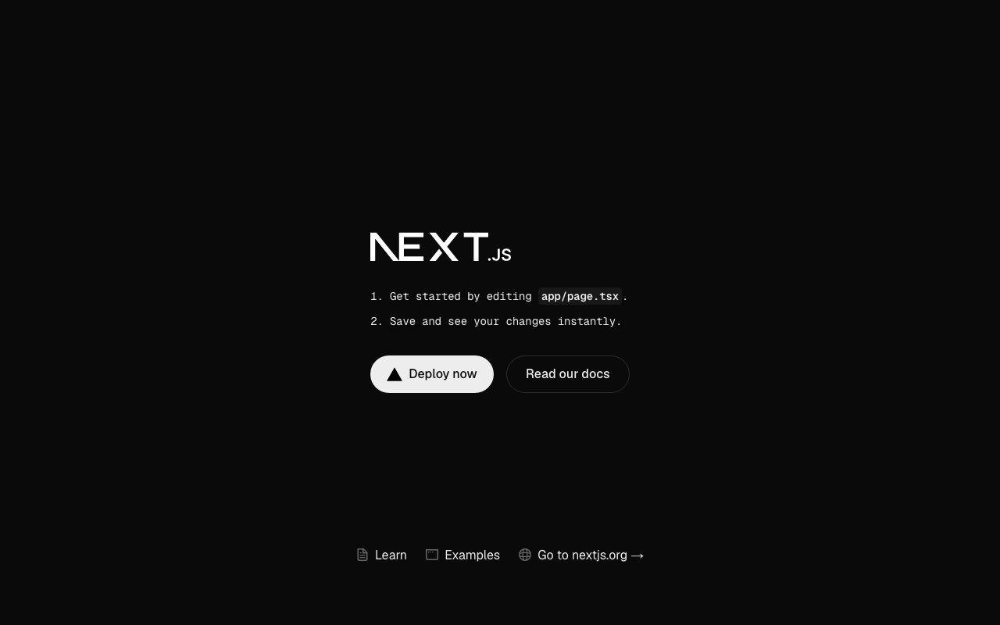
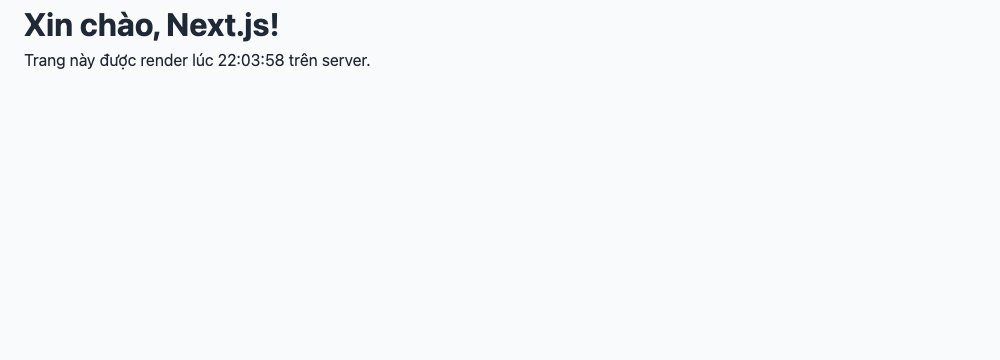

Series này dạy Next.js từ con số 0, bằng cách **xây một ứng dụng thật** từ đầu tới lúc deploy: một shop bán phụ kiện công nghệ tên **TechShop**, có danh sách sản phẩm, trang chi tiết, giỏ hàng, đặt hàng, đăng nhập, trang quản trị, API và SEO. Mỗi bài thêm một tính năng và dạy đúng phần Next.js cần cho tính năng đó. Không bài nào chỉ nói lý thuyết suông.

Bạn cần biết trước: HTML, CSS (series bài 129 - 137 là đủ), và JavaScript cơ bản (biến, hàm, mảng, <mark>map</mark>, <mark>async/await</mark> ở bài 044). Biết React càng tốt, nhưng không bắt buộc, bài 3 sẽ ôn lại những gì cần.

#### Next.js là gì
**React** là thư viện để xây giao diện bằng component: bạn viết hàm trả về HTML, React vẽ nó lên màn hình và cập nhật khi dữ liệu đổi. Nhưng React **không** lo những việc còn lại của một trang web: URL nào hiện trang nào, lấy dữ liệu từ đâu, tạo HTML trên server để Google đọc được, tối ưu ảnh, build ra file để deploy.

**Next.js** là framework đặt React vào trong một bộ khung đã có sẵn mọi thứ đó:

| Việc | Chỉ có React | Next.js |
|---|---|---|
| Trang và URL | Tự cài thư viện router | Tạo thư mục là có route |
| HTML lúc tải trang | Trang trắng, chờ JavaScript chạy | HTML có sẵn từ server, hiện ngay |
| Lấy dữ liệu | Gọi API từ trình duyệt | Đọc trực tiếp database ngay trong component |
| Xử lý form | Tự viết API riêng | Server Action, gọi hàm server như hàm thường |
| Ảnh, font, SEO | Tự lo | Có sẵn component và API |
| Backend | Phải có project riêng | Viết API ngay trong cùng project |

Nói ngắn: học React là học cách viết component; học Next.js là học cách **ghép component thành một ứng dụng web hoàn chỉnh**. Hầu hết công việc "React developer" ở Việt Nam hiện nay thực chất là Next.js.

#### Phiên bản dùng trong series
Chọn phiên bản **ổn định và phổ biến**, không chạy theo bản mới nhất:

| Công cụ | Phiên bản | Ghi chú |
|---|---|---|
| Node.js | 20 trở lên | Tôi dùng 24, mọi bản LTS từ 20 đều được |
| Next.js | **15.5** | App Router. Next 16 đã ra nhưng khác biệt nhỏ; 15 có nhiều tài liệu và dự án thật nhất |
| React | 19.1 | Đi kèm Next 15 |
| TypeScript | 5 | Dùng ở mức tối thiểu, sẽ giải thích khi gặp |
| Prisma | 6 | Database, từ bài 5 |
| better-auth | 1.x | Đăng nhập, từ bài 8 |

Code trong series chạy đúng với các phiên bản này. Khi bạn đọc bài, có thể Next 16 hay 17 đã phổ biến; những khái niệm không đổi, chỉ vài tên file và API đổi, tôi sẽ ghi chú ở chỗ có thể thay đổi.

#### Dự án xuyên suốt: TechShop

| Bài | Tính năng | Học được |
|---|---|---|
| 138 | Cài đặt, trang đầu tiên | Cấu trúc dự án, dev server, build |
| 139 | Trang chủ, danh sách, chi tiết sản phẩm | Routing theo thư mục, layout, dynamic route, 404 |
| 140 | Nút thêm giỏ, menu active | Server Component vs Client Component |
| 141 | Tải dữ liệu, trang tĩnh/động | Data fetching, caching, streaming, static generation |
| 142 | Database thật | Prisma + SQLite, migration, seed |
| 143 | Giỏ hàng | Server Action, form, cookie |
| 144 | Đặt hàng | Validation với Zod, useActionState, transaction |
| 145 | Đăng ký, đăng nhập | better-auth, session |
| 146 | Trang quản trị | Bảo vệ route, phân quyền, CRUD |
| 147 | API cho mobile, webhook | Route Handler, middleware |
| 148 | Ảnh, font, SEO | next/image, next/font, metadata, sitemap |
| 149 | Lên production | Env, Postgres, Vercel, Docker |

Mỗi bài có file zip chứa toàn bộ code tại thời điểm kết thúc bài đó, để bạn có thể bắt đầu từ bất kỳ bài nào.

#### Cài đặt
Kiểm tra Node
```sh
node -v   # v20 trở lên
npm -v
```
Chưa có thì tải ở nodejs.org (bản LTS). Tạo dự án
```sh
npx create-next-app@15 techshop
```
<mark>create-next-app</mark> hỏi vài câu, trả lời như sau (series dùng đúng các lựa chọn này):
```
Would you like to use TypeScript?              Yes
Would you like to use ESLint?                  Yes
Would you like to use Tailwind CSS?            No
Would you like your code inside a src/ directory?  No
Would you like to use App Router?              Yes
Would you like to use Turbopack for next dev?  Yes
Would you like to customize the import alias?  No
```
Vì sao chọn vậy:
- **TypeScript**: gần như mọi dự án Next.js hiện nay dùng TypeScript. Chúng ta dùng ở mức tối thiểu, chủ yếu để VS Code gợi ý và báo lỗi sớm.
- **Không Tailwind**: để dùng CSS thường và CSS Modules, tiếp nối series CSS. Tailwind học sau rất dễ nếu cần.
- **App Router**: cách làm hiện tại của Next.js (thư mục <mark>app/</mark>). Pages Router (<mark>pages/</mark>) là cách cũ, chỉ gặp ở dự án từ trước 2023.
- **Turbopack**: bộ build mới, dev server nhanh hơn.

Vài phút sau, chạy
```sh
cd techshop
npm run dev
```
Mở <mark>http://localhost:3000</mark>



#### Cấu trúc dự án
```
techshop/
├── app/                  mọi trang nằm ở đây
│   ├── layout.tsx        khung chung của mọi trang (html, body)
│   ├── page.tsx          trang chủ, tức là URL /
│   ├── globals.css       CSS toàn cục
│   └── favicon.ico
├── public/               file tĩnh: ảnh, robots.txt. /public/logo.png → /logo.png
├── node_modules/         thư viện đã cài, không bao giờ sửa và không commit
├── package.json          tên dự án, script, danh sách thư viện và phiên bản
├── next.config.ts        cấu hình Next.js, bài 148 sẽ đụng tới
├── tsconfig.json         cấu hình TypeScript, có sẵn alias @/ trỏ về thư mục gốc
├── eslint.config.mjs     luật kiểm tra code
└── .gitignore
```
Ba thứ bạn sẽ làm việc hằng ngày: <mark>app/</mark>, <mark>public/</mark> và sau này <mark>components/</mark>, <mark>lib/</mark> (tự tạo). Còn lại đã cấu hình xong.

Trong <mark>package.json</mark>
```json
"scripts": {
  "dev": "next dev --turbopack",
  "build": "next build --turbopack",
  "start": "next start",
  "lint": "eslint"
},
"dependencies": {
  "react": "19.1.0",
  "react-dom": "19.1.0",
  "next": "15.5.29"
}
```
<mark>npm run dev</mark> cho lúc code (tự tải lại khi sửa), <mark>npm run build</mark> rồi <mark>npm run start</mark> cho production.

#### Trang đầu tiên
Thay toàn bộ 3 file trong <mark>app/</mark>. Trước hết <mark>globals.css</mark>: token và reset giống series CSS, thêm class <mark>.container</mark>
```css
:root {
  --color-primary: #0f766e;
  --color-primary-dark: #115e59;
  --color-text: #1f2937;
  --color-muted: #6b7280;
  --color-bg: #f9fafb;
  --color-surface: #ffffff;
  --color-border: #e5e7eb;
  --color-sale: #dc2626;
  --radius: 12px;
  --shadow: 0 1px 3px rgba(0, 0, 0, 0.06), 0 10px 30px rgba(0, 0, 0, 0.08);
  --font: system-ui, -apple-system, "Segoe UI", Roboto, sans-serif;
}

*,
*::before,
*::after {
  box-sizing: border-box;
  margin: 0;
  padding: 0;
}

body {
  font-family: var(--font);
  color: var(--color-text);
  background: var(--color-bg);
  line-height: 1.5;
}

a {
  color: inherit;
  text-decoration: none;
}

ul {
  list-style: none;
}

button,
input,
select {
  font: inherit;
  color: inherit;
}

.container {
  max-width: 1100px;
  margin: 0 auto;
  padding: 0 24px;
}
```
<mark>layout.tsx</mark>: khung của mọi trang
```tsx
import type { Metadata } from "next";
import "./globals.css";

export const metadata: Metadata = {
  title: "TechShop",
  description: "Phụ kiện công nghệ, giao trong ngày",
};

export default function RootLayout({ children }: { children: React.ReactNode }) {
  return (
    <html lang="vi">
      <body>{children}</body>
    </html>
  );
}
```
Và <mark>page.tsx</mark>: trang chủ
```tsx
export default function HomePage() {
  const now = new Date().toLocaleTimeString("vi-VN");

  return (
    <main className="container">
      <h1>Xin chào, Next.js!</h1>
      <p>Trang này được render lúc {now} trên server.</p>
    </main>
  );
}
```
Lưu lại, trình duyệt tự cập nhật (xóa luôn file <mark>page.module.css</mark> có sẵn, không dùng nữa)



Ba file này là toàn bộ "ma thuật" của Next.js ở mức cơ bản:
- Một **component** là một hàm JavaScript trả về thứ trông như HTML. Thứ đó gọi là **JSX**: viết HTML trong JavaScript, chèn biến bằng <mark>{ }</mark>. Khác HTML vài chỗ: <mark>className</mark> thay vì <mark>class</mark>, thẻ phải đóng (<mark>&lt;br /&gt;</mark>).
- <mark>app/page.tsx</mark> là trang ở URL <mark>/</mark>. Thêm thư mục <mark>app/about/page.tsx</mark> là có URL <mark>/about</mark>. Bài 139 nói kỹ.
- <mark>app/layout.tsx</mark> bọc **mọi** trang: <mark>children</mark> là nội dung trang hiện tại. Thẻ <mark>html</mark>, <mark>body</mark>, import CSS toàn cục đặt ở đây một lần.
- <mark>export const metadata</mark>: Next.js sinh thẻ <mark>&lt;title&gt;</mark> và <mark>&lt;meta&gt;</mark> từ object này.

**Kiểm chứng "render trên server"**: bấm chuột phải → View Page Source (không phải Inspect). Bạn thấy HTML **đã có sẵn** đoạn <mark>&lt;p&gt;Trang này được render lúc 21:57:48 trên server.&lt;/p&gt;</mark>. Với React thuần, mã nguồn chỉ có một <mark>&lt;div id="root"&gt;&lt;/div&gt;</mark> trống và nội dung được JavaScript vẽ sau. Đây là khác biệt lớn nhất, và là lý do Google đọc được trang Next.js dễ dàng.

**Mẹo:** <mark>{ children }: { children: React.ReactNode }</mark> là TypeScript: tham số là object có thuộc tính <mark>children</mark> kiểu "bất kỳ thứ gì React vẽ được". Bạn sẽ thấy dòng này ở mọi layout, copy là được. Khi gặp lỗi TypeScript đỏ mà không hiểu, rê chuột vào để đọc thông báo, 80% là thiếu một kiểu đơn giản như vậy.

#### Build thử
```sh
npm run build
```
```
Route (app)                         Size  First Load JS
┌ ○ /                                0 B         113 kB
└ ○ /_not-found                      0 B         113 kB
○  (Static)  prerendered as static content
```
Next.js liệt kê từng route và cách nó được tạo. <mark>○ Static</mark>: trang chủ được **tạo sẵn thành HTML lúc build**, vì nó không đọc dữ liệu gì thay đổi theo request. Nghĩa là dòng "render lúc ..." sẽ **đứng yên** ở thời điểm build khi chạy <mark>npm run start</mark>. Đây không phải lỗi, mà là Next.js tối ưu: trang tĩnh thì phục vụ từ cache, nhanh nhất có thể. Bài 141 sẽ học cách bảo Next.js "trang này động, render mỗi request".

<mark>113 kB</mark> JavaScript là phần React và Next.js cần cho mọi trang; trang của bạn thêm <mark>0 B</mark> vì chưa có code nào chạy ở trình duyệt. Hãy nhớ con số này, bài 140 sẽ giải thích vì sao.

#### Công cụ nên có
- **VS Code** với extension **ESLint** (báo lỗi ngay khi gõ) và **Prettier** (tự format khi lưu).
- **React Developer Tools** cho Chrome: xem cây component và props.
- Terminal luôn mở với <mark>npm run dev</mark>: lỗi compile hiện ở đây **và** trên trình duyệt.

#### Checklist
- <mark>npm run dev</mark> chạy, sửa chữ trong <mark>page.tsx</mark>, trình duyệt tự đổi không cần F5.
- View Page Source thấy nội dung đã có trong HTML.
- <mark>npm run build</mark> không lỗi, thấy ○ Static ở route <mark>/</mark>.

Mã nguồn cuối bài: [post_138.zip](/assets/code/post_138.zip) (giải nén, <mark>npm install</mark>, <mark>npm run dev</mark>).

Bài tiếp theo: tạo trang chủ, trang danh sách và trang chi tiết sản phẩm, và hiểu cách Next.js biến thư mục thành URL.
