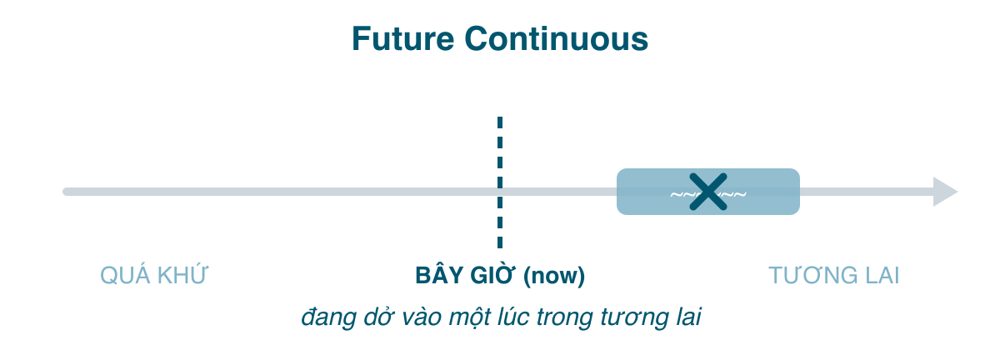

Tương lai tiếp diễn là quá khứ tiếp diễn (bài 179) lật sang phía bên kia của "bây giờ": **một hành động sẽ đang dở vào một thời điểm trong tương lai**. "Giờ này ngày mai tôi đang ngồi trên máy bay." Ngoài nghĩa đó, nó còn có một công dụng rất hay trong giao tiếp mà sách ít dạy: nói về tương lai một cách *nhẹ nhàng, không ép buộc*, và hỏi kế hoạch người khác mà không nghe như đang xin xỏ.

#### Công thức

| | |
|---|---|
| Khẳng định | I/You/He/She/It/We/They **will be working**. |
| Phủ định | I **won't be working**. |
| Câu hỏi | **Will** you **be working**? What **will** you **be doing** at 8? |

Ba phần: <mark>will</mark> + <mark>be</mark> + <mark>V-ing</mark>. Mọi ngôi như nhau. Cũng có dạng <mark>be going to be + V-ing</mark> (*I'm going to be working*) với nghĩa tương tự, ít dùng hơn.

#### Khi nào dùng
**1. Hành động sẽ đang diễn ra tại một thời điểm trong tương lai.**
- This time tomorrow, I'**ll be lying** on the beach. (Giờ này mai tôi đang nằm trên bãi biển.)
- Don't call at 9, I'**ll be driving**. (Đừng gọi lúc 9 giờ, tôi đang lái xe.)
- At 10 tonight, they'**ll be watching** the final. (10 giờ tối nay họ đang xem chung kết.)

**2. Hành động dài trong tương lai bị một hành động khác cắt ngang**, giống cặp quá khứ tiếp diễn + quá khứ đơn. Vế <mark>when</mark> dùng hiện tại đơn.
- I'**ll be waiting** for you when your plane **lands**. (Máy bay hạ cánh là tôi đã đứng đợi sẵn.)
- She'**ll be sleeping** when you **get** home.

**3. Việc sẽ xảy ra như lẽ thường, theo lịch hoặc theo đà, không phải vì ai quyết định.** Nghĩa này tạo cảm giác "đằng nào cũng thế", rất tiện để nhờ vả không áp lực.
- I'**ll be going** to the supermarket anyway, so I can get your milk. (Đằng nào tôi cũng đi siêu thị.)
- The company **will be sending** you a confirmation email. (Công ty sẽ gửi email xác nhận, quy trình bình thường.)
- We'**ll be landing** in Da Nang in 20 minutes. (Thông báo trên máy bay.)

So sánh: *I'll go to the supermarket* nghe như đang xung phong; *I'll be going* chỉ là thông báo tiện thể.

**4. Hỏi kế hoạch người khác một cách lịch sự**, không nghe như yêu cầu. Đây là mẹo giao tiếp đáng giá nhất bài.
- **Will** you **be using** the car tonight? (Tối nay anh có dùng xe không? Hàm ý: nếu không thì cho tôi mượn, nhưng không ép.)
- **Will** you **be coming** to the party? (Hỏi thông tin, không giục.)
- **Will** you **be staying** long? (Lễ tân hỏi khách.)

So sánh: *Will you come to the party?* dễ bị hiểu là lời mời hoặc giục; *Will you be coming?* chỉ hỏi để biết.

**5. Dự đoán điều đang xảy ra ở hiện tại** (ít gặp hơn, nhưng hay dùng khi suy đoán).
- Don't call her now. She'**ll be having** dinner. (Giờ này chắc cô ấy đang ăn tối.)

#### Dấu hiệu nhận biết
<mark>this time tomorrow/next week</mark>, <mark>at + giờ + tomorrow</mark>, <mark>when + hiện tại đơn</mark>, <mark>in a few hours</mark>, <mark>still</mark>, <mark>all day tomorrow</mark>, và các câu hỏi <mark>Will you be ...-ing?</mark>

#### So sánh với thì dễ nhầm
**Tương lai tiếp diễn vs. Tương lai đơn.**

| Future Continuous | Future Simple |
|---|---|
| đang dở tại một lúc; lẽ thường, theo đà | quyết định, hứa, dự đoán |
| I'**ll be working** late tonight. (thông báo, việc đã rõ) | I'**ll work** late tonight. (vừa quyết, hoặc hứa với sếp) |
| **Will** you **be coming**? (hỏi thông tin) | **Will** you **come**? (mời, yêu cầu) |
| At 8 I'**ll be having** dinner. (đang ăn dở) | At 8 I'**ll have** dinner. (8 giờ bắt đầu ăn) |

**Tương lai tiếp diễn vs. Hiện tại tiếp diễn cho tương lai** (bài 175): *I'm meeting Nam at 7* (sắp xếp đã chốt) vs. *I'll be meeting Nam at 7* (gần như cùng nghĩa, nhẹ hơn, hoặc nhấn vào "vào lúc 7 giờ tôi đang ở trong cuộc gặp đó"). Hai cách gần nhau; hiện tại tiếp diễn phổ biến hơn trong hội thoại thường ngày.

**Tương lai tiếp diễn vs. Tương lai hoàn thành** (bài 184): *At 6 I'll be cooking* (đang nấu) vs. *By 6 I'll have cooked dinner* (6 giờ đã nấu xong). <mark>at</mark> hay đi với tiếp diễn, <mark>by</mark> hay đi với hoàn thành.

**Động từ trạng thái** vẫn không chia tiếp diễn: *I'll **be** at home at 8* (không ~~I'll be being~~), *She'll **know** by then* (không ~~will be knowing~~).

#### Lỗi người Việt hay mắc
- **Không dùng vì không có "đang" trong tiếng Việt**: "Giờ này mai tôi ở Hà Nội" thường bị dịch thành *I will be in Hanoi* (đúng, vì <mark>be</mark> là trạng thái) nhưng "Giờ này mai tôi bay" thì *I will fly* kém chính xác; nên là *I'll be flying*.
- **Rụng <mark>be</mark>**: ~~I will working~~ → *I will be working.*
- **<mark>will</mark> trong vế <mark>when</mark>**: ~~I'll be waiting when you will arrive~~ → *when you arrive.*
- **Dùng tương lai đơn cho câu hỏi kế hoạch**, nghe như ra lệnh: *Will you use the car tonight?* không sai nhưng hơi cộc; *Will you be using the car tonight?* mềm hơn.
- **Tiếp diễn hóa động từ trạng thái**: ~~I'll be having a car by then~~ → *I'll have a car by then.*

#### Bài tập
1. This time next week, I (will sit / will be sitting) in a café in Paris. → will be sitting
2. Don't phone at 7, we (will have / will be having) dinner. → will be having
3. I (will wait / will be waiting) outside when you (arrive / will arrive). → will be waiting, arrive
4. "I'm cold." "I (will close / will be closing) the window." → will close (quyết định tức thì)
5. (Will you use / Will you be using) the printer? I need it for a minute. → Will you be using (hỏi lịch sự)
6. She (will know / will be knowing) the result tomorrow. → will know (trạng thái)
7. The bus (will leave / leaves) at 6, so at 6:30 we (will travel / will be travelling) to Hue. → leaves, will be travelling
8. Sửa lỗi: *At 9 tomorrow I will working.* → At 9 tomorrow I will be working.
9. Sửa lỗi: *I'll be sleeping when you will come home.* → I'll be sleeping when you come home.
10. Dịch: "Giờ này tối mai tôi đang trên tàu về quê." → This time tomorrow night I'll be on the train home. (hoặc I'll be travelling home by train)
11. Dịch: "Tối nay anh có dùng laptop không? Cho em mượn nhé." → Will you be using your laptop tonight? Can I borrow it?
12. Dịch: "Đằng nào tôi cũng đi ngang bưu điện, để tôi gửi giúp." → I'll be passing the post office anyway, so I can send it for you.

#### Tóm tắt
- <mark>will be + V-ing</mark>: đang dở **tại một thời điểm tương lai**; việc xảy ra "theo lẽ thường"; hỏi kế hoạch cho lịch sự.
- <mark>at + giờ</mark> → tiếp diễn; vế <mark>when</mark> → hiện tại đơn.
- *Will you be coming?* hỏi thông tin; *Will you come?* mời hoặc yêu cầu.
- Bài 184: tương lai hoàn thành, "tới lúc đó thì xong rồi".
