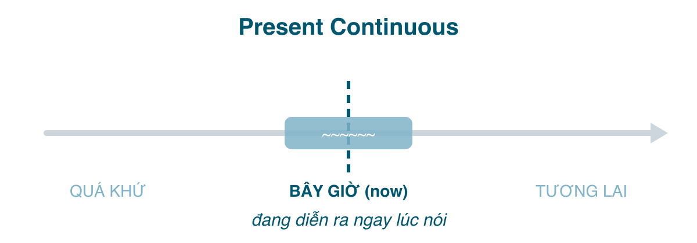

Nếu hiện tại đơn (bài 174) là "nói chung", thì hiện tại tiếp diễn là "ngay lúc này". Tiếng Việt diễn đạt nó bằng chữ "đang", nên thoạt nhìn thì dễ: thấy "đang" là chia <mark>be + V-ing</mark>. Rắc rối ở chỗ tiếng Anh dùng thì này cho nhiều thứ *không* có chữ "đang" (kế hoạch tương lai, than phiền), và ngược lại có những chữ "đang" trong tiếng Việt lại *không* được dùng thì này (đang hiểu, đang thích, đang có). Bài này đi qua từng trường hợp.

#### Công thức

| | |
|---|---|
| Khẳng định | I **am working**. He/She/It **is working**. You/We/They **are working**. |
| Phủ định | I **am not working**. She **isn't working**. They **aren't working**. |
| Câu hỏi | **Am** I **working**? **Is** she **working**? **Are** they **working**? |

Trong văn nói gần như luôn viết tắt: *I'm, he's, she's, it's, you're, we're, they're*.

Quy tắc thêm <mark>-ing</mark>:
- Thường: <mark>work → working</mark>, <mark>play → playing</mark>.
- Tận cùng <mark>-e</mark> câm: bỏ e: <mark>make → making</mark>, <mark>write → writing</mark>. (Giữ nếu là <mark>-ee</mark>: <mark>see → seeing</mark>.)
- Một nguyên âm + một phụ âm, trọng âm ở âm cuối: gấp đôi phụ âm: <mark>run → running</mark>, <mark>sit → sitting</mark>, <mark>begin → beginning</mark>. Không gấp đôi khi trọng âm không ở cuối: <mark>open → opening</mark>, <mark>visit → visiting</mark>.
- <mark>-ie</mark> → <mark>-ying</mark>: <mark>lie → lying</mark>, <mark>die → dying</mark>.

#### Khi nào dùng
**1. Đang xảy ra ngay lúc nói.** Nghĩa cơ bản nhất.
- She **is talking** on the phone. (Cô ấy đang nghe điện thoại.)
- Why **are** you **laughing**? (Sao cậu cười?)
- Don't go in, they'**re having** a meeting. (Đừng vào, họ đang họp.)

**2. Đang diễn ra quanh thời điểm này, nhưng không nhất thiết đúng lúc nói.** Một việc tạm thời, đang dở, "dạo này".
- I'**m reading** a book about Rome. (Dạo này tôi đọc một cuốn về Rome; lúc nói không cầm sách.)
- He'**s learning** to drive. (Anh ấy đang học lái xe.)
- We'**re staying** at my parents' place while the flat is being repaired. (Tạm ở nhà bố mẹ trong lúc sửa nhà.)

**3. Thay đổi, xu hướng đang diễn ra.** Thường đi với <mark>get, become, grow, increase, change</mark>.
- The weather **is getting** colder. (Trời đang lạnh dần.)
- Rents in Saigon **are rising** fast. (Giá thuê nhà ở Sài Gòn đang tăng nhanh.)
- More and more people **are working** from home.

**4. Kế hoạch, sắp xếp đã chốt cho tương lai gần.** Đây là cách dùng người Việt ít để ý nhất, nhưng người bản xứ dùng rất nhiều, nhiều hơn cả <mark>will</mark>. Điều kiện: đã *sắp xếp* xong (có vé, có hẹn, đã nói với người kia), thường kèm thời gian.
- I'**m meeting** Linh at 7 tonight. (Tối nay 7 giờ tôi gặp Linh.)
- We'**re flying** to Tokyo on Friday. (Thứ sáu bay đi Tokyo.)
- What **are** you **doing** this weekend? (Cuối tuần cậu làm gì? Hỏi kế hoạch.)

**5. Than phiền về thói quen khó chịu**, với <mark>always, constantly, forever</mark>. Về ngữ pháp thuần túy thì thói quen là hiện tại đơn, nhưng thêm <mark>always + V-ing</mark> là người nói đang bực.
- He'**s always losing** his keys. (Anh ta suốt ngày làm mất chìa khóa.)
- My neighbour **is constantly playing** loud music. (Hàng xóm cứ mở nhạc ầm ĩ.)

So sánh: *She always comes late* (nêu sự thật) vs. *She's always coming late* (và tôi khó chịu về chuyện đó).

#### Động từ không dùng tiếp diễn (stative verbs)
Đây là chỗ chữ "đang" của tiếng Việt phản bội bạn. Một số động từ chỉ **trạng thái** (cảm xúc, suy nghĩ, sở hữu, giác quan) chứ không phải **hành động**, nên không có "quá trình" để tiếp diễn, dù tiếng Việt nói "đang" rất tự nhiên:

| Nhóm | Động từ | Người Việt hay viết sai |
|---|---|---|
| Cảm xúc, ý muốn | like, love, hate, want, need, prefer, wish | ~~I'm wanting~~ → I want |
| Suy nghĩ, hiểu biết | know, understand, believe, remember, forget, mean, think (= cho rằng) | ~~I'm understanding~~ → I understand |
| Sở hữu | have (= có), own, belong, contain | ~~I'm having a car~~ → I have a car |
| Giác quan | see, hear, smell, taste, seem, look (= trông có vẻ) | ~~I'm hearing you~~ → I hear you |

Một số động từ có **hai nghĩa**, một trạng thái, một hành động, và nghĩa hành động thì tiếp diễn được:
- <mark>think</mark>: *I **think** it's a good idea* (cho rằng) / *I'**m thinking** about moving* (đang cân nhắc).
- <mark>have</mark>: *I **have** two kids* (có) / *I'**m having** lunch* (ăn trưa), *We'**re having** a party* (tổ chức).
- <mark>see</mark>: *I **see** what you mean* (hiểu) / *I'**m seeing** the doctor tomorrow* (gặp).
- <mark>taste/smell</mark>: *The soup **tastes** good* (có vị) / *She'**s tasting** the soup* (nếm thử).
- <mark>be</mark>: *He **is** rude* (bản tính) / *He'**s being** rude* (đang cư xử thô lỗ, khác thường ngày).

Còn *I'm loving it* của McDonald's? Cố tình phá luật để gây chú ý, và vì thế nó thành câu nổi tiếng; trong bài thi thì vẫn là *I love it*.

#### Dấu hiệu nhận biết
<mark>now, right now, at the moment, at present, currently, today, this week, these days, Look!, Listen!</mark>. Kế hoạch tương lai: <mark>tonight, tomorrow, on Friday, next week</mark> đi kèm động từ chuyển động hoặc gặp gỡ (<mark>go, come, leave, meet, fly, have dinner</mark>).

#### So sánh với thì dễ nhầm
**Hiện tại tiếp diễn vs. Hiện tại đơn** (đã bắt đầu ở bài 174). Thêm vài cặp để thấy sự khác nhau không phải ở thời gian mà ở *tạm thời vs. lâu dài*:
- *I **live** in Hanoi* (nhà tôi ở đó) / *I'**m living** in Hanoi* (tạm thời, sẽ chuyển).
- *He **doesn't drink*** (anh ấy không uống rượu, nguyên tắc sống) / *He **isn't drinking** tonight* (tối nay không uống, vì lái xe chẳng hạn).
- *The river **flows** into the sea* (sự thật địa lý) / *The river **is flowing** very fast today* (hôm nay, sau mưa).

**Hiện tại tiếp diễn vs. <mark>be going to</mark>** cho tương lai: cả hai đều nói kế hoạch. Tiếp diễn nhấn vào việc đã *sắp xếp* với người khác (*I'm having dinner with Nam*), <mark>be going to</mark> nhấn vào *ý định* của bản thân (*I'm going to learn Japanese*). Bài 182 so sánh cả ba cách nói tương lai.

**Hiện tại tiếp diễn vs. Hiện tại hoàn thành tiếp diễn** (bài 177): *I'm working on the report* (đang làm) vs. *I've been working on the report since 8* (đang làm, và nhấn đã làm từ 8 giờ tới giờ). Khi muốn nói **bao lâu rồi** thì phải chuyển sang hoàn thành tiếp diễn.

#### Lỗi người Việt hay mắc
- **Bỏ <mark>be</mark>**: ~~She working now~~. Hoặc ngược lại, **bỏ <mark>-ing</mark>**: ~~She is work now~~. Cả hai phải đi cùng nhau.
- **Tiếp diễn hóa động từ trạng thái**: ~~I'm knowing~~, ~~Are you understanding?~~, ~~I'm not liking it~~. Xem bảng ở trên.
- **Dùng <mark>will</mark> cho kế hoạch đã chốt**: nói *I will meet Linh tonight* không sai hẳn nhưng nghe như vừa quyết định xong. Nếu đã hẹn, *I'm meeting Linh tonight* tự nhiên hơn nhiều.
- **Dùng hiện tại đơn khi mô tả cảnh trước mắt**: ~~Look, it rains~~ → *Look, it's raining.*
- **Dịch "đang có" thành <mark>am having</mark>**: ~~I'm having a problem with my laptop~~ thật ra chấp nhận được (have = gặp phải), nhưng ~~I'm having a laptop~~ thì sai (have = sở hữu).

#### Bài tập
1. Be quiet, the baby (sleeps / is sleeping). → is sleeping
2. I (don't understand / am not understanding) this question. → don't understand
3. She usually (takes / is taking) the bus, but today she (drives / is driving). → takes, is driving
4. We (have / are having) dinner with my boss tomorrow. → are having (kế hoạch đã chốt)
5. What (do you think / are you thinking) about? You look worried. → are you thinking
6. He (is always complaining / always complains) about the food. (ý bực mình) → is always complaining
7. Sửa lỗi: *I'm not believing you.* → I don't believe you.
8. Sửa lỗi: *She is work in a hospital now.* → She is working in a hospital now. (hoặc "She works in a hospital" nếu là nghề nghiệp lâu dài)
9. Dịch: "Trời đang mưa to." → It's raining heavily.
10. Dịch: "Cuối tuần này bạn làm gì?" (hỏi kế hoạch) → What are you doing this weekend?

#### Tóm tắt
- <mark>am/is/are + V-ing</mark>: ngay lúc này, dạo này, xu hướng, kế hoạch đã chốt, than phiền với <mark>always</mark>.
- Động từ trạng thái (<mark>know, like, want, have = có, see = hiểu</mark>) không chia tiếp diễn, bất kể tiếng Việt có "đang".
- Tạm thời → tiếp diễn; lâu dài, thói quen → hiện tại đơn.
- Bài 176: hiện tại hoàn thành, thì khó nhất trong 12 thì đối với người Việt.
