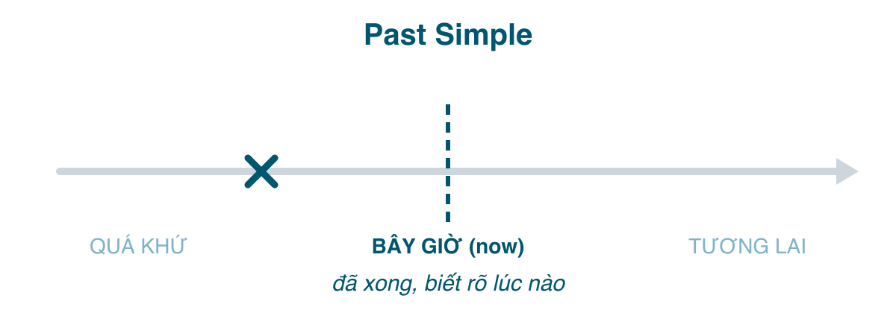

Bốn bài trước là bốn khía cạnh ở mốc hiện tại. Từ bài này, mốc dời về quá khứ. Quá khứ đơn là thì bạn dùng nhiều nhất khi **kể chuyện**: đã xảy ra, đã xong, và người nói biết (hoặc coi như biết) nó xảy ra **lúc nào**. Nó là cái "đã" của tiếng Việt khi câu chuyện có thời điểm: hôm qua, năm ngoái, hồi nhỏ, lúc 5 giờ.

Thì này dễ về nghĩa, khó về hình thức: bảng động từ bất quy tắc, cách đọc đuôi <mark>-ed</mark>, và thói quen quên chia khi nói nhanh.

#### Công thức

| | Động từ thường | Động từ <mark>be</mark> |
|---|---|---|
| Khẳng định | I/You/He/She/It/We/They **worked** / **went**. | I/He/She/It **was**. You/We/They **were**. |
| Phủ định | I **didn't work** / **didn't go**. | I **wasn't**. They **weren't**. |
| Câu hỏi | **Did** you **work**? **Did** she **go**? | **Was** she...? **Were** you...? |

Điểm dễ chịu: mọi ngôi chia như nhau (trừ <mark>be</mark>). Điểm cần nhớ: trong phủ định và câu hỏi, <mark>did</mark> đã mang quá khứ, nên động từ chính về nguyên mẫu: *Did you **go**?* không phải ~~Did you went?~~

**Động từ có quy tắc**: thêm <mark>-ed</mark>. <mark>work → worked</mark>; tận cùng <mark>-e</mark>: <mark>live → lived</mark>; phụ âm + y: <mark>study → studied</mark>; một nguyên âm + một phụ âm, trọng âm cuối: <mark>stop → stopped</mark>, <mark>plan → planned</mark>.

**Phát âm <mark>-ed</mark>** có ba cách, và người Việt thường đọc thành "ed" cho tất cả hoặc bỏ luôn:
- /t/ sau âm vô thanh (p, k, f, s, sh, ch): <mark>stopped, worked, laughed, missed, washed, watched</mark>.
- /d/ sau âm hữu thanh và nguyên âm: <mark>lived, played, called, cleaned</mark>.
- /ɪd/ **chỉ** sau /t/ và /d/: <mark>wanted, needed, started, decided</mark>.

**Động từ bất quy tắc**: phải thuộc. Khoảng 50 động từ hay dùng nhất giải quyết 90% nhu cầu: <mark>be-was/were, have-had, do-did, say-said, go-went, get-got, make-made, know-knew, think-thought, take-took, see-saw, come-came, want-wanted, give-gave, tell-told, find-found, leave-left, feel-felt, put-put, bring-brought, begin-began, keep-kept, write-wrote, read-read (đọc /red/), run-ran, eat-ate, drink-drank, buy-bought, sit-sat, speak-spoke, send-sent, meet-met, pay-paid, teach-taught, understand-understood, forget-forgot, lose-lost, sleep-slept, wear-wore, win-won, break-broke, choose-chose, drive-drove, fly-flew, grow-grew, sell-sold, build-built, cut-cut, cost-cost, hit-hit, let-let</mark>.

#### Khi nào dùng
**1. Việc đã xảy ra và kết thúc tại một thời điểm xác định trong quá khứ.** Thời điểm có thể được nói ra hoặc hiểu ngầm từ ngữ cảnh.
- I **met** her **in 2019**. (Tôi gặp cô ấy năm 2019.)
- We **went** to Phu Quoc **last summer**. (Hè rồi nhà tôi đi Phú Quốc.)
- She **didn't come** to work **yesterday**.
- **Did** you **see** the match? (Hiểu ngầm: trận tối qua.)

**2. Chuỗi hành động nối tiếp nhau trong quá khứ**: kể chuyện.
- I **woke up**, **brushed** my teeth, **made** coffee and **left** for work. (Tôi dậy, đánh răng, pha cà phê rồi đi làm.)
- He **opened** the door, **saw** the mess and **sighed**.

**3. Thói quen, tình trạng trong quá khứ, giờ không còn.** Thường kèm trạng từ tần suất hoặc <mark>when I was a child</mark>. Có thể dùng <mark>used to</mark> để nhấn "hồi xưa thế, giờ khác".
- When I was a kid, we **played** football every afternoon. (Hồi nhỏ chiều nào cũng đá bóng.)
- I **used to smoke**, but I quit. (Hồi trước tôi hút thuốc, giờ bỏ rồi.)
- My grandparents **lived** in the countryside. (Ông bà tôi sống ở quê; nay đã mất hoặc đã chuyển.)

**4. Kinh nghiệm hoặc sự kiện trong một khoảng thời gian đã đóng lại** (người đã mất, giai đoạn đã kết thúc).
- Shakespeare **wrote** 37 plays.
- I **visited** five countries **during my years at university**.

**5. Nói về thời điểm cụ thể sau khi đã dùng hiện tại hoàn thành để mở chuyện** (bài 176).
- "I've been to Japan." "Oh, when **did** you **go**?" "I **went** last year."

**6. Giả định không có thật ở hiện tại (câu điều kiện loại 2) và câu lịch sự.** Hình thức là quá khứ nhưng nghĩa không phải quá khứ.
- If I **had** more time, I'd learn Japanese. (Giờ không có thời gian.)
- I **wondered** if you could help me. (Lịch sự hơn *I wonder*.)

#### Dấu hiệu nhận biết
<mark>yesterday, last night/week/month/year, X days/years ago, in 2019, in the 1990s, when I was..., at that time, then, the other day, once, in those days</mark>. Và mọi câu hỏi bắt đầu bằng <mark>When did...?</mark>

#### So sánh với thì dễ nhầm
**Quá khứ đơn vs. Hiện tại hoàn thành.** Đã nói kỹ ở bài 176, nhắc lại từ phía quá khứ đơn:

| Past Simple | Present Perfect |
|---|---|
| Xong rồi, có thời điểm, **không còn liên quan** | Không nói thời điểm, **còn liên quan tới giờ** |
| I **lost** my phone last week. (giờ có thể đã tìm thấy) | I'**ve lost** my phone. (giờ vẫn chưa có) |
| She **worked** there for ten years. (đã nghỉ) | She'**s worked** there for ten years. (vẫn làm) |
| **Did** you **eat** breakfast this morning? (nói vào buổi chiều) | **Have** you **eaten** breakfast? (còn sáng) |
| I **saw** him on Monday. | I'**ve seen** him twice this week. (tuần chưa hết) |

Một mẹo thực dụng: **nếu bạn có thể hỏi "when?" và câu trả lời có nghĩa, dùng quá khứ đơn.** *I lost my phone. When? Last week.* Nếu "when?" trở nên lạc đề (*I've been to Japan. When? ... à, chuyện đó không quan trọng, tôi chỉ nói đã từng*), thì hiện tại hoàn thành.

**Quá khứ đơn vs. Quá khứ tiếp diễn** (bài 179): quá khứ đơn là hành động *trọn vẹn*, quá khứ tiếp diễn là hành động *đang dở* làm nền.
- When she **called**, I **was cooking**. (Lúc cô ấy gọi, tôi đang nấu ăn: nấu là nền, gọi chen vào.)
- When she **called**, I **turned off** the stove. (Cô ấy gọi, rồi tôi tắt bếp: hai việc nối tiếp.)

**Quá khứ đơn vs. Quá khứ hoàn thành** (bài 180): khi kể hai việc theo đúng thứ tự thời gian, quá khứ đơn là đủ. Chỉ cần quá khứ hoàn thành khi muốn nhảy ngược về *trước* một mốc quá khứ: *When I arrived, the film **had started**.* (Phim bắt đầu trước khi tôi tới.)

**<mark>used to</mark> vs. quá khứ đơn**: <mark>used to</mark> chỉ dùng cho thói quen hoặc trạng thái kéo dài trong quá khứ và nhấn rằng *giờ không còn*. Không dùng cho việc xảy ra một lần: ~~I used to go to Hue last year~~ → *I went to Hue last year.*

#### Lỗi người Việt hay mắc
- **Quên chia quá khứ khi nói**, nhất là khi câu đã có "yesterday": *Yesterday I ~~go~~ to the market.* Trong tiếng Việt, "hôm qua" đủ để báo thời gian nên não không bận tâm chia động từ. Tiếng Anh bắt chia bất kể đã có trạng từ.
- **Chia cả động từ sau <mark>did</mark>**: ~~Did you went?~~, ~~I didn't saw him~~ → *Did you go? I didn't see him.*
- **Dùng <mark>was/were</mark> với động từ thường**: ~~I was go~~, ~~She was study~~. Đây là lỗi "be + V" của bài 174 chuyển sang quá khứ. *I went. She studied.*
- **Hiện tại hoàn thành với thời điểm quá khứ**: ~~I have seen him yesterday~~ → *I saw him yesterday.*
- **Đọc <mark>-ed</mark> thành một âm tiết thừa**: "work-ed", "stopp-ed". Chỉ <mark>wanted, needed, decided</mark> và các động từ tận cùng /t/, /d/ mới có thêm âm tiết.
- **Nhầm <mark>read</mark> hiện tại và quá khứ**: viết giống nhau, đọc khác: /riːd/ và /red/.

#### Bài tập
1. I (see / saw) him at the market yesterday. → saw
2. (Did you go / Did you went / Have you gone) to the party last night? → Did you go
3. She (didn't come / didn't came / doesn't came) to class on Monday. → didn't come
4. When I was young, I (used to play / use to play) the piano. → used to play
5. Where (were you / did you be / you were) at 9 last night? → were you
6. He (has left / left) the company in 2020. → left
7. I (lost / have lost) my keys. I can't get in. → have lost (còn liên quan tới bây giờ)
8. Sửa lỗi: *Last week I have bought a new phone.* → Last week I bought a new phone.
9. Sửa lỗi: *She was arrive late this morning.* → She arrived late this morning.
10. Dịch: "Hôm qua tôi không đi làm." → I didn't go to work yesterday.
11. Dịch: "Bạn học đại học ở đâu?" → Where did you go to university? (hoặc Where did you study?)
12. Dịch: "Hồi nhỏ tôi hay ra biển bơi." → When I was a child, I often went swimming in the sea. (hoặc I used to go swimming in the sea.)

#### Tóm tắt
- <mark>V2 / V-ed</mark>, phủ định và câu hỏi dùng <mark>did</mark> + nguyên mẫu. Mọi ngôi như nhau, trừ <mark>was/were</mark>.
- Dùng khi việc **đã xong** và **biết lúc nào** (nói ra hoặc ngầm hiểu). Hỏi được "when?" là quá khứ đơn.
- Đuôi <mark>-ed</mark> đọc /t/, /d/ hoặc /ɪd/; chỉ thêm âm tiết sau t/d.
- Bài 179: quá khứ tiếp diễn, cách dựng "bối cảnh" khi kể chuyện.
