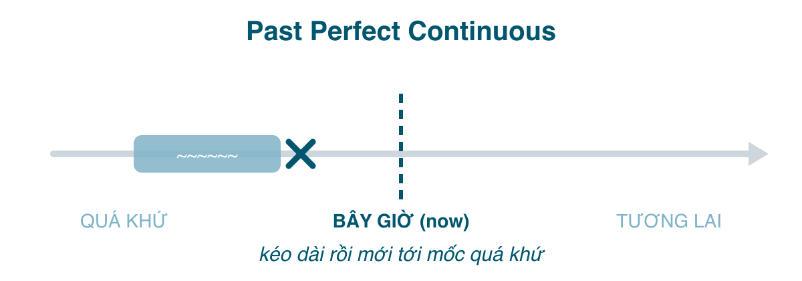

Nếu bạn đã hiểu hiện tại hoàn thành tiếp diễn (bài 177) và quá khứ hoàn thành (bài 180), thì bài này gần như không có gì mới: lấy "hành động kéo dài tới bây giờ" và dời "bây giờ" về một mốc trong quá khứ. Kết quả là **một hành động đã diễn ra liên tục trong một khoảng thời gian, tính tới một thời điểm trong quá khứ**, thường để giải thích tình trạng tại thời điểm đó.

Đây là thì ít gặp nhất trong nhóm quá khứ, nhưng là thì "ăn điểm" trong bài viết: dùng đúng một lần là người chấm thấy bạn kiểm soát được thời gian trong câu chuyện.

#### Công thức

| | |
|---|---|
| Khẳng định | I/You/He/She/It/We/They **had been working**. |
| Phủ định | I **hadn't been working**. |
| Câu hỏi | **Had** you **been working**? **How long had** she **been waiting**? |

Ba phần, mọi ngôi như nhau: <mark>had</mark> + <mark>been</mark> + <mark>V-ing</mark>.

#### Khi nào dùng
**1. Hành động kéo dài tới một mốc trong quá khứ, nhấn độ dài.** Với <mark>for, since, how long, all day</mark>. Mốc là một quá khứ đơn.
- We **had been waiting** for two hours when the bus finally **came**. (Đợi hai tiếng thì xe mới tới.)
- She **had been working** there for ten years when she **got** promoted. (Làm 10 năm mới được thăng chức.)
- By the time he **arrived**, I **had been standing** in the rain for half an hour.
- **How long had** you **been learning** English before you **moved** to Australia?

**2. Giải thích nguyên nhân của một tình trạng trong quá khứ**, hành động vừa dừng trước mốc đó và còn để lại dấu vết. Đây là *Why are you out of breath? Have you been running?* của bài 177 dời về quá khứ.
- He **was** out of breath. He **had been running**. (Anh ấy thở dốc. Anh ấy vừa chạy.)
- Her eyes **were** red because she **had been crying**. (Mắt đỏ vì đã khóc.)
- The ground **was** wet. It **had been raining**. (Đất ướt. Trời vừa mưa.)
- I **was** exhausted. I **had been studying** all night.

**3. Trong câu tường thuật,** khi lời gốc là hiện tại hoàn thành tiếp diễn hoặc quá khứ tiếp diễn.
- "I'**ve been waiting** for ages." → He said he **had been waiting** for ages.
- "I **was working** at 8." → She said she **had been working** at 8.

#### Dấu hiệu nhận biết
<mark>for + độ dài</mark>, <mark>since</mark>, <mark>how long</mark>, <mark>all day/night</mark>, <mark>by the time</mark>, <mark>when + quá khứ đơn</mark>, <mark>before</mark>, cộng với dấu hiệu của hiện trạng quá khứ: *was tired, was wet, were red, was out of breath*.

#### So sánh với thì dễ nhầm
**Quá khứ hoàn thành tiếp diễn vs. Quá khứ hoàn thành.** Cùng mốc, khác chỗ nhấn: quá trình vs. kết quả. Giống hệt so sánh ở bài 177.
- I **had been reading** the report when she called. (Đang đọc dở, quá trình.)
- I **had read** the report when she called. (Đọc xong trước khi cô ấy gọi, kết quả.)
- They **had been building** the house for a year. (Xây suốt một năm, chưa chắc xong.)
- They **had built** three houses by then. (Xây được ba căn, đếm kết quả.)

Số lượng → hoàn thành; độ dài → hoàn thành tiếp diễn. Động từ trạng thái → chỉ hoàn thành: *I **had known** him for years* (không ~~had been knowing~~).

**Quá khứ hoàn thành tiếp diễn vs. Quá khứ tiếp diễn.** Cả hai đều là "đang" ở quá khứ. Khác nhau: quá khứ tiếp diễn chỉ nói *đang dở tại thời điểm đó*; hoàn thành tiếp diễn nói *đã kéo dài bao lâu tính tới thời điểm đó*, hoặc *vừa dừng trước đó*.
- When I arrived, they **were eating**. (Lúc tôi tới, họ đang ăn.)
- When I arrived, they **had been eating** for an hour. (Lúc tôi tới, họ đã ăn được một tiếng.)
- When I arrived, they **had been eating**; the table was a mess. (Lúc tôi tới, họ vừa ăn xong, bàn bừa bộn.)

Người Việt hay viết ~~When I arrived, they were eating for an hour~~, giống lỗi ~~I'm waiting for 20 minutes~~ ở bài 177. Hễ có <mark>for/since</mark> với nghĩa "tính tới mốc", phải là hoàn thành tiếp diễn.

**Quá khứ hoàn thành tiếp diễn vs. Hiện tại hoàn thành tiếp diễn.** Cùng khía cạnh, khác mốc:
- I'**ve been waiting** for an hour. (Tới *bây giờ*, vẫn đang đợi.)
- I **had been waiting** for an hour when she **arrived**. (Tới *lúc cô ấy tới*.)

Nếu không có mốc quá khứ nào, đừng dùng <mark>had</mark>. ~~I had been waiting for an hour, where were you?~~ (đang nói với người vừa tới, bây giờ) → *I've been waiting for an hour.*

#### Lỗi người Việt hay mắc
- **Quá khứ tiếp diễn + for/since**: ~~She was working there for 5 years when it closed~~ → *had been working.*
- **Dùng khi không có mốc quá khứ**: ~~I had been learning English for 10 years~~ (nói về bây giờ) → *I've been learning...*
- **Động từ trạng thái ở dạng tiếp diễn**: ~~We had been knowing each other~~ → *had known.*
- **Rụng <mark>been</mark>** hoặc **dùng <mark>being</mark>**: ~~had working~~, ~~had being working~~.
- **Dùng khi có số lượng**: ~~She had been writing three reports by Friday~~ → *had written.*

#### Bài tập
1. When the teacher came in, the students (were talking / had been talking) loudly. → were talking (chỉ nói đang nói chuyện, không nói bao lâu)
2. When the teacher came in, the students (were talking / had been talking) for ten minutes. → had been talking
3. I was tired because I (had worked / had been working) all day. → had been working
4. She (had been finishing / had finished) the report before the meeting. → had finished (kết quả)
5. We (had known / had been knowing) each other for years before we started dating. → had known
6. How long (had you been living / were you living) there when the earthquake happened? → had you been living
7. His hands were dirty. He (had fixed / had been fixing) the car. → had been fixing (dấu vết của quá trình)
8. Sửa lỗi: *I was waiting for an hour when he finally showed up.* → I had been waiting for an hour when he finally showed up.
9. Sửa lỗi: *She had been working here for ten years.* (đang nói về hiện tại, cô ấy vẫn làm) → She has been working here for ten years.
10. Dịch: "Tôi học tiếng Anh được năm năm thì mới sang Mỹ." → I had been learning English for five years when I moved to the US.
11. Dịch: "Đường ướt. Trời vừa mưa." (kể chuyện quá khứ) → The road was wet. It had been raining.
12. Dịch: "Anh ấy nói là đã đợi tôi hai tiếng." → He said (that) he had been waiting for me for two hours.

#### Tóm tắt
- <mark>had been + V-ing</mark>: hành động kéo dài **tới một mốc quá khứ**, nhấn độ dài hoặc giải thích hiện trạng lúc đó.
- Cần có mốc quá khứ (quá khứ đơn). Không có → hiện tại hoàn thành tiếp diễn.
- Độ dài → hoàn thành tiếp diễn; số lượng, kết quả, động từ trạng thái → hoàn thành.
- Nhóm quá khứ đã xong. Bài 182 chuyển sang tương lai, bắt đầu với <mark>will</mark> và câu hỏi vì sao người bản xứ ít dùng <mark>will</mark> hơn bạn nghĩ.
