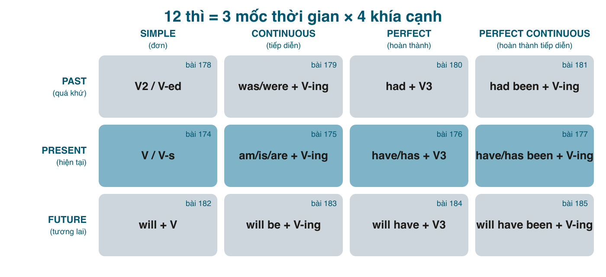
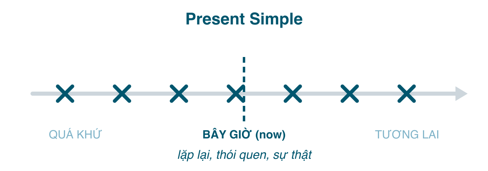

Tiếng Việt không chia động từ. "Tôi ăn cơm" đúng cho hôm qua, hôm nay, ngày mai; muốn rõ thời gian thì thêm "đã", "đang", "sẽ", "rồi", "vừa", hoặc chẳng thêm gì vì người nghe tự hiểu. Tiếng Anh thì ngược lại: **động từ bắt buộc phải mang thời gian**, và không chỉ thời gian mà còn cả "góc nhìn" của người nói với hành động đó (xong chưa, đang dở, có liên quan tới bây giờ không). Đó là lý do người Việt học tiếng Anh gần như ai cũng vấp ở các thì: không phải vì công thức khó, mà vì trong đầu chúng ta không có thói quen phải quyết định chuyện này mỗi khi mở miệng.

Series này đi qua đúng 12 thì, mỗi bài một thì, theo cùng một khung: công thức, **khi nào dùng** (phần quan trọng nhất), ví dụ có dịch, **so sánh với thì dễ nhầm**, lỗi người Việt hay mắc, và bài tập có đáp án ẩn. Tôi viết cho người đã học tiếng Anh ở trường, thuộc công thức nhưng nói và viết vẫn chọn sai thì; nên sẽ ít thuộc lòng, nhiều "vì sao".

#### Bản đồ 12 thì
12 thì nghe nhiều, nhưng thật ra chỉ là **3 mốc thời gian** (quá khứ, hiện tại, tương lai) nhân với **4 khía cạnh** (đơn, tiếp diễn, hoàn thành, hoàn thành tiếp diễn):

Ba mốc thời gian thì dễ hiểu. Bốn khía cạnh mới là thứ tiếng Việt không có và cần học thật kỹ:

| Khía cạnh | Người nói muốn nhấn | Hình dung |
|---|---|---|
| **Simple** (đơn) | sự việc như một *sự thật*, một *điểm* | một dấu X trên trục thời gian |
| **Continuous** (tiếp diễn) | hành động *đang dở*, có *quá trình* | một đoạn đang kéo dài |
| **Perfect** (hoàn thành) | hành động *xong trước* một mốc, và *kết quả* còn liên quan tới mốc đó | mũi tên nối tới mốc |
| **Perfect Continuous** | *quá trình* kéo dài tới mốc, nhấn *độ dài* | đoạn kéo dài chạm tới mốc |

Học hết bài 4 (4 thì hiện tại) là bạn nắm được cả 4 khía cạnh; 8 thì còn lại chỉ là dời mốc "bây giờ" về quá khứ hoặc tới tương lai.

#### Hiện tại đơn: công thức

| | Động từ thường | Động từ <mark>be</mark> |
|---|---|---|
| Khẳng định | I/You/We/They **work**. He/She/It **works**. | I **am**. He/She/It **is**. You/We/They **are**. |
| Phủ định | I **don't work**. She **doesn't work**. | I **am not**. She **isn't**. They **aren't**. |
| Câu hỏi | **Do** you work? **Does** she work? | **Are** you...? **Is** she...? |

Quy tắc thêm <mark>-s</mark> cho ngôi thứ ba số ít (he/she/it và mọi danh từ số ít):
- Thường: <mark>work → works</mark>, <mark>play → plays</mark>.
- Tận cùng <mark>-s, -sh, -ch, -x, -o</mark>: thêm <mark>-es</mark>: <mark>watch → watches</mark>, <mark>go → goes</mark>, <mark>do → does</mark>.
- Phụ âm + <mark>y</mark>: đổi thành <mark>-ies</mark>: <mark>study → studies</mark>, <mark>try → tries</mark>. (Nguyên âm + y thì giữ: <mark>play → plays</mark>.)
- Bất quy tắc: <mark>have → has</mark>.

Phát âm đuôi <mark>-s</mark> cũng có ba cách, và người Việt hay bỏ luôn không đọc: /s/ sau âm vô thanh (<mark>works</mark>, <mark>stops</mark>), /z/ sau âm hữu thanh và nguyên âm (<mark>plays</mark>, <mark>runs</mark>), /ɪz/ sau âm xuýt (<mark>watches</mark>, <mark>misses</mark>).

#### Khi nào dùng
**1. Thói quen, việc lặp đi lặp lại.** Đây là nghĩa chính. Không nói việc đó đang xảy ra lúc này, mà nói nó *thường* xảy ra.
- I **drink** coffee every morning. (Sáng nào tôi cũng uống cà phê.)
- She **goes** to the gym three times a week. (Cô ấy đi tập ba lần một tuần.)
- We **don't eat** out much. (Nhà tôi ít ăn ngoài.)

**2. Sự thật, chân lý, điều luôn đúng.**
- Water **boils** at 100°C. (Nước sôi ở 100 độ.)
- The sun **rises** in the east. (Mặt trời mọc ở hướng đông.)
- Vietnamese **doesn't have** verb tenses. (Tiếng Việt không có thì.)

**3. Trạng thái, tình trạng ở hiện tại** (với các động từ chỉ trạng thái: <mark>be, have, know, like, want, need, believe, live, work</mark>...). Chú ý: "work" theo nghĩa "làm việc ở đâu" là trạng thái lâu dài, không phải đang ngồi làm lúc này.
- I **live** in Da Nang. (Tôi sống ở Đà Nẵng.)
- He **works** for a bank. (Anh ấy làm ở ngân hàng.)
- I **don't know** her name. (Tôi không biết tên cô ấy.)

**4. Lịch trình cố định, thời gian biểu** (tàu xe, lịch chiếu, lịch học), kể cả khi nói về tương lai.
- The train **leaves** at 6:30 tomorrow. (Tàu chạy lúc 6 rưỡi mai.)
- The class **starts** next Monday. (Lớp bắt đầu thứ hai tuần sau.)

**5. Chỉ dẫn, bình luận trực tiếp, kể chuyện cho sinh động** (ít gặp hơn): *First you **boil** the water, then you **add** the noodles.* / *Messi **passes** to Suárez, Suárez **shoots**...*

**6. Trong mệnh đề thời gian và điều kiện nói về tương lai.** Sau <mark>when, if, as soon as, before, after, until</mark>, dùng hiện tại đơn dù nghĩa là tương lai. Người Việt rất hay viết "when I will finish".
- I'll call you **when I finish**. (Xong tôi gọi.) Không phải ~~when I will finish~~.
- **If it rains**, we'll stay home.

#### Dấu hiệu nhận biết
Trạng từ tần suất: <mark>always, usually, often, sometimes, rarely, never</mark> (đứng **trước** động từ thường, **sau** <mark>be</mark>: *She **is always** late.* / *She **always comes** late.*). Cụm chỉ lặp lại: <mark>every day/week/year</mark>, <mark>once a week</mark>, <mark>on Mondays</mark>, <mark>in the morning</mark>.

#### So sánh với thì dễ nhầm
**Hiện tại đơn vs. Hiện tại tiếp diễn** (bài 175) là cặp đầu tiên cần tách bạch, vì tiếng Việt dùng "đang" cho cả hai trường hợp mà tiếng Anh thì không:

| | Present Simple | Present Continuous |
|---|---|---|
| Ý | nói chung, thói quen, sự thật | ngay lúc này, tạm thời |
| | I **work** in Hanoi. (sống và làm ở đó) | I'**m working** in Hanoi this month. (tạm thời) |
| | She **speaks** three languages. (khả năng) | She'**s speaking** to the manager. (ngay lúc này) |
| | What **do** you **do**? (nghề gì?) | What **are** you **doing**? (đang làm gì đấy?) |

Hai câu hỏi cuối là ví dụ kinh điển: *What do you do?* hỏi nghề nghiệp, *What are you doing?* hỏi đang làm gì. Trả lời nhầm là chuyện thường gặp.

**Hiện tại đơn vs. Tương lai đơn** cho lịch trình: *The meeting **is** at 3 pm* (lịch cố định) vs. *I **will be** there at 3* (ý định/lời hứa của tôi). Bài 182 nói kỹ hơn.

#### Lỗi người Việt hay mắc
- **Quên <mark>-s</mark>** ở ngôi thứ ba: ~~She work here~~. Lỗi này hầu như không gây hiểu lầm nhưng lộ ngay trình độ. Mẹo: mỗi khi chủ ngữ là *he/she/it* hoặc một người, một vật, tự hỏi "đã thêm s chưa".
- **Thêm <mark>-s</mark> vào cả động từ sau <mark>does/doesn't</mark>**: ~~She doesn't works~~. Đã có <mark>does</mark> gánh ngôi rồi, động từ về nguyên mẫu.
- **Dùng <mark>be</mark> + động từ thường**: ~~I am agree~~, ~~I am work here~~. "Agree" là động từ, nói *I agree*. Lỗi này đến từ thói quen dịch "tôi *là* đồng ý". Chỉ dùng <mark>am/is/are</mark> trước danh từ, tính từ, hoặc V-ing.
- **Bỏ trợ động từ trong câu hỏi**: ~~You like coffee?~~ (nói được nhưng là văn nói thân mật), ~~Where you live?~~ (sai). Chuẩn là *Do you like coffee? Where do you live?*
- **Dùng hiện tại tiếp diễn cho thói quen** vì "đang" trong đầu: ~~I'm going to work by bus every day~~ → *I go to work by bus every day.*
- **Hiện tại đơn cho việc xảy ra đúng lúc này**: ~~I eat lunch now~~ → *I'm eating lunch now.*

#### Bài tập
Chọn dạng đúng rồi bôi đen để xem đáp án.

1. My sister (study / studies) medicine in Hue. → studies
2. (Do / Does) your parents live with you? → Do
3. He (don't / doesn't) (like / likes) durian. → doesn't like
4. The bus (leave / leaves) at 7 every morning. → leaves
5. I'll text you when I (arrive / will arrive). → arrive
6. Sửa lỗi: *I am agree with you.* → I agree with you.
7. Sửa lỗi: *She always is tired after work.* → She is always tired after work. ("always" đứng sau "be")
8. Dịch: "Bố tôi không uống bia." → My father doesn't drink beer.
9. Dịch: "Bạn làm nghề gì?" → What do you do?
10. Dịch: "Nước đóng băng ở 0 độ C." → Water freezes at 0°C.

#### Tóm tắt
- Hiện tại đơn = **sự thật và thói quen**, không phải "đang xảy ra".
- Ngôi thứ ba số ít: động từ thêm <mark>-s/-es</mark>; phủ định và câu hỏi dùng <mark>do/does</mark> và động từ trở về nguyên mẫu.
- Không dùng <mark>will</mark> sau <mark>when/if/until...</mark> khi nói tương lai.
- Bài 175: hiện tại tiếp diễn, và vì sao *I'm loving it* của McDonald's là cố tình sai ngữ pháp.
