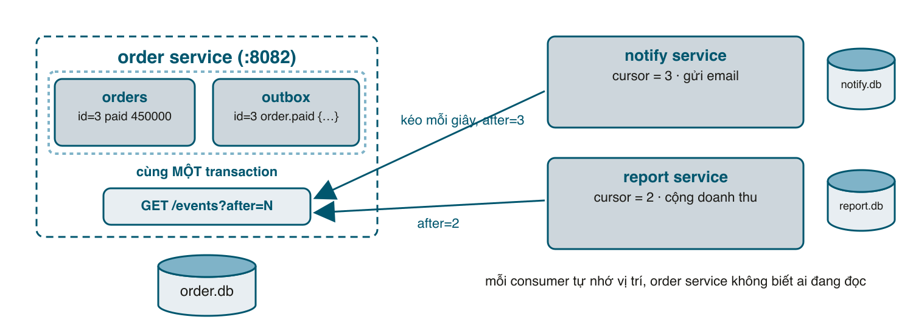

Sau bài 2, shop còn thiếu hai thứ so với monolith: gửi email khi đơn thanh toán xong, và trang báo cáo doanh thu. Cách dễ nhất là order service gọi thêm hai lời HTTP nữa: <mark>POST /emails</mark> rồi <mark>POST /sales</mark>. Đừng. Mỗi lời gọi đồng bộ thêm vào là thêm một service mà khi nó sập thì **khách không đặt hàng được**, dù email hay báo cáo chẳng liên quan gì tới việc đặt hàng. Bài này đổi cách nói chuyện: order service chỉ **ghi lại chuyện đã xảy ra** (event), ai cần thì tự đọc. Và để làm điều đó **không mất event** mà không cần cài Kafka hay RabbitMQ, ta dùng pattern **outbox** với một feed HTTP đơn giản.

#### Kết quả cuối bài
```sh
# notify service đang tắt, tạo hai đơn
curl -s -X POST localhost:8082/orders ... card 4242    # {"id":1,...}
curl -s -X POST localhost:8082/orders ... card 4242    # {"id":2,...}

# bật notify lên: nó đọc bù cả hai, rồi đứng chờ
bundle exec ruby services/notify.rb
# msg="notify chạy, đang đọc" service=notify feed=http://localhost:8082/events
# msg="gửi email" service=notify to=an@example.com subject="Đơn hàng đã thanh toán" order=1 total=2400000
# msg="gửi email" service=notify to=binh@example.com subject="Đơn hàng đã thanh toán" order=2 total=2500000
```
Service nhận event tắt bao lâu cũng được, bật lên là đọc bù, và không bao giờ gửi trùng.

#### Database trong microservices có "đồng bộ" với nhau không?
Câu hỏi tôi hay nhận nhất, nên trả lời trước khi viết code: **không**. Không có replication giữa database của các service, không có bảng chung, không có "đồng bộ" tự động nào. Mỗi service sở hữu một database, và chỉ nó được đọc ghi vào đó. Service khác muốn dữ liệu có đúng hai cách:
- **Hỏi lúc cần** (API composition): report gọi catalog để lấy tên sản phẩm. Luôn mới, nhưng kéo độ trễ và uptime của mình theo service kia.
- **Giữ một bản sao, cập nhật bằng event**: service sở hữu phát "đơn đã thanh toán", consumer ghi những gì mình cần vào bảng của mình. Bản sao **không phải mirror** của database kia: nó chỉ chứa vài field consumer cần, theo hình dạng tiện cho truy vấn của consumer, và trễ vài giây. Cái trễ đó gọi là **eventual consistency**, và nó là bình thường.

Hệ quả cho thiết kế schema:

| Thói quen trong monolith | Trong microservices |
|---|---|
| Foreign key <mark>orders.product_id → products.id</mark> | Chỉ là một số nguyên. Bảng kia ở database khác: không FK, không cascade, không JOIN |
| JOIN giữa các module | API composition, hoặc bảng tổng hợp nuôi bằng event (bảng <mark>sales</mark> bên dưới) |
| Một transaction qua nhiều module | Saga (bài 2), cộng outbox để event được ghi nguyên tử với dữ liệu (bài này) |
| Báo cáo JOIN mọi thứ | Đổ dữ liệu các service vào warehouse; báo cáo không thuộc về service nghiệp vụ |
| Bảng <mark>users</mark> dùng chung | Một chủ sở hữu; service khác giữ <mark>user_id</mark> và nếu cần, bản sao nhỏ của tên và email |

Ba quy tắc: nhân bản dữ liệu **có chủ đích**, nhưng mỗi mẩu dữ liệu có đúng một chủ và chỉ chủ được sửa; tham chiếu bằng id của chủ, không copy nhiều hơn những field mình thật sự truy vấn; và khi hai service liên tục cần bảng của nhau, ranh giới sai rồi, gộp lại là cách sửa đúng, dùng chung database không phải.

#### Đồng bộ và bất đồng bộ
Khi A gọi B **đồng bộ** (HTTP request, chờ response), A phụ thuộc B theo ba cách: B sập thì A lỗi; B chậm thì A chậm; muốn thêm C thì phải sửa A. Catalog và payment trong bài 2 buộc phải đồng bộ: không biết giá và không thu được tiền thì không thể trả lời khách "đã đặt hàng".

Nhưng email và báo cáo thì **không cần có trước khi trả lời khách**. Chúng chỉ cần "rồi sẽ xảy ra". Với loại việc này, cách đúng là A **phát một sự kiện** "đơn 3 đã thanh toán, 450.000đ, email an@example.com", rồi đi tiếp. Notify đọc sự kiện và gửi email. Report đọc cùng sự kiện và cộng doanh thu. Mai thêm service tích điểm thì nó cũng đọc sự kiện đó, **order service không sửa một dòng**. Đây là lợi ích "thêm tính năng không sửa service cũ" trong bảng bài 1. Nếu bạn đã dùng Sidekiq, ý tưởng không lạ: Rails đẩy job vào Redis rồi trả lời ngay. Khác biệt là ở đây **nhiều service khác nhau** cùng đọc một luồng sự kiện, và mỗi service tự quyết định làm gì với nó.

Cách thường gặp là đẩy sự kiện vào message broker (RabbitMQ, Kafka, bài 076 - 080). Nhưng broker không giải quyết câu hỏi khó nhất: **làm sao bảo đảm đơn đã lưu thì sự kiện chắc chắn được phát, và ngược lại?**

#### Vấn đề hai lần ghi
Thử viết ngây thơ:
```ruby
# services/order/app.rb (minh họa, không có trong code)
OrderStore.insert(db, order)          # ghi order.db
broker.publish("order.paid", order)   # gửi sang broker
```
Nếu process chết giữa hai dòng: có đơn, không có email. Đảo thứ tự thì ngược lại: có email cho đơn không tồn tại. Bọc hai dòng trong transaction cũng vô ích vì broker không tham gia transaction của SQLite. Đây là **dual write problem**, và nó xuất hiện ở mọi chỗ có "ghi database rồi gọi cái khác", kể cả <mark>after_commit { SomeJob.perform_later }</mark> trong Rails nếu Redis đang sập đúng lúc đó.

Lời giải: **chỉ ghi một chỗ**. Sự kiện được ghi vào một bảng <mark>outbox</mark> **trong cùng database và cùng transaction** với đơn hàng. Transaction là nguyên tử, nên hoặc có cả hai, hoặc không có gì. Sau đó một tiến trình khác lấy sự kiện từ outbox ra và chuyển đi. Trong bài này, "chuyển đi" đơn giản là **cho người khác kéo về** qua HTTP.



#### Bước 1: Bảng outbox trong order service
```ruby
# services/order/store.rb
# Bảng orders và bảng outbox của order service. Đơn hàng và sự kiện "order.paid" được ghi trong cùng một transaction.
require "json"

module OrderStore
  SCHEMA = <<~SQL
    CREATE TABLE IF NOT EXISTS orders (
      id         INTEGER PRIMARY KEY,
      product_id INTEGER NOT NULL,
      qty        INTEGER NOT NULL,
      total      INTEGER NOT NULL,
      email      TEXT    NOT NULL,
      status     TEXT    NOT NULL,
      charge_id  TEXT
    );
    CREATE TABLE IF NOT EXISTS outbox (
      id         INTEGER PRIMARY KEY,
      type       TEXT    NOT NULL,
      payload    TEXT    NOT NULL,
      created_at TEXT    NOT NULL DEFAULT (datetime('now'))
    );
  SQL

  class NotFound < StandardError; end

  # Lưu đơn hàng VÀ sự kiện vào outbox. Cùng một transaction nên không thể có
  # đơn mà không có sự kiện, hay có sự kiện mà không có đơn.
  def self.insert(db, order)
    db.transaction do
      db.execute(
        "INSERT INTO orders (product_id, qty, total, email, status, charge_id) VALUES (?, ?, ?, ?, ?, ?)",
        order.values_at("product_id", "qty", "total", "email", "status", "charge_id")
      )
      saved = get(db, db.last_insert_row_id)
      db.execute("INSERT INTO outbox (type, payload) VALUES ('order.paid', ?)", JSON.generate(saved))
      saved
    end
  end

  # Tối đa limit sự kiện có id > after, theo thứ tự id tăng dần.
  def self.events(db, after, limit)
    db.execute("SELECT id, type, payload FROM outbox WHERE id > ? ORDER BY id LIMIT ?", [after, limit])
      .map { |e| e.merge("payload" => JSON.parse(e["payload"])) }
  end

  def self.get(db, id)
    db.get_first_row("SELECT * FROM orders WHERE id = ?", id) or raise NotFound, "không có đơn hàng"
  end
end
```
<mark>insert</mark> giờ mở transaction: ghi đơn, ghi sự kiện với <mark>payload</mark> là chính đơn hàng ở dạng JSON, commit. <mark>events</mark> trả về các sự kiện có <mark>id</mark> lớn hơn một mốc, theo thứ tự tăng dần. Cột <mark>id</mark> tự tăng của SQLite chính là **offset** của feed, giống offset trong Kafka.

Thêm route vào <mark>app.rb</mark> của order:
```ruby
# services/order/app.rb (thêm)
# Feed sự kiện cho các service khác kéo về. Order service không cần biết ai đang đọc.
get "/events" do
  after = params[:after].to_i
  limit = params[:limit].to_i
  limit = 100 if limit <= 0 || limit > 1000
  json_body 200, OrderStore.events(DBH, after, limit)
end
```
Thế là xong phía phát. Order service không biết notify hay report tồn tại, không giữ danh sách người đăng ký, không retry gì cả. Nó chỉ trả lời câu hỏi "sau sự kiện số N có gì mới?".

#### Bước 2: Consumer dùng chung
Phía đọc có ba việc giống nhau với mọi consumer: nhớ đã đọc tới đâu, hỏi feed, xử lý từng sự kiện **đúng một lần**. Tôi viết một lần trong <mark>lib/events.rb</mark>:
```ruby
# lib/events.rb
# Events::Consumer đọc feed sự kiện theo kiểu "kéo" (poll), gọi handler cho mỗi sự kiện MỘT lần,
# và lưu tiến độ vào database của chính consumer.
require "net/http"
require "json"

module Events
  # Mỗi consumer nhớ mình đã đọc tới đâu (cursor) và đã xử lý sự kiện nào (done).
  CONSUMER_SCHEMA = <<~SQL
    CREATE TABLE IF NOT EXISTS events_cursor (name TEXT PRIMARY KEY, position INTEGER NOT NULL);
    CREATE TABLE IF NOT EXISTS events_done   (event_id INTEGER PRIMARY KEY);
  SQL

  class Consumer
    # feed: ví dụ http://localhost:8082/events. Block nhận (db, event) và được gọi trong transaction.
    def initialize(name:, feed:, db:, &handler)
      @name = name
      @feed = feed
      @db = db
      @handler = handler
    end

    # Lặp mãi: mỗi giây hỏi feed "có gì mới sau vị trí N không?".
    def run
      loop do
        n = poll
        sleep 1 if n.zero? # không có gì mới (hoặc lỗi): nghỉ một chút
      end
    end

    private

    def poll
      position = @db.get_first_value("SELECT position FROM events_cursor WHERE name = ?", @name) || 0
      res = Net::HTTP.get_response(URI("#{@feed}?after=#{position}&limit=100"))
      events = JSON.parse(res.body)
      events.each { |ev| handle_once(ev) }
      events.size
    rescue StandardError => e
      Log.warn("poll lỗi, thử lại sau", consumer: @name, err: e.message)
      0
    end

    # Đánh dấu done + xử lý + dời cursor trong MỘT transaction của DB consumer.
    # Sự kiện đã done (do chạy lại, do cursor bị reset) thì bỏ qua: đó là idempotency.
    def handle_once(ev)
      @db.transaction do
        @db.execute("INSERT OR IGNORE INTO events_done (event_id) VALUES (?)", ev["id"])
        if @db.changes == 1
          @handler.call(@db, ev)
        else
          Log.info("bỏ qua event đã xử lý", consumer: @name, event: ev["id"])
        end
        @db.execute(<<~SQL, [@name, ev["id"]])
          INSERT INTO events_cursor (name, position) VALUES (?, ?)
          ON CONFLICT (name) DO UPDATE SET position = excluded.position
        SQL
      end
    end
  end
end
```
Điểm mấu chốt nằm ở <mark>handle_once</mark>. Ba việc trong **một transaction của database consumer**: đánh dấu <mark>events_done</mark>, gọi handler, dời <mark>events_cursor</mark>. Vì <mark>event_id</mark> là khóa chính, <mark>INSERT OR IGNORE</mark> không thêm dòng nào nếu sự kiện đã xử lý (<mark>changes == 0</mark>), và handler bị bỏ qua. Đây là **idempotency** ở phía consumer, và nó là thứ bắt buộc, vì mọi hệ thống phát sự kiện thực tế đều là **at-least-once**: có lúc bạn nhận một sự kiện hai lần (process chết sau khi xử lý nhưng trước khi lưu cursor, feed bị đọc lại, ai đó reset offset). Không có cách nào rẻ để có exactly-once giữa hai hệ thống; cách rẻ là at-least-once cộng idempotent. Sidekiq cũng khuyên y hệt: job phải idempotent vì job có thể chạy lại.

Handler nhận <mark>db</mark> để consumer nào ghi database của mình (như report) thì ghi trong cùng transaction với cursor: dữ liệu và tiến độ luôn khớp nhau. Consumer có side effect ngoài database (gửi email thật) thì không có gì để rollback, chỉ có idempotency bảo vệ khỏi gửi trùng.

#### Bước 3: Notify service
```ruby
# services/notify.rb
# Notify service: đọc sự kiện order.paid và "gửi email". Không có HTTP server, chỉ là một consumer.
# Chạy: ruby services/notify.rb
require_relative "../lib/db"
require_relative "../lib/web"
require_relative "../lib/events"

Log.service = "notify"
db = DB.new(ENV.fetch("DB", "notify.db"), Events::CONSUMER_SCHEMA)
feed = ENV.fetch("ORDER_URL", "http://localhost:8082") + "/events"

consumer = Events::Consumer.new(name: "notify", feed: feed, db: db) do |_db, ev|
  next unless ev["type"] == "order.paid"

  o = ev["payload"]
  Log.info("gửi email", to: o["email"], subject: "Đơn hàng đã thanh toán", order: o["id"], total: o["total"])
end

Log.info("notify chạy, đang đọc", feed: feed)
consumer.run
```
Không có Sinatra, không có cổng. Một script Ruby chỉ ngồi đọc feed và ghi log, giống một process Sidekiq. Để ý nó lọc <mark>ev["type"]</mark>: feed có thể chứa nhiều loại sự kiện, consumer chỉ quan tâm loại của mình và **bỏ qua phần còn lại mà vẫn dời cursor**.

#### Bước 4: Report service, lấy lại câu JOIN
```ruby
# services/report.rb
# Report service: đọc cùng feed sự kiện, tự giữ bảng doanh thu theo sản phẩm, trả về GET /report.
# Đây là cách lấy lại câu JOIN đã mất khi tách database. Chạy: ruby services/report.rb
require "sinatra"
require "net/http"
require_relative "../lib/db"
require_relative "../lib/web"
require_relative "../lib/events"

Log.service = "report"
set :server, :puma
set :port, ENV.fetch("PORT", 8085).to_i
set :logging, false
set :show_exceptions, :after_handler
use Web::RequestLog
helpers Web::Helpers

SCHEMA = <<~SQL
  CREATE TABLE IF NOT EXISTS sales (
    product_id INTEGER PRIMARY KEY,
    orders     INTEGER NOT NULL DEFAULT 0,
    revenue    INTEGER NOT NULL DEFAULT 0
  );
SQL

DBH = DB.new(ENV.fetch("DB", "report.db"), SCHEMA + Events::CONSUMER_SCHEMA)
CATALOG_URL = ENV.fetch("CATALOG_URL", "http://localhost:8081")

# Cập nhật bảng sales bằng chính transaction của consumer: cursor và dữ liệu luôn khớp nhau.
consumer = Events::Consumer.new(name: "report", feed: ENV.fetch("ORDER_URL", "http://localhost:8082") + "/events", db: DBH) do |db, ev|
  next unless ev["type"] == "order.paid"

  o = ev["payload"]
  db.execute(<<~SQL, [o["product_id"], o["total"]])
    INSERT INTO sales (product_id, orders, revenue) VALUES (?, 1, ?)
    ON CONFLICT (product_id) DO UPDATE SET orders = orders + 1, revenue = revenue + excluded.revenue
  SQL
end
Thread.new { consumer.run } # consumer chạy nền, cạnh HTTP server

get "/report" do
  # Tên sản phẩm không có ở đây: hỏi catalog lúc đọc (API composition).
  names = begin
    JSON.parse(Net::HTTP.get(URI("#{CATALOG_URL}/products"))).to_h { |p| [p["id"], p["name"]] }
  rescue StandardError
    {}
  end
  rows = DBH.execute("SELECT product_id, orders, revenue FROM sales ORDER BY product_id")
  json_body 200, rows.map { |r| { product: names.fetch(r["product_id"], "##{r['product_id']}"), orders: r["orders"], revenue: r["revenue"] } }
end
```
Report giữ bảng <mark>sales</mark> của riêng nó, cộng dồn từ sự kiện. Đây là **nhân bản dữ liệu có chủ đích** như đã nói ở đầu bài: order service là nguồn sự thật về đơn hàng, report giữ một bản tổng hợp đủ cho câu hỏi của nó. Consumer chạy trong một <mark>Thread</mark> cạnh Puma. Tên sản phẩm thì không nhân bản mà hỏi catalog lúc đọc (API composition), vì chỉ có 3 sản phẩm. Nếu có 300 nghìn sản phẩm, bạn sẽ cho catalog cũng phát sự kiện <mark>product.updated</mark> và report tự giữ bảng tên.

#### Bước 5: Chạy và phá thử
Chạy catalog, payment, order như bài 2. **Chưa chạy notify.** Tạo hai đơn:
```sh
curl -s -X POST localhost:8082/orders -H 'Content-Type: application/json' \
  -d '{"product_id":1,"qty":2,"email":"an@example.com","card":"4242424242424242"}'
curl -s -X POST localhost:8082/orders -H 'Content-Type: application/json' \
  -d '{"product_id":3,"qty":1,"email":"binh@example.com","card":"4242424242424242"}'
curl -s 'localhost:8082/events?after=0'
# [{"id":1,"type":"order.paid","payload":{"id":1,"product_id":1,"qty":2,"total":2400000,"email":"an@example.com",...}},
#  {"id":2,"type":"order.paid","payload":{"id":2,"product_id":3,"qty":1,"total":2500000,"email":"binh@example.com",...}}]
```
Hai sự kiện nằm chờ trong outbox. Bật notify:
```sh
bundle exec ruby services/notify.rb
# time=10:58:07.193 level=INFO msg="notify chạy, đang đọc" service=notify feed=http://localhost:8082/events
# time=10:58:07.196 level=INFO msg="gửi email" service=notify to=an@example.com subject="Đơn hàng đã thanh toán" order=1 total=2400000
# time=10:58:07.197 level=INFO msg="gửi email" service=notify to=binh@example.com subject="Đơn hàng đã thanh toán" order=2 total=2500000
```
Đọc bù xong trong vài mili giây. Tắt notify bằng Ctrl+C, bật lại: **không in gì thêm**, vì cursor đã lưu ở <mark>notify.db</mark>. Tạo đơn thứ ba khi notify đang chạy: email xuất hiện sau tối đa một giây.

Giờ giả lập tai nạn: reset cursor về 0, như thể ai đó restore nhầm database:
```sh
sqlite3 notify.db "UPDATE events_cursor SET position = 0"
bundle exec ruby services/notify.rb
# msg="bỏ qua event đã xử lý" service=notify consumer=notify event=1
# msg="bỏ qua event đã xử lý" service=notify consumer=notify event=2
# msg="bỏ qua event đã xử lý" service=notify consumer=notify event=3
```
Ba sự kiện được đọc lại, không email nào gửi trùng. Bảng <mark>events_done</mark> đã làm việc của nó.

Bật report, nó đọc cùng feed từ đầu với cursor riêng:
```sh
bundle exec ruby services/report.rb
curl -s localhost:8085/report
# [{"product":"Bàn phím cơ","orders":1,"revenue":2400000},{"product":"Chuột không dây","orders":1,"revenue":450000},{"product":"Tai nghe","orders":1,"revenue":2500000}]
```
Đúng kết quả của câu JOIN bài 1, không có JOIN, không sửa order service.

Một thứ bạn sẽ thấy trong log của order: mỗi giây hai dòng <mark>GET /events</mark>, một của notify, một của report. Đó là cái giá của polling. Với vài consumer và chu kỳ một giây thì không đáng kể; với 50 consumer thì nên chuyển sang broker thật hoặc long-polling.

#### Khi nào dùng broker thật
Feed HTTP + outbox ở đây về bản chất là một **Kafka thu nhỏ**: log chỉ ghi thêm, consumer tự giữ offset, đọc lại được từ đầu. Nó đủ cho vài service và vài nghìn sự kiện mỗi phút, và quan trọng hơn, nó dạy bạn đúng mô hình để sau này dùng Kafka (bài 079 - 080) không bỡ ngỡ. Chuyển sang broker khi: nhiều consumer polling làm phiền service phát; cần xử lý song song một feed bằng nhiều instance (partition, bài 080); hoặc sự kiện cần đi qua nhiều đội và nhiều ngôn ngữ. Lúc chuyển, outbox vẫn giữ nguyên; chỉ thay "cho kéo qua HTTP" bằng "một relay đọc outbox và publish lên broker" (Debezium làm việc này bằng cách đọc thẳng WAL của PostgreSQL).

#### Mẹo và lỗi hay gặp
- Payload của sự kiện là **hợp đồng công khai**. Đổi tên key trong JSON là làm hỏng mọi consumer, kể cả consumer chưa viết. Chỉ thêm key, không đổi, không xóa (bài 5 nói kỹ).
- Sự kiện kể chuyện **đã xảy ra** (<mark>order.paid</mark>), không ra lệnh (<mark>send_email</mark>). Ra lệnh là order service lại biết về notify, mất hết ý nghĩa.
- Consumer phải chịu được **thứ tự và trùng lặp**. Trong feed này thứ tự được bảo đảm (theo <mark>id</mark>), nhưng sang Kafka thì chỉ bảo đảm trong một partition.
- Bảng <mark>outbox</mark> lớn dần. Thêm một job xóa sự kiện cũ hơn 7 ngày; consumer nào tụt hơn 7 ngày thì cần cơ chế rebuild riêng.
- Đừng để handler gọi HTTP sang service khác rồi mới commit. Timeout 2 giây trong transaction SQLite là khóa cả database. Ghi ra "việc cần làm" rồi làm ngoài transaction.
- Chạy **hai** instance notify là gửi email hai lần: cả hai cùng đọc từ một cursor. Consumer muốn scale phải chia partition hoặc khóa cursor, đó là việc broker làm hộ.

#### Checklist
- Tạo đơn khi notify tắt, bật notify lên thấy đủ email cho từng đơn.
- Restart notify không gửi trùng; reset cursor về 0 cũng không gửi trùng (thấy dòng "bỏ qua event đã xử lý").
- <mark>GET /report</mark> ra đúng số đơn và doanh thu theo sản phẩm.
- Giải thích được tại sao ghi outbox trong cùng transaction với đơn hàng là bắt buộc, và tại sao database của các service không "đồng bộ" với nhau.

#### Bài tập thêm
1. Cho catalog phát sự kiện <mark>product.updated</mark> qua outbox riêng của nó, và report giữ bảng tên sản phẩm thay vì gọi catalog lúc đọc.
2. Thay vòng lặp 1 giây bằng long-polling: <mark>GET /events?after=N&wait=30</mark> giữ kết nối tới khi có sự kiện mới hoặc hết 30 giây. Dùng <mark>ConditionVariable</mark> trong order service để đánh thức.
3. Viết service <mark>loyalty</mark> tích điểm 1% giá trị đơn, cộng dồn theo email. Bạn có phải sửa order service không?

Mã nguồn cuối bài: [post_166.zip](/assets/code/post_166.zip)
