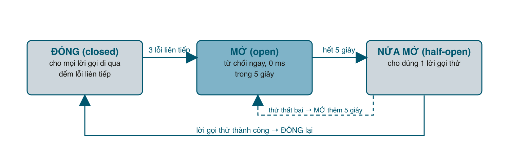

Bảng bài 1 hứa rằng microservices **khoanh vùng được lỗi**: payment hỏng thì chỉ thanh toán hỏng, trang sản phẩm vẫn chạy. Hiện tại shop chưa có được điều đó. Payment chậm 5 giây thì mỗi request đặt hàng treo 5 giây, Puma của order service hết thread, và người xem sản phẩm cũng chờ theo vì gọi vào cùng một chỗ. Bài này thêm bốn lưới an toàn (timeout, retry, circuit breaker, request id) và một cửa duy nhất ra ngoài (API gateway). Mỗi thứ chỉ vài chục dòng, và sau bài này bạn **tắt payment, làm payment chậm, tắt catalog**, hệ thống vẫn trả lời khách trong vài mili giây với một câu lỗi rõ ràng.

#### Kết quả cuối bài
```sh
# payment chậm 5 giây (thẻ 5000...), order bỏ cuộc sau 2 giây
curl -s -w " %{http_code} %{time_total}s\n" -X POST localhost:8080/orders ... card 5000
# {"error":"gọi payment: Net::ReadTimeout with #<TCPSocket:(closed)>"} 502 2.017981s

# sau 3 lần như thế, circuit breaker mở: từ chối ngay, không chờ
curl -s -w " %{http_code} %{time_total}s\n" -X POST localhost:8080/orders ... card 4242
# {"error":"circuit breaker đang mở"} 503 0.010636s
```
Và mọi dòng log của một request, trên mọi service, có cùng một <mark>rid</mark>.

#### Lỗi lan truyền như thế nào
Thêm một loại thẻ vào payment giả: thẻ bắt đầu bằng <mark>5000</mark> mất 5 giây mới trả lời, giống cổng thanh toán đang quá tải:
```ruby
# lib/payment.rb
# Payment giả lập cổng thanh toán: thẻ 4242 luôn được, thẻ 4000 luôn bị từ chối, thẻ 5000 mất 5 giây mới trả lời.
module Payment
  class Declined < StandardError; end

  # Trừ tiền trên thẻ. Thật ra chỉ nhìn 4 số đầu để quyết định.
  def self.charge(card, amount)
    raise Declined, "thẻ bị từ chối" if card.start_with?("4000")
    sleep 5 if card.start_with?("5000") # cổng thanh toán "đang chậm"

    { "id" => format("ch_%06d", rand(1_000_000)), "amount" => amount }
  end
end
```
Với code bài 2, một đơn thẻ 5000 treo 5 giây. Puma của order service mặc định có 5 thread; 5 khách như vậy là **không ai đặt hàng được nữa** trong 5 giây, kể cả người dùng thẻ tốt. Khi payment thật sự sập chứ không chỉ chậm, kết nối TCP có thể treo tới **vài phút** trước khi hệ điều hành báo lỗi (<mark>Net::HTTP</mark> mặc định chờ 60 giây mỗi lần đọc). Đó là cách một service chậm làm cả hệ thống chậm: không ai bị lỗi, tất cả cùng chờ. Trong monolith, lỗi này có tên là "database chậm"; trong microservices nó có thể xảy ra ở mọi mũi tên trên sơ đồ.

#### Bước 1: Timeout, lưới số một
Quy tắc: **không có lời gọi mạng nào không có timeout.** Client mới trong order service:
```ruby
# services/order/clients.rb
# Client HTTP tới catalog và payment, có timeout, retry (chỉ cho GET) và circuit breaker.
require "net/http"
require "json"
require_relative "../../lib/breaker"

# Bọc mọi lỗi mà service bên kia trả về (4xx, 5xx).
class RemoteError < StandardError
  attr_reader :service, :status, :remote_message

  def initialize(service, status, remote_message)
    @service = service
    @status = status
    @remote_message = remote_message
    super("#{service} trả về #{status}: #{remote_message}")
  end

  # Lỗi do dữ liệu (4xx), không phải do mạng hay service sập.
  def client_error? = status < 500
end

# Gom các "lưới an toàn" khi gọi một service khác.
class RemoteClient
  TIMEOUT = 2 # giây: không bao giờ chờ vô hạn

  def initialize(name)
    @name = name
    @breaker = Breaker.new(threshold: 3, cooldown: 5) # service kia hỏng thì ngắt sớm
  end

  # Retry tối đa 3 lần nhưng CHỈ với GET: POST lặp lại có thể trừ tiền hai lần.
  def call(method, url, body = nil)
    tries = method == :get ? 3 : 1
    attempt = 0
    begin
      attempt += 1
      @breaker.call { once(method, url, body) }
    rescue RemoteError => e
      raise if e.client_error? || attempt >= tries # lỗi dữ liệu thì thử lại cũng vô ích
      retry_after(attempt, e)
      retry
    rescue Breaker::Open
      raise
    rescue StandardError => e
      raise if attempt >= tries
      retry_after(attempt, e)
      retry
    end
  end

  private

  def retry_after(attempt, error)
    Log.warn("thử lại", target: @name, lần: attempt + 1, err: error.message)
    sleep attempt * 0.2
  end

  def once(method, url, body)
    uri = URI(url)
    req = (method == :get ? Net::HTTP::Get : Net::HTTP::Post).new(uri)
    req["Content-Type"] = "application/json"
    req["X-Request-ID"] = Log.request_id # chuyền request id sang service kia
    req.body = JSON.generate(body) if body
    res = Net::HTTP.start(uri.host, uri.port, open_timeout: TIMEOUT, read_timeout: TIMEOUT) { |http| http.request(req) }
    data = JSON.parse(res.body) rescue {}
    raise RemoteError.new(@name, res.code.to_i, data["error"] || res.message) if res.code.to_i >= 400

    data
  rescue SystemCallError, IOError, Net::OpenTimeout, Net::ReadTimeout => e
    raise "gọi #{@name}: #{e.message}"
  end
end

class CatalogClient
  def initialize(url)
    @url = url
    @c = RemoteClient.new("catalog")
  end

  def get(id) = @c.call(:get, "#{@url}/products/#{id}")
  def reserve(id, qty) = @c.call(:post, "#{@url}/products/#{id}/reserve", { qty: qty })
  def release(id, qty) = @c.call(:post, "#{@url}/products/#{id}/release", { qty: qty })
end

class PaymentClient
  def initialize(url)
    @url = url
    @c = RemoteClient.new("payment")
  end

  def charge(card, amount) = @c.call(:post, "#{@url}/charges", { card: card, amount: amount })
end
```
Ba thứ mới gói trong <mark>RemoteClient</mark>: <mark>open_timeout</mark> và <mark>read_timeout</mark> 2 giây, một <mark>Breaker</mark>, và logic retry trong <mark>call</mark>. Đi từng cái.

**Timeout 2 giây** là con số cho demo. Ngoài đời, timeout của mỗi hop phải **nhỏ hơn** timeout của hop gọi nó: khách chờ 10 giây, gateway chờ 8, order chờ catalog 2 và payment 5. Nếu đặt ngược (order chờ payment 30 giây trong khi gateway bỏ cuộc sau 10), bạn sẽ có những đơn hàng **thành công sau khi khách đã nhận thông báo lỗi**.

#### Bước 2: Retry, nhưng chỉ khi an toàn
Mạng thỉnh thoảng rớt một gói, service đang restart mất nửa giây. Thử lại giải quyết phần lớn lỗi thoáng qua. Nhưng hãy nhìn điều kiện trong <mark>call</mark>: **chỉ retry GET**. Lý do: <mark>POST /charges</mark> gửi đi, payment đã trừ tiền, response bị mất trên đường về, order thấy lỗi và gửi lại: khách bị trừ tiền hai lần. GET không có tác dụng phụ nên gửi bao nhiêu lần cũng được. Muốn retry POST, bạn phải làm API đó idempotent bằng một **idempotency key** (bài tập 1). Stripe làm đúng như vậy với header <mark>Idempotency-Key</mark>.

Cũng để ý: lỗi 4xx (<mark>client_error?</mark>) không retry, vì gửi lại cùng dữ liệu sai thì vẫn sai. Và giữa các lần thử có nghỉ tăng dần (200ms, 400ms), để không dội 3 request vào một service đang hấp hối. Gem <mark>faraday-retry</mark> làm đúng những điều này nếu bạn không muốn viết tay.

#### Bước 3: Circuit breaker, ngắt điện sớm
Timeout cứu từng request, nhưng khi payment chết hẳn thì **mỗi** request vẫn mất 2 giây để biết điều đó. Breaker nhớ rằng "3 lần vừa rồi đều lỗi" và từ chối ngay những lần sau, trong một khoảng nghỉ, rồi hé cửa cho một request thử. Cái tên lấy từ cầu dao điện: quá tải thì ngắt, không để cháy cả nhà.



```ruby
# lib/breaker.rb
# Circuit breaker tối giản. Sau N lỗi liên tiếp thì "mở", từ chối ngay mọi lời gọi trong một khoảng nghỉ;
# hết khoảng nghỉ cho MỘT lời gọi thử, thành công thì "đóng" lại.
class Breaker
  class Open < StandardError; end

  def initialize(threshold: 3, cooldown: 5)
    @threshold = threshold
    @cooldown = cooldown
    @failures = 0
    @opened_at = nil
    @probing = false
    @mutex = Mutex.new # nhiều thread (nhiều request) dùng chung một breaker
  end

  # Chạy block nếu breaker cho phép, và ghi nhận kết quả.
  def call
    allow!
    result = yield
    record(nil)
    result
  rescue Open
    raise
  rescue StandardError => e
    record(e)
    raise
  end

  private

  def allow!
    @mutex.synchronize do
      return if @failures < @threshold # đóng: cho qua
      if Time.now - @opened_at < @cooldown || @probing
        raise Open, "circuit breaker đang mở" # mở: từ chối ngay, không tốn thời gian chờ
      end

      @probing = true # nửa mở: cho đúng một lời gọi thử
    end
  end

  def record(error)
    @mutex.synchronize do
      @probing = false
      if error.nil?
        @failures = 0
        return
      end
      @failures += 1
      @failures = @threshold if @failures > @threshold # lời gọi thử thất bại: mở thêm một khoảng nữa
      @opened_at = Time.now if @failures == @threshold
    end
  end
end
```
Ba trạng thái gói trong hai biến: <mark>@failures</mark> và <mark>@opened_at</mark>. Đóng khi <mark>@failures < @threshold</mark>. Mở khi đủ ngưỡng và chưa hết <mark>@cooldown</mark>. Nửa mở khi hết cooldown: cho đúng một lời gọi (cờ <mark>@probing</mark>), thành công thì reset về 0, thất bại thì tính lại cooldown từ đầu. <mark>Mutex</mark> bảo vệ vì nhiều thread Puma (nhiều request) dùng chung một breaker, nhớ bài 102.

Mỗi service đích có **breaker riêng** (<mark>CatalogClient</mark> và <mark>PaymentClient</mark> mỗi cái tạo một <mark>RemoteClient</mark>). Payment hỏng không được làm breaker của catalog mở.

Phía handler, breaker mở thì trả 503 thay vì 502, để gateway hay client biết "đừng thử lại ngay":
```ruby
# services/order/app.rb (một phần)
error Invalid do json_error 400, env["sinatra.error"].message end
error OrderStore::NotFound do json_error 404, env["sinatra.error"].message end
error RemoteError do
  e = env["sinatra.error"]
  # 4xx từ service khác là lỗi dữ liệu: trả nguyên status và lời nhắn cho khách. 5xx hay lỗi mạng: 502.
  e.client_error? ? json_error(e.status, e.remote_message) : json_error(502, e.message)
end
error Breaker::Open do json_error 503, env["sinatra.error"].message end # service phía sau đang hỏng, trả lời ngay
error RuntimeError do json_error 502, env["sinatra.error"].message end
```

#### Bước 4: Request ID, sợi chỉ xuyên qua các service
Trong monolith, một lỗi là một stack trace. Trong microservices, một lỗi là năm dòng log ở năm file, không có gì nối chúng. Cách rẻ nhất: gateway gắn một id ngẫu nhiên vào header <mark>X-Request-ID</mark>, mọi service đọc header đó, ghi vào **mọi** dòng log, và **chuyền tiếp** khi gọi service khác. Rails làm sẵn nửa đầu (<mark>ActionDispatch::RequestId</mark> và <mark>config.log_tags = [:request_id]</mark>); nửa sau, chuyền tiếp sang service khác, bạn vẫn phải tự làm. Đây là phiên bản thủ công của tracing bài 074; OpenTelemetry làm đúng việc này với nhiều thông tin hơn.
```ruby
# lib/web.rb
# Vài thứ dùng chung cho mọi service: log dạng key=value có service và request id, helper JSON cho Sinatra.
require "json"
require "logger"
require "securerandom"

module Log
  $stdout.sync = true
  LOGGER = Logger.new($stdout)
  LOGGER.formatter = ->(level, time, _prog, msg) { "time=#{time.strftime('%H:%M:%S.%L')} level=#{level} #{msg}\n" }

  def self.service=(name)
    @service = name
  end

  # Request id của request đang xử lý trên thread này (Puma: mỗi request một thread).
  def self.request_id = Thread.current[:request_id]

  def self.request_id=(id)
    Thread.current[:request_id] = id
  end

  # Log.info("request", method: "GET") -> msg=request service=catalog rid=abc method=GET
  %i[info warn error].each do |level|
    define_singleton_method(level) do |msg, **kv|
      fields = { msg: msg, service: @service, rid: request_id }.merge(kv).compact
      LOGGER.public_send(level, fields.map { |k, v| "#{k}=#{v.to_s =~ /[\s"]/ ? v.to_s.inspect : v}" }.join(" "))
    end
  end
end

module Web
  module Helpers
    def json_body(status, obj)
      content_type :json
      halt status, JSON.generate(obj)
    end

    def json_error(status, msg)
      json_body status, error: msg
    end

    # Đọc JSON từ body; sai định dạng thì trả 400 luôn.
    def read_json
      JSON.parse(request.body.read)
    rescue JSON::ParserError => e
      json_error 400, "JSON sai: #{e.message}"
    end
  end

  # Middleware: lấy (hoặc sinh) X-Request-ID, nhớ nó cho thread này, trả lại trong response,
  # và ghi một dòng log cho mỗi request.
  class RequestLog
    def initialize(app) = @app = app

    def call(env)
      rid = env["HTTP_X_REQUEST_ID"].to_s.empty? ? SecureRandom.hex(8) : env["HTTP_X_REQUEST_ID"]
      env["HTTP_X_REQUEST_ID"] = rid
      Log.request_id = rid
      start = Process.clock_gettime(Process::CLOCK_MONOTONIC)
      status, headers, body = @app.call(env)
      ms = ((Process.clock_gettime(Process::CLOCK_MONOTONIC) - start) * 1000).round
      Log.info("request", method: env["REQUEST_METHOD"], path: env["PATH_INFO"], status: status, ms: ms)
      [status, headers.merge("x-request-id" => rid), body]
    ensure
      Log.request_id = nil
    end
  end
end
```
Middleware <mark>RequestLog</mark> lấy hoặc sinh id, nhớ nó trong <mark>Thread.current</mark> (Puma xử lý mỗi request trên một thread, giống cách <mark>ActiveSupport::CurrentAttributes</mark> hoạt động), trả lại trong response, và xóa đi ở <mark>ensure</mark> để thread đó không mang id cũ sang request sau. <mark>Log</mark> tự chèn <mark>service=</mark> và <mark>rid=</mark> vào mọi dòng. Trong <mark>clients.rb</mark> ở trên, <mark>once</mark> đã set <mark>X-Request-ID</mark> từ <mark>Log.request_id</mark> vào request đi ra. Mỗi service cũng thêm một route <mark>GET /healthz</mark> trả <mark>{"status":"ok"}</mark> cho orchestrator hỏi thăm.

#### Bước 5: API gateway
Hiện tại khách gọi thẳng <mark>:8081</mark> cho sản phẩm, <mark>:8082</mark> cho đơn hàng, và nếu tò mò thì gọi được cả <mark>POST /products/1/release</mark> để tự cộng kho. Gateway là **cửa duy nhất**: một cổng, một allowlist route công khai, gắn request id, rồi chuyển tiếp.
```ruby
# services/gateway.rb
# API gateway: cửa duy nhất cho bên ngoài. Chỉ mở những route công khai, gắn request id, rồi chuyển tiếp.
# Chạy: ruby services/gateway.rb
require "sinatra"
require "net/http"
require_relative "../lib/web"

Log.service = "gateway"
set :server, :puma
set :port, ENV.fetch("PORT", 8080).to_i
set :logging, false
use Web::RequestLog
helpers Web::Helpers

CATALOG = ENV.fetch("CATALOG_URL", "http://localhost:8081")
ORDER = ENV.fetch("ORDER_URL", "http://localhost:8082")
REPORT = ENV.fetch("REPORT_URL", "http://localhost:8085")

helpers do
  # Chuyển tiếp request hiện tại sang service phía sau, trả nguyên status và body.
  def forward(base)
    uri = URI(base + request.fullpath)
    req = (request.get? ? Net::HTTP::Get : Net::HTTP::Post).new(uri)
    req["Content-Type"] = request.content_type if request.content_type
    req["X-Request-ID"] = env["HTTP_X_REQUEST_ID"]
    req.body = request.body.read if request.post?
    res = Net::HTTP.start(uri.host, uri.port, open_timeout: 2, read_timeout: 10) { |http| http.request(req) }
    content_type :json
    halt res.code.to_i, res.body
  rescue SystemCallError, Net::OpenTimeout, Net::ReadTimeout => e
    json_error 502, "service phía sau không trả lời: #{e.message}"
  end
end

get "/healthz" do
  json_body 200, status: "ok"
end

# Chỉ những route này ra ngoài. /products/:id/reserve hay /events là chuyện nội bộ.
get("/products") { forward CATALOG }
get("/products/:id") { forward CATALOG }
post("/orders") { forward ORDER }
get("/orders/:id") { forward ORDER }
get("/report") { forward REPORT }

not_found do
  json_error 404, "không có route này"
end
```
Phần quan trọng là 5 dòng route: route nào không có ở đây thì bên ngoài không gọi được, kể cả khi service phía sau có. <mark>/events</mark>, <mark>/reserve</mark>, <mark>/release</mark>, <mark>/charges</mark> là chuyện nội bộ.

Ngoài đời gateway còn gánh xác thực (kiểm JWT một lần ở cửa, chuyền <mark>user_id</mark> vào header cho các service), rate limit (bài 024, 087), TLS, CORS. Nginx, Caddy, Kong, hay API Gateway của cloud đều làm được; viết tay 50 dòng ở đây là để thấy nó không có gì bí ẩn.

#### Bước 6: Phá thử
Chạy 5 process: catalog, payment, order, report, gateway. Một đơn bình thường qua gateway:
```sh
curl -si -X POST localhost:8080/orders -H 'Content-Type: application/json' \
  -d '{"product_id":1,"qty":1,"email":"an@example.com","card":"4242424242424242"}'
# HTTP/1.1 201 Created
# x-request-id: 862979ac8e30c364
# {"id":1,...,"status":"paid","charge_id":"ch_869628"}
```
Gom log của tất cả service lại và lọc theo id đó:
```sh
cat *.log | grep 862979ac8e30c364 | sort
# time=10:59:42.484 level=INFO msg=request service=catalog rid=862979ac8e30c364 method=GET path=/products/1 status=200 ms=7
# time=10:59:42.487 level=INFO msg=request service=catalog rid=862979ac8e30c364 method=POST path=/products/1/reserve status=200 ms=1
# time=10:59:42.491 level=INFO msg=request service=payment rid=862979ac8e30c364 method=POST path=/charges status=201 ms=2
# time=10:59:42.494 level=INFO msg=request service=order rid=862979ac8e30c364 method=POST path=/orders status=201 ms=21
# time=10:59:42.496 level=INFO msg=request service=gateway rid=862979ac8e30c364 method=POST path=/orders status=201 ms=25
```
Một request, bốn service, đọc được cả hành trình. Khách báo lỗi kèm <mark>x-request-id</mark> là bạn có đúng 5 dòng cần xem. Nếu khách (hay một service khác) gửi sẵn header này, nó được giữ nguyên:
```sh
curl -s -H 'X-Request-ID: ticket-123' localhost:8080/products/2
# log: ... service=gateway rid=ticket-123 ... và service=catalog rid=ticket-123 ...
```

Thử route nội bộ qua gateway:
```sh
curl -s -X POST localhost:8080/products/1/release -d '{"qty":1}'
# {"error":"không có route này"}
```

Giờ thẻ chậm:
```sh
curl -s -w " %{http_code} %{time_total}s\n" -X POST localhost:8080/orders -H 'Content-Type: application/json' \
  -d '{"product_id":1,"qty":1,"email":"an@example.com","card":"5000000000000000"}'
# {"error":"gọi payment: Net::ReadTimeout with #<TCPSocket:(closed)>"} 502 2.017981s
curl -s localhost:8080/products/1
# {"id":1,"name":"Bàn phím cơ","price":1200000,"stock":10}
```
Hai giây thay vì năm, và tồn kho đã được trả lại nhờ saga bài 2. Log payment cho thấy nó **vẫn làm hết 5 giây** rồi trả 201 cho một request không còn ai chờ:
```
service=payment rid=1af03399de8e1ad6 method=POST path=/charges status=201 ms=5006
```
Đây là một điểm tinh tế: timeout ở phía gọi không hủy công việc ở phía bị gọi. Nếu công việc đó là trừ tiền thật, khách vừa thấy lỗi vừa bị trừ tiền, và bạn cần bước bù trừ (hoàn tiền) hoặc idempotency key để lần đặt lại không trừ lần hai.

Thêm hai thẻ chậm nữa, rồi thử **thẻ tốt**:
```sh
# 502 2.019119s
# 502 2.018660s
curl -s -w " %{http_code} %{time_total}s\n" -X POST localhost:8080/orders ... card 4242...
# {"error":"circuit breaker đang mở"} 503 0.010636s
```
Ba lỗi liên tiếp, breaker mở, thẻ tốt cũng bị từ chối **trong 10 mili giây** thay vì chờ. Đó là chủ ý: lúc này payment đang hỏng, và cách tốt nhất để nó hồi phục là **đừng gọi nó nữa**. Chờ 5 giây rồi thử lại:
```sh
# {"id":2,...,"status":"paid","charge_id":"ch_936716"} 201 0.009228s
```
Lời gọi thử thành công, breaker đóng. Log order nhìn cả chuỗi:
```
service=order rid=1af03399de8e1ad6 method=POST path=/orders status=502 ms=2015
service=order rid=8e89cf369cbf19ba method=POST path=/orders status=502 ms=2015
service=order rid=d5b971960e9c0514 method=POST path=/orders status=502 ms=2014
service=order rid=bb111666436c1a66 method=POST path=/orders status=503 ms=7
service=order rid=28b9258bbe2e8d08 method=POST path=/orders status=201 ms=7
```

Cuối cùng tắt catalog và đặt hàng:
```sh
# {"error":"gọi catalog: Failed to open TCP connection to localhost:8081 (Connection refused - connect(2) for \"localhost\" port 8081)"} 502 0.615679s
```
Log order:
```
level=WARN msg="thử lại" service=order rid=5761cc89a7007dea target=catalog lần=2 err="gọi catalog: Failed to open TCP connection ... port 8081)"
level=WARN msg="thử lại" service=order rid=5761cc89a7007dea target=catalog lần=3 err="gọi catalog: Failed to open TCP connection ... port 8081)"
level=INFO msg=request service=order rid=5761cc89a7007dea method=POST path=/orders status=502 ms=611
```
Ba lần thử, 600 mili giây, rồi bỏ cuộc với lỗi rõ ràng. Nếu catalog chỉ restart mất nửa giây, lần thử thứ 2 hoặc 3 đã thành công và khách không biết gì.

#### Bốn lưới ghép lại

| Lưới | Chống cái gì | Giá phải trả |
|---|---|---|
| Timeout | Treo vô hạn, cạn thread Puma | Phải chọn số, và chọn theo chuỗi gọi |
| Retry | Lỗi thoáng qua | Chỉ an toàn với thao tác idempotent; có thể dội tải |
| Circuit breaker | Phí thời gian vào service đã chết, cho nó thở | Vài request tốt bị từ chối khi nửa mở |
| Request ID | Không debug được qua nhiều service | Phải chuyền ở mọi hop, kể cả qua queue |

Thư viện làm sẵn cả bốn: Ruby có <mark>faraday</mark> + <mark>faraday-retry</mark>, <mark>circuitbox</mark>, <mark>stoplight</mark>; hoặc để một **service mesh** (Istio, Linkerd) làm ngoài code. Dùng gì cũng được, miễn hiểu bốn hàng trong bảng.

#### Mẹo và lỗi hay gặp
- Retry mà không có breaker là tự tấn công mình: 1000 request lỗi thành 3000 request vào service đang hấp hối. Luôn đi cặp.
- Ngưỡng breaker đếm theo **tỷ lệ lỗi trong cửa sổ** (ví dụ 50% của 20 request gần nhất) ổn hơn "3 lỗi liên tiếp" khi tải lớn. Phiên bản đếm liên tiếp đủ cho demo và cho service tải thấp.
- Request id phải đi qua cả **event**: ghi <mark>rid</mark> vào payload hoặc một cột của outbox, consumer đọc ra và log lại. Không thì hành trình đứt ở chỗ bất đồng bộ.
- Gateway không phải chỗ để nhét nghiệp vụ ("nếu là khách VIP thì gọi thêm service X"). Nó chỉ định tuyến, xác thực, giới hạn. Nghiệp vụ vào gateway là bạn vừa tạo ra một monolith mới ở cửa.
- <mark>/healthz</mark> chỉ nên trả lời "process còn sống", không nên gọi database hay service khác. Nếu nó gọi catalog và catalog sập, orchestrator sẽ restart order vô ích.
- Số thread Puma là một giới hạn cứng: 5 thread và timeout 2 giây nghĩa là tối đa 2,5 request thất bại mỗi giây trước khi khách bắt đầu xếp hàng. Breaker là thứ giữ cho con số đó không thành vấn đề.

#### Checklist
- Thẻ 5000 trả lỗi sau đúng 2 giây, tồn kho không đổi.
- Sau 3 lỗi, thẻ tốt bị 503 trong vài mili giây; sau 5 giây lại 201.
- Tắt catalog: log có hai dòng "thử lại", tổng thời gian khoảng 600 ms.
- <mark>grep</mark> một rid ra đủ dòng của gateway, order, catalog, payment.
- Qua gateway không gọi được <mark>/events</mark> hay <mark>/release</mark>.

#### Bài tập thêm
1. Thêm header <mark>Idempotency-Key</mark> cho <mark>POST /charges</mark>: payment lưu <mark>key → kết quả</mark>, nhận lại cùng key thì trả kết quả cũ. Sau đó cho phép retry POST trong <mark>RemoteClient#call</mark>.
2. Đưa breaker lên gateway: mỗi backend một breaker, backend mở thì gateway trả 503 ngay, không đụng tới order service.
3. Thay request id tự chế bằng OpenTelemetry (bài 074) với gem <mark>opentelemetry-instrumentation-sinatra</mark> và <mark>-net_http</mark>, xem hành trình trên Jaeger. So sánh thông tin có được với cách <mark>grep</mark>.

Mã nguồn cuối bài: [post_167.zip](/assets/code/post_167.zip)
