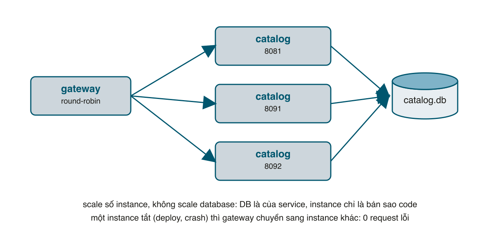

Còn hai lợi ích trong bảng bài 1 chưa được chứng minh bằng terminal: **scale riêng** service đang nóng, và **deploy service này không ảnh hưởng service kia**. Bài này làm cả hai, đo bằng số: chạy ba instance catalog, bắn request liên tục, giết và bật lại từng instance một và đếm xem bao nhiêu request lỗi. Sau đó đổi API của catalog để thấy đâu là thay đổi an toàn, đâu là thay đổi phá hỏng service khác mà **không hề có cảnh báo lúc deploy**. Cuối cùng gói mọi thứ vào Docker Compose, và nói thật về chi phí.

#### Kết quả cuối bài
```sh
# 3 instance catalog, giết và bật lại từng cái trong lúc bắn 8 giây
bundle exec ruby bin/load.rb -c 10 -d 8
# Trong 8s: 21937 request, 21937 thành công, 0 thất bại (2742 req/s)

# 1 instance, giết và bật lại một lần
# Trong 8s: 23578 request, 19725 thành công, 3853 thất bại (2947 req/s)
```

#### Scale là scale cái gì
Khi nói "scale catalog" người ta có nghĩa: chạy **nhiều bản sao của cùng một process**, đặt một bộ chia tải phía trước. Điều kiện để làm được là service **không giữ trạng thái trong bộ nhớ** giữa hai request: mọi thứ cần nhớ nằm ở database của service. Catalog của ta thỏa điều kiện đó, nên ba instance có thể dùng chung một file <mark>catalog.db</mark>. Nếu bạn đã chạy Rails với nhiều worker Puma hay nhiều máy sau load balancer thì đây là chuyện quen: session trong cookie hay Redis, không trong biến toàn cục.



Hãy chú ý hình: **database không nhân bản**. DB là của service, instance chỉ là bản sao code. Muốn scale phần ghi của database là bài toán khác (replica, sharding), và nó không liên quan gì tới microservices. Cái microservices cho bạn là **scale catalog mà không scale payment**: ngày sale, trang sản phẩm chịu 10 nghìn request mỗi giây, thanh toán chỉ 50, thì chạy 10 catalog và 1 payment.

#### Bước 1: Gateway chia tải và né instance chết
Gateway bài 4 chỉ biết một URL cho mỗi backend. Viết lại để nhận danh sách, chia vòng tròn, và với GET thì lỗi kết nối ở instance này thử instance kế:
```ruby
# services/gateway.rb
# API gateway: cửa duy nhất cho bên ngoài. Chỉ mở những route công khai, gắn request id,
# chia tải vòng tròn (round-robin) lên nhiều instance, và GET lỗi kết nối thì thử instance khác.
# Chạy: ruby services/gateway.rb
require "sinatra"
require "net/http"
require_relative "../lib/web"

Log.service = "gateway"
set :server, :puma
set :port, ENV.fetch("PORT", 8080).to_i
set :server_settings, { Threads: "0:16" } # gateway chỉ chờ mạng, cần nhiều thread hơn mặc định (5) của Puma
set :logging, false
use Web::RequestLog
helpers Web::Helpers

# Một service phía sau với một hoặc nhiều địa chỉ, ví dụ
# CATALOG_URL=http://localhost:8081,http://localhost:8091,http://localhost:8092
class Backend
  attr_reader :name, :urls

  def initialize(name, urls)
    @name = name
    @urls = urls.split(",")
    @counter = 0
    @mutex = Mutex.new
  end

  # Thứ tự instance để thử cho request này: bắt đầu từ instance kế tiếp (round-robin), rồi vòng qua các instance còn lại.
  def candidates
    start = @mutex.synchronize { @counter += 1 }
    @urls.rotate(start % @urls.size)
  end
end

CATALOG = Backend.new("catalog", ENV.fetch("CATALOG_URL", "http://localhost:8081"))
ORDER = Backend.new("order", ENV.fetch("ORDER_URL", "http://localhost:8082"))
REPORT = Backend.new("report", ENV.fetch("REPORT_URL", "http://localhost:8085"))

helpers do
  # Kết nối keep-alive tới từng instance, mỗi thread một bộ. Mở kết nối mới cho mỗi request
  # thì vài nghìn request/giây là cạn cổng TCP của máy.
  def http_for(uri)
    key = "http:#{uri.host}:#{uri.port}"
    http = Thread.current[key]
    return http if http&.started?

    Thread.current[key] = Net::HTTP.start(uri.host, uri.port, open_timeout: 2, read_timeout: 10)
  end

  def drop_http(uri)
    Thread.current["http:#{uri.host}:#{uri.port}"]&.finish
  rescue StandardError
    nil
  ensure
    Thread.current["http:#{uri.host}:#{uri.port}"] = nil
  end

  def forward(backend)
    body = request.body.read # đọc sẵn để có thể gửi lại cho instance khác
    backend.candidates.each_with_index do |base, i|
      uri = URI(base + request.fullpath)
      req = (request.get? ? Net::HTTP::Get : Net::HTTP::Post).new(uri)
      req["Content-Type"] = request.content_type if request.content_type
      req["X-Request-ID"] = env["HTTP_X_REQUEST_ID"]
      req.body = body if request.post?
      begin
        res = http_for(uri).request(req)
      rescue SystemCallError, IOError, Net::OpenTimeout, Net::ReadTimeout => e
        # Không kết nối được: với GET thì thử instance kế tiếp. POST thì KHÔNG, vì không biết
        # instance kia đã xử lý tới đâu.
        drop_http(uri)
        Log.warn("instance lỗi", backend: backend.name, url: base, err: e.message)
        next if request.get? && i < backend.urls.size - 1
        json_error 502, "#{backend.name} không trả lời"
      end
      content_type :json
      halt res.code.to_i, res.body
    end
  end
end

get "/healthz" do
  json_body 200, status: "ok"
end

# Chỉ những route này ra ngoài. /products/:id/reserve hay /events là chuyện nội bộ.
get("/products") { forward CATALOG }
get("/products/:id") { forward CATALOG }
post("/orders") { forward ORDER }
get("/orders/:id") { forward ORDER }
get("/report") { forward REPORT }

not_found do
  json_error 404, "không có route này"
end

Log.info("gateway chạy", catalog: CATALOG.urls.join(","))
```
Bốn điểm cần đọc kỹ:
- <mark>Backend#candidates</mark> dùng một bộ đếm có <mark>Mutex</mark>; <mark>rotate</mark> theo bộ đếm là round-robin, và mảng trả về cũng là thứ tự dự phòng nếu instance đầu lỗi.
- Chỉ **GET** mới đổi instance khi lỗi, cùng lý do với retry bài 4: POST tới instance đã chết giữa chừng thì không biết nó đã làm tới đâu.
- Lỗi ở đây là **lỗi kết nối** (exception của <mark>Net::HTTP</mark>), không phải HTTP 500. Instance trả 500 là instance đang sống và đang nói với bạn một điều gì đó; chuyển sang instance khác không giúp gì.
- <mark>http_for</mark> giữ **kết nối keep-alive** tới từng instance, mỗi thread một bộ. Phiên bản đầu tôi mở kết nối mới cho mỗi request, và sau khoảng 16 nghìn request thì macOS cạn cổng TCP tạm (mỗi kết nối đóng để lại một <mark>TIME_WAIT</mark> 30 giây). Mọi proxy thật đều pool kết nối tới backend vì lý do này.

Có thêm hai dòng <mark>set :server_settings, { Threads: "0:16" }</mark>: một ở gateway, một ở catalog. Puma mặc định 5 thread. Gateway chỉ ngồi chờ mạng nên cần nhiều thread hơn; còn catalog nhận 16 kết nối keep-alive từ gateway, mà chỉ có 5 thread trả lời thì các kết nối còn lại phải xếp hàng. Tôi đo được cùng 3 instance, 5 thread cho 500 request/giây, 16 thread cho 3000. Số thread Puma là một tham số vận hành, không phải chi tiết, nhớ bài 103.

#### Bước 2: Công cụ bắn tải
<mark>ab</mark> có sẵn trên macOS nhưng mặc định không dùng keep-alive, bắn vài chục nghìn request là hết cổng tạm, cùng lý do ở trên. Viết 30 dòng Ruby cho chắc, và để bạn chạy được trên mọi máy:
```ruby
# bin/load.rb
# Bắn GET liên tục vào một URL trong -d giây với -c thread song song, rồi in số request thành công/thất bại.
# Chạy: ruby bin/load.rb -u http://localhost:8080/products -c 10 -d 8
require "net/http"
require "optparse"

opts = { url: "http://localhost:8080/products", c: 10, d: 8 }
OptionParser.new do |o|
  o.on("-u URL") { |v| opts[:url] = v }
  o.on("-c N", Integer) { |v| opts[:c] = v }
  o.on("-d SECONDS", Integer) { |v| opts[:d] = v }
end.parse!

uri = URI(opts[:url])
ok = fail = 0
mutex = Mutex.new
deadline = Time.now + opts[:d]

threads = Array.new(opts[:c]) do
  Thread.new do
    http = Net::HTTP.start(uri.host, uri.port) # một kết nối keep-alive cho mỗi thread
    while Time.now < deadline
      good = begin
        http.get(uri.path).code == "200"
      rescue StandardError
        http = Net::HTTP.start(uri.host, uri.port) rescue nil
        false
      end
      mutex.synchronize { good ? ok += 1 : fail += 1 }
    end
  end
end
threads.each(&:join)
total = ok + fail
puts "Trong #{opts[:d]}s: #{total} request, #{ok} thành công, #{fail} thất bại (#{total / opts[:d]} req/s)"
```

#### Bước 3: Giết từng instance trong lúc có tải
Chạy 3 catalog **chung một database**, mỗi cái một cổng, và gateway biết cả ba:
```sh
PORT=8081 DB=catalog.db bundle exec ruby services/catalog.rb
PORT=8091 DB=catalog.db bundle exec ruby services/catalog.rb
PORT=8092 DB=catalog.db bundle exec ruby services/catalog.rb
CATALOG_URL=http://localhost:8081,http://localhost:8091,http://localhost:8092 bundle exec ruby services/gateway.rb
```
Gọi <mark>/products</mark> vài lần, log của ba catalog thay nhau có dòng mới: round-robin chạy (sau một lần bắn tải, mỗi instance đúng 4072 request). Giờ bắn 8 giây, và trong lúc đó <mark>kill -9</mark> **rồi bật lại từng instance**, mỗi cái cách nhau khoảng một giây. <mark>kill -9</mark> giả lập crash hay máy mất điện; deploy thật với graceful shutdown còn êm hơn thế:
```sh
bundle exec ruby bin/load.rb -c 10 -d 8
# (trong lúc chạy: kill -9 catalog 8081, bật lại; rồi 8091; rồi 8092)
# Trong 8s: 21937 request, 21937 thành công, 0 thất bại (2742 req/s)
```
**Không request nào lỗi** dù mỗi instance đã chết hơn một giây. Log của gateway kể chuyện gì đã xảy ra phía sau:
```
level=WARN msg="instance lỗi" service=gateway rid=88174111b6b0c1ae backend=catalog url=http://localhost:8081 err="Failed to open TCP connection to localhost:8081 (Connection refused - connect(2) for \"localhost\" port 8081)"
```
Hơn 2700 dòng như thế, mỗi dòng là một request đã được chuyển sang instance khác thay vì trả lỗi cho khách.

Làm lại với **một** instance, giết và bật lại một lần:
```sh
# Trong 8s: 23578 request, 19725 thành công, 3853 thất bại (2947 req/s)
```
3853 khách thấy lỗi trong khoảng một giây rưỡi đó. Đây là bằng chứng cho hai dòng cuối bảng bài 1: nhiều instance cộng gateway biết né là cách có được **deploy không gián đoạn**, và nó chỉ cần làm cho service bạn muốn, không cần cho cả hệ thống. Thông lượng gần như bằng nhau (2742 so với 2947 request mỗi giây) vì cả ba instance tranh nhau cùng một CPU của laptop; trên ba máy khác nhau mới là scale thật.

Tắt cả ba instance thì gateway trả lỗi sạch sẽ thay vì treo:
```sh
curl -s -w " %{http_code}\n" localhost:8080/products
# {"error":"catalog không trả lời"} 502
```

#### Bước 4: Deploy độc lập và contract
"Deploy catalog không ảnh hưởng order" chỉ đúng khi **API của catalog không đổi theo cách order không ngờ tới**. Thử hai thay đổi. Thứ nhất, thêm field <mark>currency</mark> vào sản phẩm:
```ruby
# lib/catalog.rb (một phần)
  # Thêm field mới (currency) thì an toàn: client cũ không biết field này sẽ bỏ qua.
  def self.list(db)
    db.execute("SELECT id, name, price, stock FROM products ORDER BY id").map { |p| p.merge("currency" => "VND") }
  end

  def self.get(db, id)
    row = db.get_first_row("SELECT id, name, price, stock FROM products WHERE id = ?", id) or
      raise NotFound, "không có sản phẩm"
    row.merge("currency" => "VND")
  end
```
Order service đang chạy bản cũ, **không restart**. Deploy catalog mới theo kiểu rolling như bước 3, rồi:
```sh
curl -s localhost:8080/products/1
# {"id":1,"name":"Bàn phím cơ","price":1200000,"stock":10,"currency":"VND"}
curl -s -X POST localhost:8080/orders -H 'Content-Type: application/json' \
  -d '{"product_id":1,"qty":1,"email":"an@example.com","card":"4242424242424242"}'
# {"id":1,"product_id":1,"qty":1,"total":1200000,...,"status":"paid"}
```
Order cũ vẫn đặt hàng được, vì nó chỉ lấy <mark>product["id"]</mark> và <mark>product["price"]</mark> từ Hash, key lạ nằm đó không ai đụng. Nguyên tắc này có tên **tolerant reader**: khi đọc dữ liệu của service khác, chỉ lấy thứ mình cần và bỏ qua phần còn lại. Nhờ nó, catalog thêm bao nhiêu field cũng không cần hỏi ai.

Thay đổi thứ hai, đổi tên <mark>price</mark> thành <mark>amount</mark> (chỉ để thử, không có trong code cuối bài). Deploy catalog, order vẫn bản cũ:
```sh
curl -s localhost:8080/products/1
# {"id":1,"name":"Bàn phím cơ","amount":1200000,"stock":9,"currency":"VND"}
curl -s -X POST localhost:8080/orders ... card 4242
# <title>NoMethodError at /orders</title> ... undefined method `*' for nil:NilClass
```
Catalog deploy xong không báo gì, test của catalog vẫn xanh. Order đọc <mark>product["price"]</mark> được <mark>nil</mark>, nhân với <mark>qty</mark> và nổ <mark>NoMethodError</mark>: lỗi 500 ở order cho một thay đổi ở catalog. Và đó còn là trường hợp **may**: nếu code order viết <mark>product["price"].to_i * qty</mark> thì total bằng 0, payment vẫn có thể chấp nhận, và bạn bán bàn phím giá 0 đồng mà không có dòng log lỗi nào. Trong monolith, đổi tên một method là test đỏ ngay trên máy; trong microservices là **đúng lúc chạy, sai service, và chỉ phát hiện khi có khách**.

Quy tắc về contract giữa các service, bạn nên dán lên tường:
1. **Chỉ thêm, không đổi, không xóa.** Field mới phải có giá trị mặc định hợp lý khi vắng.
2. Buộc phải đổi? Tạo **phiên bản mới** (<mark>/v2/products</mark>) và chạy song song, chuyển từng client sang, rồi mới tắt bản cũ. Thường mất vài tuần đến vài tháng.
3. Mỗi client là **tolerant reader**: đọc đúng key mình cần, bỏ qua key lạ, đừng dùng chung gem model với service kia.
4. Viết **contract test**: test trong order service chạy với một catalog giả (WebMock) trả đúng JSON mẫu đã thống nhất; catalog có test bảo đảm JSON thật khớp mẫu đó. Hai bên đổi mẫu là test đỏ trước khi deploy. Gem <mark>pact</mark> làm việc này bài bản.

#### Bước 5: Docker Compose
Chạy 6 process bằng tay đủ để học; để chia cho người khác thì gói lại. Một Dockerfile cho mọi service, chọn script bằng build arg:
```dockerfile
# Dockerfile
# Một Dockerfile cho mọi service: docker build --build-arg SERVICE=services/catalog.rb .
FROM ruby:3.3-slim
RUN apt-get update && apt-get install -y --no-install-recommends build-essential libsqlite3-dev && rm -rf /var/lib/apt/lists/*
WORKDIR /app
COPY Gemfile Gemfile.lock ./
RUN bundle install --without development
COPY . .
ARG SERVICE
ENV SERVICE=${SERVICE}
CMD bundle exec ruby ${SERVICE}
```
Và compose:
```yaml
# compose.yml
# Mỗi service một container, một volume dữ liệu riêng. Chỉ gateway mở cổng ra ngoài.
services:
  catalog:
    build: { context: ., args: { SERVICE: services/catalog.rb } }
    environment: { DB: /data/catalog.db }
    volumes: [ catalog-data:/data ]
  payment:
    build: { context: ., args: { SERVICE: services/payment.rb } }
  order:
    build: { context: ., args: { SERVICE: services/order/app.rb } }
    environment:
      DB: /data/order.db
      CATALOG_URL: http://catalog:8081
      PAYMENT_URL: http://payment:8083
    volumes: [ order-data:/data ]
  notify:
    build: { context: ., args: { SERVICE: services/notify.rb } }
    environment: { DB: /data/notify.db, ORDER_URL: http://order:8082 }
    volumes: [ notify-data:/data ]
  report:
    build: { context: ., args: { SERVICE: services/report.rb } }
    environment: { DB: /data/report.db, ORDER_URL: http://order:8082, CATALOG_URL: http://catalog:8081 }
    volumes: [ report-data:/data ]
  gateway:
    build: { context: ., args: { SERVICE: services/gateway.rb } }
    ports: [ "8080:8080" ]
    environment:
      CATALOG_URL: http://catalog:8081
      ORDER_URL: http://order:8082
      REPORT_URL: http://report:8085

volumes: { catalog-data: {}, order-data: {}, notify-data: {}, report-data: {} }
```
Vài điểm đáng nhắc: chỉ gateway mở cổng ra ngoài, các service khác chỉ thấy nhau qua tên trong mạng của Compose (<mark>http://catalog:8081</mark>); mỗi service một volume dữ liệu, **không service nào mount volume của service khác**, đó là "database riêng" ở tầng hạ tầng. Sinatra ở chế độ development chỉ lắng nghe <mark>localhost</mark>, nên trong container cần <mark>set :bind, "0.0.0.0"</mark> hoặc biến <mark>APP_ENV=production</mark>; bài tập 5 bên dưới.
```sh
docker compose up -d --build          # build 6 image, chạy 6 container
docker compose up -d --build catalog  # sửa catalog, deploy lại MỘT service
docker compose logs -f notify         # xem email "gửi" đi
```
Dòng thứ hai là lợi ích deploy độc lập ở dạng lệnh: build và thay đúng container catalog, năm container kia không restart. Muốn nhiều instance thì <mark>docker compose up -d --scale catalog=3</mark>, nhưng khi đó gateway cần tìm instance qua DNS của Compose thay vì danh sách cố định; đó là lúc người ta chuyển sang Kubernetes, nơi Service và Deployment làm sẵn phần này.

#### Chi phí thật
Hãy đếm những gì series đã phải viết thêm để ba service làm được đúng việc mà monolith bài 1 làm trong 20 dòng của method <mark>create</mark>:

| Việc | Monolith | Microservices |
|---|---|---|
| Hoàn tác khi thanh toán lỗi | Exception bay ra khỏi <mark>transaction</mark> | API release, saga, log đối soát (bài 2) |
| Gửi email, báo cáo | Gọi method, câu JOIN | Outbox, feed, consumer idempotent, bảng nhân bản (bài 3) |
| Service kia chậm hoặc chết | Không có khái niệm này | Timeout, retry, breaker, 503 (bài 4) |
| Debug một request | Stack trace | Request id qua mọi hop, gom log (bài 4) |
| Đổi tên một field | Test đỏ trên máy | Versioning, tolerant reader, contract test (bài 5) |
| Chạy local | <mark>ruby monolith.rb</mark> | 6 process hoặc compose, cổng, URL, biến môi trường |

Cộng thêm những thứ series chưa làm mà production bắt buộc: xác thực giữa các service, secret cho từng cái, CI riêng, dashboard riêng, on-call biết 6 service thay vì 1. Đây không phải lý do để không làm; đây là **hóa đơn** để đặt cạnh lợi ích mà cân. Với đội dưới 10 người, hóa đơn này gần như luôn lớn hơn lợi ích.

#### Đi từ monolith sang như thế nào
Nếu bạn đang có monolith Rails và đau thật, đừng viết lại từ đầu. Cách đã được chứng minh là **strangler fig**: đặt gateway (hay chỉ Nginx) trước monolith, tách **một** mảng ít phụ thuộc nhất (notify, payment, tìm kiếm) thành service, cho gateway chuyển route đó sang service mới, phần còn lại vẫn vào monolith. Dữ liệu của mảng đó chuyển sang database riêng, monolith gọi API thay vì đọc bảng. Sống với hai thứ vài tháng, đo, rồi tách mảng tiếp theo nếu còn đau. Nhiều đội dừng ở 2 - 3 service và hoàn toàn hài lòng.

Và ngược lại cũng có: nhiều đội gộp lại (Amazon Prime Video năm 2023 là ví dụ nổi tiếng) vì chi phí gọi mạng giữa các bước xử lý video lớn hơn lợi ích. Kiến trúc là quyết định có thể đảo ngược nếu ranh giới trong code vẫn sạch, nhớ bài 1.

#### Mẹo và lỗi hay gặp
- Gateway tự viết ở đây không có health check chủ động: instance chết thì mỗi request tới nó vẫn tốn một lần kết nối hỏng rồi mới chuyển. Thêm "đánh dấu instance hỏng trong 5 giây" (bài tập 1) hoặc dùng Nginx, Caddy, Envoy.
- Scale instance của service có job nền (notify, report) phải cẩn thận: hai instance notify cùng đọc một feed là gửi email hai lần. Cần khóa cursor (<mark>SELECT ... FOR UPDATE SKIP LOCKED</mark> trên PostgreSQL) hoặc partition như Kafka.
- Đọc **response** từ service khác thì phải tolerant; kiểm tra chặt (từ chối key lạ, như strong parameters) chỉ nên áp cho dữ liệu khách gửi lên.
- Phiên bản API nên nằm trong **đường dẫn** hoặc **header**, không trong body, để gateway định tuyến được.
- Mọi service nên log **phiên bản** của mình khi khởi động (git SHA qua biến môi trường lúc build image). Khi 3 instance catalog đang chạy 2 phiên bản khác nhau giữa lúc rolling deploy, đó là thông tin duy nhất giúp bạn hiểu tại sao 1/3 response thiếu field.
- Graceful shutdown của Puma (SIGTERM) giữ kết nối keep-alive đang bận cho tới khi khách ngắt. Deploy thật nên đặt <mark>force_shutdown_after</mark> và để gateway ngừng gửi request mới tới instance sắp tắt trước khi gửi SIGTERM; Kubernetes làm việc này bằng <mark>preStop</mark> và readiness probe.

#### Checklist
- 3 instance catalog chung <mark>catalog.db</mark>, gateway chia đều (log mỗi instance đều có request).
- <mark>kill -9</mark> và bật lại lần lượt 3 instance trong lúc chạy <mark>bin/load.rb</mark>: 0 thất bại. Với 1 instance: hàng nghìn thất bại.
- Thêm field <mark>currency</mark>, deploy catalog, order cũ vẫn đặt hàng được.
- Đổi tên <mark>price</mark>, order cũ lỗi ở chỗ không ngờ; đổi lại như cũ.
- <mark>docker compose up -d --build</mark> chạy, đặt hàng qua <mark>localhost:8080</mark>, <mark>docker compose logs notify</mark> thấy email.

#### Bài tập thêm
1. Gateway đánh dấu instance lỗi trong 5 giây và bỏ qua nó khi chia tải; có thêm thread gọi <mark>/healthz</mark> mỗi 2 giây để đưa nó về sớm hơn.
2. Thêm <mark>GET /v2/products/:id</mark> trả giá dưới dạng <mark>{"amount":..., "currency":...}</mark>, giữ <mark>/products/:id</mark> cũ, cho order chuyển sang v2, rồi mới bỏ v1. Ghi lại số bước deploy cần làm.
3. Viết contract test: file <mark>spec/fixtures/product.json</mark> dùng chung, test trong catalog bảo đảm <mark>GET /products/1</mark> trả đúng file đó, test trong order dùng file đó làm response của WebMock.
4. Chuyển gateway sang Caddy hoặc Nginx với cấu hình tương đương (route allowlist, round-robin, bỏ qua instance lỗi), so sánh số dòng cấu hình với số dòng Ruby.
5. Chạy được cả hệ thống bằng <mark>docker compose up</mark>: thêm <mark>set :bind, "0.0.0.0"</mark> vào các app Sinatra, và kiểm tra <mark>docker compose logs notify</mark> có email sau khi đặt hàng.

Mã nguồn cuối bài: [post_168.zip](/assets/code/post_168.zip), đây là toàn bộ dự án.

#### Nhìn lại series

| Bài | Lợi ích đã chứng minh | Bằng cách |
|---|---|---|
| 164 | Mốc so sánh: monolith làm gì dễ | Một transaction, một JOIN, modular monolith |
| 165 | Deploy riêng, công nghệ riêng; thấy transaction mất | Ba service, DB riêng, saga với bước bù trừ |
| 166 | Thêm tính năng không sửa service cũ; lấy lại JOIN | Outbox, feed sự kiện, consumer idempotent, bảng nhân bản |
| 167 | Lỗi không lan; debug được qua nhiều service | Timeout, retry có chọn lọc, circuit breaker, request id, gateway |
| 168 | Scale riêng, deploy không gián đoạn, đổi API an toàn | Nhiều instance, gateway né instance chết, tolerant reader, Compose |

Nếu bạn chỉ nhớ một điều: **mỗi lợi ích của microservices là một việc phải làm**, không phải một thứ tự có khi tách. Tách mà không làm thì chỉ còn chi phí. Đọc tiếp: *Building Microservices* của Sam Newman (bản 2), trang microservices.io của Chris Richardson (danh mục pattern, saga, outbox đều ở đó), và loạt bài DDD 094 - 099 để tìm ranh giới trước khi tách bất cứ thứ gì.
