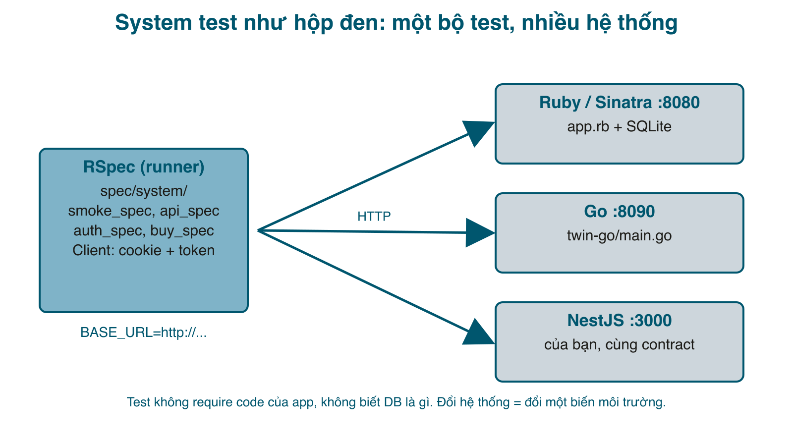

Bài này viết functional test cho shop ở bài 1, nhưng chia làm hai tầng rất rõ: **unit test** nạp code Ruby và gọi thẳng hàm, còn **system test** chỉ biết một <mark>BASE_URL</mark>. Rồi để chứng minh tầng thứ hai thật sự không quan tâm app viết bằng gì, tôi viết lại shop bằng Go (253 dòng, chỉ thư viện chuẩn, lưu trong bộ nhớ) và chạy **nguyên bộ test đó** lên bản Go. Cuối bài là file GitHub Actions chạy tất cả.



#### Vì sao tách hai tầng
Unit test là phần việc của mỗi ngôn ngữ: RSpec cho Ruby, Jest cho NestJS, <mark>go test</mark> cho Go. Nó biết tên hàm, biết schema, chạy trong vài mili giây và khi đỏ thì chỉ đúng dòng. Không thể viết unit test "chung" cho mọi ngôn ngữ, và cũng không nên cố.

System test thì ngược lại: nó mô tả **hợp đồng với người dùng** ("đăng ký xong, mua 2 cái, trang đơn hiện đúng tổng tiền, tồn kho giảm 2") bằng HTTP. Hợp đồng đó không đổi khi bạn viết lại backend. Giữ nó tách khỏi code app là có một bộ test sống lâu hơn bất kỳ framework nào, và là lưới an toàn thật sự khi migrate từ Rails sang NestJS, từ Node sang Go.

Cấu trúc thư mục:

```
spec/
  spec_helper.rb          # unit: nạp lib/shop.rb, DB test riêng
  unit/orders_spec.rb
  system/
    system_helper.rb      # system: Client HTTP + helper, chỉ biết BASE_URL
    smoke_spec.rb  api_spec.rb  auth_spec.rb  buy_spec.rb
bin/system-test.sh        # bật app + chạy spec/system
twin-go/main.go           # bản Go của shop, để chứng minh
```

#### Tầng 1: unit test (Ruby)
```ruby
# Gemfile
source "https://rubygems.org"

gem "sinatra", "~> 4.1"
gem "rackup", "~> 2.2"
gem "puma", "~> 6.5"
gem "sqlite3", "~> 2.3"
gem "bcrypt", "~> 3.1"

group :test do
  gem "rspec", "~> 3.13"
end
```

```ruby
# spec/spec_helper.rb
# Cấu hình cho UNIT test: nạp thẳng code Ruby của app, DB riêng, xóa sạch dữ liệu trước mỗi example.
# (Unit test là loại test duy nhất trong series phụ thuộc ngôn ngữ của hệ thống; các loại còn lại đi qua HTTP.)
ENV["RACK_ENV"] = "test"
ENV["DB"] = "test.db"
File.delete("test.db") if File.exist?("test.db")

require_relative "../lib/shop"
Shop.db = DB.new(ENV["DB"], Shop::SCHEMA)

module UnitHelpers
  def create_user(email: "an@example.com", password: "an-pass-123", role: "customer")
    Shop::Users.create(email: email, password: password, role: role)
  end

  def create_product(name: "Bàn gỗ", price: 100_000, stock: 5)
    Shop.db.execute("INSERT INTO products (name, price, stock) VALUES (?, ?, ?)", [name, price, stock])
    Shop.db.last_insert_row_id
  end
end

RSpec.configure do |c|
  c.include UnitHelpers
  c.before(:each) do
    %w[order_items orders products users].each { |t| Shop.db.execute("DELETE FROM #{t}") }
  end
end
```

Lưu ý: helper **không** require <mark>app.rb</mark>, chỉ require <mark>lib/shop.rb</mark>. Unit test ở đây là test nghiệp vụ, không dính Sinatra.

```ruby
# spec/unit/orders_spec.rb
# Unit test: gọi thẳng Shop::Orders, không qua HTTP. Nhanh, và chỉ ra chính xác nghiệp vụ nào hỏng.
require_relative "../spec_helper"

RSpec.describe Shop::Orders do
  let!(:user_id) { create_user }
  let!(:product_id) { create_product(stock: 5, price: 100_000) }

  it "trừ kho và ghi đúng tổng tiền" do
    id = described_class.create(user_id: user_id, product_id: product_id, qty: 2)
    expect(described_class.get(id)["total"]).to eq(200_000)
    expect(Shop::Products.get(product_id)["stock"]).to eq(3)
  end

  it "từ chối khi không đủ hàng và KHÔNG trừ kho" do
    expect { described_class.create(user_id: user_id, product_id: product_id, qty: 6) }
      .to raise_error(Shop::OutOfStock, /chỉ còn 5/)
    expect(Shop::Products.get(product_id)["stock"]).to eq(5)
    expect(described_class.all).to be_empty
  end

  it "từ chối số lượng 0 hoặc âm" do
    expect { described_class.create(user_id: user_id, product_id: product_id, qty: 0) }.to raise_error(Shop::Invalid)
    expect { described_class.create(user_id: user_id, product_id: product_id, qty: -1) }.to raise_error(Shop::Invalid)
  end

  it "báo NotFound với sản phẩm không tồn tại" do
    expect { described_class.create(user_id: user_id, product_id: 999, qty: 1) }.to raise_error(Shop::NotFound)
  end
end
```

Test quan trọng nhất là cái thứ hai: mua quá kho phải **vừa** báo lỗi **vừa** không trừ kho và không tạo đơn. Một bug kiểu "trừ kho rồi mới kiểm tra" chỉ lộ ra khi test kiểm tra cả trạng thái sau lỗi.

```sh
$ bundle exec rspec spec/unit
Shop::Orders
  trừ kho và ghi đúng tổng tiền
  từ chối khi không đủ hàng và KHÔNG trừ kho
  từ chối số lượng 0 hoặc âm
  báo NotFound với sản phẩm không tồn tại

4 examples, 0 failures
```

Tương đương: NestJS viết các test này bằng Jest cho service class (<mark>OrdersService.create</mark>), Go viết trong <mark>orders_test.go</mark>. Cùng bốn tình huống.

#### Tầng 2: system test qua HTTP
Toàn bộ "framework" là một class <mark>Client</mark> 30 dòng trên <mark>Net::HTTP</mark>: giữ cookie giữa các request để đăng nhập được, **không tự theo redirect** để test được redirect, ép body về UTF-8 để so chuỗi tiếng Việt (bài học từ smoke test bài 1).

```ruby
# spec/system/system_helper.rb
# Cấu hình cho SYSTEM test: không nạp code của app, chỉ biết một BASE_URL. Hệ thống phía sau URL đó viết bằng gì
# (Ruby, Go, NestJS...) không quan trọng. Chạy: BASE_URL=http://localhost:8080 bundle exec rspec spec/system
require "net/http"
require "json"
require "securerandom"

BASE_URL = ENV.fetch("BASE_URL", "http://localhost:8080")

# Client HTTP tối giản: giữ cookie giữa các request (để đăng nhập), không tự theo redirect (để test được redirect).
class Client
  attr_reader :last

  def initialize(base = BASE_URL)
    @base = URI(base)
    @cookies = {}
  end

  def get(path, headers = {})  = request(Net::HTTP::Get.new(path, headers))

  def post(path, form = {}, headers = {})
    req = Net::HTTP::Post.new(path, headers)
    req.set_form_data(form)
    request(req)
  end

  def json = JSON.parse(last.body)

  private

  def request(req)
    req["Cookie"] = @cookies.map { |k, v| "#{k}=#{v}" }.join("; ") unless @cookies.empty?
    @last = Net::HTTP.start(@base.host, @base.port, use_ssl: @base.scheme == "https") { |h| h.request(req) }
    @last.body&.force_encoding("UTF-8")
    @last.get_fields("set-cookie")&.each { |c| k, v = c.split(";").first.split("=", 2); @cookies[k] = v }
    @last
  end
end

module SystemHelpers
  def client = @client ||= Client.new

  # Mỗi test tự tạo user riêng (email ngẫu nhiên) để không dẫm lên dữ liệu của test khác và chạy lại bao nhiêu lần cũng được.
  def register(password: "mat-khau-moi")
    email = "t#{SecureRandom.hex(4)}@example.com"
    client.post("/register", email: email, password: password)
    expect(client.last).to be_a(Net::HTTPRedirection)
    email
  end

  def login(email, password)
    client.post("/login", email: email, password: password)
  end

  def product(id) = client.get("/api/products") && client.json.find { |p| p["id"] == id }
end

RSpec.configure do |c|
  c.include SystemHelpers
  c.before(:suite) do
    Net::HTTP.get_response(URI("#{BASE_URL}/healthz"))
  rescue StandardError => e
    abort "Không gọi được #{BASE_URL}/healthz (#{e.class}). Hãy bật hệ thống cần test trước."
  end
end
```

Hai helper đáng chú ý: <mark>register</mark> tạo user với **email ngẫu nhiên** cho mỗi test, nên test không dẫm lên nhau, chạy lại bao nhiêu lần trên cùng một server cũng được, và chạy song song được. <mark>product(id)</mark> đọc tồn kho hiện tại qua API thay vì giả định một con số, nên test không phụ thuộc server vừa seed hay đã chạy cả ngày. Đó là hai điều kiện để test hộp đen chạy được lên staging thật.

Smoke test từ bài 1 chuyển thành spec:

```ruby
# spec/system/smoke_spec.rb
# Smoke: những trang mà nếu hỏng thì không cần test gì thêm nữa.
require_relative "system_helper"

RSpec.describe "Smoke" do
  it "/healthz trả ok" do
    client.get("/healthz")
    expect(client.last.code).to eq("200")
    expect(client.json["status"]).to eq("ok")
  end

  it "trang chủ liệt kê sản phẩm" do
    client.get("/")
    expect(client.last.code).to eq("200")
    expect(client.last.body).to include("<h1>Sản phẩm</h1>")
    expect(client.last.body).to include("/products/1")
  end

  it "trang sản phẩm có nút Mua" do
    client.get("/products/1")
    expect(client.last.body).to include("Mua")
  end

  it "đường dẫn lạ trả 404 bằng trang lỗi của app, không phải trang mặc định của server" do
    client.get("/khong-co")
    expect(client.last.code).to eq("404")
    expect(client.last.body).to include("Không có trang này")
  end

  it "sản phẩm không tồn tại trả 404" do
    client.get("/products/999999")
    expect(client.last.code).to eq("404")
  end
end
```

API contract, thứ mà app mobile hay frontend đang dựa vào:

```ruby
# spec/system/api_spec.rb
# API contract: hình dạng JSON mà client (app mobile, frontend) đang dựa vào. Đổi là vỡ, nên phải có test.
require_relative "system_helper"

RSpec.describe "API /api/products" do
  it "trả JSON, mỗi sản phẩm có đủ id, name, price, stock đúng kiểu" do
    client.get("/api/products")
    expect(client.last.code).to eq("200")
    expect(client.last["content-type"]).to include("application/json")
    list = client.json
    expect(list).not_to be_empty
    list.each do |p|
      expect(p).to include("id" => Integer, "name" => String, "price" => Integer, "stock" => Integer)
    end
  end

  it "?q= lọc theo tên, không phân biệt hoa thường" do
    name = product(1)["name"]
    client.get("/api/products?q=#{URI.encode_www_form_component(name.downcase)}")
    expect(client.json.map { |p| p["id"] }).to include(1)
    client.get("/api/products?q=khong-co-san-pham-nao-ten-nay")
    expect(client.json).to eq([])
  end
end
```

Đăng nhập và phân quyền:

```ruby
# spec/system/auth_spec.rb
# Đăng ký, đăng nhập, phân quyền: qua HTTP thuần, chỉ nhìn status, header và nội dung trả về.
require_relative "system_helper"

RSpec.describe "Đăng nhập và phân quyền" do
  it "chưa đăng nhập thì /orders chuyển sang /login và nhớ trang muốn vào" do
    client.get("/orders")
    expect(client.last).to be_a(Net::HTTPRedirection)
    expect(client.last["location"]).to end_with("/login?next=/orders")
  end

  it "sai mật khẩu: 401, có thông báo, và vẫn chưa được coi là đã đăng nhập" do
    login("an@example.com", "sai-roi")
    expect(client.last.code).to eq("401")
    expect(client.last.body).to include("Sai email hoặc mật khẩu")
    client.get("/orders")
    expect(client.last).to be_a(Net::HTTPRedirection)   # không kiểm tra cookie: mỗi framework đặt cookie một kiểu
  end

  it "đăng ký rồi đăng nhập được, /orders mở ra" do
    email = register(password: "mat-khau-moi")
    other = Client.new
    other.post("/login", email: email, password: "mat-khau-moi")
    expect(other.last).to be_a(Net::HTTPRedirection)
    other.get("/orders")
    expect(other.last.code).to eq("200")
    expect(other.last.body).to include("Chưa có đơn nào")
  end

  it "đăng ký trùng email bị từ chối" do
    email = register
    Client.new.post("/register", email: email, password: "mat-khau-moi").tap do |res|
      expect(res.code).to eq("422")
    end
  end

  it "khách thường không vào được trang admin" do
    register
    client.get("/admin/orders")
    expect(client.last.code).to eq("403")
  end

  it "admin vào được trang admin" do
    login("admin@example.com", "admin-pass-1")
    client.get("/admin/orders")
    expect(client.last.code).to eq("200")
    expect(client.last.body).to include("Tất cả đơn hàng")
  end

  it "đăng xuất xong thì /orders lại đòi đăng nhập" do
    register
    client.post("/logout")
    client.get("/orders")
    expect(client.last).to be_a(Net::HTTPRedirection)
  end
end
```

Và luồng mua hàng, nghiệp vụ quan trọng nhất:

```ruby
# spec/system/buy_spec.rb
# Luồng mua hàng, nghiệp vụ quan trọng nhất của shop: đặt đơn, xem đơn, tồn kho giảm, không mua quá tồn kho.
require_relative "system_helper"

RSpec.describe "Mua hàng" do
  before { register }

  it "mua 2 cái: đơn hiện đúng sản phẩm và tổng tiền, tồn kho giảm 2" do
    before = product(1)
    client.post("/orders", product_id: 1, qty: 2)
    expect(client.last).to be_a(Net::HTTPRedirection)
    order_path = URI(client.last["location"]).path
    expect(order_path).to match(%r{\A/orders/\d+\z})

    client.get(order_path)
    expect(client.last.code).to eq("200")
    expect(client.last.body).to include(before["name"])
    expect(client.last.body).to include(money(before["price"] * 2))

    client.get("/orders")
    expect(client.last.body).to include("#{before['name']} x2")

    expect(product(1)["stock"]).to eq(before["stock"] - 2)
  end

  it "mua quá tồn kho: 422, có thông báo, tồn kho KHÔNG đổi" do
    before = product(2)
    client.post("/orders", product_id: 2, qty: before["stock"] + 1)
    expect(client.last.code).to eq("422")
    expect(client.last.body).to include("chỉ còn #{before['stock']}")
    expect(product(2)["stock"]).to eq(before["stock"])
  end

  it "số lượng 0 bị từ chối" do
    client.post("/orders", product_id: 1, qty: 0)
    expect(client.last.code).to eq("422")
  end

  def money(n) = n.to_s.reverse.scan(/\d{1,3}/).join(".").reverse + " đ"
end
```

Script bật app, seed, chạy, tắt:

```sh
# bin/system-test.sh
#!/bin/sh
# Chạy system test với một BASE_URL. Mặc định: tự bật app Ruby, seed, test, rồi tắt.
#   bin/system-test.sh                              # app Ruby trong repo
#   BASE_URL=http://localhost:8090 bin/system-test.sh   # hệ thống khác đang chạy sẵn (Go, NestJS, staging...)
set -e
if [ -z "$BASE_URL" ]; then
  export DB=system.db BASE_URL=http://localhost:8080
  rm -f system.db system.db-*
  bundle exec ruby db/seed.rb
  bundle exec ruby app.rb > /tmp/system-test-app.log 2>&1 &
  APP_PID=$!
  trap 'kill $APP_PID' EXIT
  sleep 2
fi
bundle exec rspec spec/system
```

```sh
$ bin/system-test.sh
Đã tạo 2 user, 30 sản phẩm

API /api/products
  trả JSON, mỗi sản phẩm có đủ id, name, price, stock đúng kiểu
  ?q= lọc theo tên, không phân biệt hoa thường

Đăng nhập và phân quyền
  chưa đăng nhập thì /orders chuyển sang /login và nhớ trang muốn vào
  sai mật khẩu: 401, có thông báo, và vẫn chưa được coi là đã đăng nhập
  đăng ký rồi đăng nhập được, /orders mở ra
  đăng ký trùng email bị từ chối
  khách thường không vào được trang admin
  admin vào được trang admin
  đăng xuất xong thì /orders lại đòi đăng nhập

Mua hàng
  mua 2 cái: đơn hiện đúng sản phẩm và tổng tiền, tồn kho giảm 2
  mua quá tồn kho: 422, có thông báo, tồn kho KHÔNG đổi
  số lượng 0 bị từ chối

Smoke
  /healthz trả ok
  trang chủ liệt kê sản phẩm
  trang sản phẩm có nút Mua
  đường dẫn lạ trả 404 bằng trang lỗi của app, không phải trang mặc định của server
  sản phẩm không tồn tại trả 404

Finished in 0.06522 seconds (files took 0.06552 seconds to load)
17 examples, 0 failures
```

17 test, 65 mili giây, không cần Capybara hay trình duyệt. Có một test từng đỏ ở lần chạy đầu và đáng kể lại: ban đầu "sai mật khẩu" kiểm tra **không có cookie nào được cấp**. Nhưng Rack luôn gửi <mark>Set-Cookie</mark> cho session, kể cả session rỗng, nên test đỏ dù app đúng. Tôi đổi thành kiểm tra **hành vi**: sau khi sai mật khẩu, gọi <mark>/orders</mark> phải vẫn bị chuyển sang <mark>/login</mark>. Quy tắc: test hộp đen khẳng định điều người dùng thấy, không khẳng định cách framework cài đặt (cookie tên gì, 302 hay 303, session lưu ở đâu).

#### Chứng minh: cùng bộ test, hệ thống viết bằng Go
Đây là bản Go của shop. Nó không dùng DB (map + mutex), không dùng framework, nhưng tuân cùng hợp đồng: cùng URL, cùng status, cùng vài chuỗi trong HTML mà test khẳng định.

```go
// twin-go/main.go (một phần)
mux.HandleFunc("POST /orders", func(w http.ResponseWriter, r *http.Request) {
	mu.Lock()
	defer mu.Unlock()
	u := currentUser(r)
	if u == nil {
		http.Redirect(w, r, "/login?next=/orders", http.StatusFound)
		return
	}
	id, _ := strconv.Atoi(r.FormValue("product_id"))
	qty, _ := strconv.Atoi(r.FormValue("qty"))
	if id < 1 || id > len(products) {
		page(w, 404, "<p class=\"error\">không có sản phẩm</p>")
		return
	}
	if qty <= 0 {
		page(w, 422, "<p class=\"error\">số lượng phải lớn hơn 0</p>")
		return
	}
	p := products[id-1]
	if p.Stock < qty {
		page(w, 422, fmt.Sprintf("<p class=\"error\">%s chỉ còn %d</p>", p.Name, p.Stock))
		return
	}
	p.Stock -= qty
	o := &Order{len(orders) + 1, u.ID, p.ID, qty, p.Price * qty}
	orders = append(orders, o)
	http.Redirect(w, r, fmt.Sprintf("/orders/%d", o.ID), http.StatusSeeOther)
})
```

File đầy đủ trong zip. Bật nó ở cổng 8090 và trỏ test sang:

```sh
$ cd twin-go && go run .
twin-go listening on :8090

$ BASE_URL=http://localhost:8090 bundle exec rspec spec/system
...
Finished in 0.0273 seconds (files took 0.08291 seconds to load)
17 examples, 0 failures

$ bundle exec ruby bin/smoke.rb http://localhost:8090
OK   GET /healthz       200 7ms
OK   GET /              200 1ms
OK   GET /products/1    200 2ms
OK   GET /login         200 0ms
OK   GET /api/products  200 1ms
OK   GET /orders        302 1ms
OK   GET /khong-co      404 1ms
Smoke test: 7/7 OK
```

Không sửa một dòng test nào. Với NestJS cũng vậy: viết controller theo cùng hợp đồng, bật ở cổng 3000, <mark>BASE_URL=http://localhost:3000</mark>. Hợp đồng ở đây chính là **những gì các spec khẳng định**: đọc 4 file spec là có đặc tả đủ để viết lại app bằng ngôn ngữ khác. Đó là giá trị ít được nhắc tới của test hộp đen: nó là tài liệu đặc tả chạy được.

Điều này không có nghĩa bản Go "đúng bằng" bản Ruby: nó chỉ đúng **trong phạm vi bộ test**. Bài 4 sẽ cho thấy bản Go trượt 8 trên 11 test bảo mật, và đó là cách bộ test hộp đen biến thành danh sách việc cần làm cho một bản cài đặt mới.

#### Chạy trong CI
```yaml
# .github/workflows/test.yml
name: test
on: [push, pull_request]
jobs:
  test:
    runs-on: ubuntu-latest
    steps:
      - uses: actions/checkout@v4
      - uses: ruby/setup-ruby@v1
        with:
          ruby-version: "3.3"
          bundler-cache: true           # bundle install + cache gems
      - name: unit test (trong process, chỉ cho code Ruby)
        run: bundle exec rspec spec/unit
      - name: system test (qua HTTP, tự bật app)
        run: bin/system-test.sh
      - name: smoke test
        run: |
          DB=system.db bundle exec ruby app.rb &
          sleep 2
          bundle exec ruby bin/smoke.rb http://localhost:8080
```

Ba bước, ba loại test, mỗi bước một lý do để tồn tại: unit test đỏ chỉ rõ hàm nào; system test đỏ là hợp đồng bị vỡ; smoke test đỏ là app không bật được trên máy sạch (thiếu gem, thiếu biến môi trường, cổng bận).

#### Mẹo và lỗi hay gặp
- **Khẳng định hành vi, không khẳng định cài đặt.** Dùng <mark>be_a(Net::HTTPRedirection)</mark> thay vì <mark>eq("303")</mark>; không soi tên cookie; không đếm số cookie.
- **Mỗi test tự tạo dữ liệu của nó** (email ngẫu nhiên) và **đọc trạng thái hiện tại thay vì giả định** (tồn kho qua API). Thiếu một trong hai là test chỉ chạy được một lần trên DB vừa seed.
- Giữ chuỗi mà test khẳng định ở mức **người dùng nhìn thấy** ("Chưa có đơn nào", "chỉ còn 4"), không khẳng định cấu trúc HTML. Bản Go có HTML khác hẳn bản Ruby nhưng vẫn qua.
- <mark>bin/system-test.sh</mark> có một lỗi âm thầm tôi gặp thật: nếu cổng 8080 đang bận, app mới không bật được, và test chạy lên **app cũ** đang nghe ở đó, xanh một cách vô nghĩa. Bài 3 thêm một dòng <mark>kill -0</mark> để script dừng ngay khi app không sống.
- Nếu app của bạn là Rails: unit test là model/service spec như bình thường; <mark>spec/system</mark> ở đây **không** phải "system test" của Rails (cái đó chạy Capybara trong process). Giữ bộ HTTP này tách riêng, chạy lên staging được.
- Capybara + trình duyệt thật vẫn có chỗ: khi JavaScript phía client là một phần của nghiệp vụ. Nhưng hãy giữ nó ít, chậm nhất và mong manh nhất trong các loại test.

#### Checklist
- Phân biệt được <mark>spec/unit</mark> (require code, theo ngôn ngữ) và <mark>spec/system</mark> (chỉ BASE_URL).
- <mark>bundle exec rspec spec/unit</mark>: 4 test xanh. <mark>bin/system-test.sh</mark>: 17 test xanh.
- Chạy được 17 test đó lên bản Go bằng cách đổi một biến môi trường.
- Chỉ ra được trong mỗi spec: dữ liệu nào test tự tạo, trạng thái nào test đọc từ server thay vì giả định.

#### Bài tập thêm
1. Thêm test: tìm kiếm trên trang chủ với <mark>?q=</mark> trả đúng số sản phẩm, và chuỗi "Kết quả cho" xuất hiện. Chạy lên bản Go: nó đỏ ở đâu? Sửa bản Go hay sửa test, và vì sao?
2. Viết bản NestJS (hoặc Express) của shop chỉ dựa vào 4 file spec, không đọc code Ruby. Đếm xem bạn phải đọc lại spec bao nhiêu lần để hiểu hợp đồng, đó là thước đo chất lượng của spec.
3. Cho <mark>Client</mark> tự theo redirect tối đa 3 lần (tham số <mark>follow: true</mark>) và dùng nó để viết test "mua xong thấy ngay trang đơn" ngắn hơn.

Mã nguồn cuối bài: [post_170.zip](/assets/code/post_170.zip)
