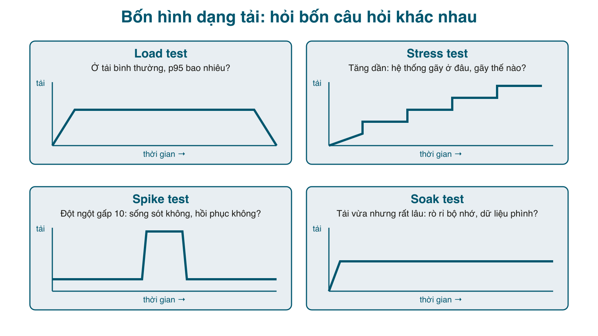

Bài này không chỉ "chạy load test cho biết". Nó cho shop 20 nghìn đơn hàng, bắn tải vào, đọc con số, **tìm ra bốn lỗi thật** (N+1, ghi đồng thời làm "database is locked", busy timeout giữ GVL, trang không phân trang làm bộ nhớ phình), sửa từng cái và đo lại. Công cụ là một file Ruby 60 dòng chỉ dùng <mark>Net::HTTP</mark>; nó bắn vào URL, nên dùng cho app Go hay NestJS y hệt, và cuối bài sẽ bắn thử vào bản Go của bài 2 để so.



#### Bốn loại test, bốn câu hỏi
- **Load test**: ở tải *bình thường* (ví dụ 10 người dùng đồng thời), p95 là bao nhiêu, có lỗi không? Đây là con số để ghi vào SLO.
- **Stress test**: tăng tải theo bậc cho tới khi hệ thống gãy. Câu hỏi là **gãy ở đâu và gãy thế nào**: chậm dần (tốt) hay đổ sập hàng loạt lỗi (xấu)?
- **Spike test**: tải tăng đột ngột gấp 10 trong vài giây (một bài đăng viral, một đợt flash sale). Sống sót không? Khi tải rút, có hồi phục không?
- **Soak test**: tải vừa phải nhưng kéo dài (giờ, ngày). Bắt rò rỉ bộ nhớ, kết nối không đóng, dữ liệu phình làm chậm dần.

Ba con số cần đọc được ở mọi loại: **req/s** (thông lượng), **tỉ lệ lỗi**, và **p95/p99** (95% hay 99% request nhanh hơn số này). Trung bình gần như vô dụng: 999 request 5ms và 1 request 10 giây có trung bình 15ms.

#### Công cụ
```ruby
# bin/load.rb
# Công cụ load test nhỏ: bắn một URL trong -d giây với -c kết nối song song, in req/s, tỉ lệ lỗi và p50/p95/p99.
#   ruby bin/load.rb -u http://localhost:8080/ -c 10 -d 10
#   ruby bin/load.rb -u http://localhost:8080/orders -H "Cookie: rack.session=..." -c 10 -d 10
#   ruby bin/load.rb -u http://localhost:8080/orders -m POST -b "product_id=1&qty=1" -H "Cookie: ..." -c 10 -d 10
#   ruby bin/load.rb -u http://localhost:8080/ --steps 5,10,20,40,80 -d 5     (stress: tăng dần tải)
require "net/http"
require "optparse"

opts = { url: "http://localhost:8080/", c: 10, d: 10, headers: {}, method: "GET", body: nil, steps: nil }
OptionParser.new do |o|
  o.on("-u URL") { |v| opts[:url] = v }
  o.on("-c N", Integer) { |v| opts[:c] = v }
  o.on("-d SECONDS", Integer) { |v| opts[:d] = v }
  o.on("-H HEADER") { |v| k, val = v.split(":", 2); opts[:headers][k.strip] = val.strip }
  o.on("-m METHOD") { |v| opts[:method] = v.upcase }
  o.on("-b BODY") { |v| opts[:body] = v }
  o.on("--steps LIST") { |v| opts[:steps] = v.split(",").map(&:to_i) }
end.parse!

uri = URI(opts[:url])

def run(uri, opts, concurrency)
  latencies = []
  errors = Hash.new(0)
  mutex = Mutex.new
  deadline = Process.clock_gettime(Process::CLOCK_MONOTONIC) + opts[:d]

  threads = Array.new(concurrency) do
    Thread.new do
      http = Net::HTTP.start(uri.host, uri.port, read_timeout: 30)   # keep-alive: mỗi thread một kết nối
      while Process.clock_gettime(Process::CLOCK_MONOTONIC) < deadline
        req = Net::HTTP.const_get(opts[:method].capitalize).new(uri.request_uri, opts[:headers])
        if opts[:body]
          req.body = opts[:body]
          req.content_type = "application/x-www-form-urlencoded"
        end
        t = Process.clock_gettime(Process::CLOCK_MONOTONIC)
        begin
          code = http.request(req).code
        rescue StandardError => e
          code = e.class.name
          http = (Net::HTTP.start(uri.host, uri.port, read_timeout: 30) rescue http)
        end
        ms = (Process.clock_gettime(Process::CLOCK_MONOTONIC) - t) * 1000
        mutex.synchronize { code.to_s.start_with?("2", "3") ? latencies << ms : errors[code] += 1 }
      end
    end
  end
  threads.each(&:join)

  sorted = latencies.sort
  pct = ->(p) { sorted.empty? ? 0 : sorted[(sorted.size * p).ceil - 1].round(1) }
  total = latencies.size + errors.values.sum
  { c: concurrency, total: total, rps: (total / opts[:d].to_f).round, err: errors.values.sum,
    p50: pct.(0.50), p95: pct.(0.95), p99: pct.(0.99), max: (sorted.last || 0).round(1), errors: errors }
end

def line(r)
  err = r[:err].zero? ? "0" : "#{r[:err]} (#{r[:errors].map { |k, v| "#{k}: #{v}" }.join(', ')})"
  "c=#{r[:c].to_s.ljust(3)} #{r[:rps].to_s.rjust(5)} req/s  lỗi=#{err.ljust(6)} p50=#{r[:p50]}ms  p95=#{r[:p95]}ms  p99=#{r[:p99]}ms  max=#{r[:max]}ms"
end

if opts[:steps]
  puts "#{opts[:method]} #{opts[:url]}, mỗi bậc #{opts[:d]}s"
  opts[:steps].each { |c| puts line(run(uri, opts, c)) }
else
  r = run(uri, opts, opts[:c])
  puts "#{opts[:method]} #{opts[:url]} trong #{opts[:d]}s, #{r[:total]} request"
  puts line(r)
end
```

Mỗi thread giữ **một kết nối keep-alive**, vì mở kết nối mới cho từng request thì trên macOS hết cổng ephemeral sau khoảng 16 nghìn request (chuyện có thật ở bài 168). <mark>--steps</mark> là stress test: chạy từng bậc concurrency, in một dòng mỗi bậc. <mark>-H</mark> truyền cookie để test trang cần đăng nhập, <mark>-m POST -b</mark> để test đường ghi.

Dữ liệu lớn: 50 khách, mỗi khách 400 đơn, sản phẩm tồn kho một triệu để test ghi không bị hết hàng:

```ruby
# db/seed_load.rb
# Dữ liệu lớn để load test: 50 khách, mỗi khách 400 đơn (20.000 đơn), sản phẩm tồn kho rất lớn.
# Chạy: bundle exec ruby db/seed_load.rb
require_relative "../lib/shop"

Shop.db = DB.new(ENV.fetch("DB", "shop.db"), Shop::SCHEMA)
%w[order_items orders users products].each { |t| Shop.db.execute("DELETE FROM #{t}") }

Shop::Users.create(email: "admin@example.com", password: "admin-pass-1", role: "admin")
30.times { |i| Shop.db.execute("INSERT INTO products (name, price, stock) VALUES (?, ?, ?)", ["Sản phẩm #{i + 1}", (i + 1) * 50_000, 1_000_000]) }

Shop.db.transaction do
  50.times do |u|
    uid = Shop::Users.create(email: "khach#{u}@example.com", password: "khach-pass-#{u}")
    400.times do |o|
      pid = (o % 30) + 1
      Shop.db.execute("INSERT INTO orders (user_id, total) VALUES (?, ?)", [uid, pid * 50_000])
      Shop.db.execute("INSERT INTO order_items (order_id, product_id, qty, price) VALUES (?, ?, 1, ?)",
                      [Shop.db.last_insert_row_id, pid, pid * 50_000])
    end
  end
end
puts "orders: #{Shop.db.get_first_value('SELECT COUNT(*) FROM orders')}, order_items: #{Shop.db.get_first_value('SELECT COUNT(*) FROM order_items')}"
```

```sh
$ bundle exec ruby db/seed_load.rb
orders: 20000, order_items: 20000
$ bundle exec ruby app.rb &
$ curl -s -c cj -o /dev/null -d "email=khach7@example.com&password=khach-pass-7" localhost:8080/login
$ COOKIE="Cookie: rack.session=$(grep rack.session cj | awk '{print $7}')"
$ curl -s -o /dev/null -w "%{http_code} %{time_total}s %{size_download}B\n" -H "$COOKIE" localhost:8080/orders
200 0.139949s 74983B
```

140ms cho một request khi không có ai khác. Hãy nhớ con số này.

#### Load test: đo trước khi sửa
```sh
$ ruby bin/load.rb -u http://localhost:8080/ -c 10 -d 10
GET http://localhost:8080/ trong 10s, 12356 request
c=10   1236 req/s  lỗi=0      p50=3.2ms  p95=4.2ms  p99=4.9ms  max=10429.1ms

$ ruby bin/load.rb -u http://localhost:8080/orders -H "$COOKIE" -c 10 -d 10
GET http://localhost:8080/orders trong 10s, 81 request
c=10      8 req/s  lỗi=0      p50=681.7ms  p95=6400.3ms  p99=7785.4ms  max=7785.4ms
```

Trang chủ: 1200 req/s, p95 4ms. Trang đơn hàng: **8 req/s, p95 6,4 giây**. Cùng một app, cùng một server, khác nhau 150 lần. Stress test cho thấy hình dạng của cái gãy:

```sh
$ ruby bin/load.rb -u http://localhost:8080/orders -H "$COOKIE" --steps 1,5,10,20,40 -d 5
GET http://localhost:8080/orders, mỗi bậc 5s
c=1       8 req/s  lỗi=0      p50=133.8ms  p95=135.0ms  p99=135.8ms  max=135.8ms
c=5       8 req/s  lỗi=0      p50=663.2ms  p95=941.6ms  p99=970.4ms  max=970.4ms
c=10      9 req/s  lỗi=0      p50=653.6ms  p95=6152.1ms  p99=6284.7ms  max=6284.7ms
c=20     11 req/s  lỗi=0      p50=714.5ms  p95=7285.8ms  p99=7550.7ms  max=7550.7ms
c=40     15 req/s  lỗi=0      p50=897.0ms  p95=9722.7ms  p99=10102.8ms  max=10102.8ms
```

Đọc bảng này như sau: **thông lượng không tăng theo concurrency** (8 req/s ở c=1 cũng như c=10), chỉ có độ trễ tăng. Đó là dấu hiệu của một tài nguyên đã bão hòa; với Ruby, tài nguyên đó gần như chắc chắn là **CPU dưới GVL**: 16 thread của Puma nhưng chỉ một thread chạy Ruby tại một thời điểm. Thêm thread, thêm máy khách chỉ làm hàng đợi dài ra.

#### Tìm nguyên nhân: đếm câu SQL
Trang <mark>/orders</mark> của bài 1 gọi <mark>Orders.items(o["id"])</mark> cho từng đơn, và <mark>items</mark> lại gọi <mark>Products.get</mark> cho từng dòng. Khách có 400 đơn: 1 + 400 + 400 = **801 câu SQL** cho một trang. Mỗi câu nhanh, nhưng 800 lần đi qua sqlite3 và dựng hash kết quả trong Ruby là 130ms CPU.

Cách bắt N+1 bằng test, để nó không quay lại: đếm câu SQL và khẳng định số câu **không phụ thuộc số đơn**.

```ruby
# spec/unit/orders_queries_spec.rb
# Test hiệu năng dạng "đếm câu SQL": số câu không được tăng theo số đơn. Bắt N+1 trước khi nó lên production.
require_relative "../spec_helper"

RSpec.describe "Shop::Orders.for_user_with_items" do
  def count_queries
    n = 0
    Shop.db.connection.trace { n += 1 }
    yield
    n
  ensure
    Shop.db.connection.trace(nil)
  end

  it "chạy đúng 2 câu SQL dù khách có 50 đơn" do
    user_id = create_user
    product_id = create_product(stock: 1000)
    50.times { Shop::Orders.create(user_id: user_id, product_id: product_id, qty: 1) }

    orders = nil
    n = count_queries { orders = Shop::Orders.for_user_with_items(user_id) }
    expect(orders.size).to eq(50)
    expect(orders.first["items"].first["name"]).to eq("Bàn gỗ")
    expect(n).to eq(2)
  end
end
```

Sửa ba thứ cùng lúc:

```ruby
# lib/shop.rb (một phần)
    PER_PAGE = 50

    def self.for_user(user_id, page: 1)
      Shop.db.execute("SELECT * FROM orders WHERE user_id = ? ORDER BY id DESC LIMIT ? OFFSET ?",
                      [user_id, PER_PAGE, (page - 1) * PER_PAGE])
    end

    # Đơn của một khách (một trang) kèm tên sản phẩm, trong ĐÚNG HAI câu SQL dù có bao nhiêu đơn (thay cho N+1).
    def self.for_user_with_items(user_id, page: 1)
      orders = for_user(user_id, page: page)
      return orders if orders.empty?
      ids = orders.map { |o| o["id"] }
      items = Shop.db.execute(<<~SQL, ids)
        SELECT oi.order_id, oi.qty, p.name FROM order_items oi JOIN products p ON p.id = oi.product_id
        WHERE oi.order_id IN (#{ids.map { '?' }.join(',')})
      SQL
      by_order = items.group_by { |it| it["order_id"] }
      orders.each { |o| o["items"] = by_order.fetch(o["id"], []) }
    end
```

(<mark>PER_PAGE</mark> và <mark>page</mark> là phần phân trang, lý do ở mục soak test bên dưới.) Thêm index cho hai cột đang được lọc, vì 20 nghìn đơn mà <mark>WHERE user_id = ?</mark> không có index là quét cả bảng:

```ruby
# lib/shop.rb (một phần)
    CREATE INDEX IF NOT EXISTS idx_orders_user ON orders(user_id);
    CREATE INDEX IF NOT EXISTS idx_order_items_order ON order_items(order_id);
```

Và tăng số thread của Puma, vì mặc định 5 thread không đủ cho 10 kết nối keep-alive (chính là cái <mark>max=10429ms</mark> ở trang chủ: một kết nối bị bỏ đói trọn 10 giây):

```ruby
# app.rb (một phần)
set :server, :puma
set :server_settings, { Threads: "0:16" }   # mặc định 5 thread là quá ít khi client dùng keep-alive
```

Đo lại:

```sh
$ curl -s -o /dev/null -w "%{http_code} %{time_total}s\n" -H "$COOKIE" localhost:8080/orders
200 0.015765s

$ ruby bin/load.rb -u http://localhost:8080/orders -H "$COOKIE" -c 10 -d 10
GET http://localhost:8080/orders trong 10s, 3754 request
c=10    375 req/s  lỗi=0      p50=24.4ms  p95=54.2ms  p99=78.9ms  max=137.3ms

$ ruby bin/load.rb -u http://localhost:8080/orders -H "$COOKIE" --steps 1,5,10,20,40 -d 5
GET http://localhost:8080/orders, mỗi bậc 5s
c=1     381 req/s  lỗi=0      p50=2.6ms  p95=2.9ms  p99=3.4ms  max=8.2ms
c=5     375 req/s  lỗi=0      p50=13.1ms  p95=19.1ms  p99=22.6ms  max=29.4ms
c=10    375 req/s  lỗi=0      p50=24.6ms  p95=54.1ms  p99=75.7ms  max=214.6ms
c=20    375 req/s  lỗi=0      p50=40.9ms  p95=159.4ms  p99=240.1ms  max=585.9ms
c=40    375 req/s  lỗi=0      p50=42.4ms  p95=698.0ms  p99=768.7ms  max=926.9ms
```

Từ 8 lên 375 req/s, p95 từ 6,4 giây xuống 54ms, bằng hai câu SQL và hai index. Bảng stress vẫn có cùng hình dạng (thông lượng phẳng, độ trễ tăng theo concurrency), vì vẫn là một process Ruby; nhưng giờ trần là 375 req/s thay vì 8. Muốn cao hơn nữa là chuyện của nhiều process/nhiều máy (bài 168), không phải của code.

#### Spike test
```sh
$ ruby bin/load.rb -u http://localhost:8080/orders -H "$COOKIE" -c 100 -d 5
GET http://localhost:8080/orders trong 5s, 1701 request
c=100   340 req/s  lỗi=0      p50=45.2ms  p95=2503.9ms  p99=2892.5ms  max=3021.1ms
```

100 kết nối đồng thời: không có lỗi, thông lượng giữ nguyên, nhưng p95 lên 2,5 giây vì request xếp hàng. Đây là kiểu gãy "tốt": chậm chứ không đổ. Kiểu xấu là timeout dây chuyền, hết kết nối DB, OOM. Nếu 2,5 giây là không chấp nhận được, lựa chọn là trả 429/503 sớm khi hàng đợi quá dài (fail fast) hoặc tự động thêm instance, chứ không phải tăng thread.

#### Đường ghi: POST /orders
Đọc nhanh rồi, còn ghi? Mười kết nối tạo đơn liên tục:

```sh
$ ruby bin/load.rb -u http://localhost:8080/orders -m POST -b "product_id=1&qty=1" -H "$COOKIE" -c 10 -d 10
POST http://localhost:8080/orders trong 10s, 21933 request
c=10   2193 req/s  lỗi=2 (500: 2) p50=3.4ms  p95=12.7ms  p99=20.2ms  max=46.3ms
```

Hai lỗi 500 trong 22 nghìn. Log: <mark>SQLite3::BusyException - database is locked</mark>. SQLite chỉ cho **một bên ghi** tại một thời điểm; transaction mặc định bắt đầu ở chế độ đọc, và khi nó muốn chuyển sang ghi mà có kết nối khác đang ghi, SQLite trả lỗi **ngay lập tức** thay vì chờ <mark>busy_timeout</mark>. Cách sửa chuẩn: mở transaction ghi bằng <mark>BEGIN IMMEDIATE</mark> để lấy khóa ghi từ đầu, và thử lại khi vẫn trượt:

```ruby
# lib/shop.rb (một phần)
    def self.create(user_id:, product_id:, qty:, attempt: 1)
      qty = qty.to_i
      raise Invalid, "số lượng phải lớn hơn 0" if qty <= 0
      # :immediate = lấy khóa ghi ngay từ đầu. Transaction mặc định bắt đầu bằng đọc, lúc chuyển sang ghi
      # mà gặp kết nối khác đang ghi thì SQLite trả "database is locked" ngay, không chờ busy_timeout.
      Shop.db.transaction(:immediate) do
        ...
      end
    rescue SQLite3::BusyException
      # SQLite chỉ cho một bên ghi tại một thời điểm; hiếm khi hết busy_timeout mà vẫn chưa tới lượt. Thử lại tối đa 3 lần.
      raise if attempt >= 3
      create(user_id: user_id, product_id: product_id, qty: qty, attempt: attempt + 1)
    end
```

Hết lỗi, nhưng xuất hiện chuyện lạ:

```sh
$ ruby bin/load.rb -u http://localhost:8080/orders -m POST -b "product_id=1&qty=1" -H "$COOKIE" --steps 1,5,10,20,40 -d 5
POST http://localhost:8080/orders, mỗi bậc 5s
c=1    1948 req/s  lỗi=0      p50=0.4ms  p95=0.7ms  p99=2.3ms  max=12.8ms
c=5      12 req/s  lỗi=0      p50=2.0ms  p95=10394.1ms  p99=10399.6ms  max=10399.6ms
c=10     61 req/s  lỗi=0      p50=3.5ms  p95=21.9ms  p99=5236.5ms  max=5252.1ms
c=20    535 req/s  lỗi=0      p50=5.9ms  p95=35.2ms  p99=78.7ms  max=5429.9ms
c=40    118 req/s  lỗi=0      p50=6.5ms  p95=5229.2ms  p99=5661.6ms  max=5668.0ms
```

Một kết nối ghi được 1948 req/s, năm kết nối chỉ còn **12 req/s** với p95 đúng 10 giây (hai lần 5 giây). Những con số "chẵn" như 5229ms, 10394ms là dấu vết của <mark>busy_timeout = 5000</mark>. Nguyên nhân nằm trong gem sqlite3: <mark>busy_timeout=</mark> dùng busy handler viết bằng C của SQLite, nó **ngủ trong C trong khi vẫn giữ GVL**. Một thread chờ khóa là mọi thread Ruby khác đứng theo, kể cả thread đang giữ khóa, nên khóa không bao giờ được nhả cho tới khi hết timeout. Gem có sẵn cách khác, <mark>busy_handler_timeout=</mark>, chờ bằng Ruby và nhả GVL giữa các lần thử:

```ruby
# lib/db.rb
# DB mở một file SQLite, chạy câu lệnh tạo bảng, và cấp cho MỖI THREAD một kết nối riêng
# (Puma chạy nhiều thread; một kết nối SQLite không nên bị hai thread dùng cùng lúc).
require "sqlite3"

class DB
  def initialize(path, schema)
    @path = path
    @key = "db:#{path}:#{object_id}"
    connection.execute_batch(schema)
  end

  def connection
    Thread.current[@key] ||= SQLite3::Database.new(@path).tap do |c|
      c.busy_handler_timeout = 5000       # chờ tối đa 5 giây khi file đang bị khóa, nhả GVL trong lúc chờ
                                          # (busy_timeout= ngủ trong C và GIỮ GVL: mọi thread Ruby khác đứng theo)
      c.execute("PRAGMA journal_mode = WAL")
      c.execute("PRAGMA foreign_keys = ON")
      c.results_as_hash = true
    end
  end

  # Những hàm hay dùng, chuyển thẳng sang kết nối của thread hiện tại.
  %i[execute get_first_row get_first_value transaction last_insert_row_id changes].each do |m|
    define_method(m) { |*args, &blk| connection.public_send(m, *args, &blk) }
  end
end
```

```sh
$ ruby bin/load.rb -u http://localhost:8080/orders -m POST -b "product_id=1&qty=1" -H "$COOKIE" -c 10 -d 10
POST http://localhost:8080/orders trong 10s, 19765 request
c=10   1977 req/s  lỗi=0      p50=3.6ms  p95=14.5ms  p99=25.2ms  max=122.1ms

$ ruby bin/load.rb -u http://localhost:8080/orders -m POST -b "product_id=1&qty=1" -H "$COOKIE" --steps 1,5,10,20,40 -d 5
POST http://localhost:8080/orders, mỗi bậc 5s
c=1    1756 req/s  lỗi=0      p50=0.4ms  p95=0.8ms  p99=3.3ms  max=78.8ms
c=5    2195 req/s  lỗi=0      p50=2.0ms  p95=4.7ms  p99=7.6ms  max=62.0ms
c=10   2122 req/s  lỗi=0      p50=3.4ms  p95=13.0ms  p99=21.8ms  max=198.6ms
c=20   2074 req/s  lỗi=0      p50=6.2ms  p95=31.2ms  p99=44.5ms  max=252.7ms
c=40   2195 req/s  lỗi=0      p50=6.1ms  p95=119.1ms  p99=131.5ms  max=465.0ms
```

2000 đơn mỗi giây, không lỗi, max 122ms. Một dòng cấu hình. Tôi sẽ không bao giờ tìm ra nó nếu chỉ chạy load test cho đường đọc.

#### Soak test
Soak test là chạy lâu ở tải vừa. Tôi chạy <mark>/orders</mark> 60 giây với 10 kết nối, ghi RSS của process trước và sau:

```sh
$ ps -o rss= -p $(pgrep -f "ruby app.rb") | awk '{print int($1/1024)" MB"}'
75 MB
$ ruby bin/load.rb -u http://localhost:8080/orders -H "$COOKIE" -c 10 -d 60
GET http://localhost:8080/orders trong 60s, 413 request
c=10      7 req/s  lỗi=0      p50=1244.2ms  p95=3424.7ms  p99=4682.7ms  max=6333.8ms
$ ps -o rss= -p $(pgrep -f "ruby app.rb") | awk '{print int($1/1024)" MB"}'
284 MB
```

Khoan, trang này vừa đo được 375 req/s cơ mà? Đúng, nhưng giữa hai lần đo là bài test POST: khách <mark>khach7</mark> giờ có **22 nghìn đơn** thay vì 400, và trang <mark>/orders</mark> in tất cả. Hai câu SQL vẫn là hai câu, nhưng mỗi câu trả 22 nghìn dòng, HTML 1,5 MB, bộ nhớ phình gấp 4. Đây chính là loại lỗi soak test sinh ra để bắt: **không có gì sai ở ngày đầu, chỉ sai khi dữ liệu lớn dần**. Sửa là phân trang (<mark>PER_PAGE = 50</mark> ở trên) và view có hai link:

```erb
<!-- views/orders.erb -->
<h1>Đơn của tôi</h1>
<% if @orders.empty? && @page == 1 %><p>Chưa có đơn nào.</p><% end %>
<table>
  <tr><th>Mã</th><th>Ngày</th><th>Sản phẩm</th><th>Tổng</th><th>Trạng thái</th></tr>
  <% @orders.each do |o| %>
    <tr>
      <td><a href="/orders/<%= o["id"] %>">#<%= o["id"] %></a></td>
      <td><%= o["created_at"] %></td>
      <td><%= o["items"].map { |it| "#{it['name']} x#{it['qty']}" }.join(", ") %></td>
      <td><%= money(o["total"]) %></td>
      <td><%= o["status"] %></td>
    </tr>
  <% end %>
</table>
<p>
  <% if @page > 1 %><a href="/orders?page=<%= @page - 1 %>">&laquo; Mới hơn</a><% end %>
  <% if @orders.size == Shop::Orders::PER_PAGE %><a href="/orders?page=<%= @page + 1 %>">Cũ hơn &raquo;</a><% end %>
</p>
```

```sh
$ ruby bin/load.rb -u http://localhost:8080/orders -H "$COOKIE" -c 10 -d 60
GET http://localhost:8080/orders trong 60s, 50616 request
c=10    844 req/s  lỗi=0      p50=10.7ms  p95=23.0ms  p99=32.4ms  max=230.9ms
RSS: 64 MB trước, 60 MB sau
```

Bộ nhớ không tăng sau 50 nghìn request; không có rò rỉ. Soak test thật nên chạy hàng giờ với dữ liệu tăng dần (chạy xen kẽ đường ghi), nhưng 60 giây đã đủ để bắt lỗi "trang không có giới hạn".

#### Cùng công cụ, bắn vào bản Go
```sh
$ ruby bin/load.rb -u http://localhost:8090/ -c 10 -d 10
GET http://localhost:8090/ trong 10s, 165245 request
c=10  16525 req/s  lỗi=0      p50=0.6ms  p95=0.9ms  p99=1.3ms  max=45.6ms
$ ruby bin/load.rb -u http://localhost:8080/api/products -c 10 -d 10
GET http://localhost:8080/api/products trong 10s, 29656 request
c=10   2966 req/s  lỗi=0      p50=2.6ms  p95=9.2ms  p99=14.1ms  max=85.3ms
$ ruby bin/load.rb -u http://localhost:8090/api/products -c 10 -d 10
GET http://localhost:8090/api/products trong 10s, 179151 request
c=10  17915 req/s  lỗi=0      p50=0.5ms  p95=0.9ms  p99=1.2ms  max=15.0ms
```

Go nhanh hơn Ruby khoảng 6 - 12 lần trên cùng trang (và bản Go không có DB, nên so sánh này có lợi cho Go). Nhưng hãy đặt cạnh con số trên: **N+1 làm bản Ruby chậm hơn chính nó 47 lần**, busy timeout làm đường ghi chậm 160 lần. Ngôn ngữ cho bạn một hệ số; lỗi cấu trúc cho bạn hai bậc độ lớn. Load test tìm cái thứ hai.

#### Mẹo và lỗi hay gặp
- **Luôn chạy đường ghi.** Hầu hết bài load test chỉ GET trang chủ, trong khi lỗi khóa, deadlock, hết connection pool đều nằm ở POST.
- **Soak test phải để dữ liệu lớn dần**: xen kẽ POST vào giữa, hoặc seed lớn trước. Trang không phân trang chỉ lộ sau vài tuần production.
- Thông lượng phẳng khi tăng concurrency = tài nguyên bão hòa (CPU/GVL, một writer của SQLite, pool DB). Đừng tăng thread; tìm xem cái gì đang phẳng.
- Những độ trễ "chẵn" (5000ms, 10000ms, 30000ms) hầu như luôn là một **timeout** nào đó. Tìm con số đó trong cấu hình.
- Chạy mỗi phép đo ít nhất hai lần. Lần chạy đầu sau khi bật server có thể có một request ngoại lệ (JIT, cache nguội, thread chưa spawn); tôi gặp một <mark>max=10s</mark> không lặp lại ở lần hai.
- Máy chạy load test và máy chạy app cùng là laptop của tôi, nên con số tuyệt đối không có ý nghĩa; chỉ **tỉ lệ trước/sau** và **hình dạng** của bảng stress mới đáng tin.
- Với Rails: N+1 bắt bằng <mark>includes</mark> + gem <mark>bullet</mark> hoặc test đếm query như trên (<mark>ActiveSupport::Notifications</mark> "sql.active_record"); index thiếu nhìn bằng <mark>EXPLAIN</mark>; Puma thread nằm ở <mark>config/puma.rb</mark>. Postgres không có vấn đề một writer, nhưng có **pool** và **lock row**, cũng lộ ra bằng đúng bài test POST này.

#### Checklist
- Định nghĩa được load, stress, spike, soak và câu hỏi mỗi loại trả lời.
- Đọc được một dòng kết quả: req/s, lỗi, p50/p95/p99, và giải thích vì sao trung bình không đủ.
- Tái hiện được: trước 8 req/s, sau 375 req/s ở <mark>/orders</mark>; đường ghi 2000 req/s không lỗi.
- <mark>orders_queries_spec</mark> xanh; đổi <mark>for_user_with_items</mark> về gọi <mark>Products.get</mark> trong vòng lặp, thấy nó đỏ.

#### Bài tập thêm
1. Thêm <mark>--rps N</mark> vào <mark>bin/load.rb</mark> để giữ thông lượng cố định thay vì "bắn hết sức", rồi đo p95 ở 100, 200, 300 req/s. Đây là cách đo gần với SLO thật hơn.
2. Chạy soak 10 phút xen kẽ GET và POST (hai tiến trình load song song). Vẽ RSS theo thời gian bằng một vòng <mark>while</mark> ghi <mark>ps</mark> mỗi 10 giây.
3. Bắn <mark>--steps 10,50,100,200</mark> vào một app Rails bạn đang có, ở trang nặng nhất. Thông lượng gãy ở bậc nào? Nhìn <mark>EXPLAIN</mark> của câu SQL chậm nhất trong log.

Mã nguồn cuối bài: [post_171.zip](/assets/code/post_171.zip)
