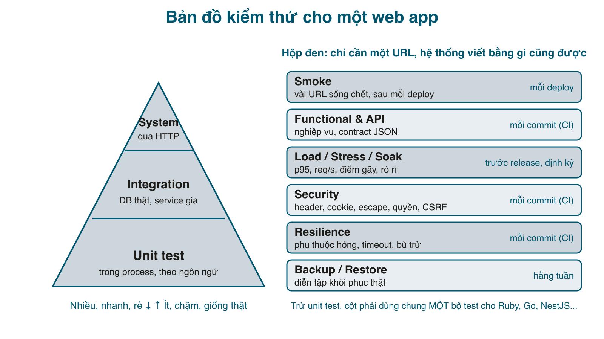

Hầu hết đội web có unit test, một số có integration test, và dừng ở đó. Rồi production dạy cho phần còn lại: trang danh sách đơn hàng chết khi khách có 20 nghìn đơn, cổng thanh toán treo kéo cả app treo theo, một bản backup chưa bao giờ được restore thử, và một lỗ bảo mật mà bất kỳ test nào gọi đúng URL cũng bắt được. Series này nói về **những test ở cấp hệ thống mà một web app nào cũng cần**: smoke, functional qua HTTP, load/stress/soak, bảo mật, chịu lỗi, backup/restore. Không có loại nào trong đó là "xa xỉ", và không loại nào cần công cụ đắt tiền.

Có một quyết định xuyên suốt series: **test chạy bằng Ruby (RSpec), nhưng hệ thống được test có thể viết bằng bất cứ gì**. Trừ unit test, mọi test trong series chỉ cần một biến <mark>BASE_URL</mark>; nó gọi HTTP, nhìn status, header và nội dung trả về, không require code của app, không biết app dùng database nào. Bài 2 sẽ chứng minh điều đó bằng cách chạy cùng một bộ test lên bản Ruby và một bản Go của cùng app; bạn thay Go bằng NestJS, Rails, Django đều được.

Series gồm:
1. Bản đồ các loại test, app demo, smoke test (bài này).
2. Functional test như hộp đen: unit test theo ngôn ngữ, system test qua HTTP, một bộ test cho Ruby và Go, chạy trong CI.
3. Load, stress, spike, soak test: đo p95, tìm điểm gãy và sửa.
4. Kiểm thử bảo mật cho app của chính mình: header, cookie, escape, phân quyền, CSRF, chống đoán mật khẩu, audit thư viện.
5. Chịu lỗi và vận hành: dịch vụ phụ thuộc hỏng, health check thật, backup và diễn tập khôi phục.

#### Bản đồ kiểm thử


Bên trái là kim tự tháp quen thuộc, chia theo **cách test chạm vào code**:
- **Unit test** chạy trong process, gọi thẳng hàm. Nhanh, chỉ ra đúng chỗ hỏng, nhưng phụ thuộc ngôn ngữ: RSpec cho Ruby, Jest cho NestJS, <mark>go test</mark> cho Go.
- **Integration test** vẫn chạy trong process nhưng dùng DB thật, service ngoài thì giả.
- **System test** đứng ngoài, gọi qua HTTP như người dùng hoặc client thật. Chậm hơn, nhưng là thứ duy nhất chứng minh "cả hệ thống" chạy, và **không phụ thuộc ngôn ngữ**.

Bên phải là các loại test chia theo **câu hỏi cần trả lời**, và đây mới là trọng tâm của series:

| Loại test | Câu hỏi | Khi nào chạy | Bài |
|---|---|---|---|
| Smoke | Deploy xong, mấy trang quan trọng nhất có sống không? | Sau mỗi deploy, và định kỳ (cron) | 1 |
| Functional / API | Nghiệp vụ đúng không? JSON còn đúng hình dạng client đang dùng không? | Mỗi commit (CI) | 2 |
| Load / Stress / Spike / Soak | Ở tải bình thường p95 bao nhiêu? Gãy ở đâu? Chạy lâu có rò rỉ? | Trước release, sau thay đổi lớn | 3 |
| Security | Header, cookie, escape, phân quyền, CSRF, brute force có ổn không? Thư viện có CVE không? | Mỗi commit (CI) | 4 |
| Resilience | Dịch vụ phụ thuộc hỏng hoặc chậm thì app làm gì? | Mỗi commit (CI) | 5 |
| Backup / Restore | Backup có restore được thật không? | Hằng tuần | 5 |

Điểm chung của cột phải: **tất cả đều là hộp đen**. Chúng không quan tâm app viết bằng gì, chỉ quan tâm URL đó trả về gì, nhanh bao nhiêu, dưới điều kiện nào. Đó là lý do một đội có thể giữ bộ test này bằng Ruby trong khi backend chuyển từ Rails sang NestJS mà không viết lại test.

#### Nguyên tắc của series
- **Test cấp hệ thống nói chuyện bằng HTTP.** Không <mark>require "app"</mark>, không mở DB của app. Nếu muốn một trạng thái nào đó (user mới, đơn mới), test tự tạo qua API như người dùng thật.
- **Unit test là chuyện riêng của mỗi ngôn ngữ**, nên series chỉ làm phần Ruby làm ví dụ và nói tương đương ở Jest, <mark>go test</mark>.
- **Mọi con số trong series đều từ terminal.** Mỗi bài đều có đoạn "chạy thử" với output thật, kể cả output lỗi.
- **Mỗi bài để lại một hoặc hai công cụ nhỏ dùng lại được**: <mark>bin/smoke.rb</mark>, <mark>bin/load.rb</mark>, <mark>bin/system-test.sh</mark>, <mark>bin/backup_check.rb</mark>... Tất cả chỉ dùng thư viện chuẩn của Ruby, cầm sang dự án khác chạy ngay.

#### App demo
Để có cái mà test, series dùng một shop nhỏ viết bằng **Sinatra + SQLite** (cùng cách với series Microservices, bài 164): đăng ký, đăng nhập, danh sách sản phẩm, mua hàng, trang đơn của tôi, trang admin, một API JSON và một health check. Nó cố tình "bình thường": có vài lỗi hiệu năng và bảo mật mà một app viết nhanh hay mắc, để các bài sau có cái mà tìm.

```ruby
# Gemfile
source "https://rubygems.org"

gem "sinatra", "~> 4.1"
gem "rackup", "~> 2.2"
gem "puma", "~> 6.5"
gem "sqlite3", "~> 2.3"
gem "bcrypt", "~> 3.1"
```

Lớp <mark>DB</mark> (một kết nối SQLite cho mỗi thread của Puma, WAL, busy timeout) lấy nguyên từ bài 164, nên không in lại ở đây. Nghiệp vụ nằm trong một module, không dính gì tới HTTP:

```ruby
# lib/shop.rb
# Toàn bộ nghiệp vụ của shop: user, sản phẩm, đơn hàng. Không có gì liên quan tới HTTP ở đây.
require "bcrypt"
require_relative "db"

module Shop
  SCHEMA = <<~SQL
    CREATE TABLE IF NOT EXISTS users (
      id INTEGER PRIMARY KEY, email TEXT NOT NULL UNIQUE, password_digest TEXT NOT NULL,
      role TEXT NOT NULL DEFAULT 'customer');
    CREATE TABLE IF NOT EXISTS products (
      id INTEGER PRIMARY KEY, name TEXT NOT NULL, price INTEGER NOT NULL, stock INTEGER NOT NULL);
    CREATE TABLE IF NOT EXISTS orders (
      id INTEGER PRIMARY KEY, user_id INTEGER NOT NULL REFERENCES users(id),
      status TEXT NOT NULL DEFAULT 'paid', total INTEGER NOT NULL,
      created_at TEXT NOT NULL DEFAULT (datetime('now')));
    CREATE TABLE IF NOT EXISTS order_items (
      id INTEGER PRIMARY KEY, order_id INTEGER NOT NULL REFERENCES orders(id),
      product_id INTEGER NOT NULL REFERENCES products(id), qty INTEGER NOT NULL, price INTEGER NOT NULL);
  SQL

  class Error < StandardError; end
  class NotFound < Error; end
  class OutOfStock < Error; end
  class Invalid < Error; end

  def self.db = @db
  def self.db=(db)
    @db = db
  end

  module Users
    def self.create(email:, password:, role: "customer")
      raise Invalid, "email không hợp lệ" unless email.to_s.match?(/\A[^@\s]+@[^@\s]+\z/)
      raise Invalid, "mật khẩu phải từ 8 ký tự" if password.to_s.length < 8
      Shop.db.execute("INSERT INTO users (email, password_digest, role) VALUES (?, ?, ?)",
                      [email, BCrypt::Password.create(password, cost: 4), role])
      Shop.db.last_insert_row_id
    rescue SQLite3::ConstraintException
      raise Invalid, "email đã tồn tại"
    end

    def self.authenticate(email, password)
      u = Shop.db.get_first_row("SELECT * FROM users WHERE email = ?", [email])
      u if u && BCrypt::Password.new(u["password_digest"]) == password.to_s
    end

    def self.get(id) = Shop.db.get_first_row("SELECT * FROM users WHERE id = ?", [id])
  end

  module Products
    def self.list(q = nil)
      return Shop.db.execute("SELECT * FROM products ORDER BY id") if q.to_s.empty?
      Shop.db.execute("SELECT * FROM products WHERE name LIKE ? ORDER BY id", ["%#{q}%"])
    end

    def self.get(id)
      Shop.db.get_first_row("SELECT * FROM products WHERE id = ?", [id]) or raise NotFound, "không có sản phẩm #{id}"
    end
  end

  module Orders
    # Tạo đơn một sản phẩm: kiểm tra tồn kho, trừ kho và ghi đơn trong CÙNG một transaction.
    def self.create(user_id:, product_id:, qty:)
      qty = qty.to_i
      raise Invalid, "số lượng phải lớn hơn 0" if qty <= 0
      Shop.db.transaction do
        product = Products.get(product_id)
        Shop.db.execute("UPDATE products SET stock = stock - ? WHERE id = ? AND stock >= ?", [qty, product_id, qty])
        raise OutOfStock, "#{product['name']} chỉ còn #{product['stock']}" unless Shop.db.changes == 1
        total = product["price"] * qty
        Shop.db.execute("INSERT INTO orders (user_id, total) VALUES (?, ?)", [user_id, total])
        order_id = Shop.db.last_insert_row_id
        Shop.db.execute("INSERT INTO order_items (order_id, product_id, qty, price) VALUES (?, ?, ?, ?)",
                        [order_id, product_id, qty, product["price"]])
        order_id
      end
    end

    def self.get(id)
      Shop.db.get_first_row("SELECT * FROM orders WHERE id = ?", [id]) or raise NotFound, "không có đơn #{id}"
    end

    def self.for_user(user_id)
      Shop.db.execute("SELECT * FROM orders WHERE user_id = ? ORDER BY id DESC", [user_id])
    end

    def self.items(order_id)
      Shop.db.execute("SELECT * FROM order_items WHERE order_id = ?", [order_id]).map do |it|
        it.merge("product" => Products.get(it["product_id"]))
      end
    end

    def self.all
      Shop.db.execute("SELECT * FROM orders ORDER BY id DESC")
    end
  end
end
```

Hai điểm đáng chú ý: <mark>Orders.create</mark> trừ kho bằng <mark>UPDATE ... WHERE stock >= ?</mark> và kiểm tra <mark>changes == 1</mark>, nên hai người mua cùng lúc không thể làm kho âm; còn <mark>Orders.items</mark> gọi <mark>Products.get</mark> cho từng dòng, một N+1 kinh điển mà bài 3 sẽ đo được bằng số.

Phần web:

```ruby
# app.rb
# App web của shop: trang HTML cho người mua, một API JSON nhỏ, và /healthz cho hệ thống giám sát.
require "sinatra"
require "json"
require_relative "lib/shop"

set :server, :puma
set :port, ENV.fetch("PORT", 8080)
set :show_exceptions, :after_handler
enable :sessions
set :session_secret, ENV.fetch("SESSION_SECRET") { "dev-secret-" * 8 }

Shop.db = DB.new(ENV.fetch("DB", "shop.db"), Shop::SCHEMA)

helpers do
  def current_user
    @current_user ||= Shop::Users.get(session[:user_id]) if session[:user_id]
  end

  def require_login!
    redirect "/login?next=#{request.path}" unless current_user
  end

  def require_admin!
    require_login!
    halt 403, erb(:error, locals: { message: "Chỉ admin mới xem được trang này" }) unless current_user["role"] == "admin"
  end

  def money(n) = n.to_s.reverse.scan(/\d{1,3}/).join(".").reverse + " đ"
end

# ---- Trang cho người mua ----
get "/" do
  @q = params[:q]
  @products = Shop::Products.list(@q)
  erb :index
end

get "/products/:id" do
  @product = Shop::Products.get(params[:id])
  erb :product
end

# ---- Đăng ký, đăng nhập ----
get("/register") { erb :register }
post "/register" do
  id = Shop::Users.create(email: params[:email], password: params[:password])
  session[:user_id] = id
  redirect "/"
end

get("/login") { erb :login, locals: { login_error: nil } }
post "/login" do
  user = Shop::Users.authenticate(params[:email], params[:password])
  halt 401, erb(:login, locals: { login_error: "Sai email hoặc mật khẩu" }) unless user
  session[:user_id] = user["id"]
  redirect(params[:next].to_s.start_with?("/") ? params[:next] : "/")
end

post "/logout" do
  session.clear
  redirect "/"
end

# ---- Đơn hàng ----
post "/orders" do
  require_login!
  id = Shop::Orders.create(user_id: current_user["id"], product_id: params[:product_id], qty: params[:qty])
  redirect "/orders/#{id}"
end

get "/orders" do
  require_login!
  @orders = Shop::Orders.for_user(current_user["id"])
  erb :orders
end

get "/orders/:id" do
  require_login!
  @order = Shop::Orders.get(params[:id])
  @items = Shop::Orders.items(@order["id"])
  erb :order
end

get "/admin/orders" do
  require_admin!
  @orders = Shop::Orders.all.map { |o| o.merge("user" => Shop::Users.get(o["user_id"])) }
  erb :admin_orders
end

# ---- API JSON và health check ----
get "/api/products" do
  content_type :json
  JSON.generate(Shop::Products.list(params[:q]))
end

get "/healthz" do
  content_type :json
  Shop.db.get_first_value("SELECT 1")
  JSON.generate(status: "ok", products: Shop.db.get_first_value("SELECT COUNT(*) FROM products"))
end

# ---- Lỗi ----
error Shop::NotFound do |e| halt 404, erb(:error, locals: { message: e.message }) end
error Shop::Invalid, Shop::OutOfStock do |e| halt 422, erb(:error, locals: { message: e.message }) end
not_found { erb :error, locals: { message: "Không có trang này" } }
```

View là ERB thường. Trang sản phẩm có form mua, các view khác tương tự (xem trong zip):

```erb
<!-- views/product.erb -->
<h1><%= @product["name"] %></h1>
<p>Giá: <strong><%= money(@product["price"]) %></strong>, còn <%= @product["stock"] %> cái</p>
<form method="post" action="/orders">
  <input type="hidden" name="product_id" value="<%= @product["id"] %>">
  <label>Số lượng <input type="number" name="qty" value="1" min="1"></label>
  <button>Mua</button>
</form>
```

Dữ liệu mẫu, một admin, một khách và 30 sản phẩm:


```ruby
# db/seed.rb
# Tạo dữ liệu mẫu: một admin, một khách, 30 sản phẩm. Chạy: bundle exec ruby db/seed.rb
require_relative "../lib/shop"

Shop.db = DB.new(ENV.fetch("DB", "shop.db"), Shop::SCHEMA)
%w[users products orders order_items].each { |t| Shop.db.execute("DELETE FROM #{t}") }

Shop::Users.create(email: "admin@example.com", password: "admin-pass-1", role: "admin")
Shop::Users.create(email: "an@example.com", password: "an-pass-123")

names = %w[Bàn Ghế Đèn Tủ Kệ Gương Thảm Rèm Gối Chăn]
30.times do |i|
  Shop.db.execute("INSERT INTO products (name, price, stock) VALUES (?, ?, ?)",
                  ["#{names[i % 10]} #{%w[gỗ sắt vải][i / 10]} #{i + 1}", (i + 1) * 50_000, 10 + i])
end
puts "Đã tạo #{Shop.db.get_first_value('SELECT COUNT(*) FROM users')} user, #{Shop.db.get_first_value('SELECT COUNT(*) FROM products')} sản phẩm"
```


Chạy thử:

```sh
$ bundle install
$ bundle exec ruby db/seed.rb
Đã tạo 2 user, 30 sản phẩm
$ bundle exec ruby app.rb
== Sinatra (v4.2.1) has taken the stage on 8080 for development with backup from Puma
```

Ở terminal khác, đi một vòng nghiệp vụ bằng curl, giữ cookie trong file <mark>cj</mark>:

```sh
$ curl -s -c cj -b cj -o /dev/null -w "login %{http_code} -> %{redirect_url}\n" \
    -d "email=an@example.com&password=an-pass-123" localhost:8080/login
login 303 -> http://localhost:8080/
$ curl -s -c cj -b cj -o /dev/null -w "order %{http_code} -> %{redirect_url}\n" \
    -d "product_id=3&qty=2" localhost:8080/orders
order 303 -> http://localhost:8080/orders/1
$ curl -s -b cj localhost:8080/orders/1 | grep -E "<h1>|<td>|Tổng"
  <h1>Đơn #1</h1>
    <tr><td>Đèn gỗ 3</td><td>2</td><td>150.000 đ</td></tr>
<p>Tổng: <strong>300.000 đ</strong></p>
$ curl -s -b cj -o /dev/null -w "qty 99: %{http_code}\n" -d "product_id=3&qty=99" localhost:8080/orders
qty 99: 422
$ curl -s -b cj -o /dev/null -w "admin as customer: %{http_code}\n" localhost:8080/admin/orders
admin as customer: 403
$ curl -s -o /dev/null -w "bad login: %{http_code}\n" -d "email=an@example.com&password=xx" localhost:8080/login
bad login: 401
```

App chạy, nghiệp vụ đúng. Giờ bắt đầu test.

#### Smoke test: test đầu tiên và rẻ nhất
Smoke test trả lời một câu duy nhất: **"vừa deploy xong, hệ thống có sống không?"** Nó gọi 5 - 10 URL quan trọng nhất, mỗi URL một điều kiện đơn giản (status đúng, body có một chuỗi đặc trưng), và dừng ngay khi có cái hỏng. Không có logic nghiệp vụ, không cần dữ liệu đặc biệt, chạy trong một giây.

```ruby
# bin/smoke.rb
# Smoke test: gọi vài URL quan trọng nhất và dừng ngay nếu có cái nào hỏng.
# Chạy sau mỗi lần deploy: ruby bin/smoke.rb https://shop.example.com
require "net/http"
require "json"

base = ARGV[0] || "http://localhost:8080"
checks = [
  ["/healthz",       ->(r) { r.code == "200" && JSON.parse(r.body)["status"] == "ok" }],
  ["/",              ->(r) { r.code == "200" && r.body.include?("<h1>Sản phẩm</h1>") }],
  ["/products/1",    ->(r) { r.code == "200" && r.body.include?("Mua") }],
  ["/login",         ->(r) { r.code == "200" && r.body.include?('name="password"') }],
  ["/api/products",  ->(r) { r.code == "200" && JSON.parse(r.body).size > 0 }],
  ["/orders",        ->(r) { r.code == "302" && r["location"].include?("/login") }],
  ["/khong-co",      ->(r) { r.code == "404" }],
]

failed = 0
checks.each do |path, ok|
  t = Process.clock_gettime(Process::CLOCK_MONOTONIC)
  res = Net::HTTP.get_response(URI(base + path))
  res.body.force_encoding("UTF-8")           # Net::HTTP trả body dạng binary, ép về UTF-8 để so chuỗi tiếng Việt
  ms = ((Process.clock_gettime(Process::CLOCK_MONOTONIC) - t) * 1000).round
  good = ok.call(res)
  failed += 1 unless good
  puts "#{good ? 'OK  ' : 'FAIL'} GET #{path.ljust(14)} #{res.code} #{ms}ms"
rescue StandardError => e
  failed += 1
  puts "FAIL GET #{path.ljust(14)} #{e.class}: #{e.message}"
end

puts failed.zero? ? "Smoke test: #{checks.size}/#{checks.size} OK" : "Smoke test: #{failed} lỗi"
exit(failed.zero? ? 0 : 1)
```

Vài chi tiết có chủ ý:
- Mỗi dòng là **một URL và một lambda**. Thêm URL mới là thêm một dòng, không có framework.
- Có cả URL "phải lỗi": <mark>/orders</mark> chưa đăng nhập phải chuyển sang <mark>/login</mark>, đường dẫn lạ phải 404 **bằng trang lỗi của app** chứ không phải trang 404 của Nginx (dấu hiệu app chết mà proxy còn sống).
- Nhận <mark>base URL</mark> từ tham số: cùng một file chạy cho local, staging, production.
- Exit code khác 0 khi hỏng, để CI hay cron dùng được.

Và đây là lần chạy đầu tiên của tôi, nguyên văn:

```sh
$ bundle exec ruby bin/smoke.rb
OK   GET /healthz       200 5ms
FAIL GET /              Encoding::CompatibilityError: incompatible character encodings: ASCII-8BIT and UTF-8
OK   GET /products/1    200 5ms
FAIL GET /login         500 14ms
OK   GET /api/products  200 1ms
OK   GET /orders        302 1ms
OK   GET /khong-co      404 1ms
Smoke test: 2 lỗi
```

Hai lỗi trong bảy dòng, ở một app tôi vừa "đi một vòng bằng curl thấy ổn":
1. **Lỗi trong chính smoke test**: <mark>Net::HTTP</mark> trả body ở dạng binary (ASCII-8BIT), so sánh với chuỗi tiếng Việt UTF-8 là nổ. Sửa bằng một dòng <mark>force_encoding("UTF-8")</mark> (đã có trong file ở trên). Bài học: công cụ test cũng là code, cũng có bug.
2. **Lỗi thật của app**: <mark>GET /login</mark> trả 500. Trong log: <mark>ArgumentError - wrong number of arguments</mark> tại <mark>views/login.erb:2</mark>. View ban đầu viết <mark>if defined?(error) && error</mark>, nhưng <mark>error</mark> là **helper có sẵn của Sinatra** (<mark>error 404, "..."</mark>), nên <mark>defined?(error)</mark> luôn đúng và Ruby gọi helper đó với 0 tham số. Curl ở trên không bắt được vì tôi chỉ POST vào <mark>/login</mark>, chưa từng GET nó. Sửa: đổi tên biến local thành <mark>login_error</mark> và luôn truyền nó từ route.

```ruby
# app.rb (một phần)
get("/login") { erb :login, locals: { login_error: nil } }
post "/login" do
  user = Shop::Users.authenticate(params[:email], params[:password])
  halt 401, erb(:login, locals: { login_error: "Sai email hoặc mật khẩu" }) unless user
  ...
```

Chạy lại:

```sh
$ bundle exec ruby bin/smoke.rb
OK   GET /healthz       200 4ms
OK   GET /              200 5ms
OK   GET /products/1    200 4ms
OK   GET /login         200 2ms
OK   GET /api/products  200 1ms
OK   GET /orders        302 1ms
OK   GET /khong-co      404 1ms
Smoke test: 7/7 OK
```

Smoke test không thay thế test nào khác. Giá trị của nó là **vị trí**: chạy ngay sau deploy (bước cuối của pipeline, rollback nếu đỏ) và chạy định kỳ từ bên ngoài (cron mỗi 5 phút, báo động khi exit code khác 0). Đó là "synthetic monitoring" phiên bản 40 dòng, và với một app nhỏ nó bắt được phần lớn sự cố "site chết mà không ai biết".

#### Mẹo và lỗi hay gặp
- Smoke test phải **nhanh và không có tác dụng phụ**: chỉ GET, không tạo đơn, không gửi email. Luồng mua hàng thuộc về bài 2.
- Hãy có ít nhất một URL **phải trả lỗi** (404, 302). Rất nhiều sự cố có dạng "mọi URL đều trả 200 với trang trắng".
- Kiểm tra một chuỗi đặc trưng trong body, không chỉ status. Reverse proxy trả 200 với trang "Welcome to nginx" là chuyện thật.
- Health check (<mark>/healthz</mark>) ở bài này chỉ <mark>SELECT 1</mark>. Bài 5 sẽ cho thấy vì sao thế là chưa đủ và sửa nó.
- Biến local trong ERB của Sinatra **dùng chung namespace với helper**: đừng đặt tên <mark>error</mark>, <mark>params</mark>, <mark>request</mark>, <mark>session</mark>, <mark>settings</mark>.
- Nếu đội bạn dùng Rails: <mark>bin/smoke.rb</mark> không cần sửa gì, chỉ đổi danh sách URL. Đó là điểm của hộp đen.

#### Checklist
- Nêu được 6 loại test trong bảng và câu hỏi mỗi loại trả lời.
- Phân biệt được test hộp trắng (phụ thuộc ngôn ngữ) và hộp đen (chỉ cần URL).
- App demo chạy, <mark>curl</mark> được một vòng: login, mua, xem đơn, mua quá kho bị 422, khách vào admin bị 403.
- <mark>bin/smoke.rb</mark> trả 7/7 OK và exit code 0; đổi một URL cho sai, thấy nó đỏ và exit code 1.

#### Bài tập thêm
1. Thêm vào smoke test một dòng cho <mark>/api/products?q=bàn</mark> với điều kiện mọi sản phẩm trả về đều có "Bàn" trong tên. Dòng này thuộc smoke hay functional test? Vì sao?
2. Viết smoke test cho một dự án thật của bạn: 5 URL, chạy lên staging. Ghi lại nó bắt được gì trong lần đầu.
3. Đặt <mark>bin/smoke.rb</mark> vào cron mỗi 5 phút (hoặc một GitHub Actions schedule) trỏ vào staging, gửi thông báo khi exit code khác 0.

Mã nguồn cuối bài: [post_169.zip](/assets/code/post_169.zip)
