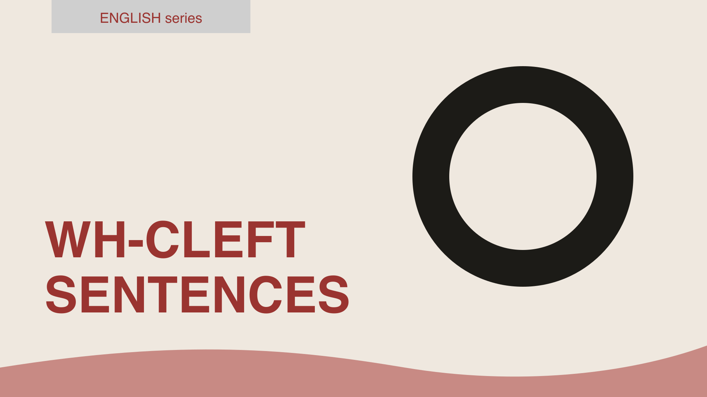

It-cleft (bài 192) nhấn được chủ ngữ, tân ngữ, trạng ngữ, nhưng không nhấn được **hành động**. Muốn nói "điều Nam *làm* là bán xe" hay "cái tôi *cần* là một kỳ nghỉ", tiếng Anh dùng **Wh-cleft** (còn gọi là pseudo-cleft): <mark>What + mệnh đề + be + phần nhấn</mark>. Mẫu này cực kỳ phổ biến trong hội thoại (*What I'm saying is...*, *What happened was...*), trong thuyết trình, và trong IELTS Speaking, nơi nó giúp bạn câu thêm vài giây suy nghĩ trong khi vẫn nghe tự nhiên.

#### Công thức
<mark>What + S + V + be + [phần nhấn]</mark>

Phần nhấn có thể là danh từ, cụm danh từ, động từ nguyên mẫu (có hoặc không <mark>to</mark>), hoặc cả một mệnh đề <mark>that</mark>.

Câu gốc: *I need a holiday.*
- **What I need is** a holiday. (Cái tôi cần là một kỳ nghỉ.)

Câu gốc: *Nam sold his car.*
- **What Nam did was** (to) sell his car. (Điều Nam làm là bán xe.)

Câu gốc: *The server crashed.*
- **What happened was** (that) the server crashed. (Chuyện xảy ra là server sập.)

Dạng này nhấn phần **sau** <mark>be</mark>; phần trước (<mark>What I need</mark>) là thông tin cũ hoặc đã biết, dẫn người nghe tới thông tin mới. Vì thế nó rất hợp để **giới thiệu một ý**, khác với It-cleft thiên về **đối chiếu**.

#### Nhấn hành động với do
Đây là nghĩa It-cleft không có. Dùng <mark>What + S + do/does/did + be + (to) V</mark>; động từ sau <mark>be</mark> ở nguyên mẫu, <mark>to</mark> tùy chọn, và nếu câu gốc ở tiếp diễn thì dùng <mark>V-ing</mark>.
- He fixed the bug himself. → **What he did was** (to) fix the bug himself. (Điều anh ấy làm là tự sửa lỗi.)
- She's wasting time. → **What she's doing is** wasting time.
- We should hire more testers. → **What we should do is** hire more testers.
- They ignored the warning. → **What they did was** ignore the warning, **which** cost them dearly.

Mẫu <mark>What we should/need to do is...</mark> là câu "đinh" trong họp và thuyết trình: nó báo rằng đề xuất sắp đến.

#### Các biến thể hay gặp
**1. All + mệnh đề + be**: "tất cả những gì ... chỉ là", nhấn kèm ý "không hơn".
- **All I want is** a quiet weekend. (Tôi chỉ muốn một cuối tuần yên tĩnh.)
- **All you have to do is** click the button. (Bạn chỉ cần bấm nút.)
- **All he said was** "sorry". (Anh ta chỉ nói mỗi chữ "xin lỗi".)

**2. The thing/person/place/time/reason + mệnh đề + be**: thay <mark>what</mark> bằng danh từ cụ thể để nhấn người, nơi, lúc, lý do.
- **The person who** helped me most **was** my first manager. (Người giúp tôi nhiều nhất là sếp đầu tiên.)
- **The place where** I feel most relaxed **is** my kitchen.
- **The reason (why)** I left **was** the commute. (Lý do tôi nghỉ là đường đi làm.)
- **The thing (that)** annoys me **is** the noise.
- **The first thing** you notice **is** the smell.

**3. Đảo ngược (reversed wh-cleft)**: phần nhấn đứng trước, cụm <mark>what</mark> đứng sau. Thường bắt đầu bằng <mark>That/This</mark>.
- A quiet weekend **is what I want**.
- **That's what** I meant. (Ý tôi là thế đó.)
- **This is where** it gets interesting. (Đây là chỗ bắt đầu hay.)
- **That's why** I called. (Thế nên tôi mới gọi.)
- Money **isn't what** motivates her.

**4. Trong hội thoại: câu mở đầu để "câu giờ"** và dẫn dắt.
- **What I'm trying to say is** (that) we need more time.
- **What I mean is**, it's not just about cost.
- **The thing is**, I've already promised Lan. (Vấn đề là...)
- **What happened was**, I missed the bus, then it started raining...

#### Hòa hợp chủ ngữ và động từ
- Cụm <mark>What + S + V</mark> được coi là **số ít**: *What I need **is** a holiday.* Khi phần sau là danh từ số nhiều, sách ngữ pháp chấp nhận cả hai: *What I need **is/are** two more days.* An toàn: dùng số ít.
- Với <mark>All</mark> cũng số ít: *All I want **is**...*
- Thì của <mark>be</mark> theo nghĩa: *What he **did was** sell the car* (quá khứ) / *What we **need is**...* (hiện tại) / *What I'**ll** do **is** call him* (tương lai, <mark>be</mark> vẫn hiện tại trong văn nói).
- Sau <mark>What ... do + be</mark>: nguyên mẫu, có hoặc không <mark>to</mark>; sau <mark>What ... be doing + be</mark>: <mark>V-ing</mark>.

#### It-cleft hay Wh-cleft?

| | It-cleft | Wh-cleft |
|---|---|---|
| Nhấn | chủ ngữ, tân ngữ, trạng ngữ | hành động, tân ngữ, cả mệnh đề |
| Nghĩa ngầm | "chứ không phải cái khác" (đối chiếu) | "cái đó chính là..." (giới thiệu thông tin mới) |
| Văn phong | viết, trang trọng, báo chí | nói và viết, rất phổ biến trong hội thoại |
| Ví dụ | **It was the price that** put me off. | **What put me off was** the price. |
| | **It was Nam who** sold the car. | **What Nam did was** sell the car. |

Hai câu ví dụ đầu nghĩa gần như nhau; It-cleft hợp khi đang cãi (*not the service*), Wh-cleft hợp khi đang kể hoặc giải thích. Khi muốn nhấn **động từ**, chỉ Wh-cleft làm được.

#### Lỗi người Việt hay mắc
- **Thừa tân ngữ trong cụm what**: ~~What I need it is a holiday~~. <mark>What</mark> đã là tân ngữ của <mark>need</mark>.
- **Thiếu <mark>be</mark>**: ~~What I need a holiday~~. Câu chẻ bắt buộc có <mark>be</mark> nối hai nửa.
- **Dùng <mark>that/which</mark> thay <mark>what</mark>**: ~~That I need is a holiday~~, ~~The what I need~~. Mở đầu là <mark>What</mark> (không có danh từ trước) hoặc <mark>The thing that</mark> (có danh từ).
- **Động từ chia sai sau <mark>do + be</mark>**: ~~What he did was sold the car~~ → *was (to) sell*. Sau <mark>be</mark> là nguyên mẫu.
- **<mark>What</mark> cho người**: ~~What helped me was my manager~~ chấp nhận được về ngữ pháp nhưng kỳ; dùng *The person who helped me was...* hoặc It-cleft.
- **Lạm dụng "What I'm trying to say is"**: hai lần trong một câu trả lời là quá nhiều. Nó là dụng cụ dẫn dắt, không phải chất độn.

#### Bài tập
Viết lại bằng Wh-cleft (hoặc biến thể được chỉ định), nhấn phần in đậm.

1. I need **more time**. → What I need is more time.
2. She **quit her job and moved to Da Lat**. → What she did was (to) quit her job and move to Da Lat.
3. We should **talk to the customers first**. → What we should do is talk to the customers first.
4. **The noise** bothers me most. → What bothers me most is the noise. (hoặc The thing that bothers me most is the noise.)
5. I only want **an apology**. (dùng All) → All I want is an apology.
6. You just need to **restart the router**. (dùng All) → All you need to do is restart the router.
7. I left **because of the long hours**. (dùng The reason) → The reason (why) I left was the long hours.
8. **My grandmother** taught me to cook. (dùng The person) → The person who taught me to cook was my grandmother.
9. I meant **that**. (đảo ngược) → That's what I meant.
10. Sửa lỗi: *What I like it most is the food.* → What I like most is the food.
11. Sửa lỗi: *What he did was called the police.* → What he did was (to) call the police.
12. Sửa lỗi: *All I want a cup of coffee.* → All I want is a cup of coffee.
13. Sửa lỗi: *That I need is a break.* → What I need is a break.
14. Chuyển It-cleft sang Wh-cleft: *It was the design that impressed the client.* → What impressed the client was the design.
15. Chuyển Wh-cleft sang It-cleft: *What I lost was my passport.* → It was my passport that I lost.
16. Dịch: "Điều tôi muốn nói là chúng ta cần thêm người." → What I'm trying to say is (that) we need more people.
17. Dịch: "Cậu chỉ cần gửi cho tôi file đó thôi." → All you have to do is send me that file.
18. Dịch: "Đó là lý do tôi hỏi." → That's why I asked.

#### Tóm tắt
- <mark>What + S + V + be + phần nhấn</mark>: nhấn thông tin mới ở cuối; nhấn hành động bằng <mark>What S do/did + be + (to) V</mark>.
- Biến thể: <mark>All I want is...</mark>, <mark>The reason/person/place ... is...</mark>, đảo ngược <mark>That's what/why/where...</mark>.
- Cụm <mark>what</mark> là số ít; sau <mark>be</mark> động từ ở nguyên mẫu; không điền lại tân ngữ.
- It-cleft để đối chiếu, Wh-cleft để dẫn dắt và nhấn động từ. Trong hội thoại, *What I mean is...* và *The thing is...* là bạn đồng hành của mọi câu trả lời dài.
