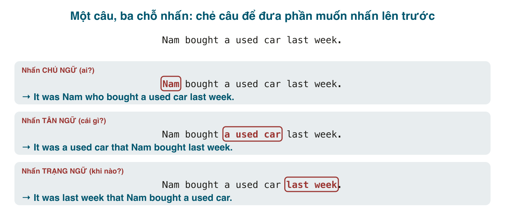

Tiếng Việt nhấn mạnh bằng từ: *chính* Nam mua xe, Nam mua *đúng* cái xe đó, Nam mua xe *mới* tuần trước. Tiếng Anh cũng có *Nam himself*, *that very car*, nhưng cách nhấn mạnh phổ biến nhất trong văn viết và văn nói trang trọng là **chẻ câu** (cleft sentence): tách một câu bình thường thành hai mệnh đề, đưa phần muốn nhấn lên trước <mark>It was ... who/that ...</mark>. Người bản xứ dùng nó mỗi khi muốn sửa một hiểu lầm (*It was Nam who bought the car, not Lan*), trả lời câu hỏi có đối chiếu, hoặc mở đầu bài viết bằng một ý trọng tâm.

Hai bài về câu chẻ: bài này là <mark>It-cleft</mark>, bài 193 là <mark>Wh-cleft</mark> (*What I need is...*). Cả hai hay bị đề thi hỏi và là thứ IELTS Speaking band 7+ dùng để làm câu trả lời có trọng tâm.

#### Công thức
<mark>It + be + [phần nhấn mạnh] + who/that + [phần còn lại của câu]</mark>

Từ một câu gốc, chọn **một** thành phần để nhấn (chủ ngữ, tân ngữ, trạng ngữ chỉ thời gian, nơi chốn, cách thức...), đưa nó lên sau <mark>It + be</mark>, phần còn lại đặt sau <mark>who/that</mark> **nguyên xi**, không đổi thứ tự.

Câu gốc: *Nam bought a used car last week.*
- Nhấn chủ ngữ: **It was Nam who** bought a used car last week. (Chính Nam là người mua, không phải ai khác.)
- Nhấn tân ngữ: **It was a used car that** Nam bought last week. (Nam mua xe cũ, chứ không phải xe mới.)
- Nhấn thời gian: **It was last week that** Nam bought a used car. (Tuần trước, chứ không phải tháng trước.)

Thêm vài ví dụ nhấn các thành phần khác:
- Nơi chốn: **It was in Da Nang that** we first met. (Chính ở Đà Nẵng, chúng tôi gặp nhau lần đầu.)
- Tân ngữ gián tiếp: **It was to Lan that** he gave the keys. (Anh ấy đưa chìa khóa cho Lan, chứ không ai khác.)
- Cách thức, lý do: **It was because of the rain that** the match was cancelled. / **It was by working nights that** she paid for college.

Thứ **không** nhấn được bằng It-cleft: động từ chính và tính từ. ~~It was bought that Nam a car~~ vô nghĩa. Muốn nhấn hành động thì dùng Wh-cleft (bài 193): *What Nam did was buy a car.*

#### Chọn who hay that
- Phần nhấn là **người**: <mark>who</mark> hoặc <mark>that</mark>. *It was Nam **who/that** called.* Trong văn viết, <mark>who</mark> phổ biến hơn khi người đó là chủ ngữ của phần sau; <mark>whom</mark> rất trang trọng và hiếm (*It was Nam whom I called*).
- Phần nhấn là **vật, thời gian, nơi chốn, lý do**: <mark>that</mark>. ~~It was last week when Nam bought~~ và ~~It was in Da Nang where we met~~ nghe tự nhiên trong văn nói và bạn sẽ gặp, nhưng chuẩn ngữ pháp (và đáp án đề thi) là <mark>that</mark>.
- Phần nhấn là cụm giới từ (*to Lan*, *in Da Nang*, *because of the rain*): luôn <mark>that</mark>.

Khi phần nhấn là tân ngữ, <mark>that</mark> có thể bỏ trong văn nói: *It was a used car (that) Nam bought.* Khi là chủ ngữ, không bỏ.

#### Thì của be và hòa hợp
- <mark>be</mark> trong <mark>It + be</mark> thường chia **theo thì của câu gốc**: *It **was** Nam who **bought**...* / *It **is** my mother who **cooks** every day.* Nhưng cũng chấp nhận hiện tại khi người nói đang nhận xét lúc này về việc trong quá khứ: *It **is** Nam who **bought** the car* (hơi khẩu ngữ).
- <mark>be</mark> **luôn số ít**, kể cả khi phần nhấn là số nhiều: *It **was** the students who complained*, không ~~It were the students~~.
- Động từ sau <mark>who/that</mark> chia theo phần được nhấn: *It is **I who am** responsible* (trang trọng) / *It's **me who is** responsible* (văn nói). *It was **they who were** wrong* / *It was **them who were** wrong*.
- Phủ định và câu hỏi đặt ở <mark>be</mark>: *It **wasn't** Nam who called.* / ***Was it** Nam who called?* / ***Who was it** that called?*

#### Nhấn mạnh và đối chiếu
Câu chẻ có nghĩa ngầm là **"chứ không phải cái khác"**. Vì thế nó tự nhiên nhất khi có đối chiếu, sửa sai, hoặc trả lời câu hỏi "ai / cái gì / khi nào":
- "Lan bought the car, right?" "No, **it was Nam who** bought it." (Không, Nam mua chứ.)
- **It wasn't the price that** put me off, **it was the service**. (Không phải giá làm tôi nản, mà là dịch vụ.)
- **It's not what you say, it's how you say it.** (Không phải nói gì, mà là nói thế nào.)
- **It was only when** I got home **that** I realised I'd lost my wallet. (Mãi tới lúc về nhà tôi mới nhận ra mất ví.)

Mẫu cuối, <mark>It was only when/after/then that...</mark> và <mark>It was not until ... that...</mark>, là cấu trúc rất hay gặp trong đề thi:
- **It was not until** 2010 **that** the bridge was finished. (Mãi tới 2010 cầu mới xong. = The bridge was not finished until 2010.)
- **It was not until** she called **that** I remembered the meeting.

Dịch sát "mãi đến ... mới" của tiếng Việt, nhớ phần sau <mark>that</mark> ở dạng **khẳng định**: ~~It was not until 2010 that the bridge wasn't finished~~ là sai (hai lần phủ định).

#### So sánh với các cách nhấn mạnh khác

| Cách | Ví dụ | Khi dùng |
|---|---|---|
| Câu thường, nhấn bằng giọng | **NAM** bought the car. | văn nói, in đậm hoặc lên giọng |
| It-cleft | **It was Nam who** bought the car. | văn viết, sửa sai, đối chiếu |
| Wh-cleft (bài 193) | **What Nam bought was** a car. / **The one who** bought it **was** Nam. | nhấn hành động hoặc dẫn dắt tới thông tin mới |
| Đại từ phản thân | Nam **himself** bought the car. | nhấn "tự mình", không phải nhờ ai |
| Đảo ngữ | **Not until 2010 was** the bridge finished. | rất trang trọng, văn viết |

It-cleft và đảo ngữ với <mark>not until</mark> cùng nghĩa; It-cleft dễ dùng hơn vì không đảo trợ động từ.

#### Lỗi người Việt hay mắc
- **Thừa chủ ngữ hoặc tân ngữ ở phần sau**: ~~It was Nam who he bought the car~~, ~~It was a car that Nam bought it~~. Phần nhấn đã "rút" ra khỏi câu, không điền lại.
- **Đổi thứ tự phần còn lại**: ~~It was last week that bought Nam a car~~. Phần sau <mark>that</mark> giữ nguyên trật tự câu gốc: *that Nam bought a car.*
- **<mark>be</mark> số nhiều**: ~~It were my parents who~~ → *It was my parents who.*
- **<mark>when/where</mark> trong bài thi**: *It was in 2010 **that**...*, không ~~when~~.
- **Hai lần phủ định với <mark>not until</mark>**: xem mục trên.
- **Dùng khi không có gì để đối chiếu**: *It was I who went to the market this morning* nghe kỳ nếu không ai hỏi hay nhầm. Câu chẻ là công cụ nhấn; dùng khi thật sự có gì để nhấn.
- **Thiếu <mark>it</mark>**: ~~Was Nam who called~~ → *It was Nam who called.*

#### Bài tập
Viết lại câu, nhấn vào phần được gạch chân (in đậm).

1. **Lan** broke the vase. → It was Lan who broke the vase.
2. Lan broke **the vase**. → It was the vase that Lan broke.
3. We moved to Hue **in 2015**. → It was in 2015 that we moved to Hue.
4. I met my wife **at a friend's wedding**. → It was at a friend's wedding that I met my wife.
5. He gave the award **to the youngest player**. → It was to the youngest player that he gave the award. (hoặc: It was the youngest player that he gave the award to.)
6. The project failed **because of poor planning**. → It was because of poor planning that the project failed.
7. The bridge wasn't finished until 2010. (dùng It was not until) → It was not until 2010 that the bridge was finished.
8. I didn't understand the problem until I read the logs. → It was not until I read the logs that I understood the problem.
9. Sửa lỗi: *It was my brother who he lent me the money.* → It was my brother who lent me the money.
10. Sửa lỗi: *It were the neighbours that called the police.* → It was the neighbours that called the police.
11. Sửa lỗi: *It was not until midnight that the party didn't end.* → It was not until midnight that the party ended.
12. Sửa lỗi: *It was in Hanoi where I studied.* (theo chuẩn thi) → It was in Hanoi that I studied.
13. Dịch: "Chính anh ấy là người đề xuất ý tưởng này, không phải tôi." → It was he who suggested this idea, not me. (văn nói: It was him who...)
14. Dịch: "Không phải tiền làm tôi lo, mà là thời gian." → It's not the money that worries me, it's the time.
15. Dịch: "Mãi đến tuần trước tôi mới nhận được email." → It was not until last week that I received the email.

#### Tóm tắt
- <mark>It + be + phần nhấn + who/that + phần còn lại</mark>; phần còn lại giữ nguyên, không điền lại chỗ đã rút.
- Người: <mark>who/that</mark>; mọi thứ khác: <mark>that</mark>. <mark>be</mark> luôn số ít, chia thì theo câu gốc.
- Nghĩa ngầm "chứ không phải cái khác": dùng khi đối chiếu, sửa sai, hoặc <mark>It was not until ... that ...</mark>.
- Bài 193: Wh-cleft, cách nhấn động từ và hành động mà It-cleft không làm được.
