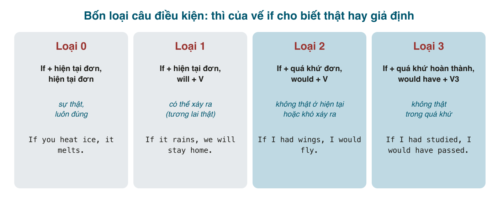

"Nếu trời mưa thì tôi ở nhà", "nếu tôi là anh thì tôi sẽ nghỉ", "nếu hồi đó tôi học hành tử tế thì giờ đã khác": tiếng Việt dùng cùng một chữ "nếu" và cùng một dạng động từ cho cả ba; người nghe tự biết câu nào là thật, câu nào là mơ. Tiếng Anh mã hóa chuyện "thật hay giả định" vào **thì của động từ**: hiện tại đơn sau <mark>if</mark> là thật, quá khứ đơn là giả định ở hiện tại, quá khứ hoàn thành là giả định về quá khứ. Thì ở đây không nói về thời gian mà về **khoảng cách với thực tế**, và đó là điều cần hiểu trước khi học công thức.

#### Cấu trúc chung
Một câu điều kiện có hai vế: **vế if** (điều kiện) và **vế chính** (kết quả). Vế nào đứng trước cũng được; vế <mark>if</mark> đứng trước thì có dấu phẩy, đứng sau thì không.
- **If** it rains, we'll stay home. = We'll stay home **if** it rains.

#### Loại 0: sự thật, luôn đúng
<mark>If + hiện tại đơn, hiện tại đơn</mark>. "Hễ ... thì ...". <mark>if</mark> có thể thay bằng <mark>when/whenever</mark> mà nghĩa không đổi.
- If you **heat** ice, it **melts**. (Hễ đun đá thì nó tan.)
- If I **drink** coffee after 6, I **can't sleep**.
- Water **boils** if you **heat** it to 100°C.

#### Loại 1: có thể xảy ra trong tương lai
<mark>If + hiện tại đơn, will + V</mark>. Điều kiện thật, có khả năng xảy ra.
- If it **rains** tomorrow, we **will cancel** the picnic. (Nếu mai mưa thì hủy picnic.)
- If you **don't hurry**, you**'ll miss** the train.
- I**'ll call** you if I **have** time.

Vế chính không bắt buộc là <mark>will</mark>; có thể là <mark>can, may, might, should, must</mark>, mệnh lệnh, hoặc <mark>be going to</mark>:
- If you finish early, you **can** go home.
- If you see Lan, **tell** her to call me.
- If he keeps eating like that, he**'s going to** get sick.

Vế <mark>if</mark> cũng có thể là hiện tại tiếp diễn hoặc hoàn thành khi nghĩa cần: *If you**'re looking** for Nam, he's in room 3. If you**'ve finished**, you can leave.*

**Luật quan trọng nhất của loại 1: không <mark>will</mark> trong vế if.** ~~If it will rain~~ là lỗi phổ biến số một của người Việt, do dịch chữ "sẽ". Trong vế <mark>if</mark>, tương lai được diễn đạt bằng hiện tại đơn, giống sau <mark>when, until, as soon as</mark> (bài 174). Ngoại lệ hiếm: <mark>if you will/would</mark> = "nếu anh vui lòng" (*If you would wait here, the doctor will see you shortly*).

#### Loại 2: không thật ở hiện tại, hoặc khó xảy ra
<mark>If + quá khứ đơn, would + V</mark>. Quá khứ đơn ở đây **không** nói về quá khứ; nó nói "điều này không đúng bây giờ" hoặc "tôi không nghĩ nó xảy ra".
- If I **had** more time, I **would learn** piano. (Nếu có thời gian thì tôi học đàn. Thực tế: không có.)
- If I **were** you, I **would take** the job. (Nếu tôi là anh... Tôi không phải anh.)
- If we **lived** by the sea, we**'d swim** every day. (Thực tế: không sống ở biển.)
- What **would** you **do** if you **won** the lottery? (Khó xảy ra.)

Hai điểm hình thức:
- <mark>were</mark> cho mọi ngôi trong văn viết và bài thi: *If I **were** rich, If he **were** here.* Văn nói chấp nhận *If I was*, nhưng *If I were you* luôn là <mark>were</mark>.
- Vế chính có thể là <mark>could</mark> (có thể) hoặc <mark>might</mark> (có lẽ): *If I had a car, I **could** drive you. If you asked him, he **might** say yes.*

So sánh loại 1 và loại 2 với cùng một tình huống:
- If I **have** time this weekend, I**'ll visit** you. (Có thể có thời gian: thật.)
- If I **had** time this weekend, I**'d visit** you. (Nhưng tôi không có: giả định, kiểu xin lỗi.)

Chọn loại nào là chọn **thái độ**, không phải chọn thời gian. Cả hai câu đều nói về cuối tuần này.

#### Loại 3: không thật trong quá khứ
<mark>If + quá khứ hoàn thành, would have + V3</mark>. Tưởng tượng quá khứ khác đi; thường để hối tiếc hoặc trách.
- If I **had studied** harder, I **would have passed**. (Nếu hồi đó học chăm hơn thì đã đậu. Thực tế: không chăm, không đậu.)
- If you **had told** me, I **would have helped**. (Nếu anh nói thì tôi đã giúp.)
- She **wouldn't have missed** the flight if she **had left** earlier.
- If we **hadn't taken** the taxi, we **would have been** late.

Cũng có <mark>could have / might have</mark>: *If I had known, I **could have** warned you.* Lỗi hay gặp là bỏ <mark>have</mark> hoặc dùng quá khứ đơn ở vế if: ~~If I knew, I would have called~~ (đây thành câu điều kiện hỗn hợp, nghĩa khác, bài 205).

#### unless, as long as, provided, in case, even if
- <mark>unless</mark> = *if ... not* ("trừ khi"): *I won't go **unless** you come with me.* = *...if you don't come with me.* Sau <mark>unless</mark> động từ ở **khẳng định**: ~~unless you don't come~~ là hai lần phủ định.
- <mark>as long as / provided (that) / on condition that</mark> = "miễn là": *You can borrow the car **as long as** you fill the tank.*
- <mark>in case</mark> = "phòng khi", làm trước đề phòng: *Take an umbrella **in case** it rains.* (Mang ô phòng khi mưa; khác *if it rains* = mưa mới lấy ô.)
- <mark>even if</mark> = "dù có": *I'll go **even if** it rains.*
- <mark>suppose / supposing / what if</mark> = "giả sử", đi với thì của loại 1 hoặc 2: *What if we **missed** the last bus?*
- <mark>otherwise</mark> = "nếu không thì", nối hai câu: *Leave now. **Otherwise** you'll be late.*

#### Lỗi người Việt hay mắc
- **<mark>will</mark> trong vế if**: ~~If it will rain~~ → *If it rains.* ~~If you will study~~ → *If you study.*
- **<mark>would</mark> trong vế if**: ~~If I would have money~~ → *If I had money.* <mark>would</mark> chỉ ở vế chính.
- **Lẫn thì giữa hai vế**: ~~If I had time, I will help~~ (loại 2 vế if, loại 1 vế chính) → *I would help*. Hai vế phải cùng "mức thật", trừ câu hỗn hợp có chủ ý (bài 205).
- **Loại 3 thiếu <mark>have</mark>**: ~~If I had known, I would called~~ → *would have called.* Trong văn nói, *would have* đọc nhanh thành *would've* / *woulda*, nên nhiều người viết sai thành ~~would of~~; đây là lỗi của cả người bản xứ.
- **<mark>unless</mark> + phủ định**: ~~Unless you don't study, you'll fail~~ → *Unless you study...* hoặc *If you don't study...*
- **<mark>was</mark> trong *If I were you***: ~~If I was you~~ → *If I were you.*
- **Dùng loại 2 cho việc có thể xảy ra**: *If I had time tomorrow, I'd come* ngụ ý "nhưng tôi không có". Nếu còn khả năng, dùng loại 1.
- **Dấu phẩy khi vế if đứng sau**: *We'll stay home, if it rains* → bỏ phẩy.

#### Bài tập
1. If you (mix / will mix) red and blue, you (get / will get) purple. → mix, get (loại 0; "will get" cũng được nhưng loại 0 tự nhiên hơn)
2. If it (is / will be) sunny tomorrow, we (go / will go) to the beach. → is, will go
3. If I (am / were) you, I (will / would) accept the offer. → were, would
4. If she (studied / had studied) medicine, she (would be / would have been) a doctor by now. → had studied, would have been (loại 3; hoặc "would be ... now" nếu muốn câu hỗn hợp)
5. I (will / would) buy a house if I (have / had) a million dollars. (giả định) → would, had
6. You'll be late (if / unless) you leave now. → unless
7. Take your phone (if / in case) you need to call me. → in case
8. If he (hadn't missed / didn't miss) the bus, he (wouldn't be / wouldn't have been) late yesterday. → hadn't missed, wouldn't have been
9. Sửa lỗi: *If it will rain, the match will be cancelled.* → If it rains, the match will be cancelled.
10. Sửa lỗi: *If I would know the answer, I would tell you.* → If I knew the answer, I would tell you.
11. Sửa lỗi: *If you had called me, I would helped you.* → ...I would have helped you.
12. Sửa lỗi: *Unless you don't hurry, we'll miss the train.* → Unless you hurry, we'll miss the train.
13. Dịch: "Nếu mai bận thì tôi gọi lại sau." → If I'm busy tomorrow, I'll call you back later.
14. Dịch: "Nếu tôi là anh, tôi sẽ không ký hợp đồng đó." → If I were you, I wouldn't sign that contract.
15. Dịch: "Nếu hôm qua anh đến sớm hơn thì đã gặp cô ấy." → If you had come earlier yesterday, you would have met her.
16. Dịch: "Trừ khi có vấn đề gì, tôi sẽ không gọi." → Unless there's a problem, I won't call. / I won't call unless there's a problem.

#### Tóm tắt
- Loại 0: sự thật, hiện tại + hiện tại. Loại 1: có thể, hiện tại + <mark>will</mark>. Loại 2: không thật bây giờ, quá khứ + <mark>would</mark>. Loại 3: không thật trong quá khứ, quá khứ hoàn thành + <mark>would have V3</mark>.
- **Không <mark>will/would</mark> trong vế if.** Thì trong vế if đo "khoảng cách với thực tế", không đo thời gian.
- <mark>unless</mark> = if not, theo sau là khẳng định; <mark>in case</mark> = phòng khi; <mark>as long as</mark> = miễn là.
- Bài 205 ghép loại 2 và 3 thành câu điều kiện hỗn hợp: *If I had studied, I would be a doctor now.*
