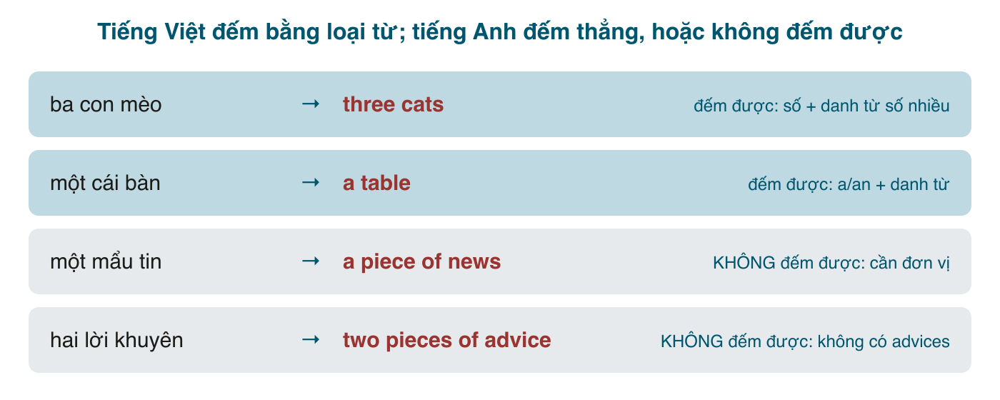

Tiếng Việt đếm mọi thứ bằng **loại từ**: *ba con mèo, hai cái bàn, một mẩu tin, vài lời khuyên*. Bản thân danh từ (*mèo, bàn, tin, khuyên*) không bao giờ đổi dạng, và bất cứ thứ gì cũng đếm được miễn là có loại từ phù hợp. Tiếng Anh thì chia danh từ làm hai loại ngay từ trong từ điển: **đếm được** (countable), có số nhiều và đi với *a/an, many, few*; và **không đếm được** (uncountable), không có số nhiều, không đi với *a/an*, và muốn đếm thì phải mượn đơn vị như *a piece of*. Vấn đề là ranh giới đó không trùng với trực giác tiếng Việt: *tin* đếm được trong tiếng Việt nhưng *news* thì không; *lời khuyên* đếm được nhưng *advice* thì không. Kết quả là ~~informations~~, ~~advices~~, ~~furnitures~~, ~~an advice~~, ~~many homeworks~~ xuất hiện trong gần như mọi bài viết của người Việt mới học.

#### Hai loại danh từ

| | Đếm được (countable) | Không đếm được (uncountable) |
|---|---|---|
| Hình dung | những đơn vị riêng lẻ, đếm 1, 2, 3 được | một khối, một chất, một khái niệm, không có "một cái" |
| Số nhiều | có: *a cat → cats* | **không** có: ~~informations~~ |
| <mark>a/an</mark> | được: *a cat, an idea* | **không**: ~~an information~~ |
| Số ít đứng một mình | không: ~~I have cat~~ | được: *I have information* |
| Động từ | theo số: *The cat **is**, the cats **are*** | **luôn số ít**: *The news **is** good* |
| Lượng từ | many, few, a few, several, a number of | much, little, a little, a great deal of, an amount of |
| Chung cho cả hai | some, any, a lot of, lots of, plenty of, no, enough, most, all | |

Nhóm không đếm được thường gồm:
- **Chất liệu, chất lỏng, khí**: water, rice, bread, meat, sugar, oil, air, gold, paper, wood.
- **Khái niệm trừu tượng**: love, happiness, knowledge, information, advice, progress, time, money.
- **Hoạt động, lĩnh vực**: work, homework, research, shopping, travel, music, English.
- **Tập hợp chung của nhiều món**: furniture, luggage, equipment, clothing, traffic, mail, software.
- **Thời tiết, hiện tượng**: weather, rain, snow, sunshine, electricity.

Nhóm cuối là nhóm đáng chú ý nhất: tiếng Anh coi *furniture* là "đồ đạc nói chung", còn từng món là *a chair, a table*. *Luggage* là "hành lý nói chung", từng cái là *a suitcase, a bag*. Khi gặp danh từ chỉ cả một nhóm, hãy nghi ngờ nó không đếm được.

#### Danh sách phải thuộc: không đếm được nhưng tiếng Việt đếm được
Đây là nguồn lỗi lớn nhất. Mỗi từ dưới đây người Việt đều có loại từ để đếm (*một thông tin, hai lời khuyên, ba bài tập*), nhưng tiếng Anh thì không.

| Không đếm được | Lỗi thường gặp | Đếm bằng |
|---|---|---|
| **information** | ~~an information, informations~~ | a piece of information, some information |
| **advice** | ~~an advice, advices~~ | a piece of advice, some advice |
| **news** | ~~a news, the news are~~ | a piece of news, an item of news; *The news **is*** |
| **furniture** | ~~furnitures~~ | a piece of furniture, an item of furniture |
| **luggage / baggage** | ~~luggages~~ | a piece of luggage, a suitcase, a bag |
| **equipment** | ~~equipments~~ | a piece of equipment |
| **homework / housework** | ~~homeworks, many homeworks~~ | a lot of homework, an assignment, an exercise |
| **work** (việc làm) | ~~a work, works~~ | a job, a task, some work |
| **research** | ~~a research, researches~~ | a study, a research project, some research |
| **knowledge** | ~~knowledges~~ | some knowledge, a good knowledge of |
| **money** | ~~moneys~~ | some money, a sum of money, a dollar, a coin, a note |
| **bread** | ~~a bread, breads~~ | a loaf of bread, a slice of bread, a piece of bread |
| **rice** | ~~rices~~ | a bowl of rice, a grain of rice, a bag of rice |
| **hair** (tóc) | ~~hairs~~ (nghĩa đổi: vài sợi) | long hair; *a hair* = một sợi |
| **traffic** | ~~traffics~~ | heavy traffic, a lot of traffic |
| **weather** | ~~a weather, a nice weather~~ | nice weather, good weather |
| **progress** | ~~progresses~~ | some progress, a lot of progress |
| **behaviour** | ~~behaviours~~ (trừ nghĩa chuyên môn) | good behaviour |
| **evidence** | ~~evidences, an evidence~~ | a piece of evidence |
| **feedback** | ~~feedbacks, a feedback~~ | some feedback, a piece of feedback, a comment |
| **staff** | ~~staffs, a staff~~ (nghĩa "một nhân viên") | a member of staff, a staff member; *The staff **are*** (Anh) / **is** (Mỹ) |
| **software / hardware** | ~~softwares~~ | a piece of software, a program, an app |
| **music** | ~~musics~~ | a song, a piece of music |
| **travel** | ~~a travel~~ | a trip, a journey |
| **accommodation** | ~~accommodations~~ (Anh) | a room, a place to stay |
| **damage** | ~~damages~~ (nghĩa đổi: tiền bồi thường) | some damage, a lot of damage |
| **scenery** | ~~sceneries~~ | beautiful scenery, a view |
| **fun** | ~~a fun, funs~~ | a lot of fun; *It was fun* |
| **permission** | ~~a permission~~ | permission to do sth |

Mẹo nhớ: *information, advice, news, furniture, luggage, equipment, homework* là bảy từ mà hễ thấy <mark>-s</mark> hoặc <mark>a/an</mark> phía trước là gần chắc chắn sai. Thuộc bảy từ này đã xóa được quá nửa lỗi.

#### Danh từ vừa đếm được vừa không: nghĩa khác nhau
Rất nhiều danh từ có cả hai dạng, và dạng nào quyết định nghĩa. Thường thì **không đếm được = chất liệu, khái niệm chung**; **đếm được = một đơn vị, một trường hợp cụ thể**.

| Từ | Không đếm được | Đếm được |
|---|---|---|
| **paper** | giấy: *a sheet of paper* | tờ báo, bài báo khoa học: *a paper on AI* |
| **glass** | thủy tinh: *made of glass* | cái ly: *a glass of water*; **glasses** = kính |
| **hair** | tóc: *She has long hair* | sợi tóc: *There's a hair in my soup* |
| **time** | thời gian: *I don't have time* | lần: *three times*; thời kỳ: *a good time* |
| **room** | chỗ trống: *Is there room for me?* | căn phòng: *a room with a view* |
| **light** | ánh sáng: *Light travels fast* | cái đèn: *Turn off the lights* |
| **work** | công việc: *I have work to do* | tác phẩm: *the works of Shakespeare* |
| **experience** | kinh nghiệm: *five years' experience* | trải nghiệm: *a terrible experience* |
| **chicken / fish / lamb** | thịt: *I ate chicken* | con vật: *a chicken, three chickens* |
| **coffee / tea / beer** | chất: *I like coffee* | một ly, một loại: *two coffees, please* |
| **business** | kinh doanh: *business is slow* | công ty: *a small business* |
| **iron** | sắt | bàn ủi |
| **noise** | tiếng ồn nói chung | một tiếng động: *I heard a noise* |
| **language** | ngôn ngữ nói chung: *the study of language* | một thứ tiếng: *three languages* |
| **life** | cuộc sống: *Life is short* | đời người: *nine lives* |
| **success / failure** | thành công nói chung | một việc thành công: *The show was a success* |

Vì vậy *I'd like a coffee* (một ly) và *I like coffee* (nói chung) đều đúng; *a chicken* là con gà còn sống hoặc nguyên con, *chicken* là món ăn. Trong nhà hàng, *two chickens* là hai con, *two chicken* là... sai; nói *two chicken dishes* hoặc *chicken for two*.

#### Cách đếm thứ không đếm được
Dùng **danh từ đơn vị + of**. Chính đơn vị này mới mang số nhiều.
- **Đơn vị chung**: a **piece** of (information, advice, furniture, cake, paper), a **bit** of (luck, help, time), an **item** of (news, clothing), an **amount** of (money, work).
- **Vật chứa**: a **cup** of coffee, a **glass** of water, a **bottle** of wine, a **bowl** of rice, a **bag** of rice, a **can** of beer, a **jar** of honey.
- **Hình dạng, phần**: a **slice** of bread/cake/pizza, a **loaf** of bread, a **bar** of chocolate/soap, a **sheet** of paper, a **drop** of water, a **grain** of rice/sand, a **lump** of sugar, a **block** of ice.
- **Đo lường**: a **kilo** of rice, a **litre** of milk, a **metre** of cloth, an **hour** of work.
- **Cụm cố định**: a **flash** of lightning, a **clap** of thunder, a **stroke** of luck, a **word** of advice, a **state** of emergency, a **work** of art.

Ví dụ: *Let me give you **two pieces of advice**.* / *She bought **three loaves of bread**.* / *There's **a lot of furniture** in the room, but only **one piece** is new.*

#### Lượng từ: nhìn một lần cho rõ

| Ý | Đếm được | Không đếm được | Cả hai |
|---|---|---|---|
| nhiều | many, a large number of | much, a great deal of, a large amount of | a lot of, lots of, plenty of |
| ít (đủ) | a few | a little | some |
| ít (không đủ) | few | little | (hardly any) |
| hỏi số lượng | how many | how much | |
| không | no, not any | no, not any | |

Hai điểm hay sai:
- **<mark>much</mark> và <mark>many</mark>** trong câu khẳng định nghe trang trọng hoặc hơi cứng; hội thoại dùng <mark>a lot of</mark>: *I have a lot of work* thay vì *much work*. Nhưng trong phủ định và câu hỏi thì <mark>much/many</mark> rất tự nhiên: *I don't have much time. How many people came?*
- **<mark>a few / a little</mark>** (có một ít, nghĩa tích cực) khác **<mark>few / little</mark>** (hầu như không, nghĩa tiêu cực): *I have **a few** friends here* (có vài người) vs. *I have **few** friends here* (gần như không có ai, hơi buồn). *There's **a little** milk left* (còn một ít, đủ dùng) vs. *There's **little** milk left* (sắp hết, phải mua).

#### Danh từ chỉ có số nhiều và danh từ tập hợp
Một nhóm nhỏ danh từ **luôn ở số nhiều** và đi với động từ số nhiều, dù tiếng Việt thấy là một thứ: *clothes, jeans, trousers, shorts, pyjamas, scissors, glasses (kính), goods, thanks, surroundings, belongings, stairs*. Đếm bằng <mark>a pair of</mark>: *a pair of jeans, two pairs of scissors*. *My jeans **are** new.*

Ngược lại, một số danh từ **kết thúc bằng -s nhưng là số ít**: *news, mathematics, physics, economics, politics, athletics, measles* và các từ chỉ môn học. *Mathematics **is** hard. The news **is** on at 7.*

**Danh từ tập hợp** (*family, team, staff, government, company, police, audience*) chỉ một nhóm người: tiếng Anh-Anh có thể chia số nhiều khi nghĩ về các thành viên (*The team **are** celebrating*), tiếng Anh-Mỹ chia số ít (*The team **is** celebrating*). Riêng *police* và *people* luôn số nhiều: *The police **are** here. People **are** friendly.* (~~a people~~ chỉ đúng khi nghĩa là "một dân tộc".)

#### Mạo từ với hai loại danh từ
- Đếm được số ít **không bao giờ đứng một mình**: cần <mark>a/an, the, this, my, one</mark>... ~~I bought car~~ → *I bought **a** car.* Đây là lỗi lớn thứ hai sau ~~informations~~, vì tiếng Việt nói "tôi mua xe" rất bình thường.
- Không đếm được và đếm được số nhiều **đứng một mình được** khi nói chung: *I like music. I like cats.* Thêm <mark>the</mark> khi nói về một thứ cụ thể: *the music at the party, the cats next door*.
- <mark>some</mark> cho câu khẳng định, <mark>any</mark> cho phủ định và câu hỏi, với cả hai loại: *I need some information. I don't have any information. Do you have any cats?* (<mark>some</mark> trong câu hỏi khi mời hoặc mong câu trả lời có: *Would you like some tea?*)

#### Lỗi người Việt hay mắc
- **Thêm -s vào danh từ không đếm được**: ~~informations, advices, furnitures, equipments, homeworks, researches, feedbacks, staffs~~. Xem bảng trên.
- **<mark>a/an</mark> trước danh từ không đếm được**: ~~an advice, a news, a good weather, a research, a permission~~ → bỏ <mark>a</mark>, hoặc thêm đơn vị: *a piece of advice, a research project.*
- **Danh từ đếm được số ít không có mạo từ**: ~~She is teacher~~, ~~I have meeting~~, ~~He bought house~~ → *a teacher, a meeting, a house.*
- **Chia động từ số nhiều với danh từ không đếm được**: ~~The information are~~, ~~The news are~~, ~~The equipment were~~ → *is, is, was.*
- **<mark>many</mark> + không đếm được, <mark>much</mark> + đếm được**: ~~many informations~~, ~~much people~~ → *a lot of information, many people / a lot of people.*
- **<mark>few/little</mark> và <mark>a few/a little</mark>**: *I have little money* nghĩa là gần hết tiền; nếu ý là "có một ít" phải nói *a little*.
- **Đơn vị không đổi số nhiều**: ~~two piece of advice~~, ~~three cup of coffee~~ → *two pieces, three cups.*
- **<mark>a pair of</mark> bị bỏ**: ~~a jeans~~, ~~a scissors~~ → *a pair of jeans, a pair of scissors.*
- **<mark>a hair</mark>, <mark>a paper</mark>, <mark>a work</mark> theo nghĩa tiếng Việt**: ~~She has a long hair~~ → *long hair*; ~~Give me a paper~~ → *a sheet of paper*; ~~I have a work tomorrow~~ → *I have work / a job / a task.*

#### Bài tập
Chọn dạng đúng hoặc sửa lỗi.

1. Can you give me (an advice / some advice)? → some advice
2. We need to buy (some new furnitures / some new furniture). → some new furniture
3. How (much / many) luggage can I take on the plane? → much
4. There (is / are) a lot of information on the website. → is
5. I'd like (a coffee / coffee), please. (gọi một ly) → a coffee
6. She has (few / a few) close friends and is very happy with them. → a few
7. Hurry up, we have (little / a little) time left! → little (sắp hết)
8. I found (a hair / hair) in my soup. → a hair (một sợi)
9. The news (is / are) not good today. → is
10. My jeans (is / are) too tight. → are
11. Sửa lỗi: *I have many homeworks to do tonight.* → I have a lot of homework to do tonight.
12. Sửa lỗi: *The equipments in the lab are old.* → The equipment in the lab is old.
13. Sửa lỗi: *She gave me three advices.* → She gave me three pieces of advice.
14. Sửa lỗi: *It was a very good weather yesterday.* → It was very good weather yesterday. / The weather was very good yesterday.
15. Sửa lỗi: *He is engineer at a software company.* → He is an engineer at a software company.
16. Sửa lỗi: *We did a research on customer behaviour.* → We did some research / a study on customer behaviour.
17. Sửa lỗi: *Two staffs were late this morning.* → Two members of staff / Two staff members were late this morning.
18. Sửa lỗi: *I bought two breads and a chocolate.* → I bought two loaves of bread and a bar of chocolate.
19. Dịch: "Tôi có một tin tốt cho bạn." → I have some good news for you. / I have a piece of good news for you.
20. Dịch: "Cô ấy có ít kinh nghiệm nhưng học rất nhanh." → She has little experience but learns very fast.
21. Dịch: "Giao thông ở Hà Nội tệ lắm." → The traffic in Hanoi is terrible.
22. Dịch: "Cho tôi hai ly nước và một lát bánh." → Two glasses of water and a slice of cake, please.

#### Tóm tắt
- Đếm được: có số nhiều, có <mark>a/an</mark>, số ít không đứng một mình. Không đếm được: không số nhiều, không <mark>a/an</mark>, động từ **luôn số ít**.
- Bảy từ hay sai nhất: **information, advice, news, furniture, luggage, equipment, homework**. Không bao giờ thêm <mark>-s</mark>, không bao giờ <mark>a/an</mark>.
- Đếm bằng đơn vị: *a piece of, a cup of, a slice of, a loaf of, a pair of*; số nhiều nằm ở đơn vị.
- <mark>many/few</mark> đi với đếm được, <mark>much/little</mark> với không đếm được, <mark>a lot of / some / any</mark> với cả hai. <mark>a few / a little</mark> = có một ít; <mark>few / little</mark> = gần như không.
- Một từ hai nghĩa: *paper/a paper, glass/a glass, hair/a hair, time/a time, chicken/a chicken, coffee/a coffee*.
