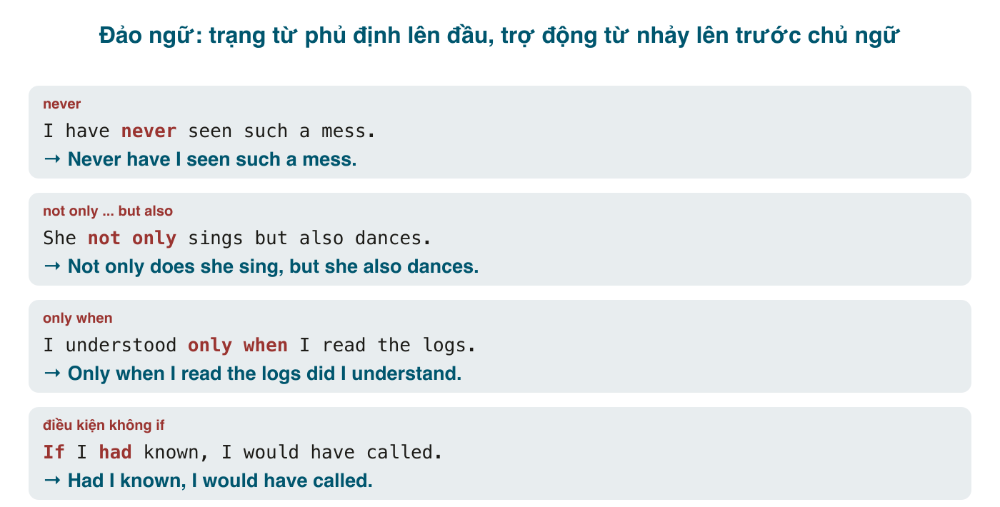

Trật tự bình thường của câu tiếng Anh là chủ ngữ rồi động từ. **Đảo ngữ** (inversion) đưa trợ động từ lên trước chủ ngữ, như trong câu hỏi, nhưng dùng trong câu kể để **nhấn mạnh** hoặc để văn phong trang trọng hơn: *Never have I seen such a mess. Not only is he late, but he's also rude. Had I known, I would have called.* Tiếng Việt có một cấu trúc gần giống trong văn chương ("Chưa bao giờ tôi thấy...") nhưng không đảo gì cả, nên người Việt học đảo ngữ thường hoặc quên đảo, hoặc đảo cả động từ chính (~~Never saw I~~). Bài này liệt kê các trường hợp bắt buộc đảo, cơ chế đảo đúng, và lời khuyên về mức độ dùng.

#### Cơ chế: đảo như câu hỏi
Đảo ngữ dùng **đúng cơ chế đặt câu hỏi**: trợ động từ (<mark>be, have, do/does/did, modal</mark>) nhảy lên trước chủ ngữ; động từ chính đứng yên.
- Câu thường: *I have never seen it.* → *Never **have I** seen it.*
- Không có trợ động từ (hiện tại đơn, quá khứ đơn): mượn <mark>do/does/did</mark>: *She rarely complains.* → *Rarely **does she** complain.* (Động từ chính về nguyên mẫu, giống câu hỏi.)
- Với <mark>be</mark> là động từ chính: *He is seldom late.* → *Seldom **is he** late.*

Lỗi phổ biến nhất là đảo động từ chính: ~~Never saw I~~, ~~Rarely complains she~~. Nhớ: nếu không đặt được câu hỏi theo kiểu đó, thì không đảo được theo kiểu đó.

#### Sau trạng từ phủ định và hạn chế ở đầu câu
Khi những từ này đứng **đầu câu**, bắt buộc đảo. Đứng ở vị trí bình thường thì không.
- <mark>Never, Rarely, Seldom, Hardly ever</mark>: *Never **have I** been so embarrassed. Seldom **do we** see such talent.*
- <mark>Not only ... but (also)</mark>: *Not only **did she** win, but she also broke the record.* (Vế sau không đảo.)
- <mark>No sooner ... than</mark>, <mark>Hardly / Scarcely / Barely ... when</mark>: vừa ... thì, luôn với quá khứ hoàn thành ở vế đầu. *No sooner **had I** sat down **than** the phone rang. Hardly **had we** left **when** it started to rain.*
- <mark>Not until ...</mark>: *Not until I got home **did I** realise my mistake.* (Đảo ở **mệnh đề chính**, không phải ở mệnh đề *until*.)
- <mark>Only + trạng ngữ</mark>: <mark>Only then, Only later, Only when/after/if ..., Only by V-ing, Only in this way</mark>: *Only when the meeting ended **did he** speak. Only by practising **can you** improve.* (Cũng đảo ở mệnh đề chính.)
- <mark>Little</mark> (= not at all): *Little **did they** know what was coming.*
- <mark>Under no circumstances, On no account, In no way, At no time, Nowhere, By no means</mark>: *Under no circumstances **should you** open this door.*
- <mark>Nor / Neither</mark> (cũng không): *I don't smoke, **nor do I** drink.* / *"I can't swim." "**Neither can I**."* Và <mark>So</mark> (cũng vậy): *"I love phở." "**So do I**."*

Chú ý <mark>Only</mark> và <mark>Not until</mark>: phần đảo là mệnh đề chính đứng sau cả cụm trạng ngữ: *Only after she **had left** (không đảo) **did I** (đảo) notice.*

#### so / such ... that
- <mark>So + tính từ/trạng từ + trợ động từ + S ... that</mark>: *So tired **was she** that she fell asleep standing.* / *So quickly **did he** run that nobody could catch him.*
- <mark>Such + be + S ... that</mark>: *Such **was** the noise that we couldn't hear ourselves.*

#### Câu điều kiện bỏ if
Ba dạng, đều trang trọng, hay gặp trong văn viết và email công việc:
- Loại 3: <mark>Had + S + V3</mark>: *If I had known* → ***Had I known**, I would have called.*
- Loại 2 với <mark>were</mark>: <mark>Were + S</mark>: *If I were you* → ***Were I** you, I'd accept.* / *If he were to resign* → ***Were he to** resign, ...*
- Loại 1 với <mark>should</mark> (nếu lỡ, trang trọng): *If you need help* → ***Should you** need help, call this number.*

Phủ định không viết tắt: *Had I **not** known* (không ~~Hadn't I known~~); *Should you **not** receive...*

#### Đảo ngữ với trạng từ chỉ nơi chốn
Khi cụm giới từ hoặc trạng từ chỉ nơi chốn, hướng đứng đầu câu, động từ **chính** (thường là <mark>be, come, go, stand, lie, sit, hang</mark>) đảo lên trước chủ ngữ, không cần <mark>do</mark>. Văn miêu tả, truyện.
- *On the hill **stood** an old church.* (Trên đồi là một nhà thờ cổ.)
- *Here **comes** the bus.* / *There **goes** my weekend.*
- *In the corner **was** a small table.*
- *Out **jumped** a cat.*

Với đại từ làm chủ ngữ thì **không** đảo: *Here **it comes**.* (không ~~Here comes it~~), *Here **she is**.*

Một loại gần giống: đảo để nối ý, với phân từ hoặc tính từ đầu câu: *Attached **is** the report you asked for.* (email công việc) / *Enclosed **are** two copies.* / *Also present **were** three ministers.*

#### Khi nào nên dùng
Đảo ngữ là **gia vị**: dùng một lần trong một bài viết hoặc một bài nói để nhấn mạnh một ý, và nó rất hiệu quả. Dùng ba lần trong một đoạn thì nghe như đang đọc thơ cổ. Các dạng tự nhiên trong giao tiếp hằng ngày: <mark>So do I / Neither do I</mark>, <mark>Here comes...</mark>, <mark>Not only ... but also</mark>, <mark>Should you need...</mark> (email). Các dạng còn lại thuộc văn viết, bài thi, diễn thuyết.

Trong IELTS Writing, một câu *Not only does this policy reduce costs, but it also...* hoặc *Only by investing in education can a country...* ở đoạn thân bài là đủ để thể hiện "range of structures". Tiêu chí chấm không thưởng cho số lượng.

#### Lỗi người Việt hay mắc
- **Đảo động từ chính**: ~~Never saw I~~, ~~Rarely goes she~~ → *Never did I see, Rarely does she go.*
- **Quên đảo** khi trạng từ phủ định đã ở đầu: ~~Never I have seen~~ → *Never have I seen.*
- **Đảo cả vế sau của <mark>not only</mark>**: ~~Not only did she sing, but also did she dance~~ → *but she also danced.*
- **Đảo sai mệnh đề với <mark>only when / not until</mark>**: ~~Only when did I get home I realised~~ → *Only when I got home did I realise.*
- **<mark>No sooner ... when</mark>, <mark>Hardly ... than</mark>**: ghép nhầm cặp. *No sooner ... **than**; Hardly ... **when**.*
- **<mark>No sooner</mark> với quá khứ đơn**: ~~No sooner I sat down than~~ → *No sooner **had I sat** down than.*
- **Viết tắt phủ định trong điều kiện đảo**: ~~Hadn't I known~~ → *Had I not known.*
- **Đảo với đại từ sau trạng từ nơi chốn**: ~~Here comes he~~ → *Here he comes.*
- **Lạm dụng**: đảo ở mọi câu có thể đảo.

#### Bài tập
Viết lại bắt đầu bằng từ cho sẵn.

1. I have never eaten such good food. (Never) → Never have I eaten such good food.
2. She rarely goes out on weekdays. (Rarely) → Rarely does she go out on weekdays.
3. He is not only a good teacher but also a kind man. (Not only) → Not only is he a good teacher, but he is also a kind man.
4. I had just arrived when the meeting started. (No sooner) → No sooner had I arrived than the meeting started.
5. I didn't understand the problem until I read the code. (Not until) → Not until I read the code did I understand the problem.
6. You can only pass the exam by studying regularly. (Only by) → Only by studying regularly can you pass the exam.
7. You should never leave the door unlocked. (Under no circumstances) → Under no circumstances should you leave the door unlocked.
8. If I had seen the email, I would have replied. (Had) → Had I seen the email, I would have replied.
9. If you have any questions, please contact us. (Should) → Should you have any questions, please contact us.
10. The storm was so strong that trees were uprooted. (So) → So strong was the storm that trees were uprooted.
11. A small café is at the end of the street. (At the end of the street) → At the end of the street is a small café.
12. "I don't like durian." "I don't either." (Neither) → "Neither do I."
13. Sửa lỗi: *Never I have been to Japan.* → Never have I been to Japan.
14. Sửa lỗi: *Not only she speaks French, but also she speaks German.* → Not only does she speak French, but she also speaks German.
15. Sửa lỗi: *Hardly had he left than the phone rang.* → Hardly had he left when the phone rang.
16. Sửa lỗi: *Hadn't I known, I wouldn't have come.* → Had I not known, I wouldn't have come.
17. Dịch: "Chưa bao giờ tôi thấy anh ấy giận như thế." → Never have I seen him so angry.
18. Dịch: "Chỉ khi mất rồi ta mới biết quý." → Only when we lose something do we appreciate it.

#### Tóm tắt
- Đảo như **câu hỏi**: trợ động từ lên trước chủ ngữ, mượn <mark>do/does/did</mark> khi cần; động từ chính không đảo.
- Bắt buộc đảo sau: <mark>Never, Rarely, Seldom, Not only, No sooner ... than, Hardly ... when, Not until, Only + trạng ngữ, Little, Under no circumstances, Nor/Neither/So</mark>.
- Điều kiện bỏ if: <mark>Had I..., Were I..., Should you...</mark>; phủ định không viết tắt.
- Nơi chốn đầu câu: đảo động từ chính (*On the hill stood...*), không đảo với đại từ.
- Một lần cho mỗi bài viết là đủ.
