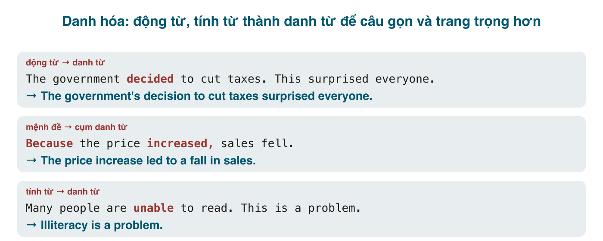

*The government decided to cut taxes, and this surprised everyone.* So với: *The government's **decision** to cut taxes surprised everyone.* Câu sau ngắn hơn, trang trọng hơn, và dồn cả một mệnh đề vào một cụm danh từ làm chủ ngữ. Đó là **danh hóa** (nominalization): biến động từ hoặc tính từ thành danh từ (*decide → decision, able → ability, grow → growth*). Nó là đặc trưng của văn học thuật, báo cáo, bài IELTS Writing band cao, và văn bản pháp lý. Tiếng Việt làm việc này bằng cách thêm *sự, việc, cuộc, nỗi, niềm* (*sự quyết định, việc cắt giảm, cuộc gặp*), từ gốc không đổi; tiếng Anh thì đổi **hậu tố**, và chọn đúng hậu tố cho đúng từ là phần phải thuộc. Phần còn lại của bài là kỹ thuật dùng, và lời cảnh báo: danh hóa quá tay cho ra thứ văn mà người Anh gọi là "zombie nouns".

#### Hậu tố danh hóa

| Hậu tố | Từ gốc → danh từ | Ghi chú |
|---|---|---|
| **-tion / -sion / -ation** | decide → decision; inform → information; educate → education; discuss → discussion; organise → organisation | nhóm lớn nhất |
| **-ment** | develop → development; govern → government; improve → improvement; agree → agreement | |
| **-ance / -ence** | perform → performance; differ → difference; exist → existence; rely → reliance | |
| **-al** | arrive → arrival; propose → proposal; approve → approval; refuse → refusal | |
| **-ure** | fail → failure; press → pressure; expose → exposure | |
| **-th** | grow → growth; strong → strength; wide → width; deep → depth | nhiều từ đổi nguyên âm |
| **-ness** (từ tính từ) | happy → happiness; aware → awareness; ill → illness | |
| **-ity** (từ tính từ) | able → ability; stable → stability; popular → popularity; complex → complexity | |
| **-ing** (danh động từ) | smoke → smoking; read → reading; train → training | luôn có, dùng khi không có danh từ riêng |
| Không đổi dạng | increase, decrease, change, rise, fall, use, need, demand, support, control, lack, risk | đổi trọng âm với một số từ: in**crease** (V) / **in**crease (N) |
| Bất quy tắc | choose → choice; believe → belief; think → thought; prove → proof; speak → speech; lose → loss; succeed → success; die → death; fly → flight; sell → sale | |

Danh từ chỉ **người làm**: <mark>-er / -or / -ant / -ist</mark> (*teach → teacher, act → actor, apply → applicant, economy → economist*). Danh từ từ tính từ còn có <mark>-cy</mark> (*accurate → accuracy, efficient → efficiency*), <mark>-dom</mark> (*free → freedom*), <mark>-hood</mark> (*likely → likelihood*).

Đây là bảng phải thuộc, và thuộc theo cặp (*succeed / success / successful*, *decide / decision / decisive*). Một mẹo: từ điển Oxford và Cambridge có mục "word family" ở cuối mỗi từ; tra một lần, ghi cả nhà.

#### Vì sao danh hóa
**1. Gọn và trang trọng.** Một mệnh đề (chủ ngữ + động từ) thành một cụm danh từ.
- *Because the price increased, sales fell.* → *The price **increase** led to a **fall** in sales.* / *The **increase** in price caused a **decline** in sales.*
- *Scientists discovered the virus in 2019.* → *The **discovery** of the virus in 2019...*
- *People are increasingly aware of the problem.* → *Growing **awareness** of the problem...*

**2. Nối mạch văn (cohesion).** Câu trước nói một hành động, câu sau nhắc lại bằng danh từ ở đầu câu, rồi nói tiếp. Đây là kỹ thuật "thông tin cũ ở đầu câu, thông tin mới ở cuối câu" mà IELTS chấm ở tiêu chí coherence.
- *The company **decided** to expand into Japan. **This decision** cost them $10 million.*
- *The city **introduced** a congestion charge in 2020. **The introduction** of the charge reduced traffic by 20%.*
- *Many people **migrate** to cities for work. **This migration** puts pressure on housing.*

**3. Khách quan, không cần chủ ngữ là người.** Giống bị động (bài 196), danh hóa cho phép bỏ "ai làm".
- *We analysed the data* → *The **analysis** of the data shows...* / *Data **analysis** shows...*
- *Someone needs to evaluate the risk* → *A risk **evaluation** is needed.*

**4. Làm chủ ngữ cho các động từ "nguyên nhân, kết quả"** rất hay dùng trong bài luận: <mark>lead to, result in, cause, contribute to, be due to, stem from, be responsible for</mark>. Những động từ này cần danh từ hai bên.
- *Because people use cars more, the air is more polluted.* → *Increased car **use** has led to higher air **pollution**.*
- *Unemployment rose because factories closed.* → *The **rise** in unemployment was due to factory **closures**.*

#### Kỹ thuật biến mệnh đề thành cụm danh từ
Lấy *The government reduced taxes sharply last year, and this boosted spending.*

1. Tìm động từ chính của ý muốn nén: *reduced*.
2. Đổi thành danh từ: *reduction*.
3. Chủ ngữ cũ thành sở hữu hoặc cụm <mark>by</mark>; tân ngữ cũ thành cụm <mark>of / in</mark>: *the government's reduction of taxes* / *the reduction in taxes by the government*.
4. Trạng từ thành tính từ: *sharply → sharp*; thời gian thành cụm giới từ: *last year's*.
5. Lắp vào câu với một động từ "nối": *Last year's **sharp reduction** in taxes **boosted** spending.*

Cụm giới từ hay đi với danh từ danh hóa: <mark>increase / decrease / rise / fall / change / reduction **in**</mark>; <mark>analysis / discovery / introduction / development **of**</mark>; <mark>demand / need **for**</mark>; <mark>effect / impact **on**</mark>; <mark>reliance / dependence **on**</mark>; <mark>solution **to**</mark>.

#### Khi nào nên dừng
Danh hóa quá tay làm văn nặng, mơ hồ, và giấu mất ai làm gì. Các dấu hiệu:
- **Động từ chính yếu ớt**: *make, have, do, give, take, be, conduct, perform* ôm một danh từ dài: *We **conducted an investigation** into...* → *We **investigated**...* / *The committee **made a decision** to...* → *The committee **decided** to...* / ***Implementation** of the plan was carried out* → *The plan was implemented* / *We implemented the plan.*
- **Chuỗi <mark>of</mark>**: *the improvement of the efficiency of the utilization of resources* → *using resources more efficiently*.
- **Mất chủ thể khi chủ thể quan trọng**: *The termination of the contract was effected* không nói ai chấm dứt. Nếu người đọc cần biết, viết *The client terminated the contract.*
- **Danh từ danh hóa làm cả chủ ngữ lẫn tân ngữ**: *The consideration of the proposal requires the evaluation of the implications* → *Before we consider the proposal, we need to evaluate what it implies.*

Nguyên tắc cân bằng: danh hóa để **nối ý** và **nén thông tin cũ** ở đầu câu; giữ **động từ mạnh** cho hành động chính ở giữa câu. Một câu học thuật tốt thường có một cụm danh từ danh hóa làm chủ ngữ và một động từ thật làm vị ngữ: *The **introduction** of the charge **reduced** traffic.* Không phải *The **introduction** of the charge **resulted in** a **reduction** of traffic.*

#### Lỗi người Việt hay mắc
- **Dùng V-ing khi có danh từ riêng**: ~~the increasing of prices~~ → *the increase in prices*; ~~the developing of the economy~~ → *economic development*. (<mark>V-ing</mark> + <mark>of</mark> gần như luôn là dấu hiệu nên tra danh từ thật.)
- **Sai hậu tố**: ~~decidement, improvation, performation, succession (nghĩa khác)~~ → *decision, improvement, performance, success.*
- **Giữ nguyên động từ làm danh từ**: ~~his decide, the develop of~~ → *his decision, the development of.*
- **Sai giới từ sau danh từ**: ~~increase of prices~~ (chấp nhận nhưng *in* chuẩn hơn), ~~solution of~~ → *solution to*, ~~impact to~~ → *impact on*, ~~demand of~~ → *demand for*.
- **Danh từ không đếm được bị thêm <mark>-s</mark>**: ~~researches, informations, advices~~ (bài 194); nhưng *decisions, improvements, developments* đếm được.
- **Dịch "sự/việc" thành <mark>the + V-ing</mark> máy móc**: *việc học tiếng Anh* → *learning English* (không ~~the learning of English~~ trừ văn rất trang trọng).
- **Danh hóa cả bài**: mỗi câu đều *the implementation of, the utilization of*. Người chấm IELTS gọi đây là "overly formal, unnatural" và trừ điểm lexical resource.
- **Quên mạo từ hoặc sở hữu**: ~~Decision of government surprised everyone~~ → *The government's decision...*

#### Bài tập
Tìm danh từ, rồi viết lại câu bằng danh hóa (hoặc ngược lại, khi được yêu cầu).

1. decide, improve, grow, able, aware, succeed, fail, choose, strong, rely → decision, improvement, growth, ability, awareness, success, failure, choice, strength, reliance
2. *The population grew rapidly, and this created a housing shortage.* → Rapid population growth created a housing shortage.
3. *They introduced a new system, which improved efficiency.* → The introduction of a new system improved efficiency.
4. *People rely more and more on smartphones. This worries many parents.* → Growing reliance on smartphones worries many parents.
5. *The company failed to deliver on time, so it lost the contract.* → The company's failure to deliver on time cost it the contract.
6. *Because fuel became more expensive, fewer people drove.* → The rise in fuel prices led to a fall in driving. / Higher fuel prices reduced driving.
7. *Many students are not able to pay the fees.* → Many students lack the ability to pay the fees. / The inability of many students to pay the fees...
8. Viết lại cho tự nhiên (bỏ bớt danh hóa): *We carried out an analysis of the results and reached the conclusion that an improvement in the design was necessary.* → We analysed the results and concluded that the design needed improving.
9. Viết lại cho tự nhiên: *The implementation of the new policy by the government resulted in a reduction in unemployment.* → The government's new policy reduced unemployment. / When the government implemented the new policy, unemployment fell.
10. Sửa lỗi: *The increasing of rent is a big problem for students.* → The increase in rent is a big problem for students. / Rising rent is...
11. Sửa lỗi: *His decide to quit surprised us.* → His decision to quit surprised us.
12. Sửa lỗi: *There is no solution of this problem.* → There is no solution to this problem.
13. Sửa lỗi: *The company made an improvation of its service.* → The company improved its service. / The company made an improvement to its service.
14. Dịch: "Sự phát triển của du lịch đã tạo nhiều việc làm." → The development of tourism has created many jobs. / Tourism development has created many jobs.
15. Dịch: "Việc thiếu đầu tư vào giáo dục dẫn đến thiếu lao động có tay nghề." → A lack of investment in education leads to a shortage of skilled workers.
16. Dịch: "Quyết định này đã gây tranh cãi." → This decision caused controversy. / This decision was controversial.

#### Tóm tắt
- Danh hóa = động từ/tính từ → danh từ bằng hậu tố (<mark>-tion, -ment, -ance, -al, -ure, -th, -ness, -ity</mark>) hoặc <mark>-ing</mark> khi không có danh từ riêng; thuộc theo "word family".
- Dùng để **nén** mệnh đề, **nối** câu (thông tin cũ ở đầu câu), và làm chủ ngữ cho <mark>lead to, result in, be due to</mark>.
- Giới từ đi kèm: *increase/change **in**, development/introduction **of**, demand **for**, impact **on**, solution **to**.*
- Dừng khi động từ chính chỉ còn *make/have/conduct*; chuỗi *of*; hoặc mất chủ thể quan trọng. Một cụm danh hóa + một động từ mạnh là công thức an toàn.
