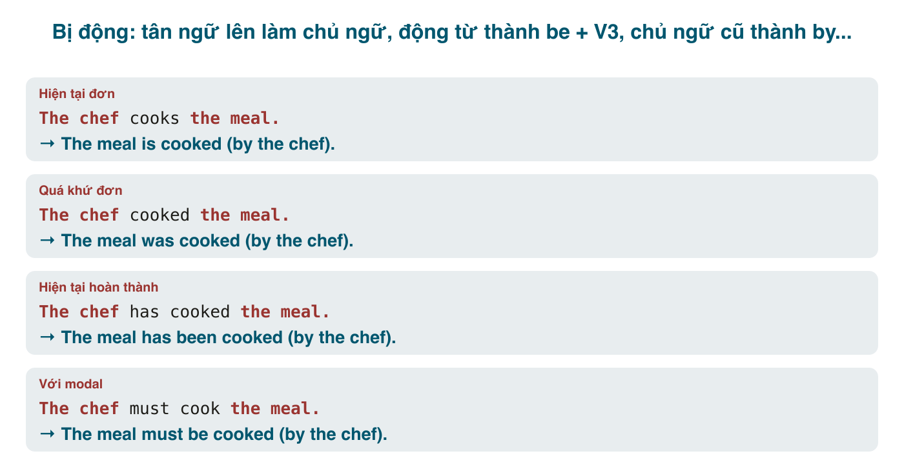

Tiếng Việt có "bị" và "được", nên câu bị động nghe quen: *Cái xe bị trộm. Bức thư được gửi hôm qua.* Nhưng "bị/được" trong tiếng Việt là **từ** đặt trước động từ nguyên dạng, còn bị động tiếng Anh là **dạng động từ**: <mark>be</mark> chia theo thì cộng <mark>V3</mark>. Chỗ người Việt hay trượt: quên <mark>be</mark> (~~The letter sent yesterday~~), dùng V2 thay V3 (~~was wrote~~), hoặc "bị động hóa" những động từ không có tân ngữ vì tiếng Việt có "bị": *bị cảm, bị ngã, bị xảy ra* → ~~was happened~~, ~~was fallen~~.

#### Công thức
<mark>Chủ ngữ mới (tân ngữ cũ) + be (chia thì) + V3 + (by + chủ ngữ cũ)</mark>

Ba bước: (1) tân ngữ của câu chủ động lên làm chủ ngữ; (2) <mark>be</mark> chia đúng thì của câu gốc, động từ chính về <mark>V3</mark>; (3) chủ ngữ cũ xuống sau <mark>by</mark>, hoặc bỏ nếu không quan trọng.

| Thì | Chủ động | Bị động |
|---|---|---|
| Hiện tại đơn | They **clean** the room daily. | The room **is cleaned** daily. |
| Hiện tại tiếp diễn | They **are cleaning** the room. | The room **is being cleaned**. |
| Hiện tại hoàn thành | They **have cleaned** the room. | The room **has been cleaned**. |
| Quá khứ đơn | They **cleaned** the room. | The room **was cleaned**. |
| Quá khứ tiếp diễn | They **were cleaning** the room. | The room **was being cleaned**. |
| Quá khứ hoàn thành | They **had cleaned** the room. | The room **had been cleaned**. |
| Tương lai đơn | They **will clean** the room. | The room **will be cleaned**. |
| be going to | They **are going to clean** the room. | The room **is going to be cleaned**. |
| Tương lai hoàn thành | They **will have cleaned** the room. | The room **will have been cleaned**. |
| Modal | They **must clean** the room. | The room **must be cleaned**. |
| Modal quá khứ | They **should have cleaned** the room. | The room **should have been cleaned**. |

Các thì hoàn thành tiếp diễn (*has been cleaning*) hầu như không dùng bị động vì quá nặng (*has been being cleaned*); viết lại bằng thì khác.

Mẹo: trong bị động, **chỉ <mark>be</mark> đổi theo thì**, còn <mark>V3</mark> đứng yên. Thấy *is/was/has been/will be/being* là xác định được thì ngay.

#### Khi nào dùng bị động
**1. Không biết hoặc không cần biết ai làm.**
- My bike **was stolen** last night. (Ai trộm? Không biết.)
- The road **is being repaired**. (Rõ ràng là công nhân, không cần nói.)
- English **is spoken** in many countries.

**2. Muốn nhấn vào việc, vào kết quả, không phải người làm.** Chủ ngữ là thứ người nói đang quan tâm.
- The Eiffel Tower **was built** in 1889. (Quan tâm tới tháp, không phải thợ.)
- The bug **has been fixed**. (Quan trọng là lỗi đã sửa.)

**3. Văn phong trang trọng, khách quan**: báo cáo, bài khoa học, thông báo, tin tức.
- The samples **were heated** to 100°C. (Không nói "tôi đun".)
- Passengers **are requested** to keep their luggage with them.
- It **is believed** that the company **will be sold**.

**4. Giữ mạch thông tin cũ → mới.** Chủ ngữ nối với câu trước.
- Nam wrote a report. **The report** **was praised** by the director. (Câu hai nói về *the report* vừa nhắc.)

Khi người làm quan trọng (thông tin mới, bất ngờ), dùng <mark>by</mark>: *The novel **was written by** a 16-year-old.* Khi người làm là *people, someone, they, we* chung chung, bỏ <mark>by</mark>: ~~The room was cleaned by someone~~.

#### Động từ không có bị động
Bị động cần **tân ngữ** để đưa lên làm chủ ngữ. Động từ **nội động** (không có tân ngữ) không bao giờ bị động, dù tiếng Việt có "bị": <mark>happen, occur, take place, arrive, come, go, exist, appear, disappear, die, fall, sleep, rise, remain, consist of, belong to</mark>.
- ~~The accident was happened~~ → The accident **happened**. (Tai nạn xảy ra.)
- ~~He was died in 2010~~ → He **died** in 2010.
- ~~The meeting was taken place~~ → The meeting **took place**.
- ~~She was arrived late~~ → She **arrived** late.
- ~~The book is belonged to me~~ → The book **belongs** to me.

Tương tự, "bị cảm", "bị ngã", "bị trễ" của tiếng Việt là chủ động trong tiếng Anh: *I **caught** a cold. He **fell**. We **were late*** (*late* là tính từ, không phải bị động).

Một số động từ có tân ngữ nhưng cũng hiếm bị động: <mark>have</mark> (sở hữu), <mark>lack, fit, suit, resemble</mark>: ~~A car is had by me~~.

#### Động từ hai tân ngữ
<mark>give, send, offer, show, tell, teach, pay, lend</mark> có hai tân ngữ (người và vật), nên có hai câu bị động; **câu lấy người làm chủ ngữ phổ biến hơn**.
- They gave **me** **a prize**. → **I was given** a prize. / **A prize was given** to me.
- Someone sent **her** **flowers**. → **She was sent** flowers. / **Flowers were sent** to her.

#### Các dạng đặc biệt
**Bị động với động từ tường thuật** (<mark>say, believe, think, know, report, expect, consider</mark>): hai cách.
- People say that he is rich. → **It is said that** he is rich. = **He is said to be** rich.
- They believe the thief escaped by car. → **It is believed that** the thief escaped... = **The thief is believed to have escaped** by car. (Việc xảy ra trước → <mark>to have V3</mark>.)

**Bị động với nguyên mẫu và danh động từ**: *She wants **to be promoted**. He hates **being told** what to do. The report needs **to be checked** (= needs **checking**).*

**Bị động với get** (khẩu ngữ, thường là việc xảy ra bất ngờ, không hay): *He **got fired**. I **got caught** in the rain. They **got married** in June.*

**Have/get something done** (nhờ, thuê người làm): *I **had my hair cut**. We'**re getting the roof repaired**.* Khác *I cut my hair* (tự cắt). Cấu trúc này dịch "đi cắt tóc, đi sửa xe" của tiếng Việt rất sát.

**Make, see, hear + V trong chủ động → to V trong bị động**: *They made him **work** late.* → *He was made **to work** late.* / *I saw her **leave**.* → *She was seen **to leave**.*

**Cụm động từ** giữ nguyên giới từ ở cuối: *They **looked after** the kids.* → *The kids **were looked after**.* / *Someone **broke into** the office.* → *The office **was broken into**.*

#### Lỗi người Việt hay mắc
- **Quên <mark>be</mark>**: ~~The letter sent yesterday~~, ~~The car repaired~~ (nếu là câu hoàn chỉnh) → *was sent, was repaired*. (Dạng không <mark>be</mark> chỉ đúng khi là mệnh đề quan hệ rút gọn: *the letter sent yesterday was...*, bài 189.)
- **V2 thay V3**: ~~was wrote~~, ~~was took~~, ~~been chose~~ → *written, taken, chosen.*
- **Bị động hóa nội động từ**: ~~was happened, was occurred, was died, was arrived, was appeared~~.
- **Thì của <mark>be</mark> sai so với câu gốc**: *They have built the bridge* → ~~The bridge was built~~ → *has been built.*
- **Quên <mark>being</mark> trong tiếp diễn**: ~~The road is repaired now~~ (khi ý là đang sửa) → *is being repaired.*
- **<mark>by</mark> + đại từ chủ ngữ**: ~~by he~~, ~~by they~~ → *by him, by them.*
- **Giữ tân ngữ cũ**: ~~The prize was given me it~~ → *I was given the prize.*
- **Dùng bị động khi chủ động tự nhiên hơn**: *The cake was eaten by me* đúng ngữ pháp nhưng kỳ; nói *I ate the cake*. Bị động là công cụ, không phải mục tiêu.

#### Bài tập
Chuyển sang bị động (bỏ <mark>by</mark> nếu không cần) hoặc sửa lỗi.

1. Someone stole my wallet on the bus. → My wallet was stolen on the bus.
2. They are building a new bridge across the river. → A new bridge is being built across the river.
3. The company has hired 50 new engineers. → 50 new engineers have been hired (by the company).
4. You must submit the form by Friday. → The form must be submitted by Friday.
5. The teacher gave us too much homework. → We were given too much homework (by the teacher).
6. People say that she is the best lawyer in town. → It is said that she is the best lawyer in town. / She is said to be the best lawyer in town.
7. They made the students clean the classroom. → The students were made to clean the classroom.
8. Nobody has answered my email. → My email hasn't been answered.
9. Sửa lỗi: *The accident was happened at midnight.* → The accident happened at midnight.
10. Sửa lỗi: *This book was wrote by a Vietnamese author.* → This book was written by a Vietnamese author.
11. Sửa lỗi: *The room is cleaning right now.* → The room is being cleaned right now.
12. Sửa lỗi: *She was arrived at the airport at 6.* → She arrived at the airport at 6.
13. Sửa lỗi: *The report should be sent to he yesterday.* → The report should have been sent to him yesterday.
14. Dịch: "Tôi đi cắt tóc hôm qua." → I had my hair cut yesterday.
15. Dịch: "Cuộc họp bị hoãn tới tuần sau." → The meeting has been postponed until next week.
16. Dịch: "Người ta tin rằng anh ấy đã rời khỏi nước." → He is believed to have left the country. / It is believed that he has left the country.
17. Dịch: "Anh ấy bị sa thải tháng trước." → He was fired / got fired last month.

#### Tóm tắt
- <mark>be</mark> (chia thì) + <mark>V3</mark>; chỉ <mark>be</mark> đổi theo thì. Tiếp diễn có <mark>being</mark>, hoàn thành có <mark>been</mark>, modal có <mark>be</mark>.
- Dùng khi không biết, không cần, hoặc không muốn nhấn người làm; văn trang trọng; nối mạch thông tin.
- Nội động từ (**happen, occur, die, arrive, take place, belong**) **không có** bị động, dù tiếng Việt nói "bị".
- *It is said that... / He is said to...*; *have sth done* = nhờ người làm; *get + V3* = bị động khẩu ngữ.
