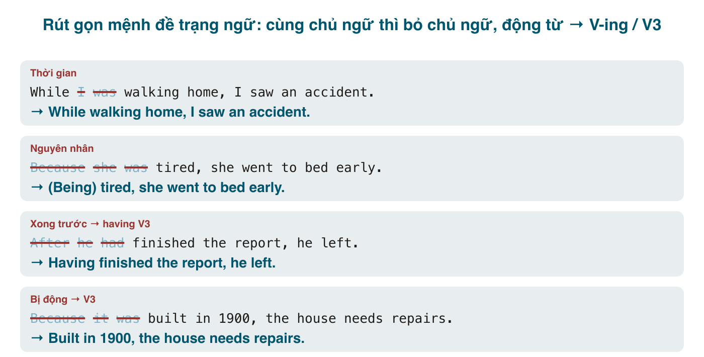

Bài 189 rút gọn mệnh đề *bổ nghĩa cho danh từ*. Bài này rút gọn mệnh đề *bổ nghĩa cho cả câu*: mệnh đề trạng ngữ chỉ thời gian, nguyên nhân, điều kiện, nhượng bộ, kết quả, bắt đầu bằng <mark>when, while, because, if, although, after, before...</mark>. Dạng rút gọn gọi là **mệnh đề phân từ** (participle clause): *Walking home, I saw an accident. Having finished the report, he left. Built in 1900, the house needs repairs.*

Đây là cấu trúc mà IELTS Writing band 7 trở lên dùng thường xuyên, và cũng là nơi sinh ra lỗi nổi tiếng nhất của tiếng Anh viết: **dangling participle**, phân từ "treo" không có chủ ngữ. Toàn bộ bài này xoay quanh một quy tắc duy nhất giúp bạn tránh lỗi đó.

#### Quy tắc vàng: hai mệnh đề phải cùng chủ ngữ
Rút gọn mệnh đề trạng ngữ là **bỏ chủ ngữ** của nó đi. Bỏ được chỉ khi người đọc tự điền lại được, tức là nó **trùng với chủ ngữ mệnh đề chính**.
- *While **I** was walking home, **I** saw an accident.* → cùng là *I* → *While walking home, I saw an accident.*
- *While **I** was walking home, **a car** hit a tree.* → khác chủ ngữ → **không** rút gọn. ~~While walking home, a car hit a tree~~ nghĩa là cái xe đi bộ về nhà.

Mọi thứ khác trong bài là chi tiết. Trước khi rút gọn, luôn tự hỏi: *ai* làm việc trong mệnh đề phụ, và *ai* là chủ ngữ mệnh đề chính? Khác nhau thì dừng.

#### Ba dạng phân từ

| Dạng | Nghĩa | Ví dụ |
|---|---|---|
| <mark>V-ing</mark> | chủ động, cùng lúc hoặc ngay trước mệnh đề chính | **Feeling** tired, she went to bed. |
| <mark>Having + V3</mark> | chủ động, **xong hẳn trước** mệnh đề chính | **Having finished** dinner, she went to bed. |
| <mark>V3</mark> (hoặc <mark>Being/Having been + V3</mark>) | bị động | **Built** in 1900, the house needs repairs. |

Phủ định: đặt <mark>not</mark> lên đầu: *Not knowing the answer, I kept quiet.* / *Not having been invited, he stayed home.*

#### Mệnh đề thời gian
Có thể **giữ liên từ** (<mark>while, when, after, before, since, until, once</mark>) + <mark>V-ing</mark>, hoặc bỏ luôn liên từ khi nghĩa vẫn rõ.
- **While** I was waiting for the bus, I read the news. → **While waiting** for the bus, I read the news. (Trong lúc đợi xe, tôi đọc tin.)
- **When** you cross the road, look both ways. → **When crossing** the road, look both ways.
- **After** he had finished the report, he left. → **After finishing** the report, he left. = **Having finished** the report, he left. (Xong báo cáo, anh ấy về.)
- **Before** you sign, read the contract. → **Before signing**, read the contract.
- **Since** she moved to Hanoi, she has made many friends. → **Since moving** to Hanoi, she has made many friends.

Hai hành động nối tiếp nhau nhanh, không cần liên từ: *She **opened** the door and **saw** a stranger.* → ***Opening** the door, she saw a stranger.* Hành động thứ nhất xong hẳn và có khoảng cách thì dùng <mark>having V3</mark>: ***Having opened** the shop, she went to buy coffee.*

Chú ý: sau <mark>after, before, since, when, while</mark>, dạng <mark>V-ing</mark> vừa là phân từ vừa là danh động từ, nên không cần <mark>having</mark>: *after finishing* là đủ; *after having finished* đúng nhưng thừa.

#### Mệnh đề nguyên nhân
Với <mark>because, as, since</mark>, **bỏ luôn liên từ**; cụm phân từ tự mang nghĩa "vì". Đây là cách dùng phổ biến nhất của mệnh đề phân từ trong văn viết.
- **Because** she was tired, she went to bed early. → **Being** tired, she went to bed early. = **Tired**, she went to bed early. (Vì mệt, cô ấy đi ngủ sớm.)
- **As** he didn't know the way, he asked a local. → **Not knowing** the way, he asked a local.
- **Because** I had lost my keys, I couldn't get in. → **Having lost** my keys, I couldn't get in.
- **Since** it was written in a hurry, the report has many errors. → **Written** in a hurry, the report has many errors.
- **Because** he had been warned twice, he was fired. → **Having been warned** twice, he was fired.

<mark>Being + tính từ/danh từ</mark> hay được lược luôn <mark>being</mark>: *Being a doctor, she knew what to do* = *A doctor, she knew what to do* (văn viết). Với bị động, <mark>being</mark> cũng hay lược: *(Being) built in 1900...*

Không bỏ liên từ với các mệnh đề thời gian khi nghĩa có thể nhầm sang nguyên nhân: *Driving home, I saw an accident* (lúc lái xe) rõ; nhưng *Driving home, I felt tired* có thể hiểu "vì lái xe về nên mệt" hoặc "trong lúc lái xe thì thấy mệt". Giữ <mark>while</mark> nếu muốn nhấn thời gian.

#### Mệnh đề điều kiện và nhượng bộ
Với <mark>if, unless, although, though, even though, whether</mark>: **giữ liên từ**, rút gọn phần còn lại. Thường gặp nhất với bị động (<mark>V3</mark>) và tính từ.
- **If** it is heated, ice melts. → **If heated**, ice melts.
- **Unless** you are told otherwise, wait here. → **Unless told** otherwise, wait here. (Trừ khi được bảo khác, đợi ở đây.)
- **Although** he was exhausted, he kept running. → **Although exhausted**, he kept running.
- **Though** she was a beginner, she won. → **Though a beginner**, she won.
- **While** I admit it's risky, I think we should try. → **While admitting** it's risky, I think we should try. (<mark>while</mark> ở đây là "mặc dù".)
- **If** you are in doubt, ask. → **If in doubt**, ask. (cụm giới từ)
- **When** it is necessary, call me. → **When necessary**, call me.

Cấu trúc nhượng bộ này rất hay gặp trong hướng dẫn và văn bản kỹ thuật: *Unless otherwise stated, all prices include VAT.* / *If approved, the request will be processed within 3 days.*

#### Mệnh đề kết quả, cách thức, bổ sung
Phân từ đặt **sau** mệnh đề chính để nói hệ quả hoặc hành động đi kèm. Không có liên từ nào bị bỏ; đây là rút gọn của *and* hoặc *which* chỉ cả mệnh đề trước.
- The storm hit the coast, **and it caused** heavy flooding. → The storm hit the coast, **causing** heavy flooding. (Bão đổ bộ, gây lụt nặng.)
- The company cut 200 jobs, **which left** many families without income. → The company cut 200 jobs, **leaving** many families without income.
- She sat by the window **and she was reading** a book. → She sat by the window, **reading** a book.
- He walked out **and didn't say** a word. → He walked out **without saying** a word. (giới từ + V-ing)

Trong IELTS Task 1 và 2 cấu trúc này gần như bắt buộc: *Sales rose sharply in 2020, **reaching** a peak of $5m.* / *More people are moving to cities, **putting** pressure on housing.*

#### Dangling participle: lỗi phân từ treo
Khi rút gọn mà chủ ngữ hai mệnh đề khác nhau, phân từ "treo" lơ lửng và bị hiểu là nói về chủ ngữ mệnh đề chính, thường cho ra câu buồn cười:
- ~~**Walking** down the street, **the trees** were beautiful.~~ (Cây đi bộ.)
- ~~**Having finished** the exam, **the teacher** collected the papers.~~ (Giáo viên làm bài thi.)
- ~~**Being** only 5, **my mother** didn't let me go.~~ (Mẹ mới 5 tuổi.)
- ~~**Written** in 1990, **people** still read this book.~~ (Người được viết năm 1990.)

Ba cách sửa:
1. Đổi chủ ngữ mệnh đề chính cho khớp: *Walking down the street, **I** saw beautiful trees.*
2. Trả lại mệnh đề đầy đủ: *When **I** walked down the street, the trees were beautiful.* / *Because **I** was only 5, my mother didn't let me go.*
3. Giữ chủ ngữ riêng trong cụm phân từ (**absolute clause**, văn viết trang trọng): *The weather being bad, we stayed home.* / *The exam having finished, the teacher collected the papers.* / *All things considered, it was a good trip.*

Một số cụm cố định được chấp nhận dù "treo" về kỹ thuật: *Generally speaking, Judging from his accent, Considering the cost, Speaking of money, Taking everything into account, Provided that...* Người bản xứ dùng thoải mái.

#### Lỗi người Việt hay mắc
- **Khác chủ ngữ vẫn rút gọn** (dangling): xem mục trên. Đây là lỗi số một, và lỗi này xuất hiện cả trong bài viết của người đã rất giỏi.
- **Chọn sai V-ing / V3**: ~~Interesting in the job, I applied~~ → *Interested in the job* (tôi *được* gây hứng thú); ~~Seen the results, we changed the plan~~ → *Having seen / Seeing the results* (chúng tôi *thấy*, chủ động).
- **Giữ chủ ngữ mà vẫn bỏ liên từ và đổi dạng động từ**: ~~She being tired, she went to bed~~. Hoặc bỏ chủ ngữ, hoặc giữ cả mệnh đề.
- **Dùng <mark>having V3</mark> cho việc cùng lúc**: ~~Having walked home, I saw an accident~~ (nghĩa thành: về tới nhà rồi mới thấy) → *Walking home, I saw an accident.*
- **Bỏ liên từ điều kiện, nhượng bộ**: ~~Heated, ice melts~~ nghe như nguyên nhân; giữ *If heated*. ~~Exhausted, he kept running~~ nghĩa thành "vì kiệt sức nên chạy tiếp"; giữ *Although exhausted*.
- **Thiếu dấu phẩy** sau cụm phân từ mở đầu: *Having finished the report he left* → thêm phẩy sau *report*.
- **Lạm dụng**: ba câu liên tiếp bắt đầu bằng V-ing nghe như văn mẫu. Trộn với câu có liên từ đầy đủ.

#### Bài tập
Rút gọn nếu được; nếu không, sửa cho đúng.

1. While I was cooking dinner, I listened to a podcast. → While cooking dinner, I listened to a podcast.
2. Because she didn't have enough money, she couldn't buy the ticket. → Not having enough money, she couldn't buy the ticket.
3. After he had checked the code twice, he deployed it. → Having checked the code twice, he deployed it. (hoặc After checking the code twice, ...)
4. Because the house was damaged by the storm, it was unsafe to enter. → Damaged by the storm, the house was unsafe to enter.
5. If it is used correctly, this tool saves hours. → If used correctly, this tool saves hours.
6. Although he was offered a higher salary, he turned the job down. → Although offered a higher salary, he turned the job down.
7. The factory closed down, and this left 300 people unemployed. → The factory closed down, leaving 300 people unemployed.
8. While I was waiting for the bus, the rain started. → Không rút gọn được (chủ ngữ khác: I / the rain). Giữ nguyên, hoặc: While I was waiting for the bus, it started to rain.
9. Because I had never seen snow, the trip to Sapa was special. → Không rút gọn được (I / the trip). Sửa: Having never seen snow, I found the trip to Sapa special.
10. She left the room and she didn't say goodbye. → She left the room without saying goodbye.
11. Sửa lỗi: *Looking out of the window, the mountains were covered in snow.* → Looking out of the window, I saw that the mountains were covered in snow.
12. Sửa lỗi: *Having been tired, I went to bed.* → Being tired, I went to bed. (hoặc Tired, I went to bed; "having been" là bị động hoàn thành, không hợp ở đây)
13. Sửa lỗi: *Exciting about the trip, the kids couldn't sleep.* → Excited about the trip, the kids couldn't sleep.
14. Sửa lỗi: *Having finished the meeting, the room was empty.* → When the meeting had finished, the room was empty. (hoặc The meeting having finished, the room was empty.)
15. Dịch: "Không biết nói gì, tôi im lặng." → Not knowing what to say, I kept silent.
16. Dịch: "Nếu được bảo quản đúng cách, sản phẩm dùng được hai năm." → If stored properly, the product lasts two years.
17. Dịch: "Giá xăng tăng, khiến chi phí vận chuyển tăng theo." → Petrol prices rose, pushing up transport costs.

#### Tóm tắt
- Chỉ rút gọn khi **hai mệnh đề cùng chủ ngữ**. Khác chủ ngữ là phân từ treo.
- <mark>V-ing</mark> chủ động cùng lúc; <mark>having V3</mark> chủ động xong trước; <mark>V3</mark> bị động. Phủ định: <mark>not</mark> lên đầu.
- Thời gian: giữ hoặc bỏ liên từ. Nguyên nhân: bỏ liên từ. Điều kiện, nhượng bộ: **giữ** liên từ.
- Cụm phân từ sau mệnh đề chính nói kết quả hoặc hành động kèm theo: *..., causing / leaving / reaching...*
- Bài 191: rút gọn mệnh đề danh từ (*what to do, hope to pass*) và tổng kết cả ba bài.
