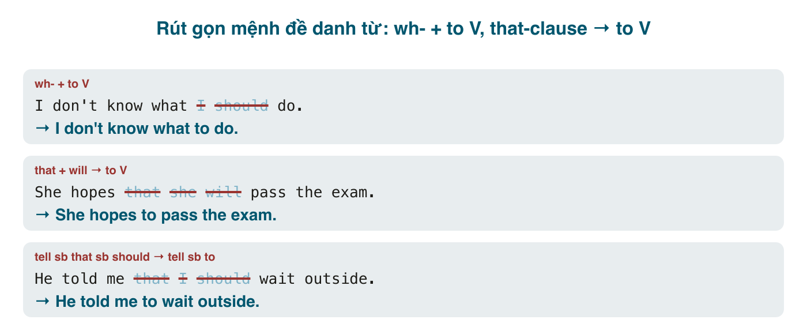

Hai bài trước rút gọn mệnh đề quan hệ (bổ nghĩa danh từ) và mệnh đề trạng ngữ (bổ nghĩa câu). Còn một loại mệnh đề nữa: **mệnh đề danh từ** (noun clause), đóng vai trò tân ngữ hoặc chủ ngữ: *I don't know **what I should do**. She hopes **that she will pass**.* Chúng cũng rút gọn được, về dạng <mark>wh- + to V</mark> và <mark>to V</mark>, và trong văn nói hằng ngày dạng rút gọn còn phổ biến hơn dạng đầy đủ.

Nửa sau bài gom các kiểu lược bỏ nhỏ khác hay gặp (so sánh, *so/not*, *to* đứng một mình, mệnh đề nối bằng *and*), rồi tổng kết cả ba bài trong một bảng và một bộ bài tập hỗn hợp.

#### Từ để hỏi + to V
Mệnh đề danh từ bắt đầu bằng <mark>what, where, when, how, which, whether, who(m)</mark> và có <mark>should/can/could</mark> (hoặc nghĩa "nên", "có thể") rút gọn thành <mark>wh- + to V</mark>, với điều kiện chủ ngữ mệnh đề danh từ **trùng với chủ ngữ hoặc tân ngữ** của mệnh đề chính.
- I don't know **what I should do**. → I don't know **what to do**. (Tôi không biết phải làm gì.)
- She asked me **where she could park**. → She asked me **where to park**.
- Can you tell me **how I can get** to the station? → Can you tell me **how to get** to the station?
- He couldn't decide **which one he should buy**. → He couldn't decide **which one to buy**.
- I'm not sure **whether I should accept** the offer. → I'm not sure **whether to accept** the offer.
- They showed us **how we could use** the system. → They showed us **how to use** the system. (chủ ngữ mệnh đề danh từ = tân ngữ *us*)

Hai điểm cần nhớ:
- <mark>why</mark> **không** rút gọn thành <mark>why to</mark>: ~~I don't know why to go~~. Nói *I don't know why I should go.*
- <mark>if</mark> cũng không: ~~I wonder if to go~~ → dùng <mark>whether to</mark>: *I wonder whether to go.*

Dạng này đi với các động từ: <mark>know, decide, wonder, ask, tell, show, explain, learn, remember, forget, understand, find out, be sure</mark>.

#### That-clause → to V
Khi chủ ngữ của mệnh đề <mark>that</mark> trùng chủ ngữ câu, và động từ chính thuộc nhóm "mong, quyết, hứa, định", rút gọn về <mark>to V</mark>.
- She hopes **that she will pass** the exam. → She hopes **to pass** the exam. (Cô ấy hy vọng đậu.)
- I expect **that I will finish** by Friday. → I expect **to finish** by Friday.
- He decided **that he would quit**. → He decided **to quit**.
- We promised **that we would help**. → We promised **to help**.
- They agreed **that they would meet** at 6. → They agreed **to meet** at 6.
- I'm glad **that I met** you. → I'm glad **to meet** you. / I'm glad **to have met** you. (xong rồi → <mark>to have V3</mark>)
- He claims **that he is** an expert. → He claims **to be** an expert.
- She seems **that she is** tired. (sai ngữ pháp từ đầu) → đúng: *It seems that she is tired.* → *She seems **to be** tired.*

Động từ nhóm này: <mark>hope, expect, decide, promise, agree, plan, intend, want, would like, claim, pretend, seem, appear, happen, be glad/sorry/happy</mark>. Khi nghĩa là việc đã xảy ra trước, dùng <mark>to have V3</mark>: *He claims **to have met** the president.* (Anh ta nói là đã gặp tổng thống.)

#### Tell/ask/want + sb + to V
Khi chủ ngữ mệnh đề danh từ **khác** chủ ngữ câu nhưng là tân ngữ của động từ, dùng <mark>V + sb + to V</mark>. Đây chính là cách tiếng Anh tường thuật mệnh lệnh và yêu cầu.
- He told me **that I should wait** outside. → He told me **to wait** outside. (Anh ấy bảo tôi đợi ngoài.)
- She asked **that we be** quiet. / She asked us **if we could be** quiet. → She asked us **to be** quiet.
- I want **that you come** early. (sai, tiếng Anh không nói thế) → I want **you to come** early.
- The doctor advised **that he should rest**. → The doctor advised **him to rest**.
- They expect **that we will deliver** by Monday. → They expect **us to deliver** by Monday.

Lỗi lớn nhất của người Việt ở đây: dịch "muốn ai làm gì" thành ~~want that sb do~~. <mark>want, would like, need, expect, allow, encourage, remind, warn, order, persuade, invite</mark> đều theo mẫu <mark>V + sb + to V</mark>, không bao giờ <mark>V + that</mark>.

#### Chủ ngữ là mệnh đề → It + to V
Mệnh đề danh từ làm chủ ngữ thường được đẩy ra sau với <mark>it</mark> và rút gọn thành <mark>to V</mark> hoặc <mark>V-ing</mark>.
- **That you learn** English is important. → **It is important to learn** English. = **Learning** English is important.
- **That he refused** surprised everyone. → **It surprised everyone that he refused.** (giữ <mark>that</mark> vì chủ ngữ khác) / **His refusing** surprised everyone. (danh động từ, văn viết)

#### Các kiểu lược bỏ nhỏ hay gặp
**1. Sau <mark>than, as</mark> trong so sánh.** Mệnh đề so sánh thường bị cắt tới mức chỉ còn chủ ngữ, hoặc tân ngữ trong văn nói.
- She is taller **than I am**. → taller **than I** (trang trọng) / taller **than me** (hội thoại, rất phổ biến).
- He works harder **than she does**. → harder **than her** / **than she does**.
- Giữ trợ động từ khi cần tránh mơ hồ: *I like you more **than he does*** (hơn anh ta thích bạn) vs. *more **than him*** (hơn tôi thích anh ta).

**2. <mark>so</mark> và <mark>not</mark> thay cho cả mệnh đề** sau <mark>think, hope, expect, suppose, guess, be afraid, believe</mark>.
- "Will it rain?" "I **hope not**." (= I hope it won't rain.) / "I **think so**." (= I think it will.)
- "Is she coming?" "I'**m afraid not**." / "I **suppose so**."
- Với <mark>think, believe, expect</mark>, phủ định hay đặt ở động từ: *I **don't think so**.* (Không nói ~~I think not~~ trừ văn trang trọng.)

**3. <mark>to</mark> đứng một mình** (ellipsis sau <mark>to</mark>), tránh lặp động từ.
- "Do you want to come?" "I'd love **to**." (= to come)
- I didn't call her, but I meant **to**.
- You can leave early if you want **to**.
- Không bỏ cả <mark>to</mark>: ~~I'd love~~ là câu cụt.

**4. Mệnh đề nối bằng <mark>and, but, or</mark>**: bỏ chủ ngữ và trợ động từ trùng.
- She **sings** and **she dances**. → She sings and dances.
- He **can read** Japanese but **he can't speak** it. → He can read Japanese but can't speak it.
- You **can pay** by card or **you can pay** in cash. → You can pay by card or in cash.

**5. Câu trả lời ngắn và câu hỏi đuôi**: *Yes, I do. / No, she hasn't. / You're coming, aren't you?* Trợ động từ thay cho cả mệnh đề.

#### Lỗi người Việt hay mắc
- **<mark>want that</mark>**: ~~I want that he comes~~ → *I want him to come.*
- **<mark>why to</mark>, <mark>if to</mark>**: ~~Tell me why to do it~~ → *Tell me why I should do it.* / ~~I don't know if to go~~ → *whether to go.*
- **Rút gọn khi chủ ngữ khác** mà không đưa chủ ngữ ra tân ngữ: *She hopes that he will pass* → ~~She hopes to pass~~ (đổi nghĩa thành cô ấy đậu). Giữ: *She hopes (that) he will pass.*
- **<mark>to V</mark> cho việc đã xảy ra**: *He claims that he met her* → ~~He claims to meet her~~ → *He claims **to have met** her.*
- **Dùng <mark>that</mark> sau động từ tri giác + to V**: ~~She seems that she is tired~~ → *She seems to be tired* / *It seems that she is tired.*
- **Bỏ luôn <mark>to</mark>**: ~~"Want to join?" "I'd love."~~ → *I'd love to.*
- **<mark>than I</mark> với động từ bị cắt gây hiểu lầm**: *My sister loves football more than I* (nghĩa: hơn tôi yêu bóng đá) vs. *more than me* (hơn yêu tôi). Khi quan trọng, viết đủ: *more than I do.*

#### Tổng kết ba bài

| Loại mệnh đề | Dấu hiệu | Điều kiện | Rút thành | Ví dụ |
|---|---|---|---|---|
| Quan hệ, chủ động | who/which/that + V | đại từ là chủ ngữ | V-ing | the man **standing** there |
| Quan hệ, bị động | who/which + be + V3 | đại từ là chủ ngữ | V3 | the book **written** by him |
| Quan hệ, thứ tự/duy nhất/khả năng | first/only/last, can/should | | to V / to be V3 | the first person **to arrive** |
| Quan hệ, tính từ/giới từ/danh từ | who/which + be + adj/prep/N | | bỏ who + be | the woman **in red** |
| Trạng ngữ thời gian | when/while/after/before | cùng chủ ngữ | (liên từ) + V-ing | **While waiting**, I read. |
| Trạng ngữ nguyên nhân | because/as/since | cùng chủ ngữ | V-ing / having V3 / V3, bỏ liên từ | **Having lost** my keys, I... |
| Trạng ngữ điều kiện/nhượng bộ | if/unless/although | cùng chủ ngữ | **giữ** liên từ + V3/adj | **If heated**, ice melts. |
| Kết quả, hành động kèm | and / which (cả mệnh đề) | | , V-ing | ..., **causing** floods. |
| Danh từ, wh- | what/where/how + should/can | chủ ngữ trùng S hoặc O | wh- + to V | what **to do** |
| Danh từ, that | hope/decide/promise + that | cùng chủ ngữ | to V / to have V3 | hope **to pass** |
| Danh từ, yêu cầu | tell/want/ask + that sb | chủ ngữ khác | V + sb + to V | told me **to wait** |

Hai câu hỏi xuyên suốt cả ba bài: **ai làm?** (quyết định có rút gọn được không, và rút gọn về chủ động hay bị động) và **nghĩa còn rõ không?** (quyết định có nên rút gọn không). Rút gọn là công cụ cho văn gọn, không phải mục tiêu; một câu đầy đủ rõ nghĩa luôn tốt hơn một câu rút gọn mơ hồ.

#### Bài tập hỗn hợp
1. I can't decide what I should wear to the party. → I can't decide what to wear to the party.
2. She promised that she would call me back. → She promised to call me back.
3. The teacher told us that we should read chapter 3. → The teacher told us to read chapter 3.
4. He pretends that he knows everything. → He pretends to know everything.
5. She claims that she saw a UFO last night. → She claims to have seen a UFO last night.
6. I wonder if I should tell him the truth. → I wonder whether to tell him the truth.
7. "Do you think it will rain?" "I hope it won't." → "I hope not."
8. "Can you come to the meeting?" "I'd like to come, but I can't." → "I'd like to, but I can't."
9. (Bài 189) The students who were selected for the program will fly to Singapore. → The students selected for the program will fly to Singapore.
10. (Bài 190) Because we didn't want to miss the train, we left early. → Not wanting to miss the train, we left early.
11. (Bài 190) The river flooded the town, and this forced thousands to evacuate. → The river flooded the town, forcing thousands to evacuate.
12. (Bài 189) He was the only one who survived the crash. → He was the only one to survive the crash.
13. Sửa lỗi: *My boss wants that I work on Saturday.* → My boss wants me to work on Saturday.
14. Sửa lỗi: *I don't know why to learn this.* → I don't know why I should learn this.
15. Sửa lỗi: *She hopes to pass the exam, but her brother doesn't think so he will.* → She hopes to pass the exam, but her brother doesn't think he will. (hoặc: ...but her brother doesn't think so.)
16. Sửa lỗi: *Walking into the office, the printer was on fire.* → Walking into the office, I saw that the printer was on fire.
17. Dịch: "Anh ấy dạy tôi cách sửa xe." → He taught me how to fix a motorbike.
18. Dịch: "Tôi định nghỉ việc cuối năm nay." → I intend to quit my job at the end of this year.
19. Dịch: "Mẹ nhắc tôi khóa cửa." → My mother reminded me to lock the door.
20. Dịch: "Những người sống gần sông được yêu cầu sơ tán." → People living near the river were asked to evacuate.

#### Tóm tắt
- <mark>wh- + to V</mark> khi có nghĩa "nên/có thể" và chủ ngữ trùng; không có <mark>why to</mark>, <mark>if to</mark>.
- <mark>hope/decide/promise + to V</mark> khi cùng chủ ngữ; việc đã xảy ra → <mark>to have V3</mark>.
- Khác chủ ngữ → <mark>tell/want/ask + sb + to V</mark>, không bao giờ <mark>want that</mark>.
- Lược bỏ nhỏ: *than me, I hope not, I'd love to, sings and dances.*
- Cả ba bài quy về hai câu hỏi: **ai làm?** và **nghĩa còn rõ không?**
