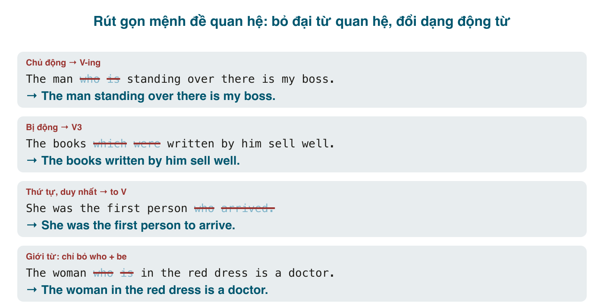

*The man who is standing over there* và *the man standing over there* nghĩa như nhau; câu sau ngắn hơn hai chữ. Nhân lên cả bài viết, "rút gọn mệnh đề" (reduced clauses) là thứ làm cho văn tiếng Anh của người bản xứ gọn và trôi, còn văn của người học thì dài và lặp *who is, which was, because he, when she*. Nó cũng là một trong những điểm ngữ pháp được hỏi nhiều nhất trong đề thi THPT và là tiêu chí "range of grammatical structures" trong IELTS Writing.

Series ngắn này có ba bài: rút gọn mệnh đề quan hệ (bài này), rút gọn mệnh đề trạng ngữ (bài 190, cái mà sách Việt hay gọi là "mệnh đề phân từ"), và rút gọn mệnh đề danh từ cộng tổng kết (bài 191). Tôi giả định bạn đã đọc hai bài về mệnh đề quan hệ (bài 187 và 188) và nắm các thì (bài 174 tới 185).

#### Điều kiện tiên quyết: đại từ quan hệ phải là chủ ngữ
Mệnh đề quan hệ chỉ rút gọn được khi đại từ quan hệ (<mark>who, which, that</mark>) làm **chủ ngữ** của mệnh đề đó. Cách kiểm tra: ngay sau đại từ quan hệ là động từ thì nó là chủ ngữ.
- The man **who is** standing there... (sau <mark>who</mark> là <mark>is</mark> → chủ ngữ → rút gọn được.)
- The man **who I** met yesterday... (sau <mark>who</mark> là <mark>I</mark> → <mark>who</mark> là tân ngữ → **không** rút gọn theo kiểu bài này; chỉ được *bỏ* đại từ: *The man I met yesterday*.)

Hai chuyện khác nhau: **bỏ đại từ tân ngữ** (*the book I bought*) là lược bỏ, còn **rút gọn** là bỏ đại từ chủ ngữ *và* đổi dạng động từ. Bài này nói về chuyện thứ hai.

#### Cách 1: chủ động → V-ing
Bỏ đại từ quan hệ, bỏ <mark>be</mark> nếu có, đưa động từ chính về <mark>V-ing</mark>. Áp dụng cho mọi thì chủ động: đơn, tiếp diễn, quá khứ, hiện tại.
- The woman **who is talking** to Nam is my aunt. → The woman **talking** to Nam is my aunt. (Người phụ nữ đang nói chuyện với Nam là dì tôi.)
- Students **who want** to join must register. → Students **wanting** to join must register. (Sinh viên muốn tham gia phải đăng ký.)
- The train **which leaves** at 6 is always full. → The train **leaving** at 6 is always full.
- Anyone **who knows** the answer can email me. → Anyone **knowing** the answer can email me.

Chú ý: với động từ trạng thái (<mark>want, know, have, live</mark>), mệnh đề quan hệ không chia tiếp diễn (~~who is wanting~~), nhưng rút gọn thì vẫn dùng <mark>V-ing</mark> (*wanting, knowing*). Đây không phải thì tiếp diễn; <mark>V-ing</mark> ở đây là phân từ hiện tại, chỉ mang nghĩa chủ động.

Rút gọn làm **mất thông tin thì**: *the students **studying** hard* có thể là "đang học", "học" hay "đã học". Nếu thì quan trọng cho nghĩa, giữ nguyên mệnh đề.

#### Cách 2: bị động → V3
Bỏ đại từ quan hệ và <mark>be</mark>, giữ <mark>V3</mark>.
- The books **which were written** by him sell well. → The books **written** by him sell well. (Sách ông ấy viết bán chạy.)
- The house **that was built** in 1900 needs repairs. → The house **built** in 1900 needs repairs.
- Cars **which are made** in Japan are reliable. → Cars **made** in Japan are reliable.
- The people **who were injured** in the crash were taken to hospital. → The people **injured** in the crash...

Với bị động tiếp diễn giữ <mark>being</mark>: The bridge **which is being built** → The bridge **being built** over the river will open next year.

Đây là chỗ người Việt sai nhiều nhất: chọn <mark>V-ing</mark> hay <mark>V3</mark>. Hỏi một câu: danh từ đứng trước **tự làm** hành động hay **bị** hành động? *The man **calling** me* (ông ấy gọi) vs. *The man **called** Nam* (ông ấy được gọi là Nam). *The boy **breaking** the window* (nó đập) vs. *The window **broken** by the boy* (cửa bị đập).

#### Cách 3: to-infinitive
Dùng <mark>to V</mark> (chủ động) hoặc <mark>to be V3</mark> (bị động) khi danh từ đứng trước có:
- **Số thứ tự, <mark>last, next, only</mark>, so sánh nhất**: *She was the **first** person **who arrived**.* → *the first person **to arrive**.* / *He is the **only** one **who understands** it.* → *the only one **to understand** it.* / *This is the **best** restaurant **that you can find** here.* → *the best restaurant **to find** here.*
- **Nghĩa "có thể", "nên", "phải", mục đích** (mệnh đề gốc có <mark>can, should, must</mark> hoặc <mark>be to</mark>): *I have some work **that I must do**.* → *some work **to do**.* / *She needs a place **where she can stay**.* → *a place **to stay**.* / *There's nothing **that we can eat**.* → *nothing **to eat**.*
- Bị động: *He is the first man **who was sent** to space.* → *the first man **to be sent** to space.* / *There are three reports **that must be finished** today.* → *three reports **to be finished** today.* (Trong văn nói, *three reports to finish* cũng chấp nhận.)

Khi chủ ngữ của mệnh đề quan hệ khác chủ ngữ câu, thêm <mark>for + sb</mark>: *This is the book **that you should read**.* → *This is the book **for you to read**.*

#### Cách 4: tính từ, cụm giới từ, danh từ đồng vị
Khi mệnh đề quan hệ là <mark>who/which + be + tính từ/cụm giới từ/danh từ</mark>, chỉ cần bỏ đại từ và <mark>be</mark>.
- Tính từ, một từ thì đưa ra **trước** danh từ: *a woman **who is beautiful*** → *a **beautiful** woman*. Cụm tính từ dài thì để sau: *the students **who are interested in** AI* → *the students **interested in** AI*; *the man **who is responsible for** this* → *the man **responsible for** this*. (Cụm tính từ ở sau trông giống V3, nhưng *interested, responsible* ở đây là tính từ.)
- Cụm giới từ: *The woman **who is in** the red dress* → *The woman **in** the red dress*. / *The book **which is on** the table is mine.* → *The book **on** the table is mine.*
- Danh từ đồng vị (appositive), thường trong mệnh đề không xác định có dấu phẩy: *Hanoi, **which is** the capital of Vietnam, ...* → *Hanoi, the capital of Vietnam, ...* / *Mr. Long, **who is** our new manager, ...* → *Mr. Long, our new manager, ...*

Mẹo: với cách 4 chỉ bỏ <mark>who/which + be</mark>, không thêm bớt gì khác. Lỗi ~~The woman being in the red dress~~ hay gặp: không cần <mark>being</mark> vì phần còn lại đã là cụm giới từ hoàn chỉnh.

#### Mệnh đề xác định và không xác định
Cả hai loại đều rút gọn được; dấu phẩy giữ nguyên như câu gốc.
- Xác định (không phẩy): *The students **who failed** the test* → *The students **failing** the test must retake it.*
- Không xác định (có phẩy): *My brother, **who lives** in Hue, is a teacher.* → *My brother, **living** in Hue, is a teacher.* (Đúng ngữ pháp nhưng hơi văn viết; văn nói giữ nguyên.)

Rút gọn với <mark>V3</mark> và danh từ đồng vị trong mệnh đề không xác định thì rất tự nhiên: *The report, **submitted** last week, was rejected.* / *Pho, **a Vietnamese noodle soup**, is popular worldwide.*

#### Khi nào không nên rút gọn
- Đại từ quan hệ là **tân ngữ** (*the man who I met*): không có gì để đổi dạng.
- Mệnh đề có <mark>whose</mark> (*the man whose car was stolen*): không rút gọn được.
- Rút gọn làm **mất nghĩa thì** cần thiết: *the people who **will attend*** ≠ *the people **attending*** nếu người đọc cần biết là tương lai. Trường hợp đó giữ nguyên hoặc dùng *the people due to attend*.
- Sau rút gọn mà **mơ hồ**: *I saw the man walking the dog* có thể hiểu "tôi, đang dắt chó, thấy ông ấy" hoặc "ông ấy đang dắt chó". Nếu ngữ cảnh không làm rõ, giữ *who was walking*.
- Nhiều phân từ liên tiếp đọc rất mệt: *the man standing there holding a sign saying "free hugs"* đúng, nhưng viết lại thành hai câu thì dễ đọc hơn.

#### Lỗi người Việt hay mắc
- **Chọn sai V-ing / V3**: ~~The letter writing by her~~ → *written* (thư bị viết); ~~The man calling Nam is my uncle~~ khi ý là "ông tên Nam" → *called Nam*.
- **Giữ <mark>be</mark>**: ~~The man is standing there is my boss~~ (giờ câu có hai động từ chính). Phải bỏ <mark>is</mark>: *The man standing there is my boss.*
- **Giữ đại từ**: ~~The man who standing there~~. Bỏ đại từ **cùng với** <mark>be</mark>, hoặc giữ cả hai.
- **Thêm <mark>being</mark> thừa**: ~~the book being on the table~~, ~~the students being interested in AI~~ → *the book on the table, the students interested in AI*. Chỉ giữ <mark>being</mark> cho bị động tiếp diễn (*the bridge being built*).
- **Rút gọn mệnh đề có đại từ tân ngữ**: *The movie which I watched* → ~~The movie watching~~ hay ~~The movie watched~~ (câu sau đổi nghĩa thành "bị xem"). Đúng: *The movie I watched.*
- **Quên <mark>to be</mark> cho bị động ở cách 3**: *the first man who was sent* → ~~the first man to send~~ (nghĩa thành ông ấy gửi) → *to be sent*.

#### Bài tập
Rút gọn mệnh đề quan hệ nếu có thể; nếu không, nói vì sao.

1. The students who are studying in the library are preparing for the exam. → The students studying in the library are preparing for the exam.
2. The car which was stolen last night has been found. → The car stolen last night has been found.
3. He was the last person who left the office. → He was the last person to leave the office.
4. The girl who is sitting next to me is from Hue. → The girl sitting next to me is from Hue.
5. The man who I spoke to was very helpful. → Không rút gọn được (who là tân ngữ). Chỉ bỏ đại từ: The man I spoke to was very helpful.
6. Do you have anything that I can read on the plane? → Do you have anything to read on the plane? (hoặc: anything for me to read)
7. The vase which is on the shelf was a gift. → The vase on the shelf was a gift.
8. Ho Chi Minh City, which is the largest city in Vietnam, has 9 million people. → Ho Chi Minh City, the largest city in Vietnam, has 9 million people.
9. The bridge which is being repaired will reopen in May. → The bridge being repaired will reopen in May.
10. People who live in glass houses shouldn't throw stones. → People living in glass houses shouldn't throw stones.
11. She is the only student who has passed all the tests. → She is the only student to have passed all the tests. (hoặc đơn giản hơn: the only student to pass all the tests)
12. Sửa lỗi: *The email sending yesterday had the wrong attachment.* → The email sent yesterday had the wrong attachment.
13. Sửa lỗi: *The woman who standing at the door is waiting for you.* → The woman standing at the door... (hoặc The woman who is standing...)
14. Sửa lỗi: *The man being in the blue shirt is my father.* → The man in the blue shirt is my father.
15. Dịch: "Những người làm việc ở đây đều nói tiếng Anh." → The people working here all speak English.
16. Dịch: "Sản phẩm được bán ở cửa hàng này đều nhập từ Nhật." → The products sold in this shop are all imported from Japan.

#### Tóm tắt
- Chỉ rút gọn khi đại từ quan hệ là **chủ ngữ**. Bỏ đại từ, bỏ <mark>be</mark>, đổi dạng động từ.
- Chủ động → <mark>V-ing</mark>; bị động → <mark>V3</mark> (hỏi: danh từ *làm* hay *bị*?).
- Số thứ tự, <mark>only/last/next</mark>, so sánh nhất, nghĩa "có thể/nên/phải" → <mark>to V</mark> / <mark>to be V3</mark>.
- <mark>who/which + be + tính từ/giới từ/danh từ</mark>: chỉ bỏ đại từ và <mark>be</mark>, không thêm <mark>being</mark>.
- Bài 190: rút gọn mệnh đề trạng ngữ, nơi quy tắc "cùng chủ ngữ" quyết định tất cả.
