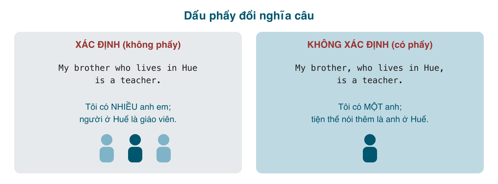

*My brother who lives in Hue is a teacher* và *My brother, who lives in Hue, is a teacher* khác nhau đúng hai dấu phẩy, và khác nhau về số anh em tôi có. Câu đầu nói tôi có nhiều anh em, và người ở Huế là giáo viên. Câu sau nói tôi có một anh, anh ấy là giáo viên, tiện thể kể thêm là anh ở Huế. Tiếng Việt không có cơ chế này; ta nói "anh tôi ở Huế" và để ngữ cảnh lo phần còn lại. Tiếng Anh viết thì đặt gánh nặng đó lên dấu phẩy.

Bài này nói về hai loại mệnh đề quan hệ đó, những luật kéo theo (khi nào không được dùng <mark>that</mark>, khi nào không được bỏ đại từ), rồi đến các dạng hay gặp trong văn viết: <mark>which</mark> chỉ cả mệnh đề trước, <mark>some of whom</mark>, <mark>what</mark>, và mệnh đề quan hệ với <mark>all, everything, the only</mark>.

#### Mệnh đề xác định (defining, restrictive)
Mệnh đề **cần thiết để biết đang nói về ai, cái gì**. Bỏ đi thì câu mất nghĩa hoặc đổi nghĩa. Không có dấu phẩy.
- The students **who failed the test** must retake it. (Chỉ những sinh viên rớt; bỏ mệnh đề đi thành "mọi sinh viên phải thi lại", sai ý.)
- I don't like films **that are longer than three hours**.
- The woman **who called you** didn't leave her name.

Trong mệnh đề xác định:
- Dùng được <mark>who, which, that, whose, where, when, why</mark>; <mark>that</mark> rất phổ biến.
- Đại từ tân ngữ **bỏ được**: *the film (that) we saw*.
- Mệnh đề có thể rút gọn theo cả bốn cách của bài 189.

#### Mệnh đề không xác định (non-defining, non-restrictive)
Danh từ phía trước **đã rõ là ai, cái gì** (tên riêng, danh từ duy nhất, *my mother*, *the Eiffel Tower*, hoặc đã nhắc đến trước đó); mệnh đề chỉ **thêm thông tin phụ**. Bỏ đi câu vẫn nguyên nghĩa. Có dấu phẩy ở hai đầu (hoặc một dấu phẩy nếu mệnh đề ở cuối câu).
- My mother, **who is 70**, still runs every morning. (Mẹ tôi, năm nay 70, vẫn chạy bộ mỗi sáng.)
- Hanoi, **which is the capital of Vietnam**, has a population of 8 million.
- We stayed at the Rex Hotel, **where the press briefings were held during the war**.
- I lent the book to Lan, **who returned it the next day**.

Trong mệnh đề không xác định, ba luật khác hẳn:
- **Không dùng <mark>that</mark>**: ~~My mother, that is 70, ...~~ → *who*. ~~Hanoi, that is...~~ → *which*.
- **Không bỏ đại từ**, kể cả tân ngữ: ~~I lent the book to Lan, returned it the next day~~ → *who returned it*. ~~My boss, I respect a lot, ...~~ → *whom/who I respect a lot*.
- Trong văn nói, dấu phẩy thành **ngắt giọng nhẹ** trước và sau mệnh đề.

#### Cùng một câu, hai nghĩa

| Không phẩy (xác định) | Có phẩy (không xác định) |
|---|---|
| The employees **who worked overtime** got a bonus. (Chỉ ai làm thêm giờ mới có thưởng.) | The employees, **who worked overtime**, got a bonus. (Tất cả nhân viên đều làm thêm giờ, và tất cả được thưởng.) |
| She has a son **who is a doctor**. (Có thể có con khác.) | She has a son, **who is a doctor**. (Chỉ có một con trai.) |
| The bridge **which was built in 1900** collapsed. (Có nhiều cầu; cái 1900 sập.) | The bridge, **which was built in 1900**, collapsed. (Cây cầu đang nói tới sập; tiện thể, nó xây 1900.) |

Quy tắc chọn: hỏi **"cái nào?"** Nếu mệnh đề quan hệ là câu trả lời cho "cái nào?" thì nó xác định, không phẩy. Nếu người nghe đã biết cái nào rồi (tên riêng, *my mother*, *the sun*, *this phone*), mệnh đề là không xác định, có phẩy.

Tên riêng và danh từ duy nhất **gần như luôn** đi với mệnh đề không xác định: *Da Nang, which...*, *Messi, who...*, *the Internet, which...*. Ngoại lệ là khi cố tình phân biệt hai người cùng tên: *the Nguyen Van A who works in sales* (chứ không phải Nguyễn Văn A bên kế toán).

#### which chỉ cả mệnh đề trước
Trong mệnh đề không xác định, <mark>which</mark> có thể thay cho **cả ý của mệnh đề trước**, chứ không chỉ một danh từ. Luôn có dấu phẩy, và luôn là <mark>which</mark> (không <mark>that</mark>, không <mark>what</mark>).
- He arrived on time, **which surprised everyone**. (Anh ấy đến đúng giờ, điều đó làm mọi người ngạc nhiên.)
- The train was cancelled, **which meant we had to take a taxi**. (Tàu bị hủy, nghĩa là bọn tôi phải đi taxi.)
- She passed the exam, **which I knew she would**.

Người Việt dịch "điều đó" thành ~~what~~ hoặc ~~that~~: ~~He arrived on time, what surprised everyone~~. Đây là lỗi hay gặp vì tiếng Đức, tiếng Tây Ban Nha dùng từ tương đương "what", nhưng tiếng Anh thì không. Cách rút gọn của câu này (*He arrived on time, **surprising** everyone*) ở bài 190.

#### Lượng từ + of + whom/which
Trong văn viết, để nói "một số trong đó", "hầu hết trong số họ", dùng <mark>some/most/many/all/none/one/two/half/the majority + of + whom/which</mark>. Luôn có dấu phẩy, luôn không xác định.
- We interviewed 20 candidates, **most of whom** had no experience. (Phỏng vấn 20 ứng viên, hầu hết không có kinh nghiệm.)
- He has three cars, **one of which** is a Tesla.
- The company has 500 employees, **half of whom** work remotely.
- She gave me a list of books, **none of which** I had read.
- The project has two phases, **the first of which** starts in May.

Đây là cách gộp hai câu *We interviewed 20 candidates. Most of them had no experience.* Người Việt hay viết ~~most of them had~~ ngay sau dấu phẩy (comma splice, hai câu dính nhau bằng phẩy). Hễ sau phẩy mà muốn nói "trong số đó", đổi <mark>them</mark> thành <mark>whom</mark>, <mark>it</mark> thành <mark>which</mark>.

Cũng dùng được với <mark>whose</mark> và danh từ: *a company **whose** CEO...*; và với danh từ + <mark>of which</mark>: *a book, **the title of which** I've forgotten* (trang trọng; văn nói: *a book whose title I've forgotten*).

#### what = the thing(s) that
<mark>what</mark> **không** phải đại từ quan hệ; nó là "cái mà", đã gồm sẵn danh từ bên trong (= *the thing that*). Vì vậy <mark>what</mark> **không đứng sau danh từ**.
- I didn't understand **what** he said. (= the things that he said)
- **What** I need is a holiday. (= The thing that I need)
- ~~Everything what he said was true.~~ → *Everything **that** he said* (đã có danh từ *everything*, dùng <mark>that</mark>).
- ~~The thing what I need~~ → *The thing **that** I need* hoặc *What I need*.

#### Khi nào ưu tiên that
Trong mệnh đề xác định, <mark>that</mark> được ưu tiên (hoặc bắt buộc) sau:
- <mark>everything, something, anything, nothing, all, little, much</mark>: *Everything **that** happened was my fault.* / *There's nothing **that** we can do.*
- So sánh nhất, <mark>the only, the first, the last</mark>: *It's the best film **that** I've ever seen.* / *She was the only person **that** understood.*
- Danh từ hỗn hợp người + vật: *the people and the places **that** I remember.*

Và sau giới từ, trong mệnh đề không xác định, và khi chỉ cả mệnh đề trước, **không** dùng <mark>that</mark> (xem các mục trên).

#### Mệnh đề quan hệ lồng và dài
Khi mệnh đề quan hệ nằm giữa chủ ngữ và động từ chính, câu dài rất dễ rụng động từ chính hoặc chia sai số:
- The report **that the committee, which was formed last year, published** **is** 200 pages long. (Chủ ngữ *the report*, động từ chính *is*.)

Mẹo: viết xong, che mệnh đề quan hệ lại (từ đại từ quan hệ tới trước động từ chính) và đọc phần còn lại: *The report is 200 pages long.* Nếu phần còn lại không thành câu, bạn đã rụng động từ. Nếu một câu có hơn hai mệnh đề quan hệ, tách thành hai câu; đây là lời khuyên cho cả người bản xứ.

#### Lỗi người Việt hay mắc
- **Thiếu dấu phẩy với tên riêng, danh từ duy nhất**: ~~Da Nang which is my hometown is beautiful~~ → *Da Nang, which is my hometown, is beautiful.*
- **Thừa dấu phẩy ở mệnh đề xác định**: ~~The students, who failed the test, must retake it~~ khi ý là chỉ những ai rớt. Dấu phẩy biến câu thành "tất cả đều rớt".
- **<mark>that</mark> sau dấu phẩy**: ~~My father, that is a doctor, ...~~ → *who*.
- **Bỏ đại từ trong mệnh đề không xác định**: ~~Lan, I met at the conference, is a designer~~ → *Lan, **who(m)** I met...*
- **<mark>what</mark> thay cho <mark>which</mark> chỉ cả câu**: ~~She was late, what annoyed me~~ → *which annoyed me*.
- **<mark>what</mark> sau danh từ**: ~~all what I know~~ → *all (that) I know*.
- **Comma splice với <mark>them/it</mark>**: ~~We have 10 servers, three of them are down~~ → *three of **which** are down*, hoặc tách thành hai câu.
- **Chỉ một dấu phẩy** cho mệnh đề không xác định ở giữa câu: ~~My mother, who is 70 still runs~~ → cần phẩy sau *70*.

#### Bài tập
Thêm dấu phẩy nếu cần, chọn từ nối, hoặc sửa lỗi.

1. My sister who lives in Canada is visiting next month. (Tôi chỉ có một chị.) → My sister, who lives in Canada, is visiting next month.
2. The people who live near the airport complain about the noise. → Giữ nguyên, không phẩy (xác định: chỉ những người sống gần sân bay).
3. Mount Fansipan which is the highest mountain in Vietnam attracts many hikers. → Mount Fansipan, which is the highest mountain in Vietnam, attracts many hikers.
4. We visited a temple that was built in the 11th century. → Giữ nguyên (xác định; "a temple" chưa rõ là ngôi nào).
5. She didn't reply to my email ______ was quite rude. → , which (chỉ cả việc không trả lời)
6. The team has eight developers ______ are from Vietnam. (sáu người) → , six of whom
7. I didn't believe ______ he told me. → what (= the things that)
8. Everything ______ you need is in this folder. → that (hoặc bỏ)
9. Sửa lỗi: *My boss, that I've worked with for five years, is retiring.* → My boss, who(m) I've worked with for five years, is retiring.
10. Sửa lỗi: *The company launched three products last year, two of them failed.* → ..., two of which failed. (hoặc: last year. Two of them failed.)
11. Sửa lỗi: *He forgot my birthday, what made me sad.* → He forgot my birthday, which made me sad.
12. Sửa lỗi: *The only thing what matters is the result.* → The only thing that matters is the result.
13. Sửa lỗi: *Pho which is Vietnam's most famous dish, is eaten for breakfast.* → Pho, which is Vietnam's most famous dish, is eaten for breakfast. (thiếu phẩy đầu)
14. Hai câu sau khác nghĩa thế nào? *The workers who went on strike were fired.* / *The workers, who went on strike, were fired.* → Câu 1: chỉ những công nhân đình công bị sa thải (có người không đình công). Câu 2: toàn bộ công nhân đình công, và toàn bộ bị sa thải.
15. Ghép: *I have two laptops. One of them is for work.* → I have two laptops, one of which is for work.
16. Dịch: "Chị tôi, hiện sống ở Nhật, là bác sĩ." → My sister, who lives in Japan, is a doctor.
17. Dịch: "Anh ấy đến trễ, điều này làm sếp bực." → He arrived late, which annoyed the boss.
18. Dịch: "Chúng tôi có 50 khách hàng, hầu hết là doanh nghiệp nhỏ." → We have 50 clients, most of whom are small businesses.

#### Tóm tắt
- Hỏi "cái nào?": mệnh đề trả lời được → **xác định, không phẩy**; danh từ đã rõ (tên riêng, *my mother*) → **không xác định, có phẩy**.
- Không xác định: không <mark>that</mark>, không bỏ đại từ, phẩy ở cả hai đầu khi nằm giữa câu.
- <mark>, which</mark> chỉ cả mệnh đề trước; <mark>, most of whom / one of which</mark> thay cho "most of them / one of it".
- <mark>what</mark> = *the thing that*, không đứng sau danh từ. Sau <mark>everything, the only, so sánh nhất</mark> dùng <mark>that</mark>.
- Bài 189: rút gọn mệnh đề quan hệ, biến *who is standing* thành *standing*.
