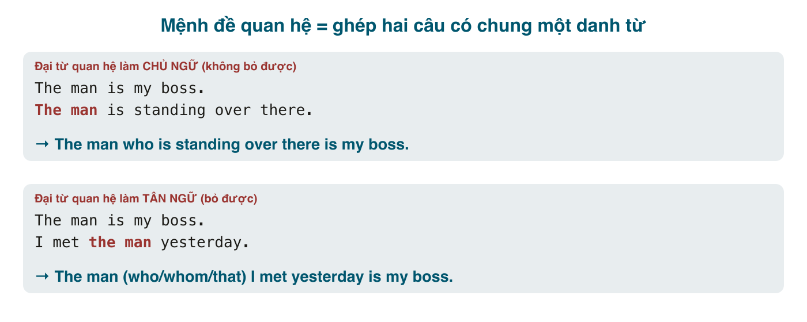

Tiếng Việt nối hai ý về cùng một người bằng chữ "mà" hoặc chẳng bằng gì cả: *người đàn ông (mà) tôi gặp hôm qua*, *cái xe (mà) anh mua*. Tiếng Anh thì có hẳn một bộ đại từ cho việc này: <mark>who, whom, which, that, whose</mark>, cộng ba trạng từ <mark>where, when, why</mark>, và mỗi từ có luật riêng về khi nào dùng, khi nào bỏ được, khi nào phải có dấu phẩy. Cụm đó gọi là **mệnh đề quan hệ** (relative clause), và là cấu trúc xuất hiện trong gần như mọi câu dài của tiếng Anh viết.

Hai bài về mệnh đề quan hệ này là nền cho ba bài rút gọn mệnh đề (bài 189 tới 191). Bài 1 nói về **chọn đúng từ nối** và **khi nào được bỏ**; bài 2 (bài 188) nói về **dấu phẩy**, tức mệnh đề xác định và không xác định, cùng các trường hợp đặc biệt.

#### Mệnh đề quan hệ là gì
Là một mệnh đề (có chủ ngữ, động từ) đứng **ngay sau một danh từ** để nói rõ danh từ đó là ai, là cái gì. Nó được tạo ra bằng cách ghép hai câu có chung một danh từ:

Đại từ quan hệ (<mark>who</mark>, <mark>that</mark>...) làm hai việc cùng lúc: **thay thế** danh từ bị lặp và **nối** hai câu. Vì nó đã thay cho danh từ, nên trong mệnh đề quan hệ **không được lặp lại** danh từ hay đại từ đó nữa. Đây là lỗi số một của người Việt: ~~The man who I met him yesterday~~. Chữ <mark>who</mark> đã là "him" rồi.

#### Bảng chọn từ nối

| Từ | Thay cho | Vai trò trong mệnh đề | Ví dụ |
|---|---|---|---|
| <mark>who</mark> | người | chủ ngữ (và tân ngữ trong văn nói) | the woman **who** called you |
| <mark>whom</mark> | người | tân ngữ (trang trọng), sau giới từ | the woman **whom** I called / to **whom** I spoke |
| <mark>which</mark> | vật, con vật, ý | chủ ngữ hoặc tân ngữ | the book **which** I bought |
| <mark>that</mark> | người hoặc vật | chủ ngữ hoặc tân ngữ, chỉ trong mệnh đề xác định | the book **that** I bought / the man **that** called |
| <mark>whose</mark> | sở hữu (của người, vật) | đứng trước danh từ | the man **whose** car was stolen |
| <mark>where</mark> | nơi chốn (= in/at which) | trạng ngữ | the café **where** we met |
| <mark>when</mark> | thời gian (= on/in which) | trạng ngữ | the day **when** we met |
| <mark>why</mark> | lý do (sau *the reason*) | trạng ngữ | the reason **why** she left |

**who / which / that.** Trong mệnh đề xác định (không dấu phẩy, xem bài 188), <mark>that</mark> dùng được cho cả người lẫn vật, và trong văn nói <mark>that</mark> phổ biến hơn <mark>which</mark>. Người dùng <mark>who</mark> hoặc <mark>that</mark>; vật dùng <mark>which</mark> hoặc <mark>that</mark>.
- The people **who/that** live next door are from Hue. (Những người sống cạnh nhà là người Huế.)
- The phone **which/that** I bought last week is already broken. (Cái điện thoại tôi mua tuần trước đã hỏng.)

**whom.** Dạng tân ngữ của <mark>who</mark>. Trong văn nói gần như chỉ còn <mark>who</mark> hoặc bỏ luôn; <mark>whom</mark> sống trong văn viết trang trọng và **bắt buộc** ngay sau giới từ: *the person **to whom** I spoke*, *the colleague **with whom** I share an office*.

**whose.** Thay cho <mark>his/her/their/its</mark> + danh từ. Luôn có danh từ theo sau. Dùng cho cả người lẫn vật.
- I know a man. **His** brother is a pilot. → I know a man **whose brother** is a pilot. (Tôi biết một người có anh là phi công.)
- This is the company. **Its** products are everywhere. → This is the company **whose products** are everywhere.
- Không nhầm với <mark>who's</mark> (= who is / who has): *the man **who's** standing there* (đang đứng) vs. *the man **whose** car is there* (có xe).

**where / when / why.** Thay cho **giới từ + which**. Không thay cho chủ ngữ hay tân ngữ.
- This is the café. We met **in** the café. → This is the café **where** we met. = the café **in which** we met. = the café **(that)** we met **in**.
- I remember the day. I met you **on** that day. → I remember the day **when** I met you. = the day **on which** I met you. = the day **(that)** I met you.
- That's the reason. She left **for** that reason. → That's the reason **why** she left. = the reason **(that)** she left.

Kiểm tra nhanh để biết dùng <mark>where</mark> hay <mark>which</mark>: nếu mệnh đề quan hệ đã **đủ chủ ngữ và tân ngữ**, danh từ chỉ là nơi chốn, dùng <mark>where</mark>; nếu mệnh đề **thiếu** chủ ngữ hoặc tân ngữ và danh từ điền vào chỗ đó, dùng <mark>which</mark>. *The city **where** I was born* (I was born: đủ, thành phố chỉ là nơi) vs. *The city **which** I visited* (I visited ___: thiếu tân ngữ, thành phố điền vào). Lỗi ~~the city where I visited~~ rất phổ biến.

#### Chủ ngữ hay tân ngữ: quyết định có bỏ đại từ được không
Đây là điểm quan trọng nhất của bài. Đại từ quan hệ có thể là **chủ ngữ** hoặc **tân ngữ** của mệnh đề quan hệ. Cách kiểm tra: nhìn từ ngay sau đại từ quan hệ.
- Sau nó là **động từ** → đại từ là chủ ngữ. *The man **who is** standing there* / *the bus **that goes** to the airport*.
- Sau nó là **danh từ hoặc đại từ** (một chủ ngữ khác) → đại từ là tân ngữ. *The man **who I** met* / *the bus **that we** took*.

Luật: **đại từ tân ngữ bỏ được, đại từ chủ ngữ thì không** (trong mệnh đề xác định).
- The man **(who)** I met yesterday is my boss. (Bỏ được, và trong văn nói người ta bỏ.)
- The film **(that)** we watched was boring.
- The man **who** is standing there is my boss. (Không bỏ: ~~The man is standing there is my boss~~ thành câu hai động từ chính.)
- The bus **that** goes to the airport leaves at 6. (Không bỏ.)

Đại từ sau giới từ cũng bỏ được nếu giới từ chuyển ra cuối: *the house **in which** I grew up* → *the house **(which/that)** I grew up **in***. Dạng giới từ cuối là dạng tự nhiên trong văn nói.

<mark>whose</mark> không bao giờ bỏ. <mark>where, when, why</mark>: <mark>when</mark> và <mark>why</mark> hay bỏ (*the day I met you*, *the reason she left*); <mark>where</mark> thì không bỏ trừ khi thay bằng <mark>that ... in</mark>.

#### Giới từ trong mệnh đề quan hệ
Khi động từ trong mệnh đề quan hệ cần giới từ (*talk **to**, look **for**, live **in**, work **with***), có hai chỗ để đặt nó:
1. **Cuối mệnh đề**, văn nói, dùng <mark>who/that/which</mark> hoặc bỏ: *the woman **(who)** I talked **to***, *the keys **(that)** I'm looking **for***.
2. **Trước đại từ**, văn viết trang trọng, bắt buộc <mark>whom/which</mark>, không dùng <mark>that</mark> hoặc <mark>who</mark>: *the woman **to whom** I talked*, *the keys **for which** I'm looking* (câu này nghe cứng, người bản xứ cũng tránh). ~~to who~~, ~~in that~~ là sai.

Không dùng **cả hai** chỗ: ~~the house in which I grew up in~~. Và không bỏ giới từ: ~~the woman I talked~~ (thiếu *to*). Người Việt hay rơi vào lỗi thứ hai vì tiếng Việt nói "người tôi nói chuyện" không cần "với".

#### Vị trí và hòa hợp
- Mệnh đề quan hệ đứng **ngay sau** danh từ nó bổ nghĩa. Để xa là đổi nghĩa: *I gave the book to my sister **that I bought yesterday*** nghe như mua em gái; phải là *I gave the book **that I bought yesterday** to my sister.*
- Động từ trong mệnh đề quan hệ **chia theo danh từ đứng trước** (danh từ mà đại từ thay thế): *the student **who studies** hard*, *the students **who study** hard*, *one of the students **who study** hard* (các sinh viên học chăm, số nhiều).
- Mệnh đề quan hệ có thể chen vào giữa chủ ngữ và động từ của câu chính; đừng quên động từ chính: *The man **who lives next door** **is** a doctor.* Người Việt viết dài hay rụng mất <mark>is</mark>.

#### Lỗi người Việt hay mắc
- **Lặp lại tân ngữ hoặc chủ ngữ**: ~~the book which I bought it~~, ~~the man who he helped me~~. Đại từ quan hệ đã thay thế rồi.
- **<mark>where</mark> thay cho tân ngữ**: ~~the city where I visited~~ → *the city (which) I visited*; ~~the restaurant where we tried~~ → *the restaurant (that) we tried*.
- **<mark>which</mark> cho người, <mark>who</mark> cho vật**: ~~the people which~~, ~~the car who~~. (<mark>that</mark> cho cả hai thì được.)
- **Bỏ đại từ chủ ngữ**: ~~I have a friend lives in Hue~~ → *a friend **who** lives in Hue* (hoặc rút gọn *a friend living in Hue*, bài 189).
- **Thiếu giới từ**: ~~the man I talked~~, ~~the job I applied~~ → *talked **to***, *applied **for***.
- **Giới từ + <mark>that/who</mark>**: ~~the man to who~~, ~~the house in that~~ → *to whom*, *in which*.
- **<mark>whose</mark> và <mark>who's</mark>**: ~~the man who's car~~ → *whose car*.
- **Chia động từ theo chủ ngữ câu chính thay vì danh từ trước đại từ**: ~~The books that is on the table are mine~~ → *that **are***.

#### Bài tập
Điền từ nối thích hợp; ghi (bỏ được) nếu có thể bỏ.

1. The woman ______ lives upstairs is a nurse. → who / that (không bỏ được: chủ ngữ)
2. The laptop ______ I bought last month is very slow. → which / that (bỏ được: tân ngữ)
3. I know a guy ______ father owns three restaurants. → whose
4. That's the hotel ______ we stayed last summer. → where (hoặc: that we stayed at / at which we stayed)
5. That's the hotel ______ we liked best. → which / that (bỏ được); không dùng where vì "liked" cần tân ngữ
6. Do you remember the year ______ we first met? → when (bỏ được; hoặc in which)
7. The colleague ______ I share an office with is from Hue. → who / whom / that (bỏ được); trang trọng: with whom I share an office
8. Is there any reason ______ you didn't call? → why (bỏ được)
9. Sửa lỗi: *The movie which we saw it last night was great.* → The movie (which/that) we saw last night was great.
10. Sửa lỗi: *This is the village where my grandparents were born in.* → This is the village where my grandparents were born. (hoặc ...the village (that) my grandparents were born in.)
11. Sửa lỗi: *She has a friend works at Google.* → She has a friend who works at Google.
12. Sửa lỗi: *The people which I met at the conference were friendly.* → The people (who/that) I met at the conference were friendly.
13. Sửa lỗi: *The teacher to who I spoke was helpful.* → The teacher to whom I spoke was helpful. (hoặc The teacher (who) I spoke to...)
14. Ghép hai câu: *I have a colleague. Her English is excellent.* → I have a colleague whose English is excellent.
15. Ghép hai câu: *The company went bankrupt. I used to work for the company.* → The company (which/that) I used to work for went bankrupt. / The company for which I used to work went bankrupt.
16. Dịch: "Người phụ nữ mà bạn vừa gặp là sếp tôi." → The woman (who) you just met is my boss.
17. Dịch: "Đây là nhà hàng nơi chúng tôi tổ chức đám cưới." → This is the restaurant where we held our wedding.
18. Dịch: "Tôi không nhớ tên của người có xe đậu trước cửa." → I don't remember the name of the person whose car is parked outside.

#### Tóm tắt
- Đại từ quan hệ **thay thế** danh từ bị lặp: không lặp lại *him, it, there* trong mệnh đề.
- Người: <mark>who/that</mark>; vật: <mark>which/that</mark>; sở hữu: <mark>whose</mark>; nơi, lúc, lý do: <mark>where/when/why</mark> (= giới từ + which).
- Sau đại từ là động từ → chủ ngữ, **không bỏ**. Sau đại từ là chủ ngữ khác → tân ngữ, **bỏ được**.
- Giới từ: cuối mệnh đề (văn nói) hoặc trước <mark>whom/which</mark> (trang trọng), không bao giờ cả hai, không bao giờ thiếu.
- Bài 188: dấu phẩy, mệnh đề xác định và không xác định, <mark>which</mark> chỉ cả câu, *some of whom*.
