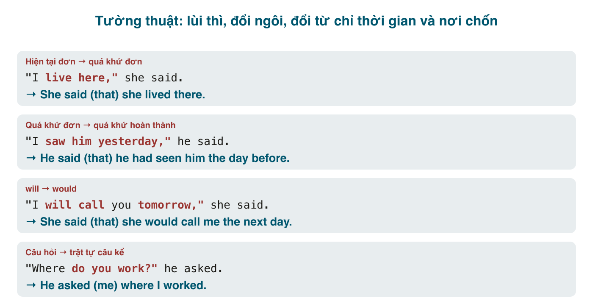

Kể lại lời người khác trong tiếng Việt gần như là chép nguyên: *Cô ấy nói "mai tôi đi Huế"* → *Cô ấy nói mai cô ấy đi Huế*. Đổi mỗi ngôi, thì giữ nguyên vì tiếng Việt không có thì. Tiếng Anh thì khi chuyển từ lời nói trực tiếp sang **tường thuật** (reported speech, indirect speech), có ba thứ đổi cùng lúc: **thì lùi một bậc**, **đại từ đổi theo người kể**, và **từ chỉ thời gian, nơi chốn đổi theo lúc kể**. Thêm vào đó, câu hỏi phải về trật tự câu kể, mệnh lệnh phải thành <mark>tell sb to</mark>, và <mark>say/tell</mark> không thay nhau được. Đây là một trong vài chủ đề ngữ pháp mà đề thi Việt Nam hỏi nhiều nhất, và cũng là thứ bạn dùng hằng ngày khi kể "sếp bảo là...".

#### say và tell
- <mark>say</mark> **không** có tân ngữ chỉ người ngay sau: *She **said** (that) she was tired.* Muốn nói với ai: *She **said to me** that...* (ít dùng).
- <mark>tell</mark> **bắt buộc** có tân ngữ chỉ người: *She **told me** (that) she was tired.*
- ~~She said me~~, ~~She told that~~ là hai lỗi phổ biến nhất của bài này. Mẹo: *say something*, *tell somebody something*.
- Cụm cố định với <mark>tell</mark> không cần <mark>that</mark>: *tell the truth, tell a lie, tell a story, tell the time, tell the difference.*
- Các động từ tường thuật khác: <mark>ask, explain, mention, admit, reply, add, claim, insist, promise, warn, suggest</mark>.

#### Lùi thì (backshift)
Khi động từ tường thuật ở **quá khứ** (*said, told, asked*), thì trong lời nói gốc lùi một bậc về quá khứ:

| Lời nói trực tiếp | Tường thuật |
|---|---|
| Hiện tại đơn: "I **work** here." | quá khứ đơn: She said she **worked** there. |
| Hiện tại tiếp diễn: "I**'m working**." | quá khứ tiếp diễn: She said she **was working**. |
| Hiện tại hoàn thành: "I**'ve finished**." | quá khứ hoàn thành: She said she **had finished**. |
| Quá khứ đơn: "I **saw** him." | quá khứ hoàn thành: She said she **had seen** him. |
| Quá khứ tiếp diễn: "I **was sleeping**." | quá khứ hoàn thành tiếp diễn: She said she **had been sleeping**. |
| Quá khứ hoàn thành: "I **had left**." | giữ nguyên: She said she **had left**. |
| will: "I**'ll** call." | would: She said she **would** call. |
| can: "I **can** swim." | could: She said she **could** swim. |
| may: "I **may** be late." | might: She said she **might** be late. |
| must (bắt buộc): "I **must** go." | had to: She said she **had to** go. (*must* suy đoán giữ nguyên) |
| shall: "**Shall** I help?" | should / offered to: She asked if she **should** help. |
| should, could, might, would, ought to | **giữ nguyên** |
| be going to: "I**'m going to** quit." | was going to: She said she **was going to** quit. |

Nếu động từ tường thuật ở **hiện tại** (*says, tells, has said*), **không** lùi thì: *She **says** she **is** tired.* Hay gặp khi kể tin nhắn vừa nhận, lời trong bài báo, lời của người đang có mặt.

#### Khi nào không lùi thì
Lùi thì không bắt buộc khi điều được nói **vẫn còn đúng** lúc kể, hoặc là **sự thật chung**:
- "The Earth goes round the Sun." → The teacher said the Earth **goes** round the Sun. (Chân lý.)
- "I live in Hue." (nói hôm qua, vẫn ở Huế) → She said she **lives** in Hue. (hoặc *lived*; cả hai đúng.)
- "The meeting is at 3 tomorrow." (kể lại ngay) → He said the meeting **is** at 3 tomorrow.

Trong bài thi, lùi thì luôn an toàn. Trong đời thật, lùi thì khi việc đã qua hoặc không còn chắc; giữ thì khi việc vẫn đúng.

#### Đổi đại từ và từ chỉ thời gian, nơi chốn
Đại từ đổi theo **người kể**: "I" của người nói thành *he/she*; "you" thành *I/me* hoặc *him/her* tùy ai được nói với. Đây là chỗ cần nghĩ, không có công thức: *"I'll give you my book," Nam said to me.* → *Nam said he would give me his book.*

Từ chỉ thời gian, nơi chốn đổi khi lúc kể và nơi kể đã khác:

| Trực tiếp | Tường thuật |
|---|---|
| now | then, at that time |
| today | that day |
| tonight | that night |
| yesterday | the day before, the previous day |
| tomorrow | the next day, the following day |
| last week / year | the week / year before, the previous week |
| next week | the following week, the week after |
| X days ago | X days before, X days earlier |
| here | there |
| this / these | that / those |
| come | go (thường) |

Không đổi máy móc: nếu kể trong cùng ngày, "today" vẫn là *today*; nếu kể tại cùng chỗ, "here" vẫn là *here*.

#### Tường thuật câu hỏi
Hai luật: (1) trật tự **câu kể** (S + V), không đảo, không <mark>do/does/did</mark>; (2) không dấu hỏi.
- **Câu hỏi có từ để hỏi**: giữ từ để hỏi. *"Where **do you** live?"* → *He asked (me) where **I lived**.* Không ~~where did I live~~, không ~~where do I live~~.
- **Câu hỏi yes/no**: thêm <mark>if</mark> hoặc <mark>whether</mark>. *"**Are you** tired?"* → *She asked **if/whether I was** tired.* / *"**Did you** see him?"* → *She asked **whether I had seen** him.*
- Động từ tường thuật: <mark>ask, want to know, wonder, inquire</mark>. *I **wondered** where she had gone.*
- Câu hỏi lịch sự trong hội thoại dùng cùng trật tự: *Could you tell me **where the station is**?* Không ~~where is the station~~. Đây là lỗi người Việt mắc cả trong câu hỏi gián tiếp hằng ngày.

#### Tường thuật mệnh lệnh, yêu cầu, lời khuyên
<mark>tell / ask / order / advise / warn / remind / beg / invite + sb + (not) to V</mark>.
- "Close the door." → He **told me to close** the door.
- "Please don't be late." → She **asked me not to be** late. (Phủ định: <mark>not to V</mark>, không ~~to not~~ trong bài thi, không ~~to don't~~.)
- "You should see a doctor." → He **advised me to see** a doctor.
- "Don't touch the wire!" → She **warned me not to touch** the wire.
- "Remember to lock the door." → He **reminded me to lock** the door.

Lời đề nghị, gợi ý, xin lỗi có mẫu riêng (các động từ này **không** đi với <mark>sb + to V</mark>):
- "Let's go out." → She **suggested going** out. / She **suggested (that) we (should) go** out. Không ~~suggested us to go~~.
- "I'll help you." → He **offered to help** me. / He **promised to help**.
- "I'm sorry I'm late." → She **apologised for being** late.
- "I didn't do it." → He **denied doing** it. / "Yes, I did it." → He **admitted doing** it.
- "Why don't you try again?" → She **encouraged me to try** again.
- "I won't go." → He **refused to go**.
- "Congratulations!" → She **congratulated me on** passing.
- "Thanks for the gift." → He **thanked me for** the gift.

#### Lỗi người Việt hay mắc
- **<mark>said me</mark>, <mark>told that</mark>**: → *told me, said that.*
- **Không lùi thì** khi động từ tường thuật ở quá khứ: *She said she **is** tired* → *was* (trừ khi vẫn còn đúng và bạn cố ý).
- **Lùi quá**: *"I had left"* → ~~had had left~~. Quá khứ hoàn thành giữ nguyên.
- **Đảo ngữ trong câu hỏi tường thuật**: ~~He asked where did I live~~, ~~She asked me was I tired~~ → *where I lived, if I was tired.*
- **Thiếu <mark>if/whether</mark>**: ~~He asked I was ready~~ → *He asked if I was ready.*
- **Giữ dấu hỏi**: ~~He asked where I lived?~~
- **Mệnh lệnh phủ định**: ~~told me to don't go~~, ~~told me don't go~~ → *told me not to go.*
- **<mark>suggest sb to V</mark>**: → *suggested that I / suggested V-ing.*
- **Quên đổi đại từ**: *Nam said "I'm tired"* → ~~Nam said I was tired~~ (giờ thành người kể mệt) → *Nam said **he** was tired.*
- **Đổi máy móc *today/here*** khi đang kể cùng ngày, cùng chỗ.

#### Bài tập
Chuyển sang tường thuật (động từ tường thuật ở quá khứ, giả sử kể vào hôm khác).

1. "I'm learning Japanese," she said. → She said (that) she was learning Japanese.
2. "I have never been to Hue," Nam said. → Nam said (that) he had never been to Hue.
3. "I'll call you tomorrow," he told me. → He told me (that) he would call me the next day.
4. "We saw that film last week," they said. → They said (that) they had seen that film the week before.
5. "Where do you work?" she asked me. → She asked me where I worked.
6. "Have you finished the report?" my boss asked. → My boss asked if/whether I had finished the report.
7. "Can you swim?" he asked her. → He asked her if/whether she could swim.
8. "Please wait here," the nurse said to me. → The nurse asked me to wait there.
9. "Don't open the window," she said to him. → She told him not to open the window.
10. "Let's take a break," Lan said. → Lan suggested taking a break. / Lan suggested (that) we take a break.
11. "I'm sorry I broke your cup," he said. → He apologised for breaking my cup.
12. "Water boils at 100°C," the teacher said. → The teacher said (that) water boils at 100°C. (không lùi: chân lý)
13. Sửa lỗi: *She said me that she was busy.* → She told me that she was busy. / She said that she was busy.
14. Sửa lỗi: *He asked me where did I buy the phone.* → He asked me where I had bought the phone.
15. Sửa lỗi: *My mother told me to don't stay up late.* → My mother told me not to stay up late.
16. Sửa lỗi: *Could you tell me what time is it?* → Could you tell me what time it is?
17. Dịch: "Sếp bảo tôi là tuần sau phải nộp báo cáo." → My boss told me (that) I had to submit the report the following week.
18. Dịch: "Cô ấy hỏi tôi có đi dự tiệc không." → She asked me if/whether I was going to the party.

#### Tóm tắt
- <mark>say + (that)</mark>, <mark>tell + sb + (that)</mark>. Không ~~said me~~, không ~~told that~~.
- Động từ tường thuật ở quá khứ → lùi một bậc: hiện tại → quá khứ, quá khứ → quá khứ hoàn thành, will → would, can → could, must → had to. Quá khứ hoàn thành và should/could/might giữ nguyên. Sự thật vẫn đúng: không bắt buộc lùi.
- Đại từ đổi theo người kể; *tomorrow → the next day, yesterday → the day before, here → there, now → then*.
- Câu hỏi: trật tự câu kể, không <mark>do</mark>, không dấu hỏi; yes/no thêm <mark>if/whether</mark>.
- Mệnh lệnh: <mark>tell/ask sb (not) to V</mark>; gợi ý: <mark>suggest V-ing / that S V</mark>; xin lỗi: <mark>apologise for V-ing</mark>.
