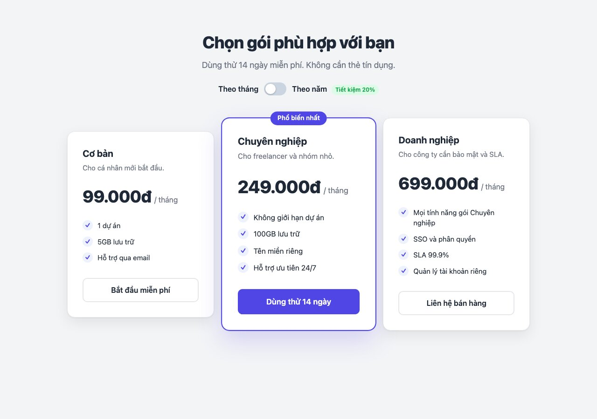
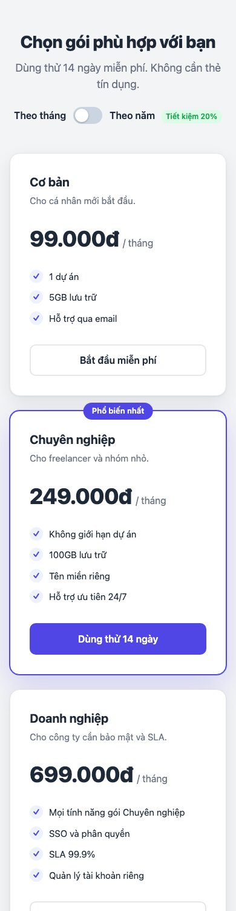
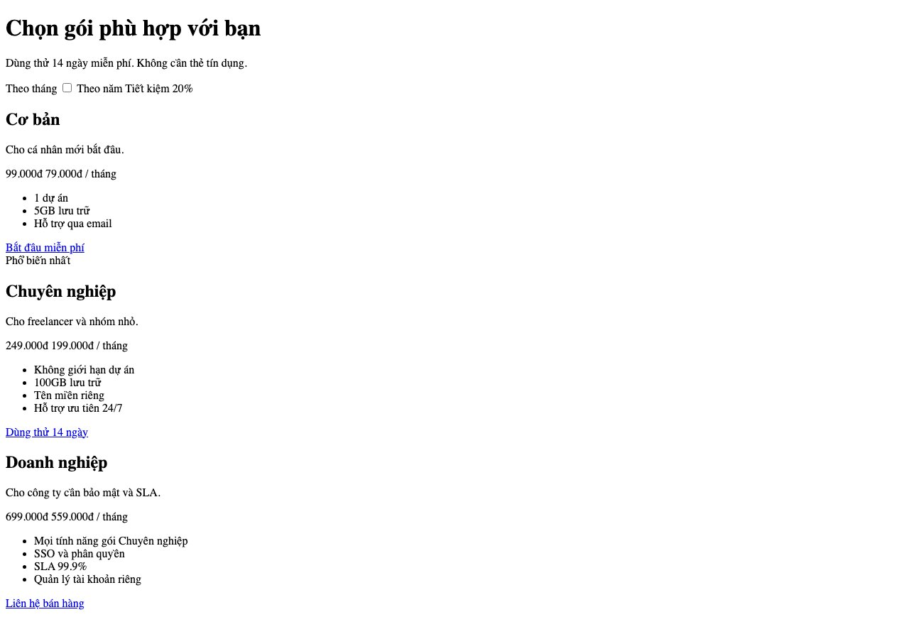
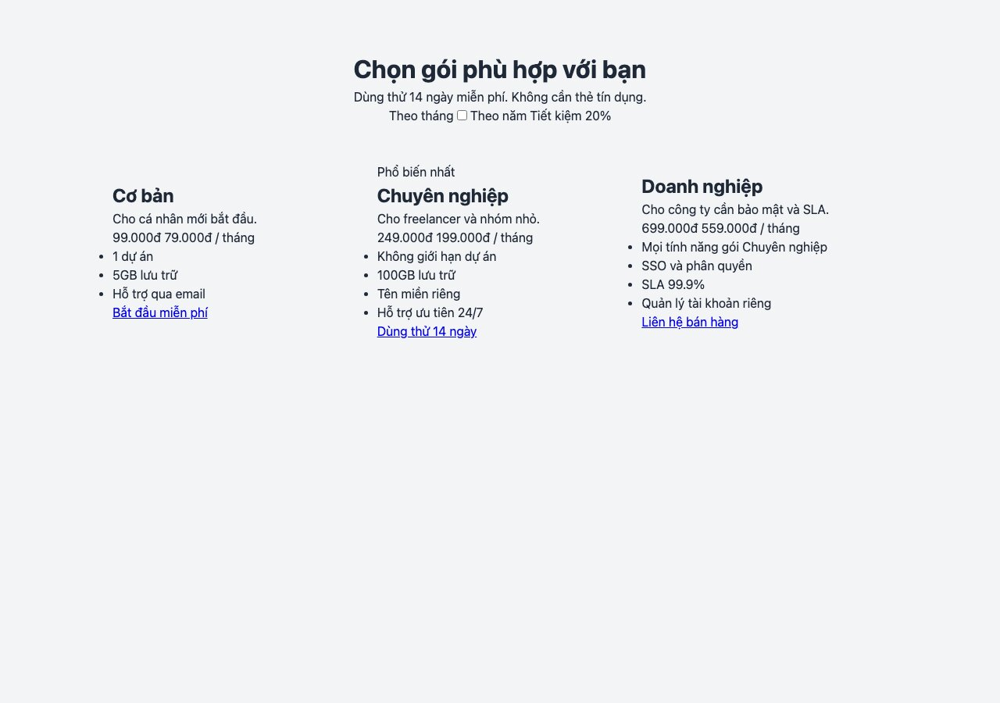
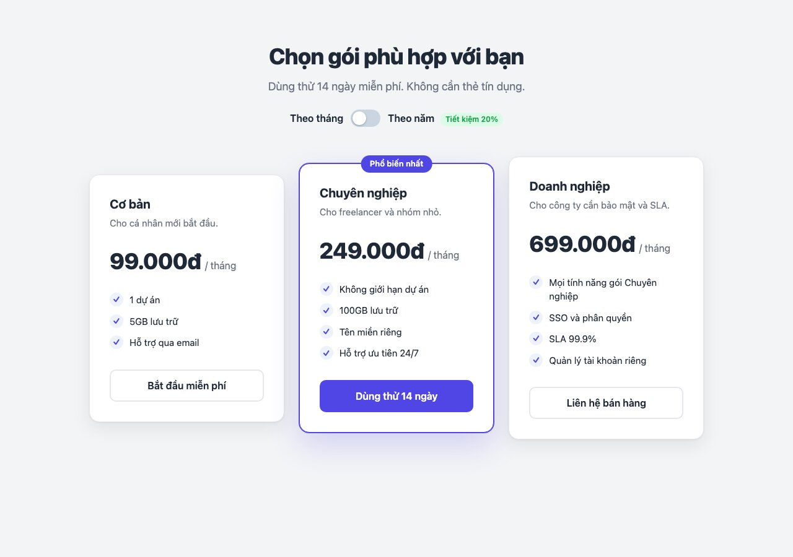

Bài 2: bảng giá 3 gói, gói giữa nổi bật, có công tắc chuyển giá theo tháng/năm **không cần JavaScript**. Kỹ năng mới: grid nhiều cột, modifier cho biến thể, pseudo-element, và <mark>:has()</mark>.

#### Kết quả cần đạt


Bật công tắc "Theo năm" thì giá đổi. Trên điện thoại 3 gói xếp dọc.



Mã nguồn: [index.html](/assets/code/post_131/index.html), [style.css](/assets/code/post_131/style.css).

#### Bước 1: Tách component
```
pricing
├── header
│   ├── title
│   ├── subtitle
│   └── toggle            công tắc tháng/năm
│       ├── label × 2
│       ├── input         checkbox ẩn
│       ├── switch        hình công tắc
│       └── badge         "Tiết kiệm 20%"
└── grid
    └── plan × 3          gói giữa là plan--featured, có badge
        ├── name
        ├── desc
        ├── price
        │   ├── amount    2 bản: monthly, yearly, chỉ hiện 1
        │   └── period
        ├── features
        │   └── feature × n   có dấu ✓ phía trước
        └── btn
```
Câu hỏi tách: 3 gói giống nhau về cấu trúc, khác về nội dung và một gói được nhấn mạnh → một block <mark>plan</mark> với modifier <mark>plan--featured</mark>. Nút tái sử dụng từ bài 130.

#### Bước 2: Đặt tên

| Khối | Class |
|---|---|
| Trang | <mark>.pricing</mark>, <mark>.pricing__header</mark>, <mark>.pricing__title</mark>, <mark>.pricing__subtitle</mark>, <mark>.pricing__grid</mark> |
| Công tắc | <mark>.toggle</mark>, <mark>.toggle__label</mark>, <mark>.toggle__input</mark>, <mark>.toggle__switch</mark>, <mark>.toggle__badge</mark> |
| Gói | <mark>.plan</mark>, <mark>.plan--featured</mark>, <mark>.plan__badge</mark>, <mark>.plan__name</mark>, <mark>.plan__desc</mark>, <mark>.plan__price</mark>, <mark>.plan__amount</mark>, <mark>.plan__amount--monthly</mark>, <mark>.plan__amount--yearly</mark>, <mark>.plan__period</mark>, <mark>.plan__features</mark>, <mark>.plan__feature</mark> |
| Nút | <mark>.btn</mark>, <mark>.btn--primary</mark>, <mark>.btn--outline</mark> |

<mark>.plan__amount--monthly</mark> là modifier của một **element**, cũng hợp lệ trong BEM.

#### Bước 3: HTML
```html
<!doctype html>
<html lang="vi">
<head>
  <meta charset="utf-8">
  <meta name="viewport" content="width=device-width, initial-scale=1">
  <title>Bảng giá</title>
  <link rel="stylesheet" href="style.css">
</head>
<body>
  <main class="pricing">
    <header class="pricing__header">
      <h1 class="pricing__title">Chọn gói phù hợp với bạn</h1>
      <p class="pricing__subtitle">Dùng thử 14 ngày miễn phí. Không cần thẻ tín dụng.</p>

      <label class="toggle">
        <span class="toggle__label">Theo tháng</span>
        <input class="toggle__input" type="checkbox">
        <span class="toggle__switch"></span>
        <span class="toggle__label">Theo năm <span class="toggle__badge">Tiết kiệm 20%</span></span>
      </label>
    </header>

    <div class="pricing__grid">
      <article class="plan">
        <h2 class="plan__name">Cơ bản</h2>
        <p class="plan__desc">Cho cá nhân mới bắt đầu.</p>
        <p class="plan__price">
          <span class="plan__amount plan__amount--monthly">99.000đ</span>
          <span class="plan__amount plan__amount--yearly">79.000đ</span>
          <span class="plan__period">/ tháng</span>
        </p>
        <ul class="plan__features">
          <li class="plan__feature">1 dự án</li>
          <li class="plan__feature">5GB lưu trữ</li>
          <li class="plan__feature">Hỗ trợ qua email</li>
        </ul>
        <a class="btn btn--outline" href="#">Bắt đầu miễn phí</a>
      </article>

      <article class="plan plan--featured">
        <span class="plan__badge">Phổ biến nhất</span>
        <h2 class="plan__name">Chuyên nghiệp</h2>
        <p class="plan__desc">Cho freelancer và nhóm nhỏ.</p>
        <p class="plan__price">
          <span class="plan__amount plan__amount--monthly">249.000đ</span>
          <span class="plan__amount plan__amount--yearly">199.000đ</span>
          <span class="plan__period">/ tháng</span>
        </p>
        <ul class="plan__features">
          <li class="plan__feature">Không giới hạn dự án</li>
          <li class="plan__feature">100GB lưu trữ</li>
          <li class="plan__feature">Tên miền riêng</li>
          <li class="plan__feature">Hỗ trợ ưu tiên 24/7</li>
        </ul>
        <a class="btn btn--primary" href="#">Dùng thử 14 ngày</a>
      </article>

      <article class="plan">
        <h2 class="plan__name">Doanh nghiệp</h2>
        <p class="plan__desc">Cho công ty cần bảo mật và SLA.</p>
        <p class="plan__price">
          <span class="plan__amount plan__amount--monthly">699.000đ</span>
          <span class="plan__amount plan__amount--yearly">559.000đ</span>
          <span class="plan__period">/ tháng</span>
        </p>
        <ul class="plan__features">
          <li class="plan__feature">Mọi tính năng gói Chuyên nghiệp</li>
          <li class="plan__feature">SSO và phân quyền</li>
          <li class="plan__feature">SLA 99.9%</li>
          <li class="plan__feature">Quản lý tài khoản riêng</li>
        </ul>
        <a class="btn btn--outline" href="#">Liên hệ bán hàng</a>
      </article>
    </div>
  </main>
</body>
</html>
```
Hai chỗ đáng chú ý:
- Công tắc là một <mark>label</mark> bọc <mark>input type="checkbox"</mark>: bấm vào bất kỳ đâu trong label đều đổi trạng thái checkbox, và bàn phím dùng được (Tab tới, Space để bật). Hình công tắc là <mark>span</mark> đứng **ngay sau** input để CSS chọn bằng <mark>+</mark>.
- Mỗi gói có **cả hai** giá trong HTML, CSS sẽ ẩn một cái. Không JavaScript.

Mở trang



**Mẹo:** viết HTML cho **một** gói trước, kiểm tra kỹ, rồi mới copy thành 3 và sửa nội dung. Copy sớm là sửa lỗi 3 lần.

#### Bước 4: Layout
Token và reset giống bài 130 (thêm <mark>--color-success</mark> cho badge xanh), chỉ liệt kê phần mới
```css
/* ===== 1. Token & reset ===== */
:root {
  --color-primary: #4f46e5;
  --color-primary-dark: #4338ca;
  --color-text: #1f2937;
  --color-muted: #6b7280;
  --color-bg: #f3f4f6;
  --color-surface: #ffffff;
  --color-border: #e5e7eb;
  --color-success: #16a34a;
  --radius: 16px;
  --shadow: 0 1px 3px rgba(0, 0, 0, 0.06), 0 10px 30px rgba(0, 0, 0, 0.08);
  --font: system-ui, -apple-system, "Segoe UI", Roboto, sans-serif;
}

*,
*::before,
*::after {
  box-sizing: border-box;
  margin: 0;
  padding: 0;
}

body {
  font-family: var(--font);
  color: var(--color-text);
  background: var(--color-bg);
  line-height: 1.5;
}

/* ===== 2. Layout ===== */
.pricing {
  max-width: 1040px;
  margin: 0 auto;
  padding: 64px 24px;
}

.pricing__header {
  text-align: center;
  margin-bottom: 48px;
}

.pricing__grid {
  display: grid;
  grid-template-columns: repeat(3, 1fr);
  gap: 24px;
  align-items: center;
}
```
<mark>.pricing</mark> là **container**: rộng tối đa 1040px, căn giữa bằng <mark>margin: 0 auto</mark>, có padding hai bên để không dính mép trên màn hình nhỏ. Gần như trang nào cũng có một container như vậy.

Trang lúc này



Ba gói đã đứng thành 3 cột, tiêu đề căn giữa. Chưa đẹp, nhưng **bố cục đã đúng**, và từ đây mọi thứ chỉ là tô màu.

<mark>grid-template-columns: repeat(3, 1fr)</mark>: 3 cột bằng nhau. <mark>align-items: center</mark> để gói giữa (cao hơn vì được phóng to) căn giữa theo chiều dọc với hai gói bên.

#### Bước 5: Style component
```css
/* ===== 3. Component: header và toggle ===== */
.pricing__title {
  font-size: 2.25rem;
  font-weight: 800;
  letter-spacing: -0.02em;
}

.pricing__subtitle {
  margin-top: 8px;
  color: var(--color-muted);
  font-size: 1.125rem;
}

.toggle {
  display: inline-flex;
  flex-wrap: wrap;
  justify-content: center;
  align-items: center;
  gap: 12px;
  margin-top: 24px;
  cursor: pointer;
  user-select: none;
}

.toggle__input {
  position: absolute;
  opacity: 0;
  width: 0;
  height: 0;
}

.toggle__switch {
  position: relative;
  width: 48px;
  height: 28px;
  border-radius: 999px;
  background: #cbd5e1;
}

.toggle__switch::after {
  content: "";
  position: absolute;
  top: 3px;
  left: 3px;
  width: 22px;
  height: 22px;
  border-radius: 50%;
  background: #fff;
  box-shadow: 0 1px 3px rgba(0, 0, 0, 0.3);
}

.toggle__label {
  font-weight: 600;
}

.toggle__badge {
  display: inline-block;
  margin-left: 6px;
  padding: 2px 8px;
  border-radius: 999px;
  background: #dcfce7;
  color: var(--color-success);
  font-size: 0.75rem;
}
```
Checkbox thật bị **ẩn** (<mark>opacity: 0</mark>, không dùng <mark>display: none</mark> vì sẽ mất khả năng dùng bàn phím), hình công tắc vẽ bằng <mark>span</mark> và nút tròn là <mark>::after</mark>. Pseudo-element <mark>::before</mark>/<mark>::after</mark> là cách thêm phần tử trang trí mà không cần thêm HTML.
```css
/* ===== 3. Component: plan ===== */
.plan {
  position: relative;
  padding: 32px;
  background: var(--color-surface);
  border: 1px solid var(--color-border);
  border-radius: var(--radius);
  box-shadow: var(--shadow);
  display: flex;
  flex-direction: column;
}

.plan__name {
  font-size: 1.25rem;
  font-weight: 700;
}

.plan__desc {
  margin-top: 4px;
  color: var(--color-muted);
  font-size: 0.9375rem;
}

.plan__price {
  margin: 24px 0;
  display: flex;
  align-items: baseline;
  gap: 6px;
}

.plan__amount {
  font-size: 2.25rem;
  font-weight: 800;
  letter-spacing: -0.02em;
}

.plan__amount--yearly {
  display: none;
}

.plan__period {
  color: var(--color-muted);
}

.plan__features {
  list-style: none;
  margin-bottom: 32px;
  display: grid;
  gap: 12px;
}

.plan__feature {
  display: flex;
  gap: 10px;
  font-size: 0.9375rem;
}

.plan__feature::before {
  content: "✓";
  flex: none;
  width: 22px;
  height: 22px;
  border-radius: 50%;
  background: #eef2ff;
  color: var(--color-primary);
  font-size: 0.8125rem;
  font-weight: 700;
  display: grid;
  place-items: center;
}

.plan--featured {
  border-color: var(--color-primary);
  box-shadow: 0 0 0 1px var(--color-primary), 0 20px 50px rgba(79, 70, 229, 0.2);
}

.plan__badge {
  position: absolute;
  top: -14px;
  left: 50%;
  transform: translateX(-50%);
  padding: 4px 14px;
  border-radius: 999px;
  background: var(--color-primary);
  color: #fff;
  font-size: 0.8125rem;
  font-weight: 600;
  white-space: nowrap;
}

.btn {
  margin-top: auto;
  padding: 12px 20px;
  border-radius: 10px;
  border: 2px solid transparent;
  font-weight: 600;
  text-align: center;
  text-decoration: none;
}

.btn--primary {
  background: var(--color-primary);
  color: #fff;
}

.btn--outline {
  border-color: var(--color-border);
  color: var(--color-text);
}
```
Trang sau bước này



Nhìn đã giống thiết kế, chỉ còn thiếu: công tắc chưa bật được, hover chưa có.

**Mẹo:** gói nổi bật khác gói thường ở đúng 3 dòng CSS (viền, bóng, badge). Viết gói thường cho xong trước, rồi thêm modifier <mark>--featured</mark> **chỉ ghi đè phần khác**, không copy lại toàn bộ.

Bốn kỹ thuật trong khối này:
- **Dấu ✓** là <mark>::before</mark> của mỗi <mark>li</mark>, một vòng tròn nhỏ dùng <mark>display: grid; place-items: center</mark> để căn chữ ✓ vào giữa. <mark>flex: none</mark> để nó không bị co khi dòng chữ dài.
- **Nút luôn ở đáy card** dù số dòng tính năng khác nhau: card là <mark>flex-direction: column</mark>, nút có <mark>margin-top: auto</mark>. Đây là cách chuẩn để đẩy một phần tử xuống cuối.
- **Badge "Phổ biến nhất"** định vị tuyệt đối so với card (<mark>.plan</mark> có <mark>position: relative</mark>), <mark>left: 50%</mark> + <mark>translateX(-50%)</mark> để căn giữa chính xác bất kể badge rộng bao nhiêu.
- <mark>align-items: baseline</mark> cho giá: số to và chữ "/ tháng" nhỏ thẳng hàng theo chân chữ, nhìn tự nhiên hơn <mark>center</mark>.

#### Bước 6: Hiệu ứng và công tắc
```css
/* ===== 4. Hiệu ứng: toggle và hover ===== */
.toggle__switch,
.toggle__switch::after {
  transition: background-color 0.2s ease, transform 0.2s ease;
}

.toggle__input:checked + .toggle__switch {
  background: var(--color-primary);
}

.toggle__input:checked + .toggle__switch::after {
  transform: translateX(20px);
}

.toggle__input:focus-visible + .toggle__switch {
  outline: 3px solid #c7d2fe;
}

.pricing:has(.toggle__input:checked) .plan__amount--monthly {
  display: none;
}

.pricing:has(.toggle__input:checked) .plan__amount--yearly {
  display: inline;
}

.plan {
  transition: transform 0.25s ease, box-shadow 0.25s ease;
}

.plan:hover {
  transform: translateY(-6px);
}

.plan--featured {
  transform: scale(1.05);
}

.plan--featured:hover {
  transform: scale(1.05) translateY(-6px);
}

.btn {
  transition: background-color 0.2s ease, border-color 0.2s ease, color 0.2s ease;
}

.btn--primary:hover {
  background: var(--color-primary-dark);
}

.btn--outline:hover {
  border-color: var(--color-primary);
  color: var(--color-primary);
}
```
Đây là phần hay nhất của bài:
- <mark>.toggle__input:checked + .toggle__switch</mark>: khi checkbox được chọn, **phần tử đứng ngay sau** nó (dấu <mark>+</mark>) đổi màu, và nút tròn trượt sang phải 20px.
- <mark>.pricing:has(.toggle__input:checked)</mark>: chọn <mark>.pricing</mark> **nếu bên trong nó** có checkbox đang được chọn. Nhờ đó, một checkbox ở header điều khiển được giá ở cả 3 gói nằm tận đâu trong cây DOM. Trước khi có <mark>:has()</mark> (2023), việc này bắt buộc phải dùng JavaScript.
- <mark>:focus-visible</mark>: khi người dùng Tab tới công tắc, hiện viền để biết đang ở đâu. Checkbox bị ẩn nên phải vẽ viền lên <mark>.toggle__switch</mark> thay thế.
- Gói nổi bật được <mark>scale(1.05)</mark>; khi hover cần **giữ** scale và cộng thêm translate, vì <mark>transform</mark> sau sẽ ghi đè hoàn toàn <mark>transform</mark> trước.

#### Bước 7: Responsive
```css
/* ===== 5. Responsive ===== */
@media (max-width: 900px) {
  .pricing {
    padding: 48px 16px;
  }

  .pricing__title {
    font-size: 1.75rem;
  }

  .pricing__grid {
    grid-template-columns: 1fr;
    max-width: 420px;
    margin: 0 auto;
  }

  .plan--featured,
  .plan--featured:hover {
    transform: none;
  }

  .plan:hover {
    transform: none;
  }
}
```
Dưới 900px: 3 cột thành 1, giới hạn 420px cho card không quá rộng trên tablet, và bỏ phóng to gói nổi bật (xếp dọc thì phóng to chỉ làm lệch). Hover cũng bỏ vì điện thoại không có hover.

Một lỗi tôi gặp khi làm bài này: công tắc với đủ chữ và badge rộng hơn 390px, làm **cả trang** có thanh cuộn ngang. Sửa bằng <mark>flex-wrap: wrap</mark> trên <mark>.toggle</mark> (đã có ở bước 5). Bài học: thu nhỏ tới 360px và nhìn thanh cuộn ngang, đó là dấu hiệu có thứ gì đó rộng cố định.

#### Checklist
- Bấm công tắc: giá đổi ở cả 3 gói, nút tròn trượt mượt.
- Tab tới công tắc, bấm Space: cũng đổi được, và thấy viền focus.
- Nút của 3 gói thẳng hàng ở đáy dù số tính năng khác nhau.
- Thu nhỏ 360px: không cuộn ngang, badge "Phổ biến nhất" không bị cắt.

#### Bài tập thêm
- Thêm gói thứ 4 và đổi grid thành <mark>repeat(auto-fit, minmax(240px, 1fr))</mark>, xem nó tự xuống dòng thế nào.
- Hiện chữ "đã tiết kiệm 240.000đ/năm" dưới giá khi bật theo năm, bằng đúng kỹ thuật <mark>:has()</mark>.
- Thêm bảng so sánh chi tiết tính năng bên dưới bằng thẻ <mark>table</mark>.
