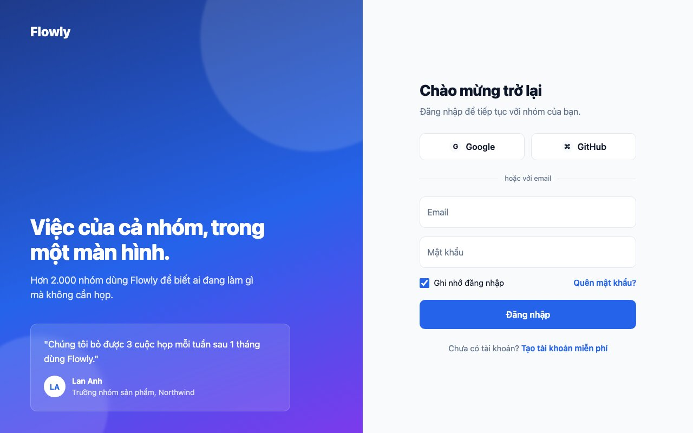
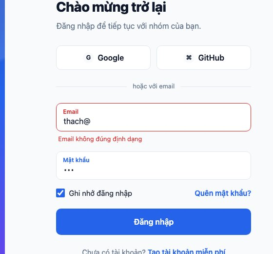
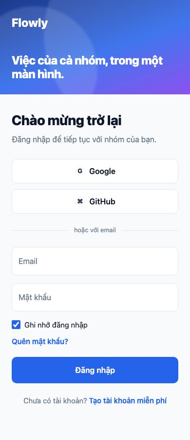
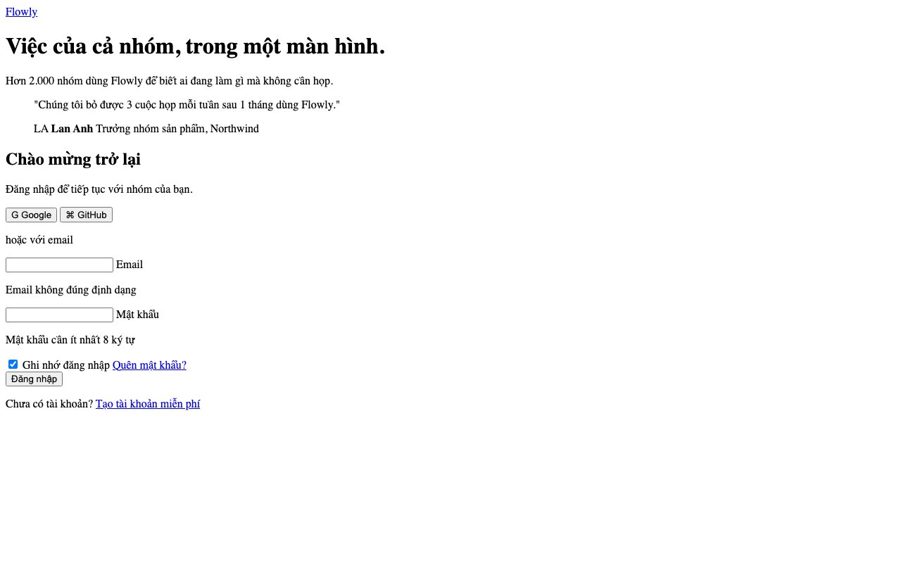
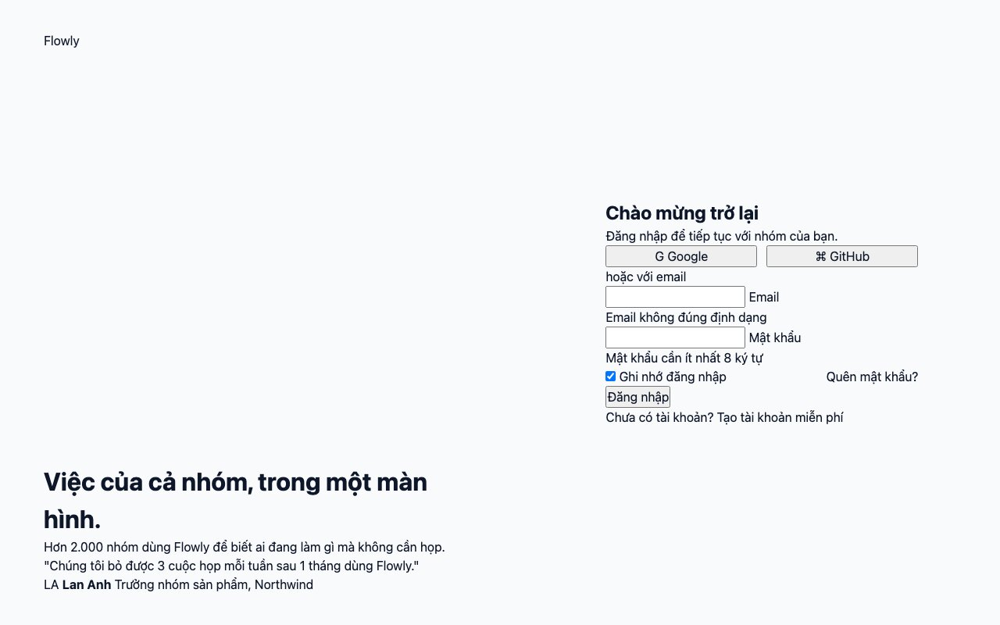

Bài 6 là trang đăng nhập chia đôi: bên trái là thương hiệu với một câu trích dẫn khách hàng, bên phải là form. Form là nơi người mới hay làm xấu nhất: ô nhập mỗi trình duyệt một kiểu, focus không thấy, lỗi hiện bằng popup mặc định. Bài này làm form đẹp và đúng **chỉ bằng CSS**: nhãn nổi (floating label), vòng focus, trạng thái lỗi hiện sau khi người dùng gõ.

#### Kết quả cần đạt


Khi gõ email sai định dạng rồi rời ô: viền đỏ, nhãn đỏ, dòng báo lỗi hiện ra. Nhãn của ô đã có nội dung nổi lên góc trên.





Mã nguồn: [index.html](/assets/code/post_135/index.html), [scss/main.scss](/assets/code/post_135/scss/main.scss), [css/style.css](/assets/code/post_135/css/style.css).

#### Bước 1: Tách component
```
auth (2 cột, cao bằng màn hình)
├── brand: logo, content (title, text, quote)
│   └── quote: text, author (avatar, name, role)
└── panel
    └── form: title, subtitle
        ├── social > btn--outline × 2 (social__icon)
        ├── divider (đường kẻ + chữ "hoặc")
        ├── field × 2: input, label, error
        ├── form__row: check (checkbox) + form__link
        ├── btn--primary btn--block
        └── form__footer
```
<mark>field</mark> là component quan trọng nhất: một ô nhập kèm nhãn và dòng lỗi, dùng lại cho mọi form sau này.

#### Bước 2: Đặt tên

| Khối | Class |
|---|---|
| Khung | <mark>.auth</mark>, <mark>.brand</mark>, <mark>.brand__logo</mark>, <mark>.brand__content</mark>, <mark>.brand__title</mark>, <mark>.brand__text</mark>, <mark>.panel</mark> |
| Trích dẫn | <mark>.quote</mark>, <mark>.quote__text</mark>, <mark>.quote__author</mark>, <mark>.quote__avatar</mark>, <mark>.quote__name</mark>, <mark>.quote__role</mark> |
| Form | <mark>.form</mark>, <mark>.form__title</mark>, <mark>.form__subtitle</mark>, <mark>.form__row</mark>, <mark>.form__link</mark>, <mark>.form__footer</mark>, <mark>.social</mark>, <mark>.social__icon</mark>, <mark>.divider</mark>, <mark>.divider__text</mark> |
| Ô nhập | <mark>.field</mark>, <mark>.field__input</mark>, <mark>.field__label</mark>, <mark>.field__error</mark>, <mark>.check</mark>, <mark>.check__input</mark> |
| Nút | <mark>.btn</mark>, <mark>.btn--primary</mark>, <mark>.btn--outline</mark>, <mark>.btn--block</mark> |

#### Bước 3: HTML
```html
<!doctype html>
<html lang="vi">
<head>
  <meta charset="utf-8">
  <meta name="viewport" content="width=device-width, initial-scale=1">
  <title>Đăng nhập - Flowly</title>
  <link rel="stylesheet" href="css/style.css">
</head>
<body>
  <main class="auth">
    <section class="brand">
      <a class="brand__logo" href="#">Flowly</a>
      <div class="brand__content">
        <h1 class="brand__title">Việc của cả nhóm, trong một màn hình.</h1>
        <p class="brand__text">Hơn 2.000 nhóm dùng Flowly để biết ai đang làm gì mà không cần họp.</p>
        <blockquote class="quote">
          <p class="quote__text">"Chúng tôi bỏ được 3 cuộc họp mỗi tuần sau 1 tháng dùng Flowly."</p>
          <footer class="quote__author">
            <span class="quote__avatar">LA</span>
            <span>
              <strong class="quote__name">Lan Anh</strong>
              <span class="quote__role">Trưởng nhóm sản phẩm, Northwind</span>
            </span>
          </footer>
        </blockquote>
      </div>
    </section>

    <section class="panel">
      <form class="form" novalidate>
        <h2 class="form__title">Chào mừng trở lại</h2>
        <p class="form__subtitle">Đăng nhập để tiếp tục với nhóm của bạn.</p>

        <div class="social">
          <button class="btn btn--outline" type="button"><span class="social__icon">G</span> Google</button>
          <button class="btn btn--outline" type="button"><span class="social__icon">⌘</span> GitHub</button>
        </div>

        <p class="divider"><span class="divider__text">hoặc với email</span></p>

        <div class="field">
          <input class="field__input" id="email" type="email" placeholder=" " required autocomplete="email">
          <label class="field__label" for="email">Email</label>
          <p class="field__error">Email không đúng định dạng</p>
        </div>

        <div class="field">
          <input class="field__input" id="password" type="password" placeholder=" " required minlength="8" autocomplete="current-password">
          <label class="field__label" for="password">Mật khẩu</label>
          <p class="field__error">Mật khẩu cần ít nhất 8 ký tự</p>
        </div>

        <div class="form__row">
          <label class="check"><input class="check__input" type="checkbox" checked> Ghi nhớ đăng nhập</label>
          <a class="form__link" href="#">Quên mật khẩu?</a>
        </div>

        <button class="btn btn--primary btn--block" type="submit">Đăng nhập</button>

        <p class="form__footer">Chưa có tài khoản? <a class="form__link" href="#">Tạo tài khoản miễn phí</a></p>
      </form>
    </section>
  </main>
</body>
</html>
```
Mở trang



Form chưa có CSS nhưng **đã hoạt động đầy đủ**: gõ được, Tab được, bấm nhãn thì focus vào ô. Đó là nhờ HTML đúng:
- Mỗi <mark>input</mark> có <mark>id</mark>, mỗi <mark>label</mark> có <mark>for</mark> trỏ tới id đó. Thiếu cặp này, bấm nhãn không focus và trình đọc màn hình không biết ô nhập là gì.
- <mark>type="email"</mark>, <mark>type="password"</mark>: điện thoại hiện đúng bàn phím, trình duyệt tự kiểm tra định dạng email.
- <mark>required</mark>, <mark>minlength="8"</mark>: luật kiểm tra nằm trong HTML, CSS sẽ dựa vào đó để tô màu.
- <mark>autocomplete="email"</mark>, <mark>"current-password"</mark>: trình quản lý mật khẩu điền đúng ô.
- <mark>novalidate</mark> trên <mark>form</mark>: tắt popup báo lỗi mặc định của trình duyệt, để ta tự hiển thị lỗi đẹp hơn. Việc kiểm tra vẫn chạy (các pseudo-class vẫn có), chỉ popup là tắt.
- <mark>placeholder=" "</mark> (một dấu cách): trông vô lý nhưng là chìa khóa của nhãn nổi, giải thích ở bước 5.

**Mẹo:** nút trong form mặc định là <mark>type="submit"</mark>. Hai nút Google/GitHub phải ghi rõ <mark>type="button"</mark>, nếu không bấm chúng sẽ gửi form.

#### Bước 4: Token, reset, layout
```scss
/* ===== 1. Token & reset ===== */
@use "sass:map";

$breakpoints: (
  tablet: 900px,
  phone: 480px,
);

@mixin below($name) {
  @media (max-width: map.get($breakpoints, $name)) {
    @content;
  }
}

:root {
  --color-primary: #2563eb;
  --color-primary-dark: #1d4ed8;
  --color-primary-soft: #dbeafe;
  --color-text: #0f172a;
  --color-muted: #64748b;
  --color-bg: #f8fafc;
  --color-surface: #ffffff;
  --color-border: #e2e8f0;
  --color-error: #dc2626;
  --color-error-soft: #fee2e2;
  --radius: 12px;
  --font: system-ui, -apple-system, "Segoe UI", Roboto, sans-serif;
  --ring: 0 0 0 4px var(--color-primary-soft);
}
```
```scss
*,
*::before,
*::after {
  box-sizing: border-box;
  margin: 0;
  padding: 0;
}

body {
  font-family: var(--font);
  color: var(--color-text);
  background: var(--color-bg);
  line-height: 1.5;
}

a {
  color: inherit;
  text-decoration: none;
}

button,
input {
  font: inherit;
  color: inherit;
}
```
```scss
/* ===== 2. Layout ===== */
.auth {
  min-height: 100vh;
  display: grid;
  grid-template-columns: 1.1fr 1fr;
}

.brand {
  display: flex;
  flex-direction: column;
  justify-content: space-between;
  padding: 40px 56px;
}

.panel {
  display: grid;
  place-items: center;
  padding: 40px 24px;
}

.form {
  width: 100%;
  max-width: 400px;
}

.social {
  display: grid;
  grid-template-columns: 1fr 1fr;
  gap: 12px;
}

.form__row {
  display: flex;
  justify-content: space-between;
  align-items: center;
  gap: 12px;
}
```
Trang lúc này



- Token mới: <mark>--ring</mark>, vòng sáng khi focus, định nghĩa một lần và dùng cho mọi thứ focus được (ô nhập, nút, checkbox, link). Trang nào có form cũng nên có token này.
- <mark>.auth { min-height: 100vh }</mark> với grid 2 cột: hai nửa cao bằng màn hình. <mark>.brand</mark> là flex cột với <mark>justify-content: space-between</mark> để logo dính trên, nội dung dính dưới.
- <mark>.panel { display: grid; place-items: center }</mark>: form nằm giữa cả hai chiều, cùng mẹo bài 130.

#### Bước 5: Style component
Nửa thương hiệu
```scss
/* ===== 3. Component ===== */
@use "../tokens" as *;

.brand {
  position: relative;
  overflow: hidden;
  color: #fff;
  background: linear-gradient(160deg, #1e3a8a, #2563eb 55%, #7c3aed);

  &::before,
  &::after {
    content: "";
    position: absolute;
    border-radius: 50%;
    background: rgba(255, 255, 255, 0.12);
    filter: blur(2px);
  }

  &::before {
    width: 420px;
    height: 420px;
    top: -140px;
    right: -120px;
  }

  &::after {
    width: 260px;
    height: 260px;
    bottom: -80px;
    left: -60px;
  }

  &__logo,
  &__content {
    position: relative;
    z-index: 1;
  }

  &__logo {
    font-weight: 800;
    font-size: 1.5rem;
  }

  &__title {
    font-size: 2.5rem;
    font-weight: 800;
    line-height: 1.15;
    letter-spacing: -0.02em;
    max-width: 480px;
  }

  &__text {
    margin-top: 16px;
    font-size: 1.125rem;
    opacity: 0.85;
    max-width: 440px;
  }
}

.quote {
  margin-top: 40px;
  padding: 24px;
  border-radius: var(--radius);
  background: rgba(255, 255, 255, 0.12);
  border: 1px solid rgba(255, 255, 255, 0.2);
  backdrop-filter: blur(6px);
  max-width: 480px;

  &__text {
    font-size: 1.0625rem;
    line-height: 1.6;
  }

  &__author {
    margin-top: 16px;
    display: flex;
    align-items: center;
    gap: 12px;
    font-size: 0.875rem;
  }

  &__avatar {
    width: 40px;
    height: 40px;
    border-radius: 50%;
    background: #fff;
    color: var(--color-primary);
    font-weight: 700;
    display: grid;
    place-items: center;
  }

  &__name {
    display: block;
  }

  &__role {
    opacity: 0.8;
  }
}
```
Hai hình tròn mờ là <mark>::before</mark> và <mark>::after</mark> định vị tuyệt đối, tràn ra ngoài góc và bị <mark>overflow: hidden</mark> cắt. Logo và nội dung cần <mark>position: relative; z-index: 1</mark> để nằm **trên** hai hình tròn. Hộp trích dẫn là "kính mờ": nền trắng 12% + viền trắng 20% + <mark>backdrop-filter</mark>.

Form, phần chính của bài
```scss
@use "../tokens" as *;

.form {
  &__title {
    font-size: 1.75rem;
    font-weight: 800;
    letter-spacing: -0.02em;
  }

  &__subtitle {
    margin-top: 6px;
    margin-bottom: 28px;
    color: var(--color-muted);
  }

  &__row {
    margin: 4px 0 20px;
    font-size: 0.9375rem;
  }

  &__link {
    color: var(--color-primary);
    font-weight: 600;
  }

  &__footer {
    margin-top: 24px;
    text-align: center;
    font-size: 0.9375rem;
    color: var(--color-muted);
  }
}

.social__icon {
  display: inline-grid;
  place-items: center;
  width: 22px;
  height: 22px;
  border-radius: 50%;
  background: var(--color-bg);
  font-size: 0.8125rem;
  font-weight: 700;
}

.divider {
  position: relative;
  margin: 24px 0;
  text-align: center;
  font-size: 0.8125rem;
  color: var(--color-muted);

  &::before {
    content: "";
    position: absolute;
    left: 0;
    right: 0;
    top: 50%;
    height: 1px;
    background: var(--color-border);
  }

  &__text {
    position: relative;
    padding: 0 12px;
    background: var(--color-bg);
  }
}

.field {
  position: relative;
  margin-bottom: 16px;

  &__input {
    width: 100%;
    padding: 24px 14px 8px;
    border: 1px solid var(--color-border);
    border-radius: 10px;
    background: var(--color-surface);
    outline: none;
  }

  &__label {
    position: absolute;
    left: 14px;
    top: 50%;
    transform: translateY(-50%);
    color: var(--color-muted);
    pointer-events: none;
  }

  &__input:focus + &__label,
  &__input:not(:placeholder-shown) + &__label {
    top: 9px;
    transform: none;
    font-size: 0.75rem;
    font-weight: 600;
    color: var(--color-primary);
  }

  &__error {
    display: none;
    margin: 6px 0 0 4px;
    font-size: 0.8125rem;
    color: var(--color-error);
  }
}

.check {
  display: flex;
  align-items: center;
  gap: 8px;
  cursor: pointer;

  &__input {
    width: 18px;
    height: 18px;
    accent-color: var(--color-primary);
  }
}

.btn {
  display: inline-flex;
  justify-content: center;
  align-items: center;
  gap: 8px;
  padding: 12px 16px;
  border-radius: 10px;
  border: 1px solid transparent;
  font-weight: 600;
  cursor: pointer;

  &--primary {
    background: var(--color-primary);
    color: #fff;
  }

  &--outline {
    background: var(--color-surface);
    border-color: var(--color-border);
  }

  &--block {
    width: 100%;
    padding: 14px;
  }
}
```
Trang lúc này


**Nhãn nổi** hoạt động thế này: nhãn được đặt tuyệt đối **đè lên** ô nhập, ở giữa. Khi ô được focus hoặc **đã có chữ**, nhãn nhảy lên góc trên và nhỏ lại; ô có <mark>padding-top</mark> lớn để chừa chỗ. Vấn đề: CSS không có cách hỏi "ô này có chữ không". Mẹo là <mark>:placeholder-shown</mark>: placeholder chỉ hiện khi ô **rỗng**; đặt placeholder là một dấu cách (vô hình) thì <mark>:not(:placeholder-shown)</mark> nghĩa là "ô có chữ". Đó là lý do có <mark>placeholder=" "</mark> ở bước 3.

Để ý <mark>&amp;__input:focus + &amp;__label</mark>: cả hai <mark>&amp;</mark> đều thay bằng <mark>.field</mark>, ra <mark>.field__input:focus + .field__label</mark>. Nhãn phải đứng **ngay sau** input trong HTML thì <mark>+</mark> mới chọn được, và <mark>pointer-events: none</mark> để bấm vào nhãn thì click "xuyên" xuống ô nhập.

**Đường kẻ "hoặc"**: <mark>::before</mark> là đường kẻ ngang chạy hết chiều rộng, chữ ở giữa có **nền cùng màu trang** để che đường kẻ phía sau nó. Không cần 2 thẻ đường kẻ hai bên.

**Mẹo:** <mark>outline: none</mark> trên ô nhập ở đây là chấp nhận được **chỉ vì** bước 6 sẽ thay bằng viền và vòng sáng rõ hơn. Xóa outline mà không thay thế là lỗi tiếp cận nghiêm trọng: người dùng bàn phím không biết mình đang ở đâu.

#### Bước 6: Trạng thái focus và lỗi
```scss
/* ===== 4. Hiệu ứng và trạng thái ===== */
.field__input,
.field__label,
.btn {
  transition: border-color 0.2s ease, box-shadow 0.2s ease, background-color 0.2s ease,
              color 0.2s ease, top 0.2s ease, transform 0.2s ease, font-size 0.2s ease;
}

.field__input:hover {
  border-color: #cbd5e1;
}

.field__input:focus {
  border-color: var(--color-primary);
  box-shadow: var(--ring);
}

.field__input:user-invalid {
  border-color: var(--color-error);
}

.field__input:user-invalid:focus {
  box-shadow: 0 0 0 4px var(--color-error-soft);
}

.field__input:user-invalid + .field__label {
  color: var(--color-error);
}

.field:has(.field__input:user-invalid) .field__error {
  display: block;
}

.btn--primary:hover {
  background: var(--color-primary-dark);
}

.btn--outline:hover {
  border-color: #cbd5e1;
  background: var(--color-bg);
}

.btn:focus-visible,
.check__input:focus-visible,
.form__link:focus-visible {
  outline: none;
  box-shadow: var(--ring);
}

.btn:active {
  transform: scale(0.98);
}
```
Ba trạng thái của một ô nhập, theo thứ tự ưu tiên tăng dần:
1. **Hover**: viền đậm hơn một chút.
2. **Focus**: viền xanh + vòng sáng <mark>--ring</mark>.
3. **Lỗi**: viền đỏ, nhãn đỏ, dòng lỗi hiện. Khi vừa lỗi vừa focus thì vòng sáng đỏ.

Điểm tinh tế nhất là <mark>:user-invalid</mark> thay vì <mark>:invalid</mark>. <mark>:invalid</mark> đúng **ngay khi tải trang** (ô rỗng mà <mark>required</mark> là invalid), nên form sẽ đỏ lòm trước khi người dùng gõ gì. <mark>:user-invalid</mark> chỉ đúng **sau khi người dùng đã tương tác** với ô đó (gõ rồi rời đi, hoặc bấm gửi). Mọi trình duyệt hiện đại đều hỗ trợ từ 2023.

Dòng lỗi là phần tử **sau** input và label, nên không dùng <mark>+</mark> được; dùng <mark>:has()</mark> trên <mark>.field</mark>: "field nào có input lỗi thì hiện error của field đó". Mỗi ô có thông báo lỗi riêng viết sẵn trong HTML.

**Mẹo:** <mark>:focus-visible</mark> khác <mark>:focus</mark>: chỉ hiện vòng sáng khi focus bằng **bàn phím**, không hiện khi bấm chuột vào nút. Với ô nhập thì dùng <mark>:focus</mark> vì gõ chữ lúc nào cũng nên thấy ô đang gõ.

#### Bước 7: Responsive
```scss
/* ===== 5. Responsive ===== */
@use "tokens" as *;

@include below(tablet) {
  .auth {
    grid-template-columns: 1fr;
  }

  .brand {
    padding: 28px 24px;
    gap: 16px;

    &__title {
      font-size: 1.5rem;
    }

    &__text,
    .quote {
      display: none;
    }
  }

  .panel {
    align-items: start;
    padding-top: 32px;
  }
}

@include below(phone) {
  .social {
    grid-template-columns: 1fr;
  }

  .form__row {
    flex-direction: column;
    align-items: flex-start;
  }
}
```
Dưới tablet, nửa thương hiệu không còn chỗ: thu thành một dải màu ở trên với logo và tiêu đề, giấu mô tả và trích dẫn (chúng là "trang trí", người dùng điện thoại muốn thấy form ngay). <mark>.panel { align-items: start }</mark> để form bám lên trên thay vì trôi giữa màn hình dài.
```scss
@use "tokens";
@use "reset";
@use "layout";
@use "components/brand";
@use "components/form";
@use "effects";
@use "responsive";
```

#### Checklist
- Tab qua các phần tử: mỗi thứ focus được đều thấy vòng sáng, theo đúng thứ tự trên xuống.
- Bấm vào chữ "Email": con trỏ vào ô. Gõ chữ: nhãn nổi lên và đổi màu xanh. Xóa hết: nhãn trở về giữa.
- Gõ <mark>abc</mark> vào Email rồi Tab sang ô khác: viền đỏ, dòng lỗi hiện. Gõ email đúng: hết đỏ.
- Mới tải trang: **không** ô nào đỏ.
- Bấm Google: form **không** gửi đi (nhờ <mark>type="button"</mark>).
- 390px: dải màu trên, form dưới, hai nút social xếp dọc.

#### Bài tập thêm
- Làm trang đăng ký cùng cấu trúc: thêm ô Tên, ô Nhập lại mật khẩu. (Kiểm tra 2 mật khẩu khớp nhau cần JavaScript, phần còn lại thì không.)
- Thêm nút "hiện mật khẩu" (con mắt) bên phải ô: CSS đặt nút tuyệt đối, JavaScript đổi <mark>type</mark> giữa <mark>password</mark> và <mark>text</mark>.
- Thêm trạng thái đang gửi: <mark>.btn--loading</mark> với một vòng xoay bằng <mark>::after</mark> và <mark>@keyframes spin</mark>, nút bị <mark>disabled</mark>.
