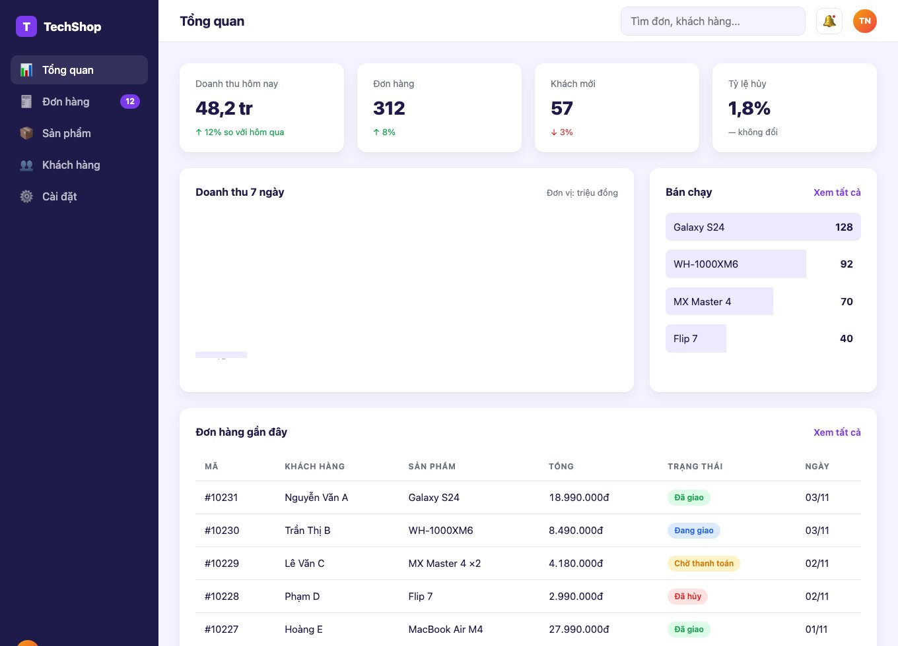
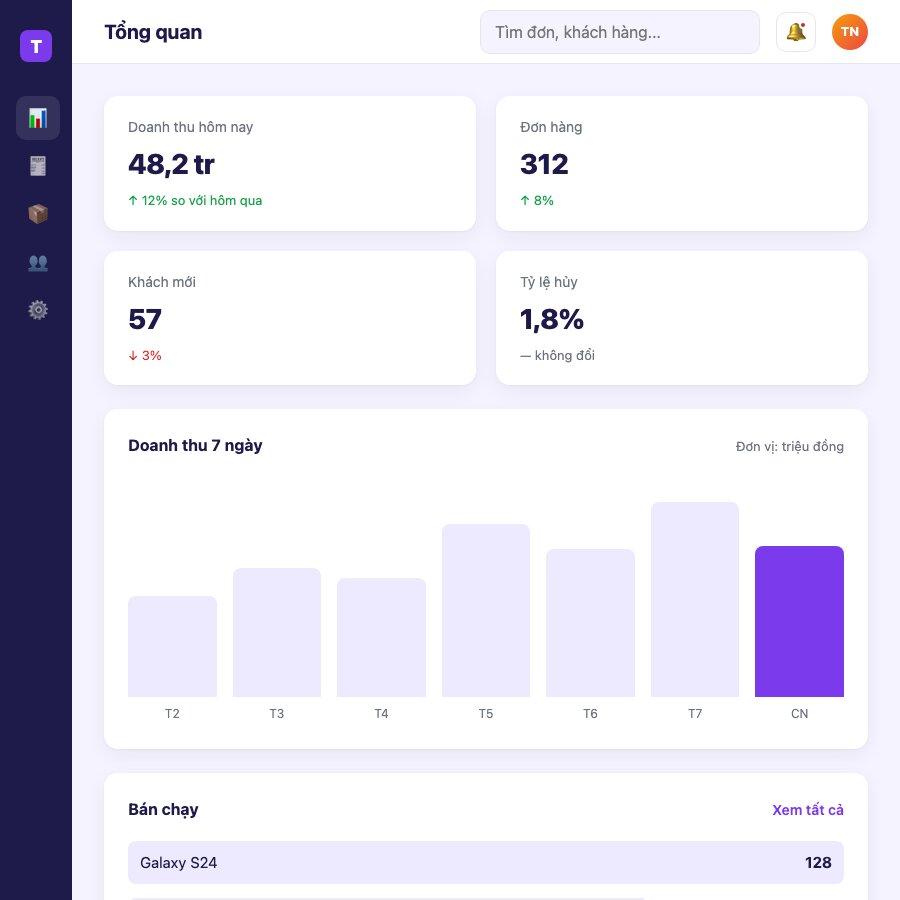
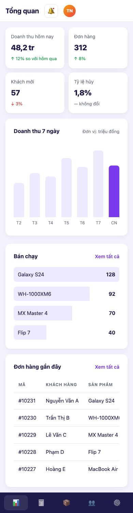
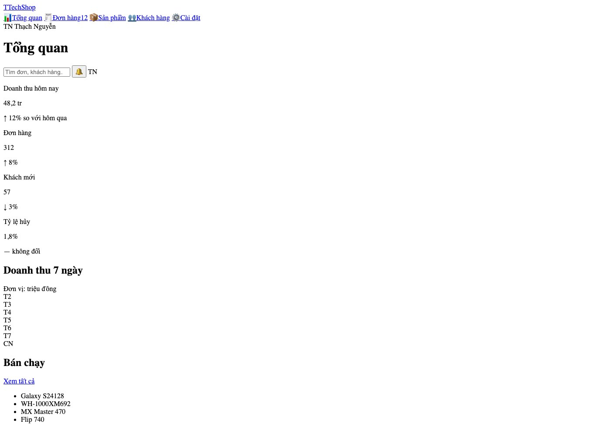
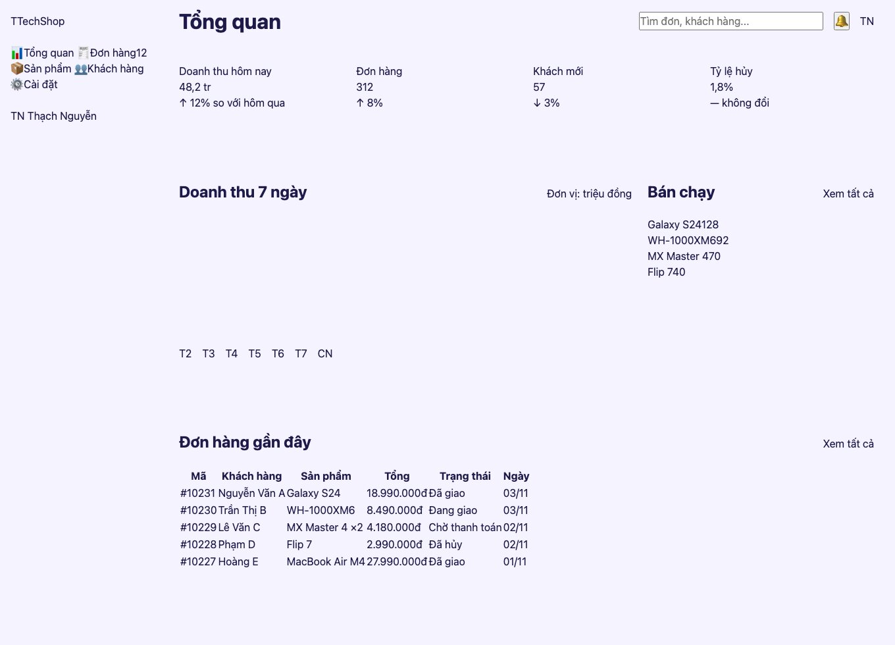
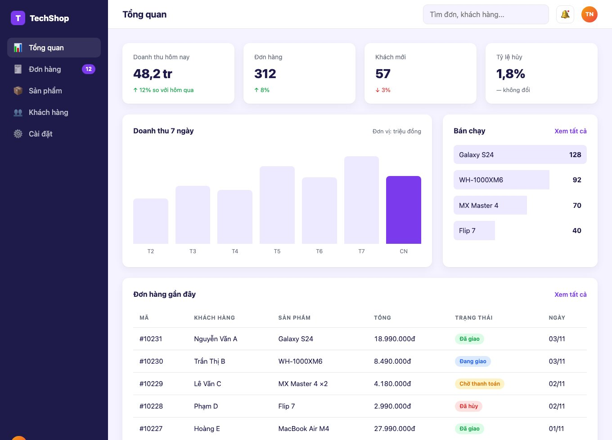

Bài 7 là trang quản trị: sidebar tối bên trái, thanh trên, 4 ô số liệu, biểu đồ cột, bảng xếp hạng và bảng đơn hàng. Kỹ năng mới: <mark>grid-template-areas</mark> để xếp khung trang bằng "bản đồ chữ", biểu đồ **chỉ bằng CSS**, bảng dữ liệu cuộn được trên điện thoại, và cách một layout 3 vùng biến thành sidebar thu gọn rồi thanh điều hướng dưới đáy.

#### Kết quả cần đạt


Dưới 1100px, sidebar thu thành thanh icon. Dưới 760px, nó xuống đáy màn hình như app điện thoại.




Mã nguồn: [index.html](/assets/code/post_136/index.html), [scss/main.scss](/assets/code/post_136/scss/main.scss), [css/style.css](/assets/code/post_136/css/style.css).

#### Bước 1: Tách component
```
app (grid 3 vùng: sidebar, topbar, content)
├── sidebar: logo (mark + text), menu > menu__item × 5 (icon, label, badge), user (avatar + tên)
├── topbar: title, search, btn thông báo (dot), avatar
└── content
    ├── stats > stat × 4 (label, value, delta up/down)
    ├── panels (2 cột)
    │   ├── card: head (title, meta) + chart > chart__bar × 7 (label)
    │   └── card: head (title, link) + ranking > ranking__item × 4 (name, count)
    └── card: head + table-wrap > table (pill cho trạng thái)
```
<mark>card</mark> là khung trắng dùng chung cho 3 khối; <mark>avatar</mark> xuất hiện ở sidebar và topbar nên là block riêng; <mark>pill</mark> là nhãn trạng thái với 4 modifier màu.

#### Bước 2: Đặt tên

| Khối | Class |
|---|---|
| Khung | <mark>.app</mark>, <mark>.sidebar</mark>, <mark>.sidebar__logo</mark>, <mark>.sidebar__mark</mark>, <mark>.sidebar__text</mark>, <mark>.sidebar__user</mark>, <mark>.topbar</mark>, <mark>.topbar__title</mark>, <mark>.topbar__search</mark>, <mark>.topbar__btn</mark>, <mark>.topbar__dot</mark>, <mark>.content</mark> |
| Menu | <mark>.menu</mark>, <mark>.menu__item</mark>, <mark>.menu__item--active</mark>, <mark>.menu__icon</mark>, <mark>.menu__label</mark>, <mark>.menu__badge</mark>, <mark>.avatar</mark> |
| Số liệu | <mark>.stats</mark>, <mark>.stat</mark>, <mark>.stat__label</mark>, <mark>.stat__value</mark>, <mark>.stat__delta</mark>, <mark>.stat__delta--up</mark>, <mark>.stat__delta--down</mark> |
| Card và nội dung | <mark>.panels</mark>, <mark>.card</mark>, <mark>.card__head</mark>, <mark>.card__title</mark>, <mark>.card__meta</mark>, <mark>.card__link</mark>, <mark>.chart</mark>, <mark>.chart__bar</mark>, <mark>.chart__bar--today</mark>, <mark>.chart__label</mark>, <mark>.ranking</mark>, <mark>.ranking__item</mark>, <mark>.ranking__name</mark>, <mark>.ranking__count</mark> |
| Bảng | <mark>.table-wrap</mark>, <mark>.table</mark>, <mark>.table__num</mark>, <mark>.pill</mark>, <mark>.pill--success</mark>, <mark>.pill--info</mark>, <mark>.pill--warning</mark>, <mark>.pill--danger</mark> |

#### Bước 3: HTML
```html
<!doctype html>
<html lang="vi">
<head>
  <meta charset="utf-8">
  <meta name="viewport" content="width=device-width, initial-scale=1">
  <title>Dashboard - TechShop Admin</title>
  <link rel="stylesheet" href="css/style.css">
</head>
<body>
  <div class="app">
    <aside class="sidebar">
      <a class="sidebar__logo" href="#"><span class="sidebar__mark">T</span><span class="sidebar__text">TechShop</span></a>
      <nav class="menu">
        <a class="menu__item menu__item--active" href="#"><span class="menu__icon">📊</span><span class="menu__label">Tổng quan</span></a>
        <a class="menu__item" href="#"><span class="menu__icon">🧾</span><span class="menu__label">Đơn hàng</span><span class="menu__badge">12</span></a>
        <a class="menu__item" href="#"><span class="menu__icon">📦</span><span class="menu__label">Sản phẩm</span></a>
        <a class="menu__item" href="#"><span class="menu__icon">👥</span><span class="menu__label">Khách hàng</span></a>
        <a class="menu__item" href="#"><span class="menu__icon">⚙️</span><span class="menu__label">Cài đặt</span></a>
      </nav>
      <div class="sidebar__user">
        <span class="avatar">TN</span>
        <span class="sidebar__text">Thạch Nguyễn</span>
      </div>
    </aside>

    <header class="topbar">
      <h1 class="topbar__title">Tổng quan</h1>
      <input class="topbar__search" type="search" placeholder="Tìm đơn, khách hàng...">
      <button class="topbar__btn" type="button" aria-label="Thông báo">🔔<span class="topbar__dot"></span></button>
      <span class="avatar">TN</span>
    </header>

    <main class="content">
      <section class="stats">
        <article class="stat">
          <p class="stat__label">Doanh thu hôm nay</p>
          <p class="stat__value">48,2 tr</p>
          <p class="stat__delta stat__delta--up">↑ 12% so với hôm qua</p>
        </article>
        <article class="stat">
          <p class="stat__label">Đơn hàng</p>
          <p class="stat__value">312</p>
          <p class="stat__delta stat__delta--up">↑ 8%</p>
        </article>
        <article class="stat">
          <p class="stat__label">Khách mới</p>
          <p class="stat__value">57</p>
          <p class="stat__delta stat__delta--down">↓ 3%</p>
        </article>
        <article class="stat">
          <p class="stat__label">Tỷ lệ hủy</p>
          <p class="stat__value">1,8%</p>
          <p class="stat__delta">— không đổi</p>
        </article>
      </section>

      <section class="panels">
        <article class="card">
          <header class="card__head">
            <h2 class="card__title">Doanh thu 7 ngày</h2>
            <span class="card__meta">Đơn vị: triệu đồng</span>
          </header>
          <div class="chart">
            <div class="chart__bar" style="--value: 32"><span class="chart__label">T2</span></div>
            <div class="chart__bar" style="--value: 41"><span class="chart__label">T3</span></div>
            <div class="chart__bar" style="--value: 38"><span class="chart__label">T4</span></div>
            <div class="chart__bar" style="--value: 55"><span class="chart__label">T5</span></div>
            <div class="chart__bar" style="--value: 47"><span class="chart__label">T6</span></div>
            <div class="chart__bar" style="--value: 62"><span class="chart__label">T7</span></div>
            <div class="chart__bar chart__bar--today" style="--value: 48"><span class="chart__label">CN</span></div>
          </div>
        </article>

        <article class="card">
          <header class="card__head">
            <h2 class="card__title">Bán chạy</h2>
            <a class="card__link" href="#">Xem tất cả</a>
          </header>
          <ul class="ranking">
            <li class="ranking__item" style="--percent: 100%"><span class="ranking__name">Galaxy S24</span><span class="ranking__count">128</span></li>
            <li class="ranking__item" style="--percent: 72%"><span class="ranking__name">WH-1000XM6</span><span class="ranking__count">92</span></li>
            <li class="ranking__item" style="--percent: 55%"><span class="ranking__name">MX Master 4</span><span class="ranking__count">70</span></li>
            <li class="ranking__item" style="--percent: 31%"><span class="ranking__name">Flip 7</span><span class="ranking__count">40</span></li>
          </ul>
        </article>
      </section>

      <article class="card">
        <header class="card__head">
          <h2 class="card__title">Đơn hàng gần đây</h2>
          <a class="card__link" href="#">Xem tất cả</a>
        </header>
        <div class="table-wrap">
          <table class="table">
            <thead>
              <tr><th>Mã</th><th>Khách hàng</th><th>Sản phẩm</th><th class="table__num">Tổng</th><th>Trạng thái</th><th>Ngày</th></tr>
            </thead>
            <tbody>
              <tr><td>#10231</td><td>Nguyễn Văn A</td><td>Galaxy S24</td><td class="table__num">18.990.000đ</td><td><span class="pill pill--success">Đã giao</span></td><td>03/11</td></tr>
              <tr><td>#10230</td><td>Trần Thị B</td><td>WH-1000XM6</td><td class="table__num">8.490.000đ</td><td><span class="pill pill--info">Đang giao</span></td><td>03/11</td></tr>
              <tr><td>#10229</td><td>Lê Văn C</td><td>MX Master 4 ×2</td><td class="table__num">4.180.000đ</td><td><span class="pill pill--warning">Chờ thanh toán</span></td><td>02/11</td></tr>
              <tr><td>#10228</td><td>Phạm D</td><td>Flip 7</td><td class="table__num">2.990.000đ</td><td><span class="pill pill--danger">Đã hủy</span></td><td>02/11</td></tr>
              <tr><td>#10227</td><td>Hoàng E</td><td>MacBook Air M4</td><td class="table__num">27.990.000đ</td><td><span class="pill pill--success">Đã giao</span></td><td>01/11</td></tr>
            </tbody>
          </table>
        </div>
      </article>
    </main>
  </div>
</body>
</html>
```
Mở trang



- Số liệu của biểu đồ và xếp hạng nằm trong <mark>style="--value: 32"</mark>, <mark>style="--percent: 72%"</mark>: cùng cách của bài 133, HTML chỉ chở **dữ liệu**, CSS quyết định vẽ thế nào. Server sinh trang chỉ cần điền số.
- Bảng dùng đúng <mark>table</mark>/<mark>thead</mark>/<mark>tbody</mark>/<mark>th</mark>/<mark>td</mark>, bọc trong một <mark>div.table-wrap</mark> để cuộn ngang ở bước 7. Đừng làm bảng dữ liệu bằng <mark>div</mark>: mất hết tính năng đọc màn hình và cũng khó style hơn.
- Thứ tự trong HTML là sidebar → topbar → content, nhưng vị trí hiển thị sẽ do grid quyết định ở bước 4.

#### Bước 4: Token, reset, layout
```scss
/* ===== 1. Token & reset ===== */
@use "sass:map";

$breakpoints: (
  desktop: 1100px,
  tablet: 760px,
);

@mixin below($name) {
  @media (max-width: map.get($breakpoints, $name)) {
    @content;
  }
}

:root {
  --color-primary: #7c3aed;
  --color-primary-soft: #ede9fe;
  --color-text: #1e1b4b;
  --color-muted: #6b7280;
  --color-bg: #f5f3ff;
  --color-surface: #ffffff;
  --color-border: #e5e7eb;
  --color-sidebar: #1e1b4b;
  --color-success: #16a34a;
  --color-danger: #dc2626;
  --color-warning: #d97706;
  --color-info: #2563eb;
  --radius: 14px;
  --shadow: 0 1px 2px rgba(0, 0, 0, 0.04), 0 6px 20px rgba(30, 27, 75, 0.06);
  --font: system-ui, -apple-system, "Segoe UI", Roboto, sans-serif;
  --sidebar-width: 240px;
  --topbar-height: 64px;
}
```
```scss
*,
*::before,
*::after {
  box-sizing: border-box;
  margin: 0;
  padding: 0;
}

body {
  font-family: var(--font);
  color: var(--color-text);
  background: var(--color-bg);
  line-height: 1.5;
}

a {
  color: inherit;
  text-decoration: none;
}

ul {
  list-style: none;
}

button,
input {
  font: inherit;
  color: inherit;
}
```
```scss
/* ===== 2. Layout ===== */
.app {
  min-height: 100vh;
  display: grid;
  grid-template-columns: var(--sidebar-width) 1fr;
  grid-template-rows: var(--topbar-height) 1fr;
  grid-template-areas:
    "sidebar topbar"
    "sidebar content";
}

.sidebar {
  grid-area: sidebar;
  display: flex;
  flex-direction: column;
  gap: 24px;
  padding: 20px 16px;
}

.topbar {
  grid-area: topbar;
  display: flex;
  align-items: center;
  gap: 16px;
  padding: 0 32px;
}

.content {
  grid-area: content;
  padding: 32px;
  display: grid;
  gap: 24px;
}

.stats {
  display: grid;
  grid-template-columns: repeat(4, 1fr);
  gap: 20px;
}

.panels {
  display: grid;
  grid-template-columns: 2fr 1fr;
  gap: 24px;
}

.card__head {
  display: flex;
  justify-content: space-between;
  align-items: baseline;
  gap: 12px;
  margin-bottom: 20px;
}

.chart {
  display: flex;
  align-items: flex-end;
  gap: 16px;
  height: 220px;
}

.topbar__search {
  margin-left: auto;
  width: 280px;
}
```
Trang lúc này



<mark>grid-template-areas</mark> là cách dễ hiểu nhất để xếp khung trang: vẽ **bản đồ bằng chữ**, mỗi chuỗi là một hàng, mỗi từ là một ô. <mark>"sidebar topbar" / "sidebar content"</mark> nghĩa là sidebar chiếm cột 1 cả hai hàng, topbar và content chia cột 2. Mỗi vùng chỉ cần khai báo <mark>grid-area: tên</mark>. Bước 7 sẽ đổi bản đồ này để sidebar xuống đáy mà **không sửa HTML**.

Chiều rộng sidebar và chiều cao topbar là token (<mark>--sidebar-width</mark>, <mark>--topbar-height</mark>). Đây là chuẩn bị cho một mẹo ở bước 7: đổi giá trị token trong media query là cả layout đổi theo.

**Mẹo:** <mark>.content { display: grid; gap: 24px }</mark> không có cột: grid một cột chỉ để lấy <mark>gap</mark> giữa các khối con, thay cho <mark>margin-bottom</mark> trên từng khối. Gọn và không bao giờ dư margin ở khối cuối.

#### Bước 5: Style component
Sidebar, menu, topbar
```scss
/* ===== 3. Component ===== */
@use "../tokens" as *;

.sidebar {
  background: var(--color-sidebar);
  color: #fff;

  &__logo {
    display: flex;
    align-items: center;
    gap: 10px;
    font-weight: 800;
    font-size: 1.125rem;
    padding: 4px 8px;
  }

  &__mark {
    width: 32px;
    height: 32px;
    border-radius: 8px;
    background: var(--color-primary);
    display: grid;
    place-items: center;
    flex: none;
  }

  &__user {
    margin-top: auto;
    display: flex;
    align-items: center;
    gap: 10px;
    padding: 8px;
    font-size: 0.875rem;
  }
}

.menu {
  display: grid;
  gap: 4px;

  &__item {
    display: flex;
    align-items: center;
    gap: 12px;
    padding: 10px 12px;
    border-radius: 10px;
    color: rgba(255, 255, 255, 0.7);
    font-weight: 500;

    &--active {
      background: rgba(255, 255, 255, 0.1);
      color: #fff;
    }
  }

  &__icon {
    width: 24px;
    text-align: center;
    flex: none;
  }

  &__badge {
    margin-left: auto;
    padding: 2px 8px;
    border-radius: 999px;
    background: var(--color-primary);
    color: #fff;
    font-size: 0.75rem;
    font-weight: 700;
  }
}

.avatar {
  flex: none;
  width: 36px;
  height: 36px;
  border-radius: 50%;
  background: linear-gradient(135deg, #f59e0b, #ef4444);
  color: #fff;
  font-size: 0.8125rem;
  font-weight: 700;
  display: grid;
  place-items: center;
}

.topbar {
  background: var(--color-surface);
  border-bottom: 1px solid var(--color-border);

  &__title {
    font-size: 1.25rem;
    font-weight: 700;
  }

  &__search {
    padding: 9px 14px;
    border: 1px solid var(--color-border);
    border-radius: 10px;
    background: var(--color-bg);

    &:focus {
      outline: none;
      border-color: var(--color-primary);
    }
  }

  &__btn {
    position: relative;
    width: 40px;
    height: 40px;
    border: 1px solid var(--color-border);
    border-radius: 10px;
    background: var(--color-surface);
    cursor: pointer;
  }

  &__dot {
    position: absolute;
    top: 8px;
    right: 8px;
    width: 8px;
    height: 8px;
    border-radius: 50%;
    background: var(--color-danger);
    border: 2px solid var(--color-surface);
  }
}
```
Sidebar tối với chữ trắng mờ 70%, mục đang chọn sáng hơn và có nền trắng 10%. <mark>.sidebar__user { margin-top: auto }</mark> đẩy khối người dùng xuống đáy sidebar (flex cột), mẹo quen thuộc từ bài 131. Chấm đỏ thông báo có viền trắng để tách khỏi icon phía sau.

Card, số liệu, biểu đồ, bảng
```scss
@use "../tokens" as *;

.card {
  min-width: 0;
  padding: 24px;
  background: var(--color-surface);
  border-radius: var(--radius);
  box-shadow: var(--shadow);

  &__title {
    font-size: 1rem;
    font-weight: 700;
  }

  &__meta {
    font-size: 0.8125rem;
    color: var(--color-muted);
  }

  &__link {
    font-size: 0.875rem;
    font-weight: 600;
    color: var(--color-primary);
  }
}

.stat {
  padding: 20px 24px;
  background: var(--color-surface);
  border-radius: var(--radius);
  box-shadow: var(--shadow);

  &__label {
    font-size: 0.875rem;
    color: var(--color-muted);
  }

  &__value {
    margin-top: 6px;
    font-size: 1.75rem;
    font-weight: 800;
    letter-spacing: -0.02em;
  }

  &__delta {
    margin-top: 6px;
    font-size: 0.8125rem;
    color: var(--color-muted);

    &--up {
      color: var(--color-success);
    }

    &--down {
      color: var(--color-danger);
    }
  }
}

.chart {
  margin-bottom: 28px;

  &__bar {
    flex: 1;
    height: calc(var(--value) / 70 * 100%);
    position: relative;
    border-radius: 8px 8px 0 0;
    background: var(--color-primary-soft);

    &--today {
      background: var(--color-primary);
    }
  }

  &__label {
    position: absolute;
    top: 100%;
    left: 0;
    right: 0;
    margin-top: 8px;
    text-align: center;
    font-size: 0.75rem;
    color: var(--color-muted);
  }
}

.ranking {
  display: grid;
  gap: 14px;

  &__item {
    position: relative;
    isolation: isolate;
    display: flex;
    justify-content: space-between;
    padding: 10px 12px;
    font-size: 0.9375rem;
    border-radius: 8px;
    overflow: hidden;

    &::before {
      content: "";
      position: absolute;
      inset: 0;
      width: var(--percent);
      background: var(--color-primary-soft);
      z-index: -1;
    }
  }

  &__count {
    font-weight: 700;
  }
}

.table-wrap {
  overflow-x: auto;
}

.table {
  width: 100%;
  border-collapse: collapse;
  font-size: 0.9375rem;
  white-space: nowrap;

  th,
  td {
    padding: 12px 14px;
    text-align: left;
    border-bottom: 1px solid var(--color-border);
  }

  th {
    font-size: 0.75rem;
    text-transform: uppercase;
    letter-spacing: 0.06em;
    color: var(--color-muted);
  }

  tbody tr:last-child td {
    border-bottom: 0;
  }

  &__num {
    text-align: right;
    font-variant-numeric: tabular-nums;
  }
}

.pill {
  display: inline-block;
  padding: 3px 10px;
  border-radius: 999px;
  font-size: 0.75rem;
  font-weight: 600;

  &--success { background: #dcfce7; color: var(--color-success); }
  &--info { background: #dbeafe; color: var(--color-info); }
  &--warning { background: #fef3c7; color: var(--color-warning); }
  &--danger { background: #fee2e2; color: var(--color-danger); }
}
```
Trang lúc này



Bốn kỹ thuật trong khối này:
- **Biểu đồ cột**: khung <mark>.chart</mark> là flex với <mark>align-items: flex-end</mark> (cột mọc từ đáy) và cao 220px. Mỗi cột cao <mark>calc(var(--value) / 70 * 100%)</mark>, với 70 là giá trị lớn nhất của trục. Nhãn ngày là <mark>span</mark> định vị tuyệt đối **dưới** cột (<mark>top: 100%</mark>), nên <mark>.chart</mark> cần <mark>margin-bottom</mark> để chừa chỗ. Không cần thư viện cho một biểu đồ đơn giản như vậy.
- **Thanh xếp hạng**: nền tím nhạt là <mark>::before</mark> rộng <mark>var(--percent)</mark>, nằm **sau** chữ nhờ <mark>z-index: -1</mark>.
- **Bảng**: <mark>white-space: nowrap</mark> để ô không xuống dòng, kết hợp <mark>.table-wrap { overflow-x: auto }</mark> để bảng rộng thì cuộn ngang trong khung. Cột tiền căn phải với <mark>font-variant-numeric: tabular-nums</mark>: mọi chữ số rộng bằng nhau, các số thẳng cột.
- **Pill trạng thái**: nền nhạt, chữ đậm cùng tông, 4 modifier. Màu nền nhạt viết thẳng mã màu vì chỉ dùng ở đây; màu chữ lấy từ token để khớp với mũi tên delta.

**Mẹo (lỗi tôi gặp):** lúc đầu thanh xếp hạng **không hiện**. <mark>z-index: -1</mark> đẩy <mark>::before</mark> ra sau... **cả card trắng**, vì nó so z-index với mọi thứ trong stacking context gần nhất, mà <mark>.ranking__item</mark> chưa tạo stacking context. Thêm <mark>isolation: isolate</mark> cho item: nó thành một "lớp" riêng, <mark>z-index: -1</mark> chỉ đi xuống đáy của lớp đó, tức là ngay sau chữ. Khi <mark>z-index</mark> âm làm thứ gì biến mất, hãy nghĩ tới <mark>isolation: isolate</mark>.

**Mẹo:** <mark>.card { min-width: 0 }</mark> là cùng bài học bài 133: card chứa bảng rộng nằm trong grid, không có dòng này thì trên điện thoại card bị kéo rộng theo bảng và trang cuộn ngang. Tôi đã quên và phải sửa lại.

#### Bước 6: Hiệu ứng
```scss
/* ===== 4. Hiệu ứng ===== */
@keyframes grow {
  from {
    transform: scaleY(0);
  }
  to {
    transform: scaleY(1);
  }
}

.chart__bar {
  transform-origin: bottom;
  animation: grow 0.6s ease-out both;
  transition: background-color 0.2s ease;

  &:nth-child(2) { animation-delay: 0.05s; }
  &:nth-child(3) { animation-delay: 0.1s; }
  &:nth-child(4) { animation-delay: 0.15s; }
  &:nth-child(5) { animation-delay: 0.2s; }
  &:nth-child(6) { animation-delay: 0.25s; }
  &:nth-child(7) { animation-delay: 0.3s; }

  &:hover {
    background: var(--color-primary);
  }
}

.menu__item {
  transition: background-color 0.2s ease, color 0.2s ease;

  &:hover {
    background: rgba(255, 255, 255, 0.08);
    color: #fff;
  }
}

.table tbody tr {
  transition: background-color 0.15s ease;

  &:hover {
    background: var(--color-bg);
  }
}

.card__link:hover {
  text-decoration: underline;
}

@media (prefers-reduced-motion: reduce) {
  .chart__bar {
    animation: none;
  }
}
```
Khi tải trang, các cột "mọc" lên từ đáy, cột sau trễ hơn cột trước 50ms. Dùng <mark>transform: scaleY</mark> với <mark>transform-origin: bottom</mark> thay vì animate <mark>height</mark>: rẻ hơn nhiều cho trình duyệt (bài 129) và nhãn ngày nằm ngoài cột không bị co theo. Hàng bảng đổi nền khi rê chuột để dễ dò theo hàng.

#### Bước 7: Responsive
```scss
/* ===== 5. Responsive ===== */
@use "tokens" as *;

@include below(desktop) {
  .app {
    --sidebar-width: 72px;
  }

  .sidebar__text,
  .menu__label,
  .menu__badge {
    display: none;
  }

  .menu__item,
  .sidebar__logo {
    justify-content: center;
    padding: 10px;
  }

  .sidebar__user {
    justify-content: center;
  }

  .stats {
    grid-template-columns: repeat(2, 1fr);
  }

  .panels {
    grid-template-columns: 1fr;
  }
}

@include below(tablet) {
  .app {
    grid-template-columns: 1fr;
    grid-template-rows: var(--topbar-height) 1fr auto;
    grid-template-areas:
      "topbar"
      "content"
      "sidebar";
  }

  .sidebar {
    position: sticky;
    bottom: 0;
    flex-direction: row;
    align-items: center;
    padding: 8px 12px;
    gap: 8px;
  }

  .sidebar__logo,
  .sidebar__user {
    display: none;
  }

  .menu {
    flex: 1;
    grid-template-columns: repeat(5, 1fr);
  }

  .topbar {
    padding: 0 16px;
  }

  .topbar__search {
    display: none;
  }

  .content {
    padding: 16px;
    gap: 16px;
  }

  .stats {
    gap: 12px;
  }

  .stat {
    padding: 16px;
  }

  .stat__value {
    font-size: 1.375rem;
  }
}
```
Hai bước thu gọn, mỗi bước là một ý tưởng:
- **Dưới 1100px, thanh icon**: chỉ cần đổi **một token** <mark>--sidebar-width: 72px</mark>, cột grid tự hẹp lại; rồi giấu chữ, căn giữa icon. Đây là lợi ích của việc đặt kích thước vào CSS variable ở bước 4.
- **Dưới 760px, menu xuống đáy**: viết lại bản đồ <mark>grid-template-areas</mark> thành 3 hàng <mark>topbar / content / sidebar</mark>. Sidebar vẫn là cùng thẻ HTML đó, chỉ chuyển chỗ và xoay ngang (<mark>flex-direction: row</mark>), 5 icon chia đều. <mark>position: sticky; bottom: 0</mark> để nó luôn ở đáy màn hình khi cuộn, giống tab bar của app.

Bảng trên điện thoại không ép vừa (6 cột không thể vừa 390px): nó cuộn ngang trong card nhờ <mark>.table-wrap</mark>, còn trang thì không cuộn. Đây là cách xử lý bảng dữ liệu phổ biến nhất; cách khác là ẩn bớt cột ít quan trọng bằng <mark>display: none</mark> theo breakpoint.

```scss
@use "tokens";
@use "reset";
@use "layout";
@use "components/sidebar";
@use "components/cards";
@use "effects";
@use "responsive";
```

#### Checklist
- Tải lại trang: 7 cột mọc lên lần lượt. Rê chuột vào cột: đổi màu đậm.
- Thanh "Bán chạy" có nền tím với độ dài khác nhau (nếu không thấy, xem lại <mark>isolation</mark>).
- Kéo cửa sổ xuống 1000px: sidebar thành thanh icon, 4 ô số liệu thành 2×2, biểu đồ và xếp hạng xếp dọc.
- Kéo xuống 700px: menu ở đáy, cuộn trang nó vẫn dính; bảng cuộn ngang được bằng ngón tay, trang không cuộn ngang.
- Kiểm tra Lighthouse (tab trong DevTools) mục Accessibility: nút chuông có <mark>aria-label</mark>, bảng có <mark>th</mark>.

#### Bài tập thêm
- Thêm biểu đồ tròn "tỷ lệ theo danh mục" chỉ bằng CSS: <mark>background: conic-gradient(...)</mark> trên một hình tròn, với một hình tròn nhỏ màu nền đè giữa để thành vòng (donut).
- Thêm tooltip giá trị khi rê vào cột: <mark>::after { content: attr(data-value) }</mark> hiện trên đỉnh cột khi <mark>:hover</mark>.
- Làm sidebar có nút thu gọn/mở rộng bằng checkbox như menu bài 132, thay vì chỉ theo breakpoint.
