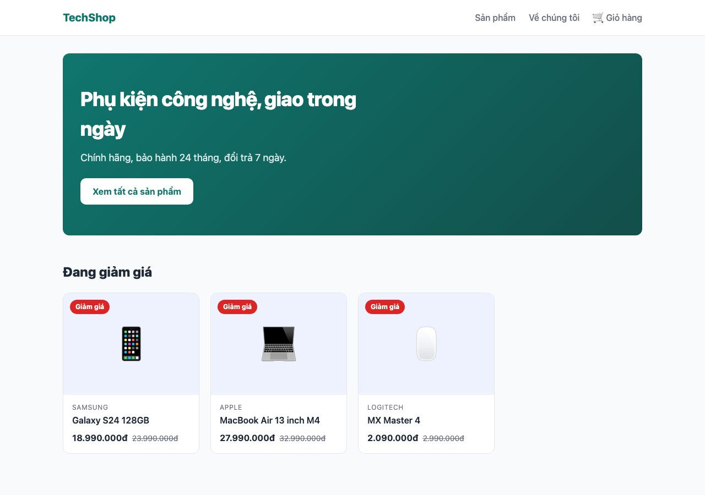
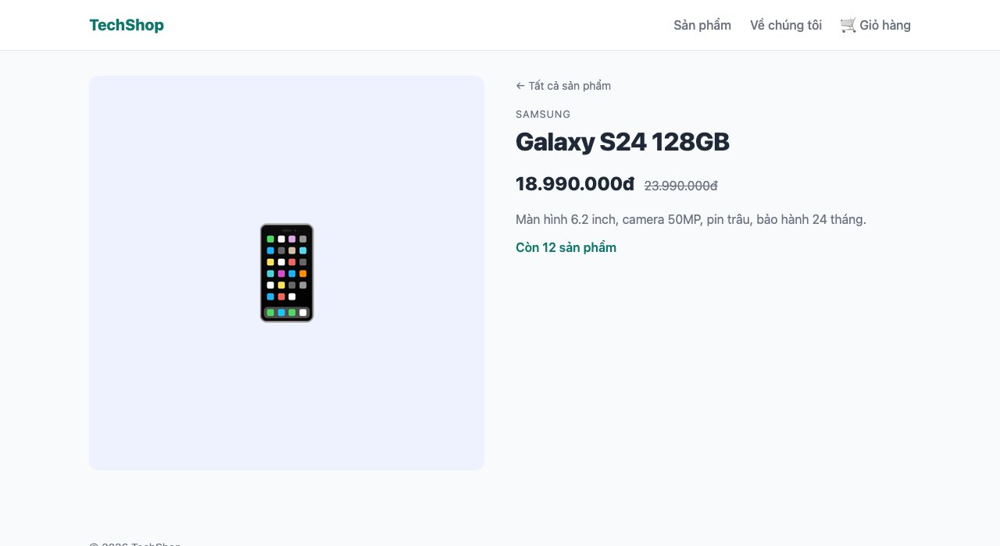
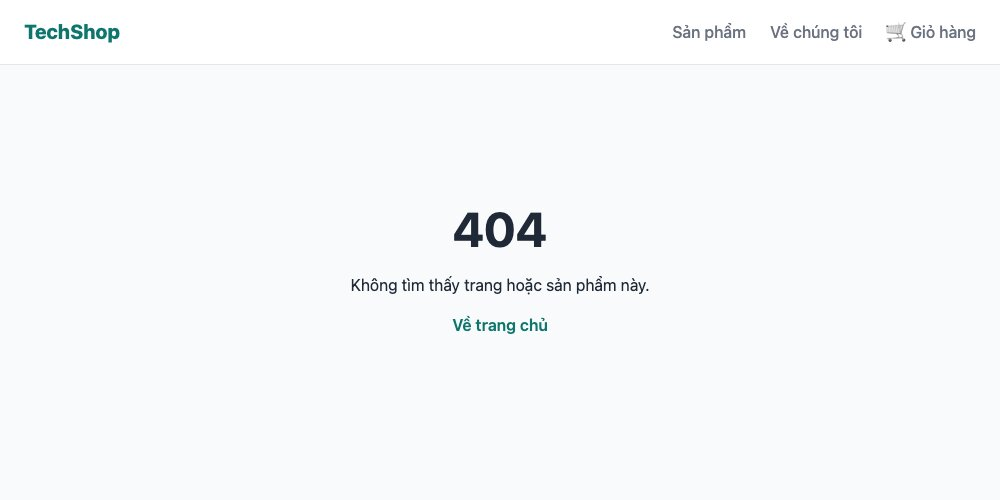
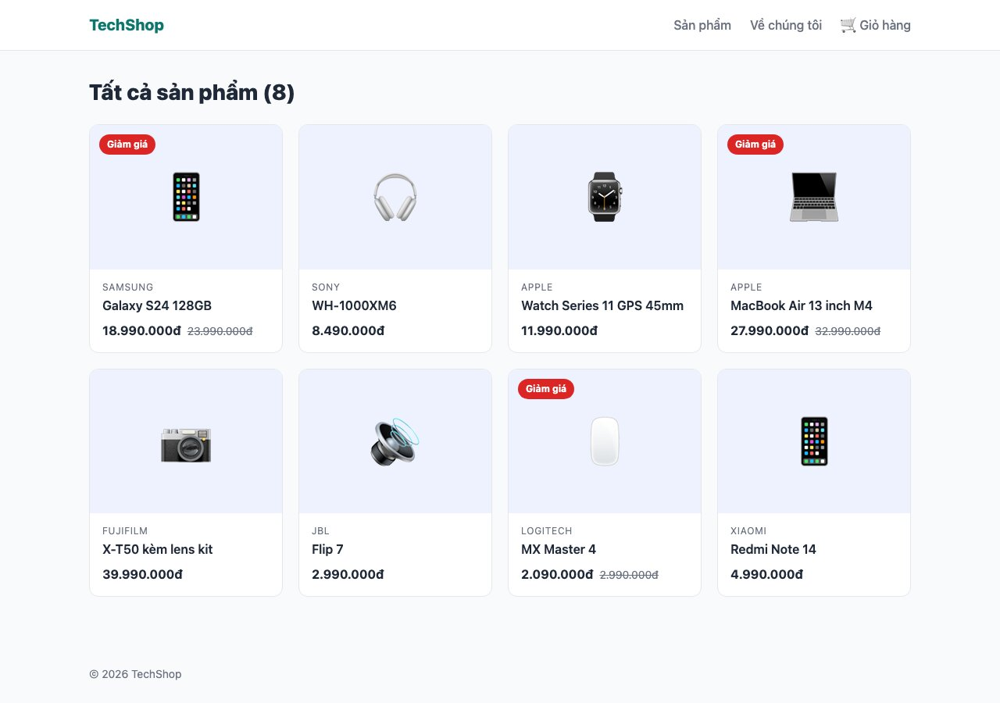
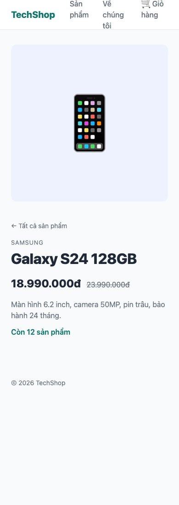

Bài này xây 4 trang của TechShop: trang chủ, danh sách sản phẩm, chi tiết từng sản phẩm, và trang 404. Qua đó học cách Next.js biến **thư mục thành URL**, layout lồng nhau, route động <mark>[slug]</mark>, và chuyển trang bằng <mark>Link</mark>. Dữ liệu tạm thời là một mảng trong code, bài 142 mới thay bằng database.

#### Kết quả cuối bài




#### Routing theo thư mục
Trong <mark>app/</mark>, **mỗi thư mục là một đoạn URL**, và thư mục chỉ thành trang khi có file <mark>page.tsx</mark>:

| File | URL |
|---|---|
| <mark>app/page.tsx</mark> | <mark>/</mark> |
| <mark>app/products/page.tsx</mark> | <mark>/products</mark> |
| <mark>app/products/[slug]/page.tsx</mark> | <mark>/products/galaxy-s24</mark>, <mark>/products/bat-ky</mark> |
| <mark>app/about/page.tsx</mark> | <mark>/about</mark> |

Ngoài <mark>page.tsx</mark>, mỗi thư mục có thể có vài file **tên cố định** với vai trò riêng:

| File | Vai trò |
|---|---|
| <mark>layout.tsx</mark> | Khung bọc các trang trong thư mục này và các thư mục con. Không bị vẽ lại khi chuyển trang |
| <mark>loading.tsx</mark> | Hiện trong lúc trang đang tải dữ liệu (bài 141) |
| <mark>error.tsx</mark> | Hiện khi trang lỗi, thay vì sập cả site (bài 141) |
| <mark>not-found.tsx</mark> | Trang 404 |
| <mark>route.ts</mark> | API endpoint thay vì trang (bài 147) |

Mọi file khác (<mark>product-card.tsx</mark>, <mark>utils.ts</mark>) đặt trong <mark>app/</mark> **không** thành route, nhưng để gọn, component và hàm dùng chung sẽ để ở <mark>components/</mark> và <mark>lib/</mark> ngoài <mark>app/</mark>.

#### Bước 1: Dữ liệu giả
```ts
// lib/products.ts
export type Product = {
  slug: string;
  name: string;
  brand: string;
  category: "dien-thoai" | "tai-nghe" | "phu-kien" | "laptop";
  price: number;
  oldPrice?: number;
  emoji: string;
  description: string;
  stock: number;
};

export const products: Product[] = [
  { slug: "galaxy-s24", name: "Galaxy S24 128GB", brand: "Samsung", category: "dien-thoai", price: 18990000, oldPrice: 23990000, emoji: "📱", description: "Màn hình 6.2 inch, camera 50MP, pin trâu, bảo hành 24 tháng.", stock: 12 },
  { slug: "wh-1000xm6", name: "WH-1000XM6", brand: "Sony", category: "tai-nghe", price: 8490000, emoji: "🎧", description: "Chống ồn chủ động thế hệ mới, pin 30 giờ.", stock: 5 },
  { slug: "watch-series-11", name: "Watch Series 11 GPS 45mm", brand: "Apple", category: "phu-kien", price: 11990000, emoji: "⌚", description: "Theo dõi sức khỏe, màn hình luôn bật.", stock: 8 },
  { slug: "macbook-air-m4", name: "MacBook Air 13 inch M4", brand: "Apple", category: "laptop", price: 27990000, oldPrice: 32990000, emoji: "💻", description: "16GB RAM, 256GB SSD, pin 18 giờ.", stock: 3 },
  { slug: "x-t50", name: "X-T50 kèm lens kit", brand: "Fujifilm", category: "phu-kien", price: 39990000, emoji: "📷", description: "Cảm biến 40MP, giả lập màu film.", stock: 2 },
  { slug: "flip-7", name: "Flip 7", brand: "JBL", category: "tai-nghe", price: 2990000, emoji: "🔊", description: "Loa di động chống nước IP68, pin 14 giờ.", stock: 20 },
  { slug: "mx-master-4", name: "MX Master 4", brand: "Logitech", category: "phu-kien", price: 2090000, oldPrice: 2990000, emoji: "🖱️", description: "Chuột không dây, cuộn MagSpeed, 70 ngày pin.", stock: 0 },
  { slug: "redmi-note-14", name: "Redmi Note 14", brand: "Xiaomi", category: "dien-thoai", price: 4990000, emoji: "📱", description: "Pin 5500mAh, sạc nhanh 45W, giá tốt.", stock: 30 },
];

export const formatPrice = (amount: number) => amount.toLocaleString("vi-VN") + "đ";
```
Phần TypeScript ở đây: <mark>type Product = { ... }</mark> mô tả một sản phẩm có những trường nào, <mark>oldPrice?</mark> nghĩa là có thể không có, <mark>category</mark> chỉ được là 1 trong 4 chuỗi. Nhờ vậy gõ <mark>product.</mark> là VS Code gợi ý đúng các trường, và gõ sai tên trường là báo đỏ ngay. <mark>slug</mark> là tên sản phẩm dạng URL, sẽ xuất hiện trong <mark>/products/galaxy-s24</mark>.

#### Bước 2: Component sản phẩm và CSS Modules
```tsx
// components/product-card.tsx
import Link from "next/link";
import { formatPrice, type Product } from "@/lib/products";
import styles from "./product-card.module.css";

export default function ProductCard({ product }: { product: Product }) {
  return (
    <Link href={`/products/${product.slug}`} className={styles.card}>
      <div className={styles.media}>
        {product.oldPrice && <span className={styles.badge}>Giảm giá</span>}
        <span className={styles.emoji}>{product.emoji}</span>
      </div>
      <div className={styles.body}>
        <p className={styles.brand}>{product.brand}</p>
        <h2 className={styles.name}>{product.name}</h2>
        <p className={styles.price}>
          {formatPrice(product.price)}
          {product.oldPrice && <s className={styles.old}>{formatPrice(product.oldPrice)}</s>}
        </p>
      </div>
    </Link>
  );
}
```
```css
/* components/product-card.module.css */
.card {
  display: block;
  background: var(--color-surface);
  border: 1px solid var(--color-border);
  border-radius: var(--radius);
  overflow: hidden;
  transition: transform 0.2s ease, box-shadow 0.2s ease;
}

.card:hover {
  transform: translateY(-4px);
  box-shadow: var(--shadow);
}

.media {
  position: relative;
  aspect-ratio: 4 / 3;
  display: grid;
  place-items: center;
  background: #eef2ff;
}

.badge {
  position: absolute;
  top: 12px;
  left: 12px;
  padding: 4px 10px;
  border-radius: 999px;
  background: var(--color-sale);
  color: #fff;
  font-size: 0.75rem;
  font-weight: 700;
}

.emoji {
  font-size: 4rem;
}

.body {
  padding: 14px 16px 16px;
}

.brand {
  font-size: 0.75rem;
  text-transform: uppercase;
  letter-spacing: 0.06em;
  color: var(--color-muted);
}

.name {
  font-size: 1rem;
  font-weight: 600;
  margin-top: 2px;
}

.price {
  margin-top: 8px;
  font-weight: 700;
  display: flex;
  gap: 8px;
  align-items: baseline;
}

.old {
  font-weight: 400;
  font-size: 0.875rem;
  color: var(--color-muted);
}
```
Bốn điều mới trong 2 file này:
- **Props**: component nhận dữ liệu qua tham số. <mark>ProductCard({ product })</mark> nhận một sản phẩm, nơi gọi viết <mark>&lt;ProductCard product={...} /&gt;</mark>.
- **CSS Modules**: file tên <mark>*.module.css</mark> được import thành object <mark>styles</mark>; <mark>styles.card</mark> là một class đã được đổi tên thành <mark>product-card_card__x7Hd2</mark> để **không bao giờ trùng** với class của component khác. Nhờ vậy không cần BEM nữa: mỗi component một file CSS, đặt tên ngắn (<mark>.card</mark>, <mark>.name</mark>) thoải mái.
- **Render có điều kiện**: <mark>{product.oldPrice && &lt;span&gt;...&lt;/span&gt;}</mark> chỉ vẽ badge khi có <mark>oldPrice</mark>.
- <mark>@/lib/products</mark>: <mark>@/</mark> là alias trỏ về thư mục gốc, thay cho <mark>../../lib/products</mark>.

**Mẹo:** <mark>Link</mark> của Next.js thay cho thẻ <mark>a</mark> khi đi **trong site**. Nó chuyển trang mà không tải lại cả trang, và **tải trước** (prefetch) trang đích khi link xuất hiện trên màn hình, nên bấm là hiện ngay. Link ra ngoài site thì vẫn dùng <mark>a</mark>.

#### Bước 3: Header và layout của shop
```tsx
// components/header.tsx
import Link from "next/link";
import styles from "./header.module.css";

export default function Header() {
  return (
    <header className={styles.header}>
      <div className={`container ${styles.inner}`}>
        <Link href="/" className={styles.logo}>TechShop</Link>
        <nav className={styles.nav}>
          <Link href="/products">Sản phẩm</Link>
          <Link href="/about">Về chúng tôi</Link>
          <Link href="/cart">🛒 Giỏ hàng</Link>
        </nav>
      </div>
    </header>
  );
}
```
```css
/* components/header.module.css */
.header {
  background: var(--color-surface);
  border-bottom: 1px solid var(--color-border);
}

.inner {
  height: 64px;
  display: flex;
  align-items: center;
  gap: 32px;
}

.logo {
  font-weight: 800;
  font-size: 1.25rem;
  color: var(--color-primary);
}

.nav {
  margin-left: auto;
  display: flex;
  gap: 24px;
  font-weight: 500;
  color: var(--color-muted);
}
```
Header này cần có ở mọi trang của shop, nhưng **không** ở trang quản trị sau này (bài 146). Nên thay vì đặt vào <mark>app/layout.tsx</mark>, tạo một **route group**: thư mục có tên trong ngoặc đơn <mark>(shop)</mark>. Ngoặc đơn nghĩa là "thư mục này chỉ để gom, **không** xuất hiện trong URL". Chuyển <mark>app/page.tsx</mark> vào <mark>app/(shop)/page.tsx</mark>, URL vẫn là <mark>/</mark>.
```
app/
├── layout.tsx            html, body: khung của TẤT CẢ
├── not-found.tsx
└── (shop)/
    ├── layout.tsx        header + footer: khung của các trang shop
    ├── page.tsx          /
    ├── page.module.css
    ├── about/page.tsx    /about
    └── products/
        ├── page.tsx      /products
        ├── page.module.css
        └── [slug]/
            ├── page.tsx  /products/:slug
            └── page.module.css
```
```tsx
// app/(shop)/layout.tsx
import Header from "@/components/header";

export default function ShopLayout({ children }: { children: React.ReactNode }) {
  return (
    <>
      <Header />
      <main className="container" style={{ paddingTop: 32, paddingBottom: 64 }}>
        {children}
      </main>
      <footer className="container" style={{ padding: 24, color: "var(--color-muted)", fontSize: 14 }}>
        © 2026 TechShop
      </footer>
    </>
  );
}
```
Layout **lồng nhau**: <mark>app/layout.tsx</mark> bọc <mark>app/(shop)/layout.tsx</mark> bọc <mark>page.tsx</mark>. Khi chuyển từ <mark>/</mark> sang <mark>/products</mark>, hai layout **giữ nguyên**, chỉ phần <mark>children</mark> đổi. Header không bị vẽ lại, không nháy.

<mark>&lt;&gt;...&lt;/&gt;</mark> là **Fragment**: component phải trả về một thẻ gốc duy nhất; khi không muốn thêm <mark>div</mark> thừa thì bọc bằng cặp thẻ rỗng này. <mark>style={{ paddingTop: 32 }}</mark> là inline style trong JSX: object JavaScript, thuộc tính viết camelCase, số là px. Dùng cho vài dòng lặt vặt; style nghiêm túc thì CSS Module.

#### Bước 4: Trang chủ và trang danh sách
```tsx
// app/(shop)/page.tsx
import Link from "next/link";
import ProductCard from "@/components/product-card";
import { products } from "@/lib/products";
import styles from "./page.module.css";

export default function HomePage() {
  const featured = products.filter((p) => p.oldPrice).slice(0, 3);

  return (
    <>
      <section className={styles.hero}>
        <h1 className={styles.title}>Phụ kiện công nghệ, giao trong ngày</h1>
        <p className={styles.text}>Chính hãng, bảo hành 24 tháng, đổi trả 7 ngày.</p>
        <Link href="/products" className={styles.cta}>Xem tất cả sản phẩm</Link>
      </section>

      <h2 className={styles.heading}>Đang giảm giá</h2>
      <div className={styles.grid}>
        {featured.map((product) => (
          <ProductCard key={product.slug} product={product} />
        ))}
      </div>
    </>
  );
}
```
```css
/* app/(shop)/page.module.css */
.hero {
  padding: 56px 32px;
  border-radius: var(--radius);
  background: linear-gradient(135deg, #0f766e, #134e4a);
  color: #fff;
}

.title {
  font-size: 2.25rem;
  font-weight: 800;
  letter-spacing: -0.02em;
  max-width: 560px;
}

.text {
  margin-top: 12px;
  opacity: 0.85;
  font-size: 1.125rem;
}

.cta {
  display: inline-block;
  margin-top: 24px;
  padding: 12px 22px;
  border-radius: 10px;
  background: #fff;
  color: var(--color-primary);
  font-weight: 700;
}

.heading {
  margin: 48px 0 20px;
  font-size: 1.5rem;
  font-weight: 800;
}

.grid {
  display: grid;
  grid-template-columns: repeat(auto-fill, minmax(240px, 1fr));
  gap: 20px;
}
```
Dòng quan trọng nhất của React nằm ở đây: <mark>{featured.map((product) => &lt;ProductCard ... /&gt;)}</mark>. Không có vòng lặp <mark>for</mark> trong JSX; muốn vẽ danh sách thì <mark>map</mark> mảng dữ liệu thành mảng component. <mark>key</mark> là bắt buộc và phải **duy nhất** trong danh sách (slug, id), để React biết phần tử nào là phần tử nào khi danh sách đổi.

Trang danh sách gần như giống, chỉ không lọc
```tsx
// app/(shop)/products/page.tsx
import ProductCard from "@/components/product-card";
import { products } from "@/lib/products";
import styles from "./page.module.css";

export default function ProductsPage() {
  return (
    <>
      <h1 className={styles.title}>Tất cả sản phẩm ({products.length})</h1>
      <div className={styles.grid}>
        {products.map((product) => (
          <ProductCard key={product.slug} product={product} />
        ))}
      </div>
    </>
  );
}
```
```css
/* app/(shop)/products/page.module.css */
.title {
  font-size: 1.75rem;
  font-weight: 800;
  margin-bottom: 20px;
}

.grid {
  display: grid;
  grid-template-columns: repeat(auto-fill, minmax(240px, 1fr));
  gap: 20px;
}
```


#### Bước 5: Route động [slug]
8 sản phẩm không thể tạo 8 thư mục. Thư mục tên trong **ngoặc vuông** <mark>[slug]</mark> khớp với **bất kỳ** giá trị nào ở vị trí đó của URL, và giá trị được đưa vào component qua <mark>params</mark>.
```tsx
// app/(shop)/products/[slug]/page.tsx
import Link from "next/link";
import { notFound } from "next/navigation";
import { formatPrice, products } from "@/lib/products";
import styles from "./page.module.css";

export default async function ProductPage({ params }: { params: Promise<{ slug: string }> }) {
  const { slug } = await params;
  const product = products.find((p) => p.slug === slug);

  if (!product) notFound();

  return (
    <article className={styles.product}>
      <div className={styles.media}>{product.emoji}</div>
      <div>
        <Link href="/products" className={styles.back}>← Tất cả sản phẩm</Link>
        <p className={styles.brand}>{product.brand}</p>
        <h1 className={styles.name}>{product.name}</h1>
        <p className={styles.price}>
          {formatPrice(product.price)}
          {product.oldPrice && <s className={styles.old}>{formatPrice(product.oldPrice)}</s>}
        </p>
        <p className={styles.desc}>{product.description}</p>
        <p className={styles.stock}>{product.stock > 0 ? `Còn ${product.stock} sản phẩm` : "Hết hàng"}</p>
      </div>
    </article>
  );
}
```
```css
/* app/(shop)/products/[slug]/page.module.css */
.product {
  display: grid;
  grid-template-columns: 1fr 1fr;
  gap: 40px;
  align-items: start;
}

.media {
  aspect-ratio: 1;
  display: grid;
  place-items: center;
  font-size: 8rem;
  border-radius: var(--radius);
  background: #eef2ff;
}

.back {
  color: var(--color-muted);
  font-size: 0.875rem;
}

.brand {
  margin-top: 16px;
  text-transform: uppercase;
  letter-spacing: 0.06em;
  font-size: 0.8125rem;
  color: var(--color-muted);
}

.name {
  font-size: 2rem;
  font-weight: 800;
  letter-spacing: -0.02em;
}

.price {
  margin-top: 12px;
  font-size: 1.5rem;
  font-weight: 800;
  display: flex;
  gap: 12px;
  align-items: baseline;
}

.old {
  font-size: 1rem;
  font-weight: 400;
  color: var(--color-muted);
}

.desc {
  margin-top: 16px;
  color: var(--color-muted);
}

.stock {
  margin-top: 12px;
  font-weight: 600;
  color: var(--color-primary);
}

@media (max-width: 700px) {
  .product {
    grid-template-columns: 1fr;
  }
}
```
Ba điều cần hiểu đúng ở file này, vì chúng hay sai:
- <mark>params</mark> là một **Promise** trong Next.js 15 (trước đó là object thường). Vì vậy component phải là <mark>async</mark> và phải <mark>await params</mark>. Copy code cũ từ internet thiếu <mark>await</mark> sẽ lỗi. Component có thể <mark>async</mark> là một khả năng chỉ có ở **Server Component**, bài 140 giải thích.
- <mark>notFound()</mark>: dừng render và hiện trang 404 gần nhất. Hàm này **ném ra** một exception đặc biệt, nên không cần <mark>return</mark> sau nó, TypeScript cũng hiểu rằng phía dưới <mark>product</mark> chắc chắn tồn tại.
- <mark>{ params }: { params: Promise&lt;{ slug: string }&gt; }</mark>: TypeScript mô tả "props có <mark>params</mark>, là Promise của object có <mark>slug</mark> chuỗi". Tên <mark>slug</mark> phải khớp tên thư mục <mark>[slug]</mark>.

Trang 404 ở gốc, dùng cho mọi URL không tồn tại và mọi lần gọi <mark>notFound()</mark>
```tsx
// app/not-found.tsx
import Link from "next/link";

export default function NotFound() {
  return (
    <main className="container" style={{ padding: "96px 24px", textAlign: "center" }}>
      <h1 style={{ fontSize: "3rem" }}>404</h1>
      <p style={{ marginTop: 8 }}>Không tìm thấy trang hoặc sản phẩm này.</p>
      <Link href="/" style={{ color: "var(--color-primary)", fontWeight: 600, display: "inline-block", marginTop: 16 }}>Về trang chủ</Link>
    </main>
  );
}
```
Mở <mark>/products/khong-co</mark>: trang 404 hiện ra **với mã HTTP 404 thật** (kiểm tra bằng tab Network), chứ không phải trang 200 có chữ "404". Google sẽ không index trang này.

Và một trang tĩnh để so sánh ở bài sau
```tsx
// app/(shop)/about/page.tsx
export default function AboutPage() {
  return (
    <>
      <h1>Về chúng tôi</h1>
      <p style={{ marginTop: 12, maxWidth: 600 }}>
        TechShop bán phụ kiện công nghệ chính hãng từ 2026. Trang này là một trang tĩnh: không có dữ liệu động, Next.js sẽ tạo sẵn HTML lúc build.
      </p>
    </>
  );
}
```

#### Build và đọc kết quả
```
Route (app)                         Size  First Load JS
┌ ○ /                                0 B         118 kB
├ ○ /_not-found                      0 B         118 kB
├ ○ /about                           0 B         118 kB
├ ○ /products                        0 B         118 kB
└ ƒ /products/[slug]                 0 B         118 kB
○  (Static)   prerendered as static content
ƒ  (Dynamic)  server-rendered on demand
```
Ba trang đầu là <mark>○</mark> tĩnh. Trang <mark>[slug]</mark> là <mark>ƒ</mark> **động**: Next.js không biết trước có những slug nào nên phải render **khi có request**. Bài 141 sẽ dạy cách khai báo trước danh sách slug để trang này cũng thành tĩnh, nhanh hơn và không tốn server.

#### Trên điện thoại


CSS Module vẫn là CSS: media query ở cuối file <mark>page.module.css</mark> xếp 2 cột thành 1. Header chưa responsive, bài 140 sẽ làm khi học Client Component.

#### Checklist
- Bấm qua lại giữa các trang: không tải lại trang (icon reload của trình duyệt không xoay), header đứng yên.
- Rê chuột lên một card sản phẩm trước khi bấm, mở tab Network: thấy Next.js tải trước trang đó.
- <mark>/products/khong-co</mark> trả về 404 trong tab Network.
- Thêm một sản phẩm vào mảng <mark>products</mark>: trang danh sách và trang chi tiết tự có, không sửa gì khác.

Mã nguồn cuối bài: [post_139.zip](/assets/code/post_139.zip).

#### Bài tập thêm
- Tạo trang <mark>/categories/[category]/page.tsx</mark> liệt kê sản phẩm theo danh mục, dùng <mark>products.filter</mark>. Nhớ <mark>notFound()</mark> khi danh mục không tồn tại.
- Thêm breadcrumb "Trang chủ › Sản phẩm › Galaxy S24" ở trang chi tiết bằng <mark>Link</mark>.
- Thêm <mark>app/(shop)/products/[slug]/not-found.tsx</mark> riêng với nội dung "Sản phẩm không tồn tại" và xem Next.js chọn file 404 nào.
