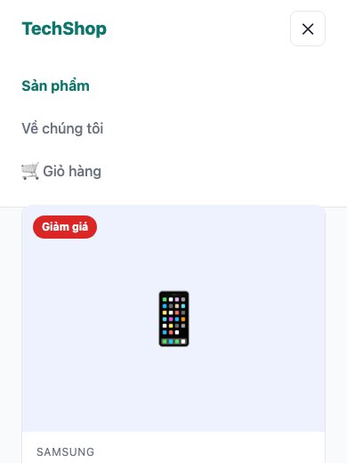
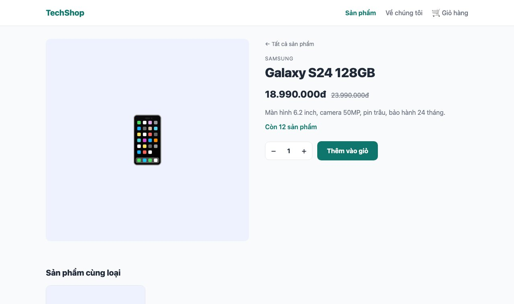

Đây là khái niệm quan trọng nhất của Next.js hiện đại, và cũng là thứ làm người mới rối nhất: có **hai loại component**, một loại chạy trên server, một loại chạy trong trình duyệt. Bài này làm rõ bằng 3 tính năng nhỏ: menu có mục đang chọn, menu di động bấm mở, và nút chọn số lượng ở trang sản phẩm.

#### Hai loại component
Mọi component trong <mark>app/</mark> mặc định là **Server Component**: hàm chạy trên server (hoặc lúc build), trả về HTML, và **JavaScript của nó không được gửi tới trình duyệt**. Đó là lý do bài 138 thấy trang của bạn tốn <mark>0 B</mark> JavaScript.

Server Component làm được mọi thứ không cần tương tác: đọc database, đọc file, gọi API bí mật (có API key), <mark>async/await</mark>. Nhưng nó **không** làm được những thứ chỉ có ở trình duyệt: <mark>onClick</mark>, <mark>useState</mark>, <mark>useEffect</mark>, <mark>window</mark>, <mark>localStorage</mark>.

Muốn những thứ đó, đặt dòng <mark>"use client"</mark> ở đầu file: component thành **Client Component**, được render sẵn ở server **và** gửi JavaScript tới trình duyệt để chạy tiếp (hydration).

| | Server Component (mặc định) | Client Component (<mark>"use client"</mark>) |
|---|---|---|
| Chạy ở | Server / lúc build | Server (render lần đầu) rồi trình duyệt |
| <mark>async</mark>, đọc DB, API key | Có | Không |
| <mark>useState</mark>, <mark>onClick</mark>, <mark>useEffect</mark>, <mark>window</mark> | Không | Có |
| Gửi JavaScript tới trình duyệt | Không | Có |
| Dùng cho | Hiển thị dữ liệu, layout, trang | Nút bấm, form tương tác, menu mở đóng, bất kỳ thứ gì đổi khi người dùng thao tác |

Cách chọn, đơn giản nhất: **mặc định là Server Component. Chỉ thêm <mark>"use client"</mark> khi gặp lỗi** vì cần <mark>useState</mark> hoặc <mark>onClick</mark>. Và thêm ở component **nhỏ nhất** có thể, không phải cả trang.

#### Bước 1: Menu có mục đang chọn
Muốn link "Sản phẩm" đổi màu khi đang ở <mark>/products</mark>, cần biết URL hiện tại. Hook <mark>usePathname</mark> cho biết điều đó, nhưng hook chỉ dùng được trong Client Component. Thay vì biến cả <mark>Header</mark> thành client, tách riêng phần link:
```tsx
// components/nav-links.tsx
"use client";

import Link from "next/link";
import { usePathname } from "next/navigation";
import { useState } from "react";
import styles from "./nav-links.module.css";

const links = [
  { href: "/products", label: "Sản phẩm" },
  { href: "/about", label: "Về chúng tôi" },
  { href: "/cart", label: "🛒 Giỏ hàng" },
];

export default function NavLinks() {
  const pathname = usePathname();
  const [open, setOpen] = useState(false);

  return (
    <>
      <button className={styles.toggle} onClick={() => setOpen(!open)} aria-label="Mở menu">
        {open ? "✕" : "☰"}
      </button>
      <nav className={`${styles.nav} ${open ? styles.open : ""}`}>
        {links.map((link) => {
          const active = pathname === link.href || pathname.startsWith(link.href + "/");
          return (
            <Link
              key={link.href}
              href={link.href}
              className={active ? styles.active : undefined}
              onClick={() => setOpen(false)}
            >
              {link.label}
            </Link>
          );
        })}
      </nav>
    </>
  );
}
```
```css
/* components/nav-links.module.css */
.nav {
  margin-left: auto;
  display: flex;
  gap: 24px;
  font-weight: 500;
  color: var(--color-muted);
}

.active {
  color: var(--color-primary);
  font-weight: 700;
}

.toggle {
  display: none;
  margin-left: auto;
  width: 40px;
  height: 40px;
  border: 1px solid var(--color-border);
  border-radius: 8px;
  background: var(--color-surface);
  font-size: 1.125rem;
  cursor: pointer;
}

@media (max-width: 700px) {
  .toggle {
    display: block;
  }

  .nav {
    display: none;
    position: absolute;
    top: 64px;
    left: 0;
    right: 0;
    flex-direction: column;
    gap: 0;
    padding: 8px 24px 16px;
    background: var(--color-surface);
    border-bottom: 1px solid var(--color-border);
  }

  .nav a {
    padding: 12px 0;
  }

  .open {
    display: flex;
  }
}
```
Những thứ React cơ bản trong file này, nếu bạn chưa học React:
- <mark>useState(false)</mark> tạo một **state**: giá trị <mark>open</mark> và hàm <mark>setOpen</mark> để đổi nó. Mỗi lần gọi <mark>setOpen</mark>, React chạy lại hàm component và vẽ lại phần thay đổi. Đây là cách duy nhất để giao diện "nhớ" gì đó giữa các lần bấm; dùng biến thường sẽ bị reset mỗi lần render.
- <mark>onClick={() => setOpen(!open)}</mark>: hàm chạy khi bấm. Phải truyền **hàm** (<mark>() =&gt; ...</mark>), không phải kết quả gọi hàm.
- <mark>className={open ? styles.open : ""}</mark>: thêm class theo điều kiện; CSS làm phần hiện/ẩn. Cùng cách nghĩ với menu checkbox ở bài 132, chỉ là state nằm trong JavaScript thay vì checkbox.
- <mark>usePathname()</mark> trả về <mark>"/products/galaxy-s24"</mark>; <mark>startsWith</mark> để link "Sản phẩm" vẫn sáng khi đang ở trang chi tiết.

Header vẫn là Server Component, chỉ **nhúng** Client Component vào
```tsx
// components/header.tsx
import Link from "next/link";
import NavLinks from "./nav-links";
import styles from "./header.module.css";

export default function Header() {
  console.log("Header render ở server");

  return (
    <header className={styles.header}>
      <div className={`container ${styles.inner}`}>
        <Link href="/" className={styles.logo}>TechShop</Link>
        <NavLinks />
      </div>
    </header>
  );
}
```
```css
/* components/header.module.css */
.header {
  position: relative;
  background: var(--color-surface);
  border-bottom: 1px solid var(--color-border);
}

.inner {
  height: 64px;
  display: flex;
  align-items: center;
  gap: 32px;
}

.logo {
  font-weight: 800;
  font-size: 1.25rem;
  color: var(--color-primary);
}
```


**Mẹo:** Server Component được phép import Client Component (như trên), nhưng Client Component **không** được import Server Component. Nếu cần đặt nội dung server bên trong một client component (ví dụ một modal client chứa danh sách từ DB), truyền nó qua <mark>children</mark>: <mark>&lt;Modal&gt;&lt;ProductList /&gt;&lt;/Modal&gt;</mark>. Server render <mark>ProductList</mark> trước rồi đưa kết quả vào.

#### Bước 2: Nút thêm vào giỏ
Trang sản phẩm là Server Component (async, đọc dữ liệu). Phần chọn số lượng cần state, tách thành component riêng:
```tsx
// components/add-to-cart.tsx
"use client";

import { useState } from "react";
import styles from "./add-to-cart.module.css";

type Props = { productName: string; stock: number };

export default function AddToCart({ productName, stock }: Props) {
  const [quantity, setQuantity] = useState(1);
  const [message, setMessage] = useState("");

  console.log("AddToCart render ở trình duyệt");

  if (stock === 0) {
    return <p className={styles.soldOut}>Hết hàng</p>;
  }

  return (
    <div className={styles.box}>
      <div className={styles.picker}>
        <button onClick={() => setQuantity(Math.max(1, quantity - 1))} aria-label="Giảm">−</button>
        <span>{quantity}</span>
        <button onClick={() => setQuantity(Math.min(stock, quantity + 1))} aria-label="Tăng">+</button>
      </div>
      <button className={styles.add} onClick={() => setMessage(`Đã chọn ${quantity} × ${productName} (bài 143 sẽ lưu vào giỏ thật)`)}>
        Thêm vào giỏ
      </button>
      {message && <p className={styles.message}>{message}</p>}
    </div>
  );
}
```
```css
/* components/add-to-cart.module.css */
.box {
  margin-top: 24px;
  display: flex;
  flex-wrap: wrap;
  align-items: center;
  gap: 12px;
}

.picker {
  display: inline-flex;
  align-items: center;
  border: 1px solid var(--color-border);
  border-radius: 10px;
  background: var(--color-surface);
}

.picker button {
  width: 40px;
  height: 44px;
  border: 0;
  background: none;
  font-size: 1.25rem;
  cursor: pointer;
}

.picker span {
  min-width: 36px;
  text-align: center;
  font-weight: 700;
}

.add {
  padding: 12px 24px;
  border: 0;
  border-radius: 10px;
  background: var(--color-primary);
  color: #fff;
  font-weight: 700;
  cursor: pointer;
}

.add:hover {
  background: var(--color-primary-dark);
}

.message {
  flex-basis: 100%;
  color: var(--color-primary);
  font-size: 0.9375rem;
}

.soldOut {
  margin-top: 24px;
  font-weight: 700;
  color: var(--color-muted);
}
```
Đặt vào trang sản phẩm, ngay dưới dòng tồn kho
```tsx
// app/(shop)/products/[slug]/page.tsx (thêm 2 dòng)
import AddToCart from "@/components/add-to-cart";
// ...
<AddToCart productName={product.name} stock={product.stock} />
```


Bấm +/−, số đổi ngay không cần server. Bấm "Thêm vào giỏ", dòng thông báo hiện. Bài 143 sẽ thay <mark>setMessage</mark> bằng việc lưu giỏ hàng thật trên server.

**Props từ server sang client phải là dữ liệu thuần**: chuỗi, số, boolean, mảng, object đơn giản. Ở đây truyền <mark>productName</mark> và <mark>stock</mark> chứ không truyền cả object <mark>product</mark> (cũng được, vì nó là object thuần) và tuyệt đối không truyền **hàm** hay instance class. Lý do: props phải được **serialize** thành JSON để gửi qua mạng tới trình duyệt.

#### Thấy tận mắt "chạy ở đâu"
Cả hai file có <mark>console.log</mark>. Mở <mark>/products/galaxy-s24</mark>:
- **Terminal** (nơi chạy <mark>npm run dev</mark>) in <mark>Header render ở server</mark>. Dòng này **không** xuất hiện trong Console của trình duyệt.
- **Console của trình duyệt** (F12) in <mark>AddToCart render ở trình duyệt</mark>. Dòng này **cũng** xuất hiện ở terminal một lần, vì Client Component được render lần đầu ở server để có HTML sẵn, rồi trình duyệt chạy lại để gắn sự kiện.

Thử gỡ dòng <mark>"use client"</mark> khỏi <mark>add-to-cart.tsx</mark>: Next.js báo lỗi ngay, nói rằng <mark>useState</mark> chỉ dùng được trong Client Component. Đây là cách học nhanh nhất: cứ viết như Server Component, lỗi thì mới thêm <mark>"use client"</mark>.

Xem lại kết quả build
```
└ ● /products/[slug]               643 B         123 kB
```
Trang sản phẩm giờ tốn <mark>643 B</mark> JavaScript riêng (so với <mark>0 B</mark> ở bài 139): đó chính là <mark>AddToCart</mark> và <mark>NavLinks</mark>. Mọi thứ khác của trang (tên, giá, mô tả) vẫn là HTML thuần. Hãy giữ thói quen nhìn cột này: nó cho biết bạn đang đẩy bao nhiêu code xuống điện thoại người dùng.

#### Ba lỗi hay gặp
1. **Đặt <mark>"use client"</mark> ở layout hoặc trang**: mọi thứ bên dưới thành client, mất hết lợi ích. Chỉ đặt ở component lá.
2. **Gọi database trong Client Component**: không chạy được (và nếu chạy được thì lộ mật khẩu DB). Dữ liệu lấy ở Server Component rồi truyền xuống qua props.
3. **Dùng <mark>window</mark> hoặc <mark>localStorage</mark> ở mức đầu file client**: Client Component vẫn render ở server lần đầu, lúc đó không có <mark>window</mark>. Đặt các truy cập đó trong <mark>useEffect</mark> hoặc trong hàm xử lý sự kiện.

#### Checklist
- Vào <mark>/products</mark>: link "Sản phẩm" màu xanh đậm. Vào <mark>/about</mark>: link "Về chúng tôi" đậm.
- Thu nhỏ dưới 700px: nút ☰ hiện, bấm mở menu, bấm một link thì menu đóng.
- Trang sản phẩm: +/− đổi số, không vượt quá tồn kho, không dưới 1. Sản phẩm "MX Master 4" (hết hàng) hiện "Hết hàng".
- Terminal và Console của trình duyệt in log ở đúng nơi như mô tả.

Mã nguồn cuối bài: [post_140.zip](/assets/code/post_140.zip).

#### Bài tập thêm
- Thêm nút "Lên đầu trang" hiện khi cuộn xuống quá 300px (cần <mark>useEffect</mark> lắng nghe <mark>scroll</mark>, và chỉ chạy ở trình duyệt).
- Làm <mark>AddToCart</mark> nhận thêm prop <mark>price</mark> và hiển thị tổng tiền <mark>quantity × price</mark> cập nhật theo số lượng.
- Tạo component <mark>&lt;ThemeToggle /&gt;</mark> đổi <mark>data-theme</mark> trên <mark>html</mark> (bài 137), lưu lựa chọn vào <mark>localStorage</mark> trong <mark>useEffect</mark>.
