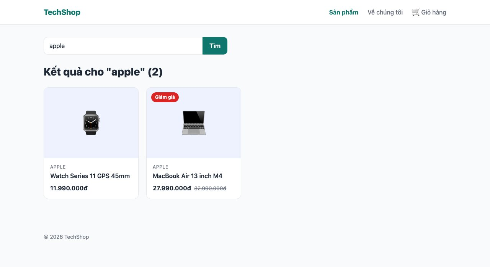
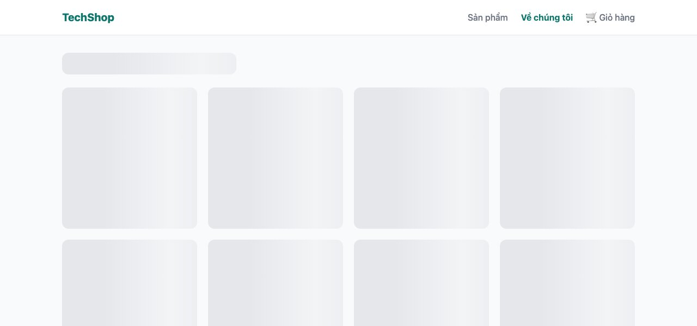
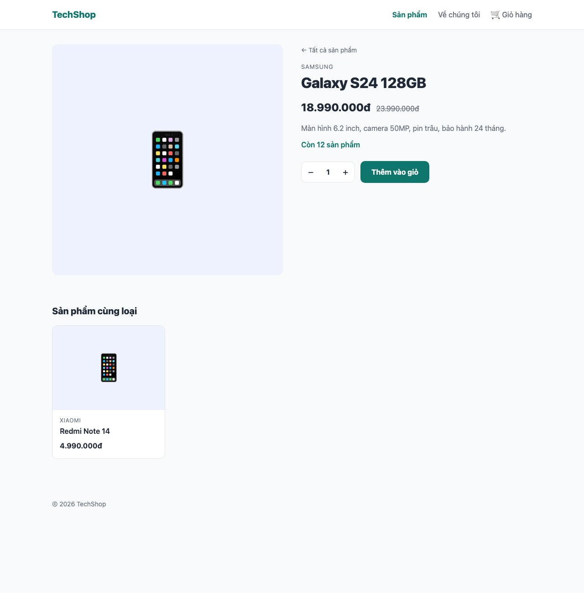

Tới giờ dữ liệu là một mảng có sẵn, lấy ra tức thì. Database thật thì mất thời gian, có thể lỗi, và thay đổi liên tục. Bài này giả lập điều đó bằng cách thêm độ trễ vào hàm lấy dữ liệu, rồi học cách Next.js xử lý: trang chờ dữ liệu thì hiện gì, lỗi thì sao, phần nào nên tạo sẵn lúc build, phần nào render mỗi request. Bài 142 thay mảng bằng database thật và **không phải sửa trang nào**, vì mọi thứ đã đi qua hàm.

#### Bước 1: Hàm lấy dữ liệu có độ trễ
```ts
// lib/products.ts
export type Product = {
  slug: string;
  name: string;
  brand: string;
  category: "dien-thoai" | "tai-nghe" | "phu-kien" | "laptop";
  price: number;
  oldPrice?: number;
  emoji: string;
  description: string;
  stock: number;
};

const products: Product[] = [
  { slug: "galaxy-s24", name: "Galaxy S24 128GB", brand: "Samsung", category: "dien-thoai", price: 18990000, oldPrice: 23990000, emoji: "📱", description: "Màn hình 6.2 inch, camera 50MP, pin trâu, bảo hành 24 tháng.", stock: 12 },
  { slug: "wh-1000xm6", name: "WH-1000XM6", brand: "Sony", category: "tai-nghe", price: 8490000, emoji: "🎧", description: "Chống ồn chủ động thế hệ mới, pin 30 giờ.", stock: 5 },
  { slug: "watch-series-11", name: "Watch Series 11 GPS 45mm", brand: "Apple", category: "phu-kien", price: 11990000, emoji: "⌚", description: "Theo dõi sức khỏe, màn hình luôn bật.", stock: 8 },
  { slug: "macbook-air-m4", name: "MacBook Air 13 inch M4", brand: "Apple", category: "laptop", price: 27990000, oldPrice: 32990000, emoji: "💻", description: "16GB RAM, 256GB SSD, pin 18 giờ.", stock: 3 },
  { slug: "x-t50", name: "X-T50 kèm lens kit", brand: "Fujifilm", category: "phu-kien", price: 39990000, emoji: "📷", description: "Cảm biến 40MP, giả lập màu film.", stock: 2 },
  { slug: "flip-7", name: "Flip 7", brand: "JBL", category: "tai-nghe", price: 2990000, emoji: "🔊", description: "Loa di động chống nước IP68, pin 14 giờ.", stock: 20 },
  { slug: "mx-master-4", name: "MX Master 4", brand: "Logitech", category: "phu-kien", price: 2090000, oldPrice: 2990000, emoji: "🖱️", description: "Chuột không dây, cuộn MagSpeed, 70 ngày pin.", stock: 0 },
  { slug: "redmi-note-14", name: "Redmi Note 14", brand: "Xiaomi", category: "dien-thoai", price: 4990000, emoji: "📱", description: "Pin 5500mAh, sạc nhanh 45W, giá tốt.", stock: 30 },
];

// Giả lập độ trễ của database để thấy loading và streaming hoạt động
const delay = (ms: number) => new Promise((resolve) => setTimeout(resolve, ms));

export async function getProducts(query?: string): Promise<Product[]> {
  await delay(800);
  if (!query) return products;
  const q = query.toLowerCase();
  return products.filter((p) => p.name.toLowerCase().includes(q) || p.brand.toLowerCase().includes(q));
}

export async function getProduct(slug: string): Promise<Product | undefined> {
  await delay(500);
  return products.find((p) => p.slug === slug);
}

export async function getRelatedProducts(product: Product): Promise<Product[]> {
  await delay(1500);
  return products.filter((p) => p.category === product.category && p.slug !== product.slug).slice(0, 3);
}

export const formatPrice = (amount: number) => amount.toLocaleString("vi-VN") + "đ";
```
Mảng <mark>products</mark> không còn <mark>export</mark>; mọi nơi phải đi qua 3 hàm <mark>async</mark>. Đây là cách tổ chức đúng ngay cả khi có database: trang không biết dữ liệu đến từ đâu.

#### Bước 2: Trang async
Server Component có thể là hàm <mark>async</mark> và <mark>await</mark> dữ liệu ngay trong thân hàm, không cần <mark>useEffect</mark>, không cần state loading. Trang chủ:
```tsx
// app/(shop)/page.tsx
import Link from "next/link";
import ProductCard from "@/components/product-card";
import { getProducts } from "@/lib/products";
import styles from "./page.module.css";

// Trang tĩnh nhưng tự làm mới tối đa mỗi 60 giây (ISR)
export const revalidate = 60;

export default async function HomePage() {
  const products = await getProducts();
  const featured = products.filter((p) => p.oldPrice).slice(0, 3);

  return (
    <>
      <section className={styles.hero}>
        <h1 className={styles.title}>Phụ kiện công nghệ, giao trong ngày</h1>
        <p className={styles.text}>Chính hãng, bảo hành 24 tháng, đổi trả 7 ngày.</p>
        <Link href="/products" className={styles.cta}>Xem tất cả sản phẩm</Link>
      </section>

      <h2 className={styles.heading}>Đang giảm giá</h2>
      <div className={styles.grid}>
        {featured.map((product) => (
          <ProductCard key={product.slug} product={product} />
        ))}
      </div>
    </>
  );
}
```
Dòng <mark>export const revalidate = 60</mark> giải thích ở cuối bài. Trang danh sách thêm **tìm kiếm** bằng query string <mark>?q=</mark>:
```tsx
// app/(shop)/products/page.tsx
import ProductCard from "@/components/product-card";
import { getProducts } from "@/lib/products";
import styles from "./page.module.css";

export default async function ProductsPage({ searchParams }: { searchParams: Promise<{ q?: string }> }) {
  const { q } = await searchParams;
  const products = await getProducts(q);

  return (
    <>
      <form className={styles.search}>
        <input name="q" type="search" defaultValue={q} placeholder="Tìm theo tên hoặc hãng..." />
        <button type="submit">Tìm</button>
      </form>

      <h1 className={styles.title}>
        {q ? `Kết quả cho "${q}"` : "Tất cả sản phẩm"} ({products.length})
      </h1>

      {products.length === 0 ? (
        <p>Không có sản phẩm nào khớp.</p>
      ) : (
        <div className={styles.grid}>
          {products.map((product) => (
            <ProductCard key={product.slug} product={product} />
          ))}
        </div>
      )}
    </>
  );
}
```
```css
/* app/(shop)/products/page.module.css */
.search {
  display: flex;
  max-width: 480px;
  margin-bottom: 24px;
}

.search input {
  flex: 1;
  padding: 10px 14px;
  border: 1px solid var(--color-border);
  border-right: 0;
  border-radius: 10px 0 0 10px;
  background: var(--color-surface);
}

.search button {
  padding: 10px 18px;
  border: 0;
  border-radius: 0 10px 10px 0;
  background: var(--color-primary);
  color: #fff;
  font-weight: 600;
  cursor: pointer;
}

.title {
  font-size: 1.75rem;
  font-weight: 800;
  margin-bottom: 20px;
}

.grid {
  display: grid;
  grid-template-columns: repeat(auto-fill, minmax(240px, 1fr));
  gap: 20px;
}
```


Form này **không có JavaScript**: <mark>form</mark> không có <mark>action</mark> thì gửi GET tới chính URL hiện tại với các field thành query string, <mark>/products?q=apple</mark>. Trang đọc <mark>searchParams</mark> (cũng là Promise như <mark>params</mark>) và lọc. Không <mark>useState</mark>, không <mark>fetch</mark> từ trình duyệt, và URL chia sẻ được. Rất nhiều tính năng "tìm kiếm, lọc, phân trang" chỉ cần đúng như vậy.

#### Bước 3: loading.tsx
Mở <mark>/products</mark> lúc này: trang trắng **0.8 giây** rồi mới hiện (vì <mark>getProducts</mark> chờ 800ms). Thêm file <mark>loading.tsx</mark> cạnh <mark>page.tsx</mark>: Next.js hiện nó **ngay lập tức** trong lúc trang đang chờ dữ liệu, rồi thay bằng trang thật khi xong.
```tsx
// app/(shop)/products/loading.tsx
import styles from "./loading.module.css";

export default function Loading() {
  return (
    <>
      <div className={`${styles.bar} ${styles.skeleton}`} />
      <div className={styles.grid}>
        {Array.from({ length: 8 }).map((_, i) => (
          <div key={i} className={`${styles.card} ${styles.skeleton}`} />
        ))}
      </div>
    </>
  );
}
```
```css
/* app/(shop)/products/loading.module.css */
.skeleton {
  background: linear-gradient(90deg, #e5e7eb 25%, #f3f4f6 50%, #e5e7eb 75%);
  background-size: 200% 100%;
  animation: shimmer 1.2s infinite;
  border-radius: var(--radius);
}

.bar {
  height: 40px;
  width: 320px;
  margin-bottom: 24px;
}

.grid {
  display: grid;
  grid-template-columns: repeat(auto-fill, minmax(240px, 1fr));
  gap: 20px;
}

.card {
  aspect-ratio: 4 / 4.2;
}

@keyframes shimmer {
  from { background-position: 200% 0; }
  to { background-position: -200% 0; }
}
```


Skeleton (khung xám nhấp nháy) tốt hơn vòng xoay vì nó **giữ chỗ đúng bố cục**, trang không nhảy khi dữ liệu về. <mark>loading.tsx</mark> áp dụng cho <mark>page.tsx</mark> cùng thư mục và mọi trang con; header vẫn hiện bình thường vì layout không chờ.

Bên dưới, Next.js dùng **streaming**: gửi HTML của layout và skeleton trước, giữ kết nối mở, khi dữ liệu về thì gửi tiếp phần trang thật. Người dùng thấy gì đó ngay sau vài chục mili giây thay vì nhìn màn hình trắng.

#### Bước 4: error.tsx
Dữ liệu có thể lỗi (database chết, API timeout). Không có gì bắt, cả trang sập với màn hình lỗi của Next.js. File <mark>error.tsx</mark> hứng lỗi của trang cùng thư mục, hiện giao diện thân thiện và cho thử lại:

```tsx
// app/(shop)/products/error.tsx
"use client";

export default function ProductsError({ error, reset }: { error: Error; reset: () => void }) {
  return (
    <div style={{ padding: 48, textAlign: "center" }}>
      <h2>Không tải được danh sách sản phẩm</h2>
      <p style={{ color: "var(--color-muted)", margin: "8px 0 16px" }}>{error.message}</p>
      <button onClick={reset} style={{ padding: "10px 20px", borderRadius: 10, border: 0, background: "var(--color-primary)", color: "#fff", cursor: "pointer" }}>
        Thử lại
      </button>
    </div>
  );
}
```

<mark>error.tsx</mark> **bắt buộc** là Client Component (có nút bấm <mark>reset</mark> để render lại). Thử: thêm <mark>throw new Error("Database không phản hồi")</mark> vào đầu <mark>getProducts</mark>, mở <mark>/products</mark>, thấy giao diện lỗi với header vẫn nguyên; bấm "Thử lại" là Next.js render lại trang. Nhớ xóa dòng <mark>throw</mark> sau khi thử.

Trong production, <mark>error.message</mark> của lỗi server bị thay bằng thông báo chung để không lộ chi tiết nội bộ, nên hãy hiển thị thông điệp của riêng bạn thay vì dựa vào <mark>error.message</mark>.

#### Bước 5: Streaming từng phần với Suspense
Trang sản phẩm có thêm "Sản phẩm cùng loại", lấy từ một hàm chậm (1.5 giây). Không nên bắt cả trang chờ nó. Tách thành component async riêng:

```tsx
// components/related-products.tsx
import ProductCard from "@/components/product-card";
import { getRelatedProducts, type Product } from "@/lib/products";

export default async function RelatedProducts({ product }: { product: Product }) {
  const related = await getRelatedProducts(product);

  if (related.length === 0) return null;

  return (
    <section style={{ marginTop: 64 }}>
      <h2 style={{ fontSize: "1.25rem", fontWeight: 800, marginBottom: 16 }}>Sản phẩm cùng loại</h2>
      <div style={{ display: "grid", gridTemplateColumns: "repeat(auto-fill, minmax(220px, 1fr))", gap: 20 }}>
        {related.map((p) => (
          <ProductCard key={p.slug} product={p} />
        ))}
      </div>
    </section>
  );
}
```

Và bọc nó trong <mark>Suspense</mark> ở trang sản phẩm. Đây cũng là lúc thêm <mark>generateStaticParams</mark>, giải thích ngay bên dưới:

```tsx
// app/(shop)/products/[slug]/page.tsx
import Link from "next/link";
import { Suspense } from "react";
import { notFound } from "next/navigation";
import AddToCart from "@/components/add-to-cart";
import RelatedProducts from "@/components/related-products";
import { formatPrice, getProduct, getProducts } from "@/lib/products";
import styles from "./page.module.css";

export async function generateStaticParams() {
  const products = await getProducts();
  return products.map((p) => ({ slug: p.slug }));
}

export default async function ProductPage({ params }: { params: Promise<{ slug: string }> }) {
  const { slug } = await params;
  const product = await getProduct(slug);

  if (!product) notFound();

  return (
    <>
      <article className={styles.product}>
        <div className={styles.media}>{product.emoji}</div>
        <div>
          <Link href="/products" className={styles.back}>← Tất cả sản phẩm</Link>
          <p className={styles.brand}>{product.brand}</p>
          <h1 className={styles.name}>{product.name}</h1>
          <p className={styles.price}>
            {formatPrice(product.price)}
            {product.oldPrice && <s className={styles.old}>{formatPrice(product.oldPrice)}</s>}
          </p>
          <p className={styles.desc}>{product.description}</p>
          <p className={styles.stock}>{product.stock > 0 ? `Còn ${product.stock} sản phẩm` : "Hết hàng"}</p>
          <AddToCart productName={product.name} stock={product.stock} />
        </div>
      </article>

      <Suspense fallback={<p style={{ marginTop: 64, color: "var(--color-muted)" }}>Đang tìm sản phẩm cùng loại...</p>}>
        <RelatedProducts product={product} />
      </Suspense>
    </>
  );
}
```



<mark>Suspense</mark> là ranh giới: phần trên hiện ngay khi có sản phẩm, phần "cùng loại" hiện dòng chờ rồi tự thay khi xong. <mark>loading.tsx</mark> thực chất là Next.js tự bọc cả trang trong một <mark>Suspense</mark>; viết tay thì bọc được **từng phần** nhỏ hơn. Quy tắc: thứ gì chậm và không quan trọng với nội dung chính thì bọc Suspense.

#### Tĩnh hay động: đọc lại kết quả build
```
┌ ○ /                                0 B         122 kB
├ ○ /about                           0 B         122 kB
├ ƒ /products                        0 B         122 kB
└ ● /products/[slug]               643 B         123 kB
○  (Static)   prerendered as static content
●  (SSG)      prerendered as static HTML (uses generateStaticParams)
ƒ  (Dynamic)  server-rendered on demand
```
Mỗi trang rơi vào một trong ba loại, và Next.js **tự quyết** dựa vào code của bạn:
- <mark>○ Static</mark>: trang chủ và about. Dù trang chủ <mark>await getProducts()</mark>, Next.js vẫn chạy nó **một lần lúc build** và lưu HTML, vì không có gì phụ thuộc vào request cụ thể. Nhanh nhất, không tốn server, nhưng dữ liệu là dữ liệu lúc build.
- <mark>● SSG</mark>: trang sản phẩm, nhờ <mark>generateStaticParams</mark> trả về danh sách 8 slug, Next.js build sẵn 8 trang HTML. Bài 139 trang này là <mark>ƒ</mark> vì không biết trước slug nào. Slug lạ vẫn được render lúc request (rồi 404).
- <mark>ƒ Dynamic</mark>: trang danh sách, vì đọc <mark>searchParams</mark>: mỗi URL một kết quả khác nhau, không thể build sẵn. Những thứ làm trang thành động: <mark>searchParams</mark>, <mark>cookies()</mark>, <mark>headers()</mark>, hoặc khai báo <mark>export const dynamic = "force-dynamic"</mark>.

Vấn đề của tĩnh: trang chủ hiện "Đang giảm giá" lúc build; mai đổi giá trong DB, trang vẫn hiện giá cũ cho tới lần build sau. Giải pháp ở giữa là <mark>export const revalidate = 60</mark> (đã thêm ở trang chủ): trang vẫn tĩnh, nhưng tối đa 60 giây một lần Next.js sẽ render lại ở lần request kế tiếp và cache bản mới. Gọi là **ISR** (Incremental Static Regeneration). Với shop: trang chủ, trang sản phẩm dùng ISR vài chục giây tới vài phút; trang có tìm kiếm, giỏ hàng, tài khoản thì động.

**Mẹo:** khi dữ liệu đổi vì **hành động của chính bạn** (admin sửa giá ở bài 146), không cần chờ 60 giây: gọi <mark>revalidatePath("/products/galaxy-s24")</mark> trong Server Action để xóa cache ngay. Bài 143 sẽ dùng.

#### Nếu dữ liệu đến từ API ngoài
Series dùng database trực tiếp, nhưng nếu bạn gọi API bên ngoài bằng <mark>fetch</mark>, Next.js có cache riêng cho từng lời gọi:
```ts
// Không cache, gọi mỗi request (mặc định của Next 15)
const res = await fetch("https://api.example.com/rates");

// Cache và tự làm mới mỗi 10 phút
const res = await fetch("https://api.example.com/rates", { next: { revalidate: 600 } });

// Cache vĩnh viễn cho tới lần build sau
const res = await fetch("https://api.example.com/rates", { cache: "force-cache" });
```
Next 14 mặc định cache mọi <mark>fetch</mark>; Next 15 đổi thành **không cache**. Đọc tài liệu cũ thấy "fetch tự cache" thì đó là phiên bản trước.

#### Checklist
- <mark>/products</mark>: thấy skeleton khoảng 1 giây rồi hiện danh sách. Header hiện ngay từ đầu.
- Tìm "apple": URL thành <mark>/products?q=apple</mark>, 2 kết quả. Tìm "xyz": "Không có sản phẩm nào khớp."
- Trang sản phẩm: nội dung chính hiện trước, "Sản phẩm cùng loại" hiện sau 1.5 giây.
- Thêm <mark>throw</mark> vào <mark>getProducts</mark>: thấy trang lỗi có nút "Thử lại". Xóa <mark>throw</mark>.
- <mark>npm run build</mark>: 8 trang sản phẩm là <mark>●</mark>, <mark>/products</mark> là <mark>ƒ</mark>.

Mã nguồn cuối bài: [post_141.zip](/assets/code/post_141.zip).

#### Bài tập thêm
- Thêm <mark>loading.tsx</mark> cho trang sản phẩm (<mark>[slug]/loading.tsx</mark>) dạng skeleton 2 cột.
- Thêm lọc theo danh mục bằng <mark>&lt;select name="category"&gt;</mark> trong cùng form tìm kiếm, đọc từ <mark>searchParams</mark>.
- Đổi <mark>revalidate</mark> của trang chủ thành 10, chạy <mark>npm run build &amp;&amp; npm run start</mark>, sửa giá trong <mark>lib/products.ts</mark>... và nhận ra sửa file không đủ, vì dữ liệu nằm trong code đã build. Bài 142 giải quyết bằng database.
