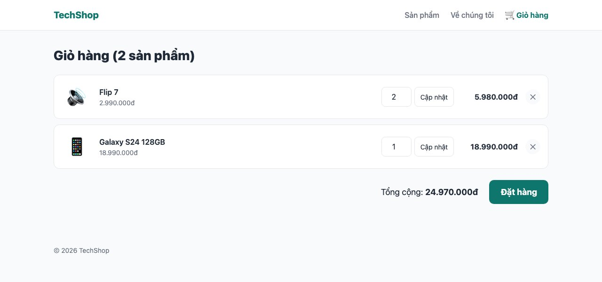
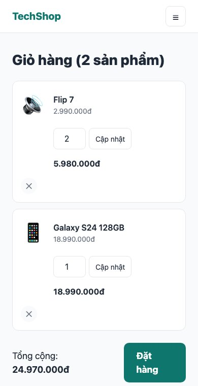
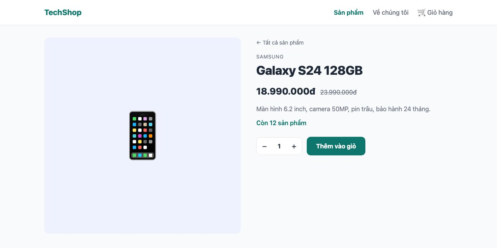
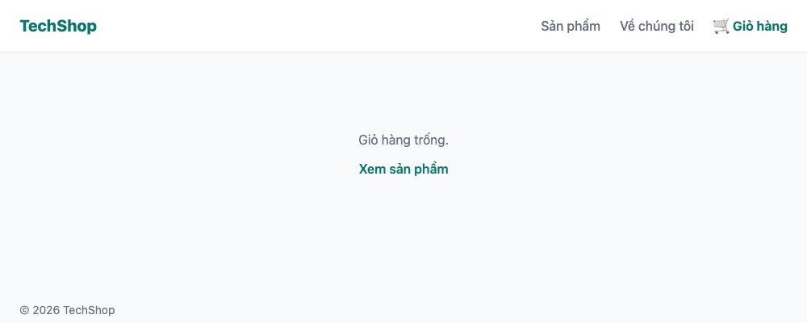

Nút "Thêm vào giỏ" ở bài 140 mới chỉ đổi state trong trình duyệt. Bài này làm giỏ hàng thật: thêm, sửa số lượng, xóa, lưu lại để tải lại trang vẫn còn. Công cụ là **Server Action**, cách Next.js xử lý form mà không cần viết API, và **cookie** để lưu giỏ của người chưa đăng nhập.

#### Kết quả cuối bài



#### Server Action là gì
Trước đây, form gửi dữ liệu lên server cần: một API endpoint, code <mark>fetch</mark> ở trình duyệt gọi endpoint đó, xử lý loading, lỗi, rồi cập nhật giao diện. Server Action rút gọn thành: **viết một hàm async trên server, gắn vào thuộc tính <mark>action</mark> của form**. Next.js lo phần gửi, nhận và cập nhật.
```tsx
// Hàm chạy trên server
async function addToCart(formData: FormData) {
  "use server";
  // đọc formData, ghi database hoặc cookie...
}

// Form gọi hàm đó khi submit
<form action={addToCart}>
```
Khi submit, trình duyệt gửi POST tới Next.js, Next.js gọi đúng hàm đó với dữ liệu form. Hàm có thể đọc database, ghi cookie, rồi bảo Next.js render lại trang hoặc chuyển hướng. Và vì là <mark>form</mark> HTML thật, nó **hoạt động cả khi JavaScript chưa tải xong**.

Quy ước: đặt các action vào file riêng có <mark>"use server"</mark> ở đầu, để cả Server Component lẫn Client Component đều import được.

#### Lưu giỏ hàng ở đâu
Người dùng chưa đăng nhập (bài 145 mới có tài khoản). Hai lựa chọn: lưu trong database kèm một mã phiên, hoặc lưu trong **cookie**. Cookie đơn giản hơn nhiều cho giỏ nhỏ: <mark>{ "galaxy-s24": 2, "flip-7": 1 }</mark> chỉ vài chục byte, giới hạn 4KB của cookie thừa sức. Chỉ lưu **slug và số lượng**, giá luôn đọc lại từ database lúc hiển thị, để người dùng không sửa cookie mà đổi được giá.

#### Bước 1: Đọc và ghi giỏ
```ts
// lib/cart.ts
import { cookies } from "next/headers";
import { prisma } from "./db";

export type Cart = Record<string, number>; // { "galaxy-s24": 2, "flip-7": 1 }

const COOKIE_NAME = "cart";

export async function readCart(): Promise<Cart> {
  const store = await cookies();
  const raw = store.get(COOKIE_NAME)?.value;
  if (!raw) return {};
  try {
    return JSON.parse(raw);
  } catch {
    return {};
  }
}

// Chỉ gọi được từ Server Action hoặc Route Handler (nơi được phép ghi cookie)
export async function writeCart(cart: Cart) {
  const store = await cookies();
  store.set(COOKIE_NAME, JSON.stringify(cart), {
    httpOnly: true,
    path: "/",
    maxAge: 60 * 60 * 24 * 7, // 7 ngày
  });
}

export async function getCartItems() {
  const cart = await readCart();
  const slugs = Object.keys(cart);
  if (slugs.length === 0) return [];

  const products = await prisma.product.findMany({ where: { slug: { in: slugs } } });
  return products.map((product) => ({ product, quantity: cart[product.slug] }));
}
```
- <mark>cookies()</mark> từ <mark>next/headers</mark> là cách đọc/ghi cookie ở server. Trong Next.js 15 nó trả về Promise, phải <mark>await</mark> (cùng lý do với <mark>params</mark>).
- **Đọc** cookie được ở mọi nơi trên server; **ghi** chỉ được trong Server Action và Route Handler, vì lúc render trang thì header đã gửi đi rồi.
- <mark>httpOnly: true</mark>: JavaScript ở trình duyệt không đọc được cookie này, chỉ server. Tránh bị script lạ đọc hoặc sửa.
- <mark>try/catch</mark> quanh <mark>JSON.parse</mark>: cookie là dữ liệu từ người dùng, có thể bị sửa thành rác. Không bao giờ tin nó.
- <mark>getCartItems</mark> ghép cookie với database: lấy đúng những sản phẩm có trong giỏ bằng <mark>slug: { in: slugs }</mark> (một query cho mọi sản phẩm, không N+1).

#### Bước 2: Ba action
```ts
// app/actions/cart.ts
"use server";

import { revalidatePath } from "next/cache";
import { redirect } from "next/navigation";
import { readCart, writeCart } from "@/lib/cart";

export async function addToCart(formData: FormData) {
  const slug = String(formData.get("slug"));
  const quantity = Math.max(1, Number(formData.get("quantity")) || 1);

  const cart = await readCart();
  cart[slug] = (cart[slug] ?? 0) + quantity;
  await writeCart(cart);

  redirect("/cart");
}

export async function updateQuantity(formData: FormData) {
  const slug = String(formData.get("slug"));
  const quantity = Number(formData.get("quantity"));

  const cart = await readCart();
  if (quantity > 0) cart[slug] = quantity;
  else delete cart[slug];
  await writeCart(cart);

  revalidatePath("/cart");
}

export async function removeFromCart(formData: FormData) {
  const slug = String(formData.get("slug"));

  const cart = await readCart();
  delete cart[slug];
  await writeCart(cart);

  revalidatePath("/cart");
}
```
- <mark>"use server"</mark> ở đầu file: **mọi** hàm export trong file là Server Action.
- Action nhận <mark>FormData</mark>, đọc field bằng <mark>formData.get("tên")</mark>. Giá trị luôn là chuỗi (hoặc file), nên phải <mark>Number()</mark>; và vì dữ liệu từ người dùng có thể là bất kỳ gì, <mark>|| 1</mark> và <mark>Math.max(1, ...)</mark> chặn số âm hay chữ. Bài 144 sẽ validate nghiêm túc hơn với Zod.
- <mark>redirect("/cart")</mark>: sau khi thêm, chuyển sang trang giỏ. <mark>redirect</mark> ném exception đặc biệt giống <mark>notFound</mark>, không cần <mark>return</mark>.
- <mark>revalidatePath("/cart")</mark>: báo Next.js trang <mark>/cart</mark> đã đổi, render lại. Không có dòng này, sau khi sửa số lượng trang vẫn hiện số cũ (cache). Quy tắc: action làm đổi dữ liệu của trang nào thì <mark>revalidatePath</mark> trang đó (hoặc <mark>redirect</mark>, cũng render trang mới).

#### Bước 3: Nút thêm vào giỏ thành form
```tsx
// components/add-to-cart.tsx
"use client";

import { useState } from "react";
import { useFormStatus } from "react-dom";
import { addToCart } from "@/app/actions/cart";
import styles from "./add-to-cart.module.css";

type Props = { slug: string; stock: number };

function SubmitButton() {
  const { pending } = useFormStatus();
  return (
    <button className={styles.add} type="submit" disabled={pending}>
      {pending ? "Đang thêm..." : "Thêm vào giỏ"}
    </button>
  );
}

export default function AddToCart({ slug, stock }: Props) {
  const [quantity, setQuantity] = useState(1);

  if (stock === 0) {
    return <p className={styles.soldOut}>Hết hàng</p>;
  }

  return (
    <form action={addToCart} className={styles.box}>
      <input type="hidden" name="slug" value={slug} />
      <input type="hidden" name="quantity" value={quantity} />
      <div className={styles.picker}>
        <button type="button" onClick={() => setQuantity(Math.max(1, quantity - 1))} aria-label="Giảm">−</button>
        <span>{quantity}</span>
        <button type="button" onClick={() => setQuantity(Math.min(stock, quantity + 1))} aria-label="Tăng">+</button>
      </div>
      <SubmitButton />
    </form>
  );
}
```
Thêm vào CSS module của nó
```css
/* components/add-to-cart.module.css (thêm) */
.add:disabled {
  opacity: 0.6;
  cursor: wait;
}
```
Và ở trang sản phẩm đổi props: <mark>&lt;AddToCart slug={product.slug} stock={product.stock} /&gt;</mark>.



Ba chi tiết quan trọng:
- Client Component **import trực tiếp** Server Action và gắn vào <mark>action</mark>. Next.js tự thay hàm bằng một "tham chiếu" khi gửi xuống trình duyệt; code thật của action không bao giờ rời server.
- Hai nút +/− phải có <mark>type="button"</mark>. Nút trong form mặc định là submit; thiếu dòng này, bấm "+" là gửi form luôn.
- <mark>useFormStatus</mark> cho biết form đang gửi hay không, để đổi chữ nút và khóa nó. Hook này chỉ hoạt động trong component **con** của <mark>form</mark>, nên phải tách <mark>SubmitButton</mark> riêng, không gọi ngay trong <mark>AddToCart</mark>.

Số lượng chọn được đưa vào form qua <mark>&lt;input type="hidden" name="quantity" value={quantity} /&gt;</mark>: state ở trình duyệt, nhưng khi gửi thì là field form bình thường.

#### Bước 4: Trang giỏ hàng
```tsx
// app/(shop)/cart/page.tsx
import Link from "next/link";
import { removeFromCart, updateQuantity } from "@/app/actions/cart";
import { getCartItems } from "@/lib/cart";
import { formatPrice } from "@/lib/products";
import styles from "./page.module.css";

export default async function CartPage() {
  const items = await getCartItems();
  const total = items.reduce((sum, item) => sum + item.product.price * item.quantity, 0);

  if (items.length === 0) {
    return (
      <div className={styles.empty}>
        <p>Giỏ hàng trống.</p>
        <Link href="/products" className={styles.link}>Xem sản phẩm</Link>
      </div>
    );
  }

  return (
    <>
      <h1 className={styles.title}>Giỏ hàng ({items.length} sản phẩm)</h1>

      <ul className={styles.list}>
        {items.map(({ product, quantity }) => (
          <li key={product.slug} className={styles.item}>
            <span className={styles.emoji}>{product.emoji}</span>
            <div className={styles.info}>
              <Link href={`/products/${product.slug}`} className={styles.name}>{product.name}</Link>
              <p className={styles.price}>{formatPrice(product.price)}</p>
            </div>

            <form action={updateQuantity} className={styles.qty}>
              <input type="hidden" name="slug" value={product.slug} />
              <input type="number" name="quantity" defaultValue={quantity} min={0} max={product.stock} />
              <button type="submit">Cập nhật</button>
            </form>

            <p className={styles.subtotal}>{formatPrice(product.price * quantity)}</p>

            <form action={removeFromCart}>
              <input type="hidden" name="slug" value={product.slug} />
              <button type="submit" className={styles.remove} aria-label="Xóa">✕</button>
            </form>
          </li>
        ))}
      </ul>

      <div className={styles.summary}>
        <p>Tổng cộng: <strong>{formatPrice(total)}</strong></p>
        <Link href="/checkout" className={styles.checkout}>Đặt hàng</Link>
      </div>
    </>
  );
}
```
```css
/* app/(shop)/cart/page.module.css */
.title {
  font-size: 1.75rem;
  font-weight: 800;
  margin-bottom: 20px;
}

.empty {
  padding: 64px 0;
  text-align: center;
  color: var(--color-muted);
}

.link {
  display: inline-block;
  margin-top: 12px;
  color: var(--color-primary);
  font-weight: 600;
}

.list {
  display: grid;
  gap: 12px;
}

.item {
  display: grid;
  grid-template-columns: 64px 1fr auto auto auto;
  align-items: center;
  gap: 16px;
  padding: 16px;
  background: var(--color-surface);
  border: 1px solid var(--color-border);
  border-radius: var(--radius);
}

.emoji {
  font-size: 2.5rem;
  text-align: center;
}

.name {
  font-weight: 600;
}

.price {
  font-size: 0.875rem;
  color: var(--color-muted);
}

.qty {
  display: flex;
  gap: 6px;
}

.qty input {
  width: 64px;
  padding: 8px;
  border: 1px solid var(--color-border);
  border-radius: 8px;
  text-align: center;
}

.qty button {
  padding: 8px 12px;
  border: 1px solid var(--color-border);
  border-radius: 8px;
  background: var(--color-surface);
  cursor: pointer;
  font-size: 0.875rem;
}

.subtotal {
  min-width: 120px;
  text-align: right;
  font-weight: 700;
}

.remove {
  width: 32px;
  height: 32px;
  border: 0;
  border-radius: 50%;
  background: var(--color-bg);
  color: var(--color-muted);
  cursor: pointer;
}

.summary {
  margin-top: 24px;
  display: flex;
  justify-content: flex-end;
  align-items: center;
  gap: 24px;
  font-size: 1.125rem;
}

.checkout {
  padding: 12px 24px;
  border-radius: 10px;
  background: var(--color-primary);
  color: #fff;
  font-weight: 700;
}

@media (max-width: 700px) {
  .item {
    grid-template-columns: 48px 1fr auto;
  }

  .qty,
  .subtotal {
    grid-column: 2 / -1;
    text-align: left;
  }
}
```
Trang giỏ là **Server Component** hoàn toàn: không <mark>"use client"</mark>, không state. Mỗi dòng có **2 form** nhỏ (cập nhật, xóa), mỗi form gọi một action. Sau action, <mark>revalidatePath</mark> làm Next.js render lại trang và gửi phần mới xuống, giao diện cập nhật mà không tải lại trang.



Thử tắt JavaScript trong DevTools (Ctrl+Shift+P → "Disable JavaScript") rồi dùng giỏ hàng: vẫn thêm, sửa, xóa được, chỉ là tải lại cả trang. Đây là **progressive enhancement**, có miễn phí nhờ dùng form thật.

#### Build và một bẫy về cache
```
├ ƒ /cart                            0 B         122 kB
├ ƒ /products                        0 B         122 kB
└ ● /products/[slug]               878 B         123 kB
```
<mark>/cart</mark> là động vì đọc <mark>cookies()</mark>: hiển nhiên, giỏ mỗi người khác nhau. Trang sản phẩm vẫn tĩnh dù có form thêm giỏ, vì form chỉ **gửi** chứ không đọc cookie khi render.

**Bẫy:** sẽ có lúc bạn muốn hiện số sản phẩm trong giỏ ở header. Nếu Header (nằm trong layout) đọc <mark>cookies()</mark>, thì **mọi trang** dùng layout đó thành động, mất hết lợi ích tĩnh của trang chủ và trang sản phẩm. Cách xử lý: để số đó trong một Client Component tự gọi một Route Handler (bài 147) sau khi trang hiện, hoặc chấp nhận động nếu site nhỏ. Hãy cân nhắc trước khi đọc cookie/header ở layout.

#### Checklist
- Thêm 2 sản phẩm khác nhau, tải lại trang, đóng mở trình duyệt: giỏ vẫn còn (cookie 7 ngày).
- Đổi số lượng thành 0 rồi Cập nhật: sản phẩm biến mất. Bấm ✕: cũng biến mất.
- DevTools → Application → Cookies: thấy cookie <mark>cart</mark> dạng JSON, cờ HttpOnly được tick.
- Bấm "Thêm vào giỏ" nhanh 2 lần: nút khóa và hiện "Đang thêm..." sau lần đầu.
- Tắt JavaScript: giỏ hàng vẫn dùng được.

Mã nguồn cuối bài: [post_143.zip](/assets/code/post_143.zip).

#### Bài tập thêm
- Thêm nút "Xóa hết giỏ" ở trang giỏ với action <mark>clearCart</mark>.
- Thêm nút "Mua ngay" ở trang sản phẩm: action thêm vào giỏ rồi <mark>redirect("/checkout")</mark>.
- Chặn thêm quá tồn kho: trong <mark>addToCart</mark>, đọc sản phẩm từ database và không cho tổng vượt <mark>stock</mark>. Bài 144 sẽ làm phần báo lỗi về cho người dùng.
