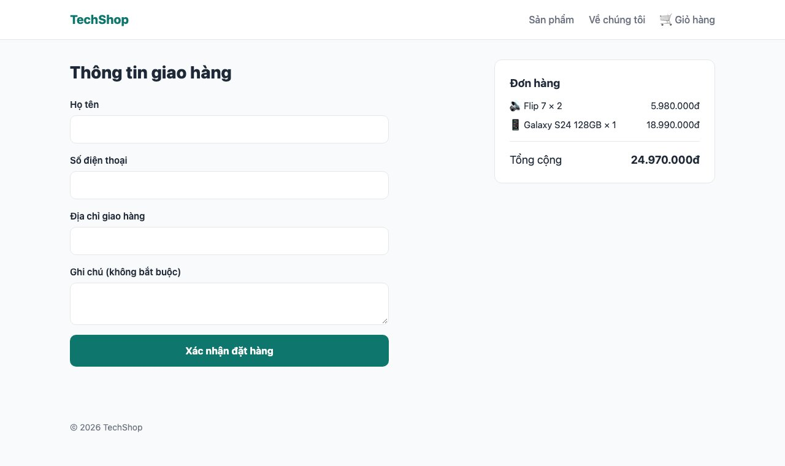
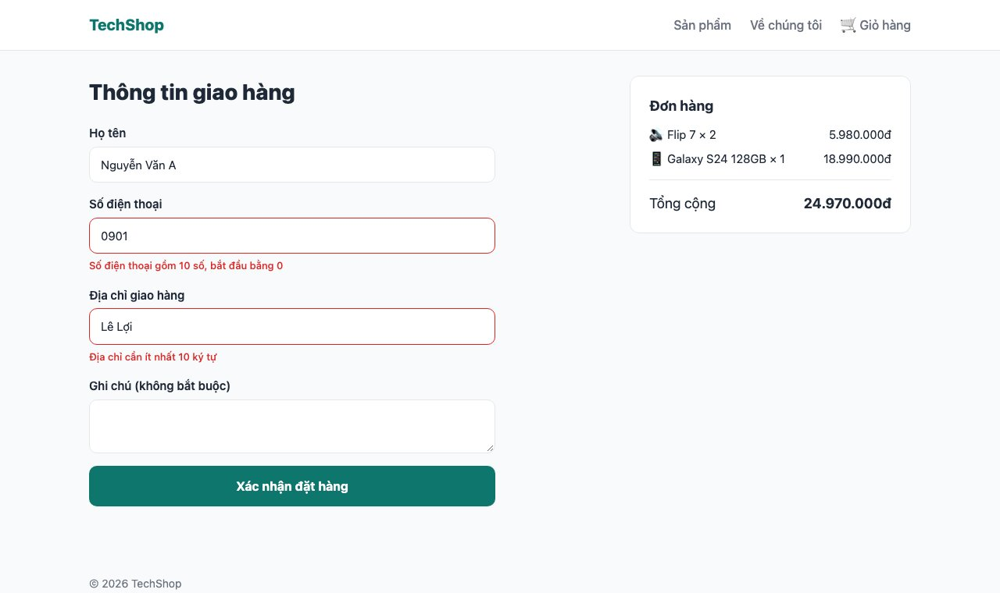
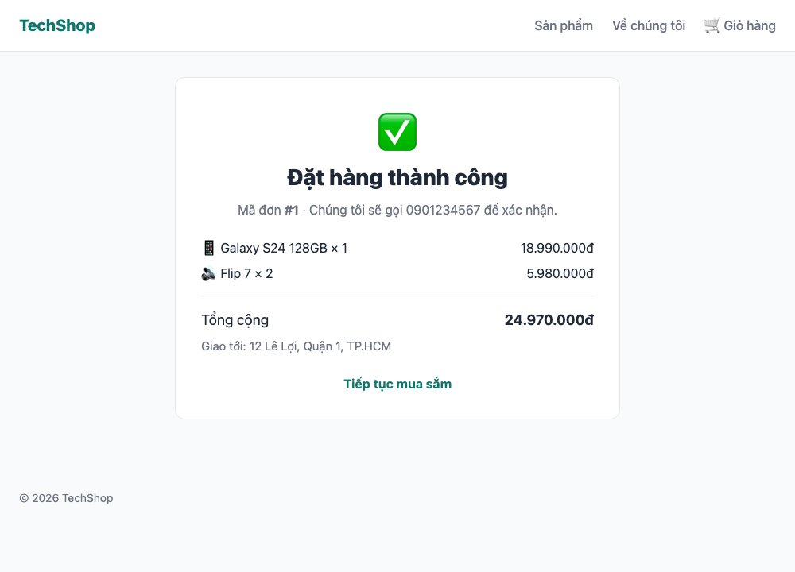

Giỏ hàng đã có, giờ là bước quan trọng nhất của một shop: **đặt hàng**. Bài này có 3 việc mà mọi form nghiêm túc đều cần: kiểm tra dữ liệu người dùng nhập (validation với **Zod**), báo lỗi về đúng ô và giữ lại những gì đã nhập (**useActionState**), và ghi nhiều bảng cùng lúc mà không bao giờ bán quá tồn kho (**transaction**).

#### Kết quả cuối bài




#### Bước 1: Bảng Order và OrderItem
Thêm vào cuối <mark>prisma/schema.prisma</mark>
```prisma
model Order {
  id           Int         @id @default(autoincrement())
  customerName String
  phone        String
  address      String
  note         String?
  total        Int
  status       String      @default("pending")
  createdAt    DateTime    @default(now())
  items        OrderItem[]
}

model OrderItem {
  id        Int     @id @default(autoincrement())
  orderId   Int
  order     Order   @relation(fields: [orderId], references: [id])
  productId Int
  product   Product @relation(fields: [productId], references: [id])
  quantity  Int
  price     Int // giá tại thời điểm mua
}
```
Và thêm một dòng vào <mark>model Product</mark>: <mark>orderItems OrderItem[]</mark> (Prisma bắt buộc khai báo quan hệ ở cả hai phía). Rồi
```sh
npx prisma migrate dev --name add_orders
```
Hai điều đáng chú ý trong thiết kế:
- <mark>@relation(fields: [orderId], references: [id])</mark>: <mark>OrderItem.orderId</mark> trỏ tới <mark>Order.id</mark>, Prisma tạo khóa ngoại trong database. Phía <mark>Order</mark> khai báo <mark>items OrderItem[]</mark> để truy vấn được <mark>order.items</mark>.
- <mark>OrderItem.price</mark> là **giá lúc mua**, copy từ sản phẩm. Mai giá sản phẩm đổi, đơn cũ vẫn đúng. Bài 097 (DDD) đã nói về quyết định này.

#### Bước 2: Luật validate bằng Zod
```sh
npm install zod
```
```ts
// lib/validation.ts
import { z } from "zod";

export const checkoutSchema = z.object({
  customerName: z.string().trim().min(2, "Tên cần ít nhất 2 ký tự"),
  phone: z.string().trim().regex(/^0\d{9}$/, "Số điện thoại gồm 10 số, bắt đầu bằng 0"),
  address: z.string().trim().min(10, "Địa chỉ cần ít nhất 10 ký tự"),
  note: z.string().trim().max(500, "Ghi chú tối đa 500 ký tự").optional(),
});

export type CheckoutInput = z.infer<typeof checkoutSchema>;
```
Zod là thư viện mô tả "dữ liệu hợp lệ trông như thế nào" rồi kiểm tra một object bất kỳ theo mô tả đó. Mỗi luật kèm thông báo tiếng Việt. <mark>z.infer</mark> sinh luôn kiểu TypeScript từ schema, không phải viết type hai lần.

Validate ở **server** là bắt buộc, vì form từ trình duyệt có thể bị sửa tùy ý (bài 086 trong series Bot & Abuse). Validate ở trình duyệt (<mark>required</mark>, <mark>pattern</mark>) chỉ là tiện cho người dùng, và ta cố tình tắt bằng <mark>noValidate</mark> ở bước 4 để thấy server hoạt động.

#### Bước 3: Action đặt hàng
```ts
// app/actions/order.ts
"use server";

import { revalidatePath } from "next/cache";
import { redirect } from "next/navigation";
import { getCartItems, writeCart } from "@/lib/cart";
import { prisma } from "@/lib/db";
import { checkoutSchema } from "@/lib/validation";

export type CheckoutState = {
  errors?: Record<string, string>;
  message?: string;
  values?: Record<string, string>;
};

export async function placeOrder(prevState: CheckoutState, formData: FormData): Promise<CheckoutState> {
  const raw = Object.fromEntries(formData) as Record<string, string>;

  // 1. Validate dữ liệu form
  const parsed = checkoutSchema.safeParse(raw);
  if (!parsed.success) {
    const errors: Record<string, string> = {};
    for (const issue of parsed.error.issues) errors[String(issue.path[0])] = issue.message;
    return { errors, values: raw };
  }

  // 2. Lấy giỏ hàng từ cookie + giá thật từ database
  const items = await getCartItems();
  if (items.length === 0) return { message: "Giỏ hàng trống", values: raw };

  let orderId: number;
  try {
    // 3. Trừ kho và tạo đơn trong MỘT transaction: hoặc tất cả, hoặc không gì cả
    orderId = await prisma.$transaction(async (tx) => {
      for (const { product, quantity } of items) {
        const updated = await tx.product.updateMany({
          where: { id: product.id, stock: { gte: quantity } },
          data: { stock: { decrement: quantity } },
        });
        if (updated.count === 0) throw new Error(`"${product.name}" không đủ hàng`);
      }

      const order = await tx.order.create({
        data: {
          ...parsed.data,
          total: items.reduce((sum, i) => sum + i.product.price * i.quantity, 0),
          items: {
            create: items.map((i) => ({ productId: i.product.id, quantity: i.quantity, price: i.product.price })),
          },
        },
      });
      return order.id;
    });
  } catch (e) {
    return { message: e instanceof Error ? e.message : "Không đặt được hàng, thử lại", values: raw };
  }

  // 4. Dọn giỏ, làm mới cache các trang sản phẩm (tồn kho đã đổi), chuyển tới trang đơn
  await writeCart({});
  revalidatePath("/products");
  for (const { product } of items) revalidatePath(`/products/${product.slug}`);
  redirect(`/orders/${orderId}`);
}
```
Action này khác <mark>addToCart</mark> bài 143 ở một điểm: nó nhận **2 tham số** <mark>(prevState, formData)</mark> và **trả về** một object <mark>CheckoutState</mark>. Đó là dạng mà <mark>useActionState</mark> ở bước 4 cần: mỗi lần submit, action trả về trạng thái mới (lỗi gì, thông báo gì, giá trị đã nhập), form hiển thị trạng thái đó.

Bốn bước trong action:
1. <mark>safeParse</mark> không ném lỗi mà trả về <mark>{ success, data, error }</mark>. Gom <mark>issues</mark> thành map <mark>{ phone: "Số điện thoại..." }</mark> và trả về **kèm <mark>values</mark>** để form điền lại những gì người dùng đã gõ.
2. Giỏ và giá đọc từ cookie + database, không tin bất cứ con số nào từ form.
3. **Transaction**: trừ kho từng sản phẩm bằng <mark>updateMany</mark> với điều kiện <mark>stock &gt;= quantity</mark>. Nếu không đủ hàng, <mark>count</mark> là 0, ném lỗi, Prisma **rollback** toàn bộ: những sản phẩm đã trừ trước đó được trả lại, không có đơn nào được tạo. Đây chính là atomic update của bài 081: hai người cùng mua chiếc cuối cùng, chỉ một người thành công. Đơn và các dòng tạo trong một lệnh <mark>create</mark> lồng nhau.
4. Chỉ khi mọi thứ xong: xóa giỏ, <mark>revalidatePath</mark> các trang sản phẩm vì tồn kho đã đổi (chúng là trang tĩnh, bài 141), rồi chuyển tới trang đơn.

**Mẹo:** <mark>redirect()</mark> phải nằm **ngoài** <mark>try/catch</mark>. Nó hoạt động bằng cách ném một exception đặc biệt; đặt trong <mark>try</mark> thì <mark>catch</mark> của bạn sẽ nuốt mất nó và báo "Không đặt được hàng" dù đã đặt thành công. Lỗi này rất hay gặp.

#### Bước 4: Form với useActionState
```tsx
// components/checkout-form.tsx
"use client";

import { useActionState } from "react";
import { placeOrder, type CheckoutState } from "@/app/actions/order";
import styles from "./checkout-form.module.css";

const initialState: CheckoutState = {};

export default function CheckoutForm() {
  const [state, formAction, pending] = useActionState(placeOrder, initialState);
  const values = state.values ?? {};

  return (
    <form action={formAction} className={styles.form} noValidate>
      {state.message && <p className={styles.alert}>{state.message}</p>}

      <label className={styles.field}>
        Họ tên
        <input name="customerName" defaultValue={values.customerName} aria-invalid={!!state.errors?.customerName} />
        {state.errors?.customerName && <span className={styles.error}>{state.errors.customerName}</span>}
      </label>

      <label className={styles.field}>
        Số điện thoại
        <input name="phone" type="tel" defaultValue={values.phone} aria-invalid={!!state.errors?.phone} />
        {state.errors?.phone && <span className={styles.error}>{state.errors.phone}</span>}
      </label>

      <label className={styles.field}>
        Địa chỉ giao hàng
        <input name="address" defaultValue={values.address} aria-invalid={!!state.errors?.address} />
        {state.errors?.address && <span className={styles.error}>{state.errors.address}</span>}
      </label>

      <label className={styles.field}>
        Ghi chú (không bắt buộc)
        <textarea name="note" rows={3} defaultValue={values.note} />
      </label>

      <button className={styles.submit} type="submit" disabled={pending}>
        {pending ? "Đang đặt hàng..." : "Xác nhận đặt hàng"}
      </button>
    </form>
  );
}
```
```css
/* components/checkout-form.module.css */
.form {
  display: grid;
  gap: 16px;
  max-width: 520px;
}

.field {
  display: grid;
  gap: 6px;
  font-weight: 600;
  font-size: 0.9375rem;
}

.field input,
.field textarea {
  padding: 11px 14px;
  border: 1px solid var(--color-border);
  border-radius: 10px;
  background: var(--color-surface);
  font-weight: 400;
}

.field input:focus,
.field textarea:focus {
  outline: none;
  border-color: var(--color-primary);
  box-shadow: 0 0 0 3px #ccfbf1;
}

.field input[aria-invalid="true"] {
  border-color: var(--color-sale);
}

.error {
  color: var(--color-sale);
  font-size: 0.8125rem;
  font-weight: 500;
}

.alert {
  padding: 12px 14px;
  border-radius: 10px;
  background: #fee2e2;
  color: #991b1b;
  font-size: 0.9375rem;
}

.submit {
  padding: 14px;
  border: 0;
  border-radius: 10px;
  background: var(--color-primary);
  color: #fff;
  font-weight: 700;
  cursor: pointer;
}

.submit:disabled {
  opacity: 0.6;
  cursor: wait;
}
```
<mark>useActionState(action, initialState)</mark> trả về 3 thứ: <mark>state</mark> (kết quả action lần gần nhất), <mark>formAction</mark> (gắn vào form), <mark>pending</mark> (đang gửi). Vòng đời: submit → action chạy ở server → trả về state mới → component vẽ lại với state đó. Không <mark>useState</mark> cho từng ô, không tự <mark>fetch</mark>, không tự quản lý loading.

<mark>defaultValue={values.phone}</mark>: khi action trả lỗi, các ô điền lại giá trị đã nhập (không phải <mark>value=</mark>, vì ta không quản lý state từng phím gõ). <mark>aria-invalid</mark> vừa để CSS tô viền đỏ vừa để trình đọc màn hình biết ô đang lỗi. <mark>useFormStatus</mark> của bài 143 không cần nữa vì <mark>pending</mark> có sẵn.

#### Bước 5: Trang checkout và trang đơn hàng
```tsx
// app/(shop)/checkout/page.tsx
import { redirect } from "next/navigation";
import CheckoutForm from "@/components/checkout-form";
import { getCartItems } from "@/lib/cart";
import { formatPrice } from "@/lib/products";
import styles from "./page.module.css";

export default async function CheckoutPage() {
  const items = await getCartItems();
  if (items.length === 0) redirect("/cart");

  const total = items.reduce((sum, i) => sum + i.product.price * i.quantity, 0);

  return (
    <div className={styles.layout}>
      <section>
        <h1 className={styles.title}>Thông tin giao hàng</h1>
        <CheckoutForm />
      </section>

      <aside className={styles.summary}>
        <h2 className={styles.summaryTitle}>Đơn hàng</h2>
        <ul className={styles.items}>
          {items.map(({ product, quantity }) => (
            <li key={product.slug} className={styles.item}>
              <span>{product.emoji} {product.name} × {quantity}</span>
              <span>{formatPrice(product.price * quantity)}</span>
            </li>
          ))}
        </ul>
        <p className={styles.total}>Tổng cộng <strong>{formatPrice(total)}</strong></p>
      </aside>
    </div>
  );
}
```
```css
/* app/(shop)/checkout/page.module.css */
.layout {
  display: grid;
  grid-template-columns: 1fr 360px;
  gap: 40px;
  align-items: start;
}

.title {
  font-size: 1.75rem;
  font-weight: 800;
  margin-bottom: 20px;
}

.summary {
  padding: 24px;
  background: var(--color-surface);
  border: 1px solid var(--color-border);
  border-radius: var(--radius);
  position: sticky;
  top: 24px;
}

.summaryTitle {
  font-size: 1.125rem;
  font-weight: 700;
  margin-bottom: 12px;
}

.items {
  display: grid;
  gap: 8px;
  font-size: 0.9375rem;
}

.item {
  display: flex;
  justify-content: space-between;
  gap: 12px;
}

.total {
  margin-top: 16px;
  padding-top: 16px;
  border-top: 1px solid var(--color-border);
  display: flex;
  justify-content: space-between;
  font-size: 1.125rem;
}

@media (max-width: 800px) {
  .layout {
    grid-template-columns: 1fr;
  }

  .summary {
    position: static;
    order: -1;
  }
}
```
Trang là Server Component: đọc giỏ, giỏ trống thì <mark>redirect</mark> về <mark>/cart</mark>, có hàng thì vẽ tóm tắt và nhúng form client. Cấu trúc "trang server bọc form client" này là mẫu bạn sẽ dùng cho mọi form trong Next.js.

Trang xác nhận đơn
```tsx
// app/(shop)/orders/[id]/page.tsx
import Link from "next/link";
import { notFound } from "next/navigation";
import { prisma } from "@/lib/db";
import { formatPrice } from "@/lib/products";
import styles from "./page.module.css";

export default async function OrderPage({ params }: { params: Promise<{ id: string }> }) {
  const { id } = await params;
  const order = await prisma.order.findUnique({
    where: { id: Number(id) },
    include: { items: { include: { product: true } } },
  });

  if (!order) notFound();

  return (
    <div className={styles.box}>
      <p className={styles.icon}>✅</p>
      <h1 className={styles.title}>Đặt hàng thành công</h1>
      <p className={styles.sub}>Mã đơn <strong>#{order.id}</strong> · Chúng tôi sẽ gọi {order.phone} để xác nhận.</p>

      <ul className={styles.items}>
        {order.items.map((item) => (
          <li key={item.id} className={styles.item}>
            <span>{item.product.emoji} {item.product.name} × {item.quantity}</span>
            <span>{formatPrice(item.price * item.quantity)}</span>
          </li>
        ))}
      </ul>
      <p className={styles.total}>Tổng cộng <strong>{formatPrice(order.total)}</strong></p>
      <p className={styles.address}>Giao tới: {order.address}</p>

      <Link href="/products" className={styles.link}>Tiếp tục mua sắm</Link>
    </div>
  );
}
```
```css
/* app/(shop)/orders/[id]/page.module.css */
.box {
  max-width: 560px;
  margin: 0 auto;
  padding: 32px;
  background: var(--color-surface);
  border: 1px solid var(--color-border);
  border-radius: var(--radius);
  text-align: center;
}

.icon {
  font-size: 3rem;
}

.title {
  font-size: 1.75rem;
  font-weight: 800;
}

.sub {
  margin-top: 8px;
  color: var(--color-muted);
}

.items {
  margin-top: 24px;
  display: grid;
  gap: 8px;
  text-align: left;
}

.item {
  display: flex;
  justify-content: space-between;
  gap: 12px;
}

.total {
  margin-top: 16px;
  padding-top: 16px;
  border-top: 1px solid var(--color-border);
  display: flex;
  justify-content: space-between;
  font-size: 1.125rem;
}

.address {
  margin-top: 8px;
  text-align: left;
  font-size: 0.9375rem;
  color: var(--color-muted);
}

.link {
  display: inline-block;
  margin-top: 24px;
  color: var(--color-primary);
  font-weight: 700;
}
```
<mark>include: { items: { include: { product: true } } }</mark>: lấy đơn kèm các dòng, mỗi dòng kèm sản phẩm, trong **một** truy vấn. Prisma tự JOIN. Không có N+1.

Một lỗ hổng cố ý để lại: ai biết URL <mark>/orders/1</mark> đều xem được đơn số 1, kể cả số điện thoại và địa chỉ (IDOR, bài 092). Bài 145 sẽ gắn đơn với tài khoản và chỉ chủ đơn mới xem được.

#### Build
```
├ ƒ /cart                            0 B         123 kB
├ ƒ /checkout                    1.01 kB         124 kB
├ ƒ /orders/[id]                     0 B         123 kB
└ ● /products/[slug]               878 B         124 kB
```
Checkout tốn 1KB JavaScript cho form; trang đơn hàng là 0 B, hoàn toàn server. Trang sản phẩm vẫn tĩnh nhưng sẽ được làm mới sau mỗi đơn nhờ <mark>revalidatePath</mark>.

#### Checklist
- Để trống form, bấm đặt hàng: 3 ô báo lỗi đỏ, không tạo đơn.
- Nhập tên đúng, số điện thoại "0901": chỉ ô số điện thoại lỗi, tên **vẫn còn** trong ô.
- Nhập đúng hết: chuyển tới <mark>/orders/1</mark>, giỏ trống, tồn kho sản phẩm vừa mua giảm (xem trang sản phẩm hoặc Prisma Studio).
- Thử mua quá tồn kho: vào Studio đặt stock của Flip 7 = 1, giỏ có 2 Flip 7, đặt hàng: báo "Flip 7 không đủ hàng", không có đơn nào được tạo, stock vẫn là 1.
- Mở <mark>/orders/999</mark>: 404.

Mã nguồn cuối bài: [post_144.zip](/assets/code/post_144.zip).

#### Bài tập thêm
- Thêm ô "Email" với <mark>z.string().email("Email không hợp lệ")</mark> và lưu vào Order (cần migration).
- Thêm radio "Phương thức thanh toán": COD hoặc Chuyển khoản, với <mark>z.enum(["cod", "bank"])</mark>.
- Kiểm tra tồn kho ngay ở trang giỏ hàng: nếu số lượng vượt stock, hiện cảnh báo trước khi bấm đặt hàng.
