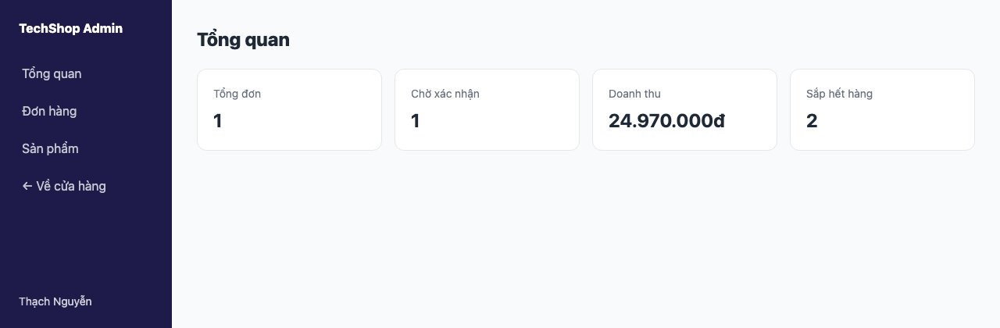
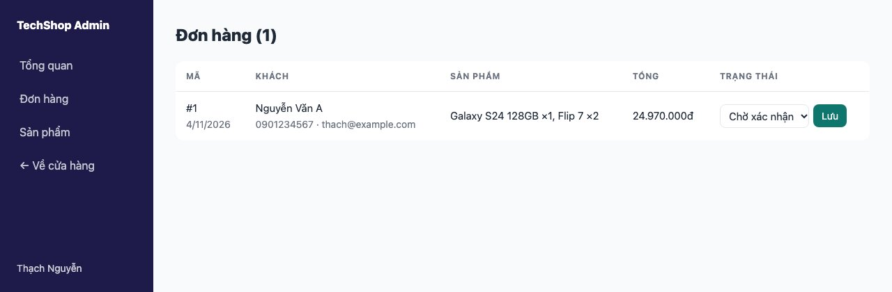
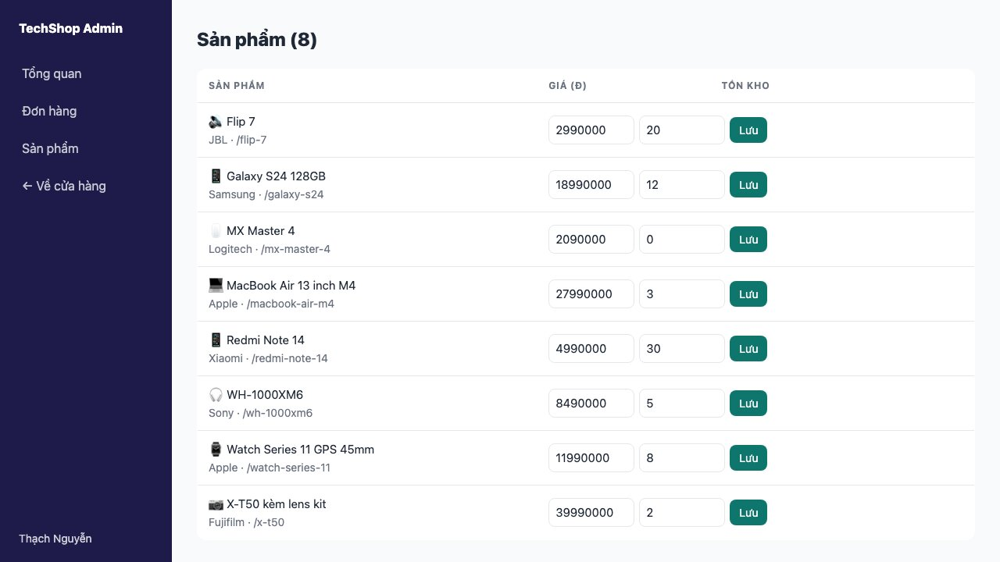

Shop cần người quản lý: xem mọi đơn, đổi trạng thái, sửa giá và tồn kho. Bài này tạo khu <mark>/admin</mark> chỉ dành cho tài khoản có vai trò admin, với layout riêng, và quan trọng nhất: **kiểm tra quyền ở đúng chỗ** để không ai gọi thẳng action mà sửa được dữ liệu.

#### Kết quả cuối bài




#### Bước 1: Vai trò
Thêm một cột vào <mark>model User</mark> trong <mark>schema.prisma</mark> (giữa <mark>image</mark> và <mark>createdAt</mark>)
```prisma
  role          String    @default("customer")
```
```sh
npx prisma migrate dev --name add_role
```
better-auth không biết và không cần biết cột này; ta tự đọc nó bằng Prisma khi cần. Mọi tài khoản mới là <mark>customer</mark>. Để nâng một tài khoản lên admin, một script nhỏ (không làm qua giao diện web, vì "trang để tự phong admin" là lỗ hổng kinh điển):
```ts
// prisma/make-admin.ts  —  npx tsx prisma/make-admin.ts email@example.com
import { PrismaClient } from "@prisma/client";

const prisma = new PrismaClient();
const email = process.argv[2];

if (!email) {
  console.error("Cách dùng: npx tsx prisma/make-admin.ts email@example.com");
  process.exit(1);
}

prisma.user
  .update({ where: { email }, data: { role: "admin" } })
  .then((u) => console.log(`${u.email} giờ là admin`))
  .catch(() => console.error("Không tìm thấy tài khoản"))
  .finally(() => prisma.$disconnect());
```
```sh
npx tsx prisma/make-admin.ts thach@example.com
# thach@example.com giờ là admin
```

#### Bước 2: requireAdmin
```ts
// lib/session.ts
import { headers } from "next/headers";
import { redirect } from "next/navigation";
import { auth } from "./auth";
import { prisma } from "./db";

// Đọc phiên đăng nhập ở Server Component / Server Action. Trả về null nếu chưa đăng nhập.
export async function getSession() {
  return auth.api.getSession({ headers: await headers() });
}

// Dùng ở mọi trang và action của khu admin: chưa đăng nhập -> /login, không phải admin -> trang chủ
export async function requireAdmin() {
  const session = await getSession();
  if (!session) redirect("/login");

  const user = await prisma.user.findUnique({ where: { id: session.user.id }, select: { role: true } });
  if (user?.role !== "admin") redirect("/");

  return session;
}
```
Một hàm, gọi ở đầu mọi thứ thuộc khu admin. Hai đường thoát khác nhau: chưa đăng nhập thì mời đăng nhập; đã đăng nhập nhưng không phải admin thì về trang chủ (không cần báo "bạn không có quyền", càng ít thông tin cho người tò mò càng tốt).

#### Bước 3: Layout khu admin
Khu admin không dùng header của shop, nên tạo route group thứ hai <mark>(admin)</mark>, song song với <mark>(shop)</mark>
```
app/
├── (shop)/...            header shop
└── (admin)/
    └── admin/
        ├── layout.tsx    sidebar admin + requireAdmin
        ├── admin.module.css
        ├── page.tsx      /admin
        ├── orders/page.tsx    /admin/orders
        └── products/page.tsx  /admin/products
```
```tsx
// app/(admin)/admin/layout.tsx
import Link from "next/link";
import { requireAdmin } from "@/lib/session";
import styles from "./layout.module.css";

export default async function AdminLayout({ children }: { children: React.ReactNode }) {
  const session = await requireAdmin();

  return (
    <div className={styles.app}>
      <aside className={styles.sidebar}>
        <p className={styles.logo}>TechShop Admin</p>
        <nav className={styles.menu}>
          <Link href="/admin">Tổng quan</Link>
          <Link href="/admin/orders">Đơn hàng</Link>
          <Link href="/admin/products">Sản phẩm</Link>
          <Link href="/">← Về cửa hàng</Link>
        </nav>
        <p className={styles.user}>{session.user.name}</p>
      </aside>
      <main className={styles.content}>{children}</main>
    </div>
  );
}
```
```css
/* app/(admin)/admin/layout.module.css */
.app {
  min-height: 100vh;
  display: grid;
  grid-template-columns: 220px 1fr;
}

.sidebar {
  display: flex;
  flex-direction: column;
  gap: 24px;
  padding: 24px 16px;
  background: #1e1b4b;
  color: #fff;
}

.logo {
  font-weight: 800;
  padding: 0 8px;
}

.menu {
  display: grid;
  gap: 4px;
}

.menu a {
  padding: 10px 12px;
  border-radius: 8px;
  color: rgba(255, 255, 255, 0.75);
}

.menu a:hover {
  background: rgba(255, 255, 255, 0.1);
  color: #fff;
}

.user {
  margin-top: auto;
  padding: 0 8px;
  font-size: 0.875rem;
  opacity: 0.8;
}

.content {
  padding: 32px;
}

@media (max-width: 760px) {
  .app {
    grid-template-columns: 1fr;
  }

  .sidebar {
    flex-direction: row;
    align-items: center;
    flex-wrap: wrap;
    padding: 12px 16px;
  }

  .menu {
    display: flex;
    gap: 4px;
  }

  .user {
    display: none;
  }
}
```
Thư mục <mark>admin/</mark> nằm **trong** group <mark>(admin)</mark>, nên URL là <mark>/admin</mark> (group không vào URL) và layout này chỉ áp dụng cho khu admin. Bố cục sidebar là bài 136 thu gọn.

#### Bước 4: Trang tổng quan
```tsx
// app/(admin)/admin/page.tsx
import { prisma } from "@/lib/db";
import { formatPrice } from "@/lib/products";
import { requireAdmin } from "@/lib/session";
import styles from "./admin.module.css";

export default async function AdminHomePage() {
  await requireAdmin();

  const [orderCount, pendingCount, revenue, lowStock] = await Promise.all([
    prisma.order.count(),
    prisma.order.count({ where: { status: "pending" } }),
    prisma.order.aggregate({ _sum: { total: true }, where: { status: { not: "cancelled" } } }),
    prisma.product.count({ where: { stock: { lte: 2 } } }),
  ]);

  return (
    <>
      <h1 className={styles.title}>Tổng quan</h1>
      <div className={styles.stats}>
        <div className={styles.stat}><span>Tổng đơn</span><strong>{orderCount}</strong></div>
        <div className={styles.stat}><span>Chờ xác nhận</span><strong>{pendingCount}</strong></div>
        <div className={styles.stat}><span>Doanh thu</span><strong>{formatPrice(revenue._sum.total ?? 0)}</strong></div>
        <div className={styles.stat}><span>Sắp hết hàng</span><strong>{lowStock}</strong></div>
      </div>
    </>
  );
}
```
<mark>Promise.all</mark> chạy 4 truy vấn **song song** thay vì lần lượt, trang nhanh gấp 4. Thói quen tốt cho mọi trang có nhiều truy vấn độc lập. <mark>aggregate</mark> với <mark>_sum</mark> tính tổng ở database, không kéo mọi đơn về rồi cộng.

Để ý <mark>await requireAdmin()</mark> cũng có ở **từng trang** dù layout đã kiểm tra. Lý do: khi chuyển trang bằng <mark>Link</mark> trong khu admin, Next.js chỉ render lại <mark>page</mark>, không render lại layout; nếu phiên hết hạn giữa chừng, trang vẫn phải tự bảo vệ. Hai dòng rẻ, an toàn gấp đôi.

CSS dùng chung cho các trang admin
```css
/* app/(admin)/admin/admin.module.css */
.title {
  font-size: 1.5rem;
  font-weight: 800;
  margin-bottom: 20px;
}

.stats {
  display: grid;
  grid-template-columns: repeat(auto-fit, minmax(180px, 1fr));
  gap: 16px;
}

.stat {
  padding: 20px;
  background: var(--color-surface);
  border: 1px solid var(--color-border);
  border-radius: var(--radius);
  display: grid;
  gap: 6px;
}

.stat span {
  font-size: 0.875rem;
  color: var(--color-muted);
}

.stat strong {
  font-size: 1.5rem;
}

.table {
  width: 100%;
  border-collapse: collapse;
  background: var(--color-surface);
  border: 1px solid var(--color-border);
  border-radius: var(--radius);
  overflow: hidden;
  font-size: 0.9375rem;
}

.table th,
.table td {
  padding: 12px 14px;
  text-align: left;
  border-bottom: 1px solid var(--color-border);
  vertical-align: middle;
}

.table th {
  font-size: 0.75rem;
  text-transform: uppercase;
  letter-spacing: 0.06em;
  color: var(--color-muted);
}

.table tr:last-child td {
  border-bottom: 0;
}

.inline {
  display: flex;
  gap: 6px;
  align-items: center;
}

.inline input,
.inline select {
  padding: 6px 8px;
  border: 1px solid var(--color-border);
  border-radius: 8px;
  background: var(--color-surface);
}

.inline input {
  width: 110px;
}

.inline button {
  padding: 6px 12px;
  border: 0;
  border-radius: 8px;
  background: var(--color-primary);
  color: #fff;
  font-size: 0.875rem;
  cursor: pointer;
}

.muted {
  color: var(--color-muted);
  font-size: 0.875rem;
}

.wrap {
  overflow-x: auto;
}
```
Một file CSS Module có thể import ở nhiều trang (<mark>import styles from "../admin.module.css"</mark>), không bắt buộc mỗi component một file.

#### Bước 5: Action của admin
```ts
// app/actions/admin.ts
"use server";

import { revalidatePath } from "next/cache";
import { z } from "zod";
import { prisma } from "@/lib/db";
import { requireAdmin } from "@/lib/session";

const ORDER_STATUSES = ["pending", "shipping", "done", "cancelled"] as const;

export async function updateOrderStatus(formData: FormData) {
  await requireAdmin(); // action là endpoint công khai, phải kiểm tra quyền ở đây, không chỉ ở layout

  const id = Number(formData.get("id"));
  const status = z.enum(ORDER_STATUSES).parse(formData.get("status"));

  await prisma.order.update({ where: { id }, data: { status } });
  revalidatePath("/admin/orders");
  revalidatePath(`/orders/${id}`);
}

const productSchema = z.object({
  id: z.coerce.number().int(),
  price: z.coerce.number().int().min(1000),
  stock: z.coerce.number().int().min(0),
});

export async function updateProduct(formData: FormData) {
  await requireAdmin();

  const { id, price, stock } = productSchema.parse(Object.fromEntries(formData));
  const product = await prisma.product.update({ where: { id }, data: { price, stock } });

  // Trang sản phẩm là tĩnh (bài 141): phải xóa cache để giá mới hiện ra ngay
  revalidatePath("/");
  revalidatePath("/products");
  revalidatePath(`/products/${product.slug}`);
  revalidatePath("/admin/products");
}
```
Dòng quan trọng nhất của bài là comment ở <mark>updateOrderStatus</mark>. **Server Action là một HTTP endpoint**: ai cũng gửi được request tới nó nếu biết cách, không cần đi qua trang admin. Layout kiểm tra quyền chỉ bảo vệ **giao diện**; dữ liệu được bảo vệ bởi <mark>requireAdmin()</mark> **bên trong action**. Quên dòng này là bất kỳ ai cũng đổi được giá sản phẩm của bạn.

<mark>z.enum</mark> chặn trạng thái lạ; <mark>z.coerce.number()</mark> ép chuỗi từ form thành số rồi kiểm tra. Ở đây dùng <mark>parse</mark> (ném lỗi) thay vì <mark>safeParse</mark>: dữ liệu sai từ form admin do chính ta tạo là lỗi lập trình, không cần báo đẹp.

#### Bước 6: Hai trang quản lý
```tsx
// app/(admin)/admin/orders/page.tsx
import { updateOrderStatus } from "@/app/actions/admin";
import { prisma } from "@/lib/db";
import { formatPrice } from "@/lib/products";
import { requireAdmin } from "@/lib/session";
import styles from "../admin.module.css";

export default async function AdminOrdersPage() {
  await requireAdmin();

  const orders = await prisma.order.findMany({
    orderBy: { createdAt: "desc" },
    include: { items: { include: { product: true } }, user: { select: { email: true } } },
  });

  return (
    <>
      <h1 className={styles.title}>Đơn hàng ({orders.length})</h1>
      <div className={styles.wrap}>
        <table className={styles.table}>
          <thead>
            <tr><th>Mã</th><th>Khách</th><th>Sản phẩm</th><th>Tổng</th><th>Trạng thái</th></tr>
          </thead>
          <tbody>
            {orders.map((order) => (
              <tr key={order.id}>
                <td>#{order.id}<br /><span className={styles.muted}>{order.createdAt.toLocaleDateString("vi-VN")}</span></td>
                <td>{order.customerName}<br /><span className={styles.muted}>{order.phone} · {order.user?.email ?? "khách"}</span></td>
                <td>{order.items.map((i) => `${i.product.name} ×${i.quantity}`).join(", ")}</td>
                <td>{formatPrice(order.total)}</td>
                <td>
                  <form action={updateOrderStatus} className={styles.inline}>
                    <input type="hidden" name="id" value={order.id} />
                    <select name="status" defaultValue={order.status}>
                      <option value="pending">Chờ xác nhận</option>
                      <option value="shipping">Đang giao</option>
                      <option value="done">Đã giao</option>
                      <option value="cancelled">Đã hủy</option>
                    </select>
                    <button type="submit">Lưu</button>
                  </form>
                </td>
              </tr>
            ))}
          </tbody>
        </table>
      </div>
    </>
  );
}
```
```tsx
// app/(admin)/admin/products/page.tsx
import { updateProduct } from "@/app/actions/admin";
import { prisma } from "@/lib/db";
import { requireAdmin } from "@/lib/session";
import styles from "../admin.module.css";

export default async function AdminProductsPage() {
  await requireAdmin();

  const products = await prisma.product.findMany({ orderBy: { name: "asc" } });

  return (
    <>
      <h1 className={styles.title}>Sản phẩm ({products.length})</h1>
      <div className={styles.wrap}>
        <table className={styles.table}>
          <thead>
            <tr><th>Sản phẩm</th><th>Giá (đ)</th><th>Tồn kho</th><th></th></tr>
          </thead>
          <tbody>
            {products.map((product) => (
              <tr key={product.id}>
                <td>{product.emoji} {product.name}<br /><span className={styles.muted}>{product.brand} · /{product.slug}</span></td>
                <td colSpan={3}>
                  <form action={updateProduct} className={styles.inline}>
                    <input type="hidden" name="id" value={product.id} />
                    <input type="number" name="price" defaultValue={product.price} step={1000} min={1000} aria-label="Giá" />
                    <input type="number" name="stock" defaultValue={product.stock} min={0} aria-label="Tồn kho" />
                    <button type="submit">Lưu</button>
                  </form>
                </td>
              </tr>
            ))}
          </tbody>
        </table>
      </div>
    </>
  );
}
```
Mỗi dòng là một form nhỏ với action, giống trang giỏ hàng bài 143. Không có JavaScript riêng nào: Server Component + form + action là đủ cho một trang quản trị cơ bản.

#### Kiểm tra bằng curl
Với 3 loại người (không đăng nhập, khách thường, admin), cùng URL <mark>/admin</mark>:
```
chưa đăng nhập  -> 307 http://localhost:3000/login
khách thường    -> 307 http://localhost:3000/
admin           -> 200
```
Cách lấy cookie cho từng loại xem bài 145. Đây là bài test tối thiểu cho bất kỳ khu vực cần quyền nào; hãy làm nó mỗi khi thêm trang mới vào admin.

#### Checklist
- Vào <mark>/admin</mark> bằng tài khoản thường: về trang chủ. Chạy <mark>make-admin</mark>, đăng nhập lại: vào được.
- Đổi trạng thái đơn thành "Đang giao": trang <mark>/orders</mark> của khách hiện "Đang giao".
- Sửa giá Galaxy S24 thành 17.990.000: trang chủ và trang sản phẩm hiện giá mới **ngay** (nhờ <mark>revalidatePath</mark>), không chờ 60 giây.
- Nhập giá 500 (dưới 1000): action ném lỗi Zod, không lưu.
- <mark>npm run build</mark>: 3 route admin đều <mark>ƒ</mark> (động), đúng vì phụ thuộc phiên.

Mã nguồn cuối bài: [post_146.zip](/assets/code/post_146.zip).

#### Bài tập thêm
- Thêm trang tạo sản phẩm mới <mark>/admin/products/new</mark> với form đầy đủ, dùng <mark>useActionState</mark> như bài 144 để báo lỗi từng ô, và tự sinh <mark>slug</mark> từ tên.
- Thêm nút xóa sản phẩm, chỉ cho xóa khi chưa có trong đơn nào (<mark>orderItems</mark> rỗng).
- Phân trang bảng đơn hàng bằng <mark>searchParams.page</mark> và <mark>skip</mark>/<mark>take</mark> của Prisma.
