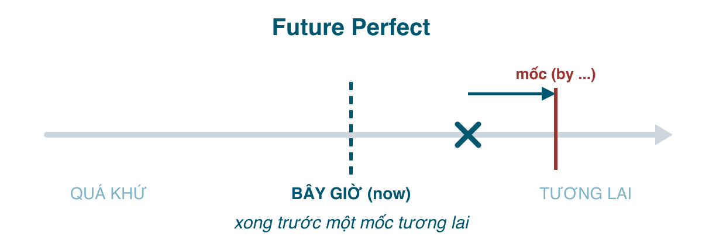

Tương lai hoàn thành là khía cạnh "hoàn thành" đặt ở mốc tương lai: **tới một thời điểm nào đó trong tương lai, việc này sẽ đã xong**. Tiếng Việt diễn đạt bằng "tới lúc đó thì ... xong rồi", "trước ... sẽ hoàn thành". Nó không nói việc xảy ra *lúc nào*, chỉ cam kết rằng *trước mốc* đó nó đã nằm trong quá khứ.

Thì này dùng ít, nhưng có một ngữ cảnh rất đời thường mà nó là lựa chọn tự nhiên nhất: **deadline**. Nếu bạn viết email công việc bằng tiếng Anh, bạn sẽ cần nó.

#### Công thức

| | |
|---|---|
| Khẳng định | I/You/He/She/It/We/They **will have finished**. |
| Phủ định | I **won't have finished**. |
| Câu hỏi | **Will** you **have finished** by Friday? |

Ba phần: <mark>will</mark> + <mark>have</mark> + <mark>V3</mark>. Luôn là <mark>have</mark>, không <mark>has</mark>, vì sau <mark>will</mark> là nguyên mẫu. Lỗi ~~She will has finished~~ hay gặp.

#### Khi nào dùng
**1. Việc sẽ hoàn thành trước một mốc thời gian trong tương lai.** Gần như luôn có <mark>by</mark>: <mark>by Friday, by 2030, by the time, by then, by the end of the month</mark>.
- I'**ll have finished** the report **by Friday**. (Tới thứ sáu là xong báo cáo.)
- **By the time** you arrive, we'**ll have eaten**. (Lúc anh tới thì bọn tôi đã ăn xong.)
- She'**ll have graduated** **by next June**. (Tháng 6 sang năm là cô ấy tốt nghiệp rồi.)
- The builders **will have left** **by the end of the week**.

**2. Thành tích, con số tích lũy tính tới một mốc tương lai.**
- **By 2030**, the city **will have built** 10 new metro lines. (Tới 2030 thành phố sẽ xây xong 10 tuyến.)
- Next month, we'**ll have been** married **for twenty years**. (Tháng sau là tròn 20 năm cưới.)
- By the end of this course, you'**ll have learned** all 12 tenses.

**3. Suy đoán rằng một việc đã xảy ra rồi** (nói về hiện tại hoặc quá khứ gần, với giọng chắc chắn).
- It's 7 pm. They'**ll have arrived** in Hanoi by now. (Giờ này chắc họ tới Hà Nội rồi.)
- You'**ll have heard** the news, I suppose. (Chắc anh nghe tin rồi.)

#### Dấu hiệu nhận biết
<mark>by + mốc</mark> là dấu hiệu lớn nhất: <mark>by tomorrow, by Monday, by the end of..., by the time + hiện tại đơn, by then</mark>. Ngoài ra: <mark>before + mốc</mark>, <mark>in two years' time</mark>, <mark>when + hiện tại đơn</mark> (*When you get back, I'll have cleaned the house*).

Chú ý vế <mark>by the time / when / before</mark> dùng **hiện tại đơn**, không <mark>will</mark>: *By the time you **arrive**...*, không ~~by the time you will arrive~~.

#### So sánh với thì dễ nhầm
**Tương lai hoàn thành vs. Tương lai đơn.** Khác nhau ở chỗ có mốc "trước đó xong" hay không.
- I'**ll finish** the report tomorrow. (Mai làm xong. Thời điểm hành động.)
- I'**ll have finished** the report by tomorrow. (Trước ngày mai là xong rồi. Có thể xong tối nay.)
- He'**ll retire** in 2030. (Năm 2030 nghỉ hưu.)
- He'**ll have retired** by 2030. (Tới 2030 là đã nghỉ, có thể từ 2028.)

Quy tắc thực dụng: <mark>in / on / at / tomorrow / next week</mark> (thời điểm hành động) → tương lai đơn; <mark>by</mark> (hạn chót) → tương lai hoàn thành. Trong email công việc, *I'll send it by Friday* vẫn đúng và phổ biến, nhưng *I'll have sent it by Friday* nhấn rõ hơn rằng thứ sáu bạn đã có nó trong tay.

**Tương lai hoàn thành vs. Tương lai tiếp diễn** (bài 183): cùng một mốc, một bên nhìn việc *đang dở*, một bên nhìn việc *đã xong*.
- At 6 pm I'**ll be cooking**. (Đang nấu.)
- By 6 pm I'**ll have cooked**. (Nấu xong rồi.)
- This time next year she'**ll be studying** in Japan. (Đang học.)
- By this time next year she'**ll have finished** her course. (Học xong.)

**Tương lai hoàn thành vs. Hiện tại hoàn thành / Quá khứ hoàn thành.** Cùng khía cạnh, ba mốc:
- I'**ve finished**. (Xong tính tới *bây giờ*.)
- I **had finished** when she called. (Xong tính tới *lúc đó* trong quá khứ.)
- I'**ll have finished** by the time she calls. (Xong tính tới *lúc đó* trong tương lai.)

Nhìn ba câu này cạnh nhau là thấy "hoàn thành" chỉ có một nghĩa duy nhất: xong trước mốc; thứ thay đổi là mốc nằm ở đâu.

#### Lỗi người Việt hay mắc
- **Dùng tương lai đơn cho hạn chót với <mark>by the time</mark>**: ~~By the time you come, I will cook dinner~~ → *I'll have cooked dinner.* Câu sai ngụ ý "anh tới rồi tôi mới nấu".
- **<mark>will</mark> trong vế <mark>by the time / when</mark>**: ~~by the time you will arrive~~ → *by the time you arrive.*
- **<mark>has</mark> sau <mark>will</mark>**: ~~She will has left~~ → *She will have left.*
- **V2 thay V3**: ~~will have went~~ → *will have gone.*
- **Nhầm <mark>by</mark> và <mark>until</mark>**: <mark>by</mark> = không muộn hơn (hạn chót), <mark>until</mark> = kéo dài cho tới. *I'll have finished by 5* (trước 5 giờ xong) vs. *I'll be working until 5* (làm tới 5 giờ). ~~I'll finish until 5~~ sai.
- **Lạm dụng khi không có mốc**: ~~I will have gone to Japan next year~~ → *I'll go to Japan next year.* Không có hạn chót thì không cần hoàn thành.

#### Bài tập
1. By 2030, I (will pay / will have paid) off my mortgage. → will have paid
2. I (will call / will have called) you tomorrow at 9. → will call (thời điểm hành động)
3. By the time you (get / will get) home, I (will cook / will have cooked) dinner. → get, will have cooked
4. At 8 tomorrow, she (will be flying / will have flown) to Seoul. → will be flying (đang bay)
5. By 8 tomorrow, she (will be landing / will have landed) in Seoul. → will have landed
6. Next year we (will live / will have lived) here for ten years. → will have lived (tích lũy tới mốc)
7. It's 11 pm. The kids (will sleep / will have gone) to sleep by now. → will have gone (suy đoán)
8. Sửa lỗi: *She will has finished the project by Monday.* → She will have finished the project by Monday.
9. Sửa lỗi: *I'll have sent the file until 5 pm.* → I'll have sent the file by 5 pm.
10. Dịch: "Tới cuối tháng tôi sẽ làm xong việc này." → I'll have finished this by the end of the month.
11. Dịch: "Lúc bạn về thì bọn tôi đã đi rồi." → By the time you get back, we'll have left.
12. Dịch: "Tháng sau là tôi làm ở đây tròn 5 năm." → Next month I'll have worked here for five years.

#### Tóm tắt
- <mark>will have + V3</mark>: xong **trước một mốc tương lai**. Dấu hiệu lớn nhất: <mark>by</mark>.
- <mark>at/in/on/tomorrow</mark> → tương lai đơn; <mark>by</mark> → tương lai hoàn thành; <mark>until</mark> → tiếp diễn kéo dài.
- Vế <mark>by the time / when</mark> luôn hiện tại đơn.
- Bài 185: thì cuối cùng, tương lai hoàn thành tiếp diễn, và bảng tổng kết toàn bộ 12 thì.
