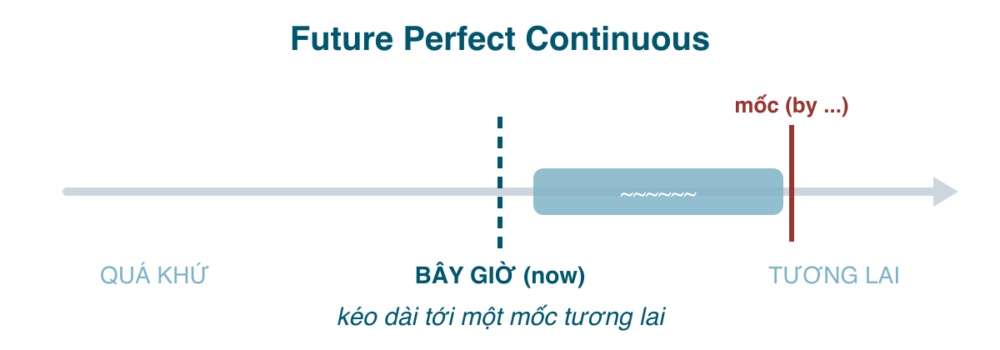
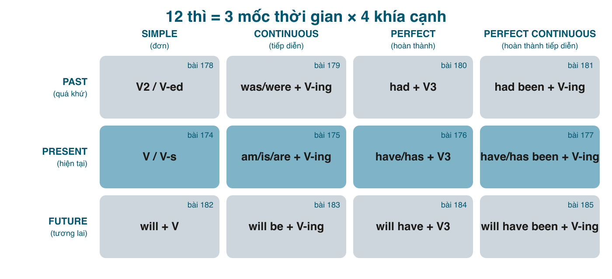

Thì thứ 12, và là thì bạn sẽ gặp ít nhất trong đời: **một hành động sẽ đã kéo dài được bao lâu tính tới một mốc trong tương lai**. "Tới tháng sau là tôi làm ở đây được tròn năm năm." Nó là hiện tại hoàn thành tiếp diễn (bài 177) với mốc dời tới tương lai, và gần như chỉ xuất hiện khi người nói muốn nhấn **độ dài**: for five years, for three hours, all day.

Nửa sau bài là **bảng tổng kết 12 thì** và một bộ câu hỏi để chọn thì, thứ bạn nên in ra dán lên tường hơn bất kỳ bảng công thức nào.

#### Công thức

| | |
|---|---|
| Khẳng định | I/You/He/She/It/We/They **will have been working**. |
| Phủ định | I **won't have been working**. |
| Câu hỏi | **Will** you **have been working** here long by then? **How long will** you **have been living** here? |

Bốn phần: <mark>will</mark> + <mark>have</mark> + <mark>been</mark> + <mark>V-ing</mark>. Dài nhất trong 12 thì; cũng vì thế mà người bản xứ hay né nó bằng cách nói khác nếu được.

#### Khi nào dùng
**1. Nhấn độ dài của một hành động tính tới một mốc tương lai.** Luôn có <mark>for/since</mark> hoặc <mark>how long</mark>, và một mốc với <mark>by</mark> hoặc <mark>when</mark>.
- **By next month**, I'**ll have been working** here **for five years**. (Tới tháng sau là tôi làm ở đây được năm năm.)
- **When** she retires, she'**ll have been teaching** **for forty years**. (Lúc nghỉ hưu là cô ấy dạy được 40 năm.)
- **By 6 pm**, we'**ll have been driving** **for ten hours**. (Tới 6 giờ chiều là lái được 10 tiếng.)
- In March, they'**ll have been living** together **for a decade**.

**2. Giải thích nguyên nhân của một tình trạng trong tương lai.** Bản tương lai của *She's been crying* / *She had been crying*.
- Don't expect him to be cheerful at 9. He'**ll have been working** since 5. (Đừng mong 9 giờ anh ấy vui vẻ; lúc đó anh ấy làm từ 5 giờ rồi.)
- By the time the guests arrive, I'**ll have been cooking** all day, so I'll be tired.

Hết. Thì này thật sự chỉ có hai cách dùng.

#### Dấu hiệu nhận biết
Phải có đủ hai thứ: một mốc tương lai (<mark>by next year, by the time, when + hiện tại đơn, in 2030</mark>) và một độ dài (<mark>for X years, since, how long, all day</mark>). Thiếu độ dài, dùng tương lai hoàn thành hoặc tiếp diễn thì tự nhiên hơn.

#### So sánh với thì dễ nhầm
**Tương lai hoàn thành tiếp diễn vs. Tương lai hoàn thành.** Giống cặp ở bài 177 và 181: quá trình/độ dài vs. kết quả/số lượng.
- By June, I'**ll have been learning** Japanese for two years. (Học được hai năm, nhấn thời gian.)
- By June, I'**ll have passed** the N3 exam. (Thi đậu, nhấn kết quả.)
- By 5, she'**ll have been writing** for six hours. (Viết sáu tiếng.)
- By 5, she'**ll have written** twenty pages. (Viết được 20 trang.)

Với <mark>for</mark> và động từ hành động, cả hai đều được: *I'll have worked here for five years* = *I'll have been working here for five years*. Với động từ trạng thái, chỉ hoàn thành: *We'll **have been** married for 20 years* (không ~~will have been being~~), *I'll **have known** her for a decade*.

**Tương lai hoàn thành tiếp diễn vs. Tương lai tiếp diễn** (bài 183): *At 8 I'll be working* (đang làm) vs. *By 8 I'll have been working for 12 hours* (đang làm, và nhấn đã được 12 tiếng). Thêm "bao lâu rồi" là đổi thì.

**Ba mốc của hoàn thành tiếp diễn**, đặt cạnh nhau:
- I'**ve been working** here for five years. (Tới *bây giờ*.)
- I **had been working** there for five years when it closed. (Tới *lúc đó*, quá khứ.)
- I'**ll have been working** here for five years next month. (Tới *lúc đó*, tương lai.)

#### Lỗi người Việt hay mắc
- **Dùng khi không có độ dài**: ~~By 6 I'll have been finishing~~ → *I'll have finished.*
- **Động từ trạng thái ở dạng tiếp diễn**: ~~We'll have been knowing each other for 10 years~~ → *will have known.*
- **Thiếu một trong bốn phần**: ~~will been working~~, ~~will have working~~.
- **<mark>will</mark> trong vế <mark>when/by the time</mark>**: ~~when she will retire~~ → *when she retires.*
- **Lạm dụng vì thấy "xịn"**: trong hội thoại, *Next month it'll be five years since I started here* tự nhiên hơn nhiều so với thì này. Hãy dùng khi thật sự muốn nhấn độ dài, nhất là trong văn viết.

#### Bài tập
1. By next year, I (will have taught / will have been teaching) for twenty years. → will have been teaching (hoặc will have taught; tiếp diễn nhấn độ dài hơn)
2. By next year, I (will have taught / will have been teaching) over a thousand students. → will have taught (số lượng)
3. By the time you (arrive / will arrive), we (will be waiting / will have been waiting) for an hour. → arrive, will have been waiting
4. In 2030, they (will have been married / will have been being married) for 30 years. → will have been married
5. At 3 pm tomorrow, I (will be driving / will have been driving). → will be driving (không có độ dài)
6. Sửa lỗi: *By June I will have been finish the course.* → By June I will have finished the course.
7. Dịch: "Tới tháng 12 là tôi học tiếng Anh được ba năm." → By December, I'll have been learning English for three years.
8. Dịch: "Lúc anh về chắc tôi đã dọn nhà cả ngày rồi, nên đừng mong tôi còn sức nấu ăn." → By the time you get home, I'll have been cleaning all day, so don't expect me to have the energy to cook.

#### Tổng kết 12 thì

| Thì | Công thức | Nghĩa cốt lõi | Ví dụ | Bài |
|---|---|---|---|---|
| Present Simple | V / V-s | thói quen, sự thật, lịch trình | I **work** here. | 174 |
| Present Continuous | am/is/are + V-ing | đang xảy ra lúc này / dạo này; kế hoạch đã chốt | I'**m working** now. | 175 |
| Present Perfect | have/has + V3 | quá khứ không rõ lúc nào, còn liên quan tới giờ | I'**ve worked** here for 5 years. | 176 |
| Present Perfect Continuous | have/has been + V-ing | kéo dài tới giờ, nhấn độ dài / vừa dứt còn dấu vết | I'**ve been working** all day. | 177 |
| Past Simple | V2 / V-ed | đã xong, biết lúc nào | I **worked** there in 2019. | 178 |
| Past Continuous | was/were + V-ing | đang dở tại một lúc trong quá khứ, làm nền | I **was working** when she called. | 179 |
| Past Perfect | had + V3 | xong trước một mốc quá khứ | I **had worked** there before I moved. | 180 |
| Past Perfect Continuous | had been + V-ing | kéo dài tới một mốc quá khứ | I **had been working** for 10 years when it closed. | 181 |
| Future Simple | will + V | quyết định tức thì, dự đoán, hứa | I'**ll work** late tonight. | 182 |
| Future Continuous | will be + V-ing | đang dở tại một lúc trong tương lai; hỏi lịch sự | I'**ll be working** at 9. | 183 |
| Future Perfect | will have + V3 | xong trước một mốc tương lai (by) | I'**ll have worked** here 5 years by June. | 184 |
| Future Perfect Continuous | will have been + V-ing | kéo dài tới một mốc tương lai, nhấn độ dài | I'**ll have been working** here for 5 years by June. | 185 |

#### Chọn thì bằng bốn câu hỏi
Khi viết, thay vì nhớ 12 công thức, hỏi lần lượt:

1. **Mốc nhìn ở đâu?** Bây giờ → nhóm hiện tại. Một lúc trong quá khứ → nhóm quá khứ. Một lúc trong tương lai → nhóm tương lai. (Chú ý: "đã" trong tiếng Việt chưa đủ để chọn quá khứ; hỏi tiếp câu 3.)
2. **Hành động đang dở, có quá trình, tạm thời?** Có → tiếp diễn. Nó là sự thật, thói quen, hay một sự kiện trọn vẹn → đơn. Động từ trạng thái (know, like, have = có) → không bao giờ tiếp diễn.
3. **Có xảy ra trước mốc và còn liên quan tới mốc không?** Có → hoàn thành. Có thời điểm cụ thể (yesterday, in 2019) → không hoàn thành, dùng đơn.
4. **Có muốn nhấn "bao lâu rồi" tính tới mốc không?** Có (for, since, how long, all day) → hoàn thành tiếp diễn. Có số lượng (three times, ten pages) → hoàn thành.

Ví dụ chạy thử với câu "Tôi đợi anh một tiếng rồi" (nói lúc người kia vừa tới): mốc = bây giờ (1); đợi là hành động có quá trình (2); bắt đầu trước, còn liên quan (3); có "một tiếng rồi" (4) → hiện tại hoàn thành tiếp diễn: *I've been waiting for an hour.*

#### Mười lỗi lớn nhất của người Việt, gom lại
1. Quên <mark>-s</mark> ngôi thứ ba, và quên chia quá khứ khi câu đã có "yesterday".
2. <mark>be</mark> + động từ thường: ~~I am agree~~, ~~She was go~~.
3. Hiện tại hoàn thành với thời điểm quá khứ: ~~I have seen him yesterday~~.
4. Hiện tại đơn hoặc tiếp diễn với <mark>for/since</mark>: ~~I live here for 10 years~~, ~~I'm waiting for 20 minutes~~.
5. Tiếp diễn hóa động từ trạng thái: ~~I'm knowing~~, ~~I've been having a car~~.
6. <mark>will</mark> sau <mark>when/if/until/by the time</mark>.
7. <mark>will</mark> cho mọi câu tương lai, kể cả kế hoạch đã chốt.
8. Chia động từ sau <mark>did/does</mark>: ~~Did you went~~, ~~She doesn't likes~~.
9. V2 thay V3 sau <mark>have/had/will have</mark>: ~~have went~~, ~~had took~~.
10. Lạm dụng quá khứ hoàn thành cho chuỗi sự kiện, hoặc không dùng khi thật sự cần.

Mỗi lỗi trên đều có một bài trong series giải thích vì sao. Nếu bạn sửa được mười lỗi này, phần "thì" trong tiếng Anh của bạn đã tốt hơn phần lớn người học, và phần còn lại là chuyện đọc nhiều, nghe nhiều để các lựa chọn trở thành phản xạ, giống như bạn chưa bao giờ phải nghĩ xem nên nói "đã" hay "rồi" trong tiếng Việt.
